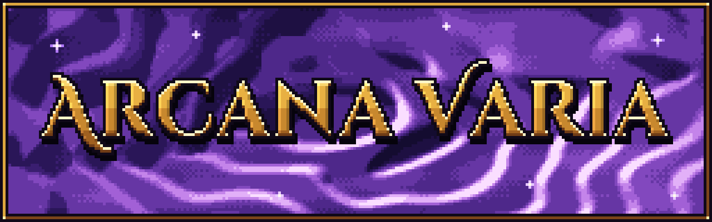
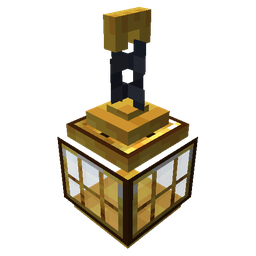
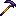
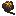
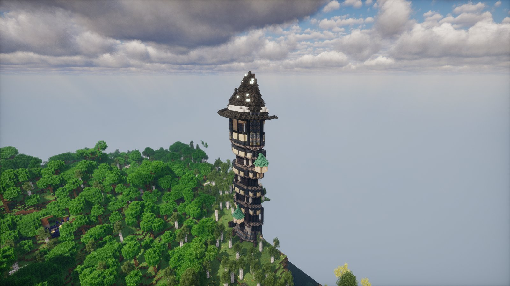

# Arcana Varia

*Sealed towers, ruined labs, and the tools you earn from them.*

Arcana Varia is an addon for [Thaumaturge](https://www.curseforge.com/projects/1628024). It adds sealed wizard towers and ruined laboratories to find, and the tools
you bring home from them: a censer that swings clouds of essentia, a building lens that mirrors and copies your builds,
glass pipes that make compound aspects on their own, scythes, a tree boss and four whips.

It has its own research tab, **Arcana Varia**, which opens with Thaumaturge's Metallurgy research.

**Requires** [Thaumaturge](https://www.curseforge.com/projects/1628024) 1.1.0 or newer (not 1.0.2), on NeoForge 26.1.2. **Optional:** [Fundamentum](../fundamentum/index.md) 1.22.1 or newer
(the four whips), [JEI](https://www.curseforge.com/projects/238222) (info pages for lab blocks, journals, blueprints and the Amber Heart), and about 50 mods whose blocks give towers new palettes, plus 7 dimension mods that get labs of their
own ([Towers and labs](towers-and-labs.md#other-mods)).

**Versions:** 0.7.5 for NeoForge 26.1.2. See [Versions](versions.md) and the [CurseForge project](https://www.curseforge.com/projects/1791046).

## What's in it

| Picture | Section | What's in it |
|---|---|---|
| { .mc-icon } | **[Towers and labs](towers-and-labs.md)** | Wizard Towers, 40 kinds of Forsaken Laboratory, their puzzles, wards and guardians |
| { .mc-icon } | **[The Thurible](thaumaturgy.md#the-thurible)** | a censer that swings clouds of essentia, and what each aspect does |
| | **[The Architect's Lens](thaumaturgy.md#the-architects-lens)** | a building tool that mirrors, copies and pastes |
| | **[The Alembic Lattice](thaumaturgy.md#the-alembic-lattice)** | glass pipes that carry essentia and make compounds |
| { .mc-icon } | **[Scythes](weapons.md#scythes)** | three scythes and four enchantments |
| { .mc-icon } | **[The Greatwood Warden](weapons.md#the-greatwood-warden)** | a tree boss and its Amber Heart |
| { .mc-icon } | **[Whips](weapons.md#whips)** | four whips, with Fundamentum |
| | **[For pack makers](towers-and-labs.md#for-pack-makers)** | lab bosses, traits and Thurible effects as datapack files |

## Built on Fundamentum

The [four whips](weapons.md#whips) use Fundamentum's cord system. Their reach spans 5 to 6 blocks. Their recipes and research appear with Fundamentum installed.

| Override | Path | Format |
|---|---|---|
| Whip tuning by item ID | <code>data/&lt;namespace&gt;/fundamentum/whips/&lt;name&gt;.json</code> | [Whips](../fundamentum/datapack/whips.md) |

## Credits

By **Oculifelis**.

| By | Work | Licence | Used for |
|---|---|---|---|
| Drift007_ | Scythes Vanilla | MIT / CC0 | the scythes' sprites, in-hand model, sounds, stats and the Soul Devourer, Grim Harvest, Eclipse and Reaper's Step enchantments |
| Malcolm Riley | [unused-textures](https://github.com/malcolmriley/unused-textures) | CC BY 4.0 | the Warden's Amber Heart sprite |
| Leclowndu93150 and contributors | [Thaumaturge](https://www.curseforge.com/projects/1628024) | its own | some of this mod's textures are drawn on Thaumaturge's own art |

Arcana Varia's code and Oculifelis's own art are LGPL-3.0-or-later. The Scythes Vanilla parts, the Amber Heart sprite
and the textures drawn on Thaumaturge's art keep their own licences; `CREDITS.md` in the jar lists each of them.
