# Thurible, Lens and Lattice

Three tools for a thaumaturge's own work, all researched in the **Arcana Varia** tab.

## The Thurible

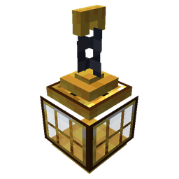{ .mc-icon }

A censer on a chain that swings clouds of essentia.

- **Filling.** It holds up to 64 essentia of one aspect, which you can see through its glass. Right-click a jar with it,
  or hold a filled phial in your other hand and use the Thurible. Sneak and right-click a jar to pour it back.
- **Swinging.** Hold use to swing it. Each swing leaves a cloud of the aspect in front of you, and a hit leaves one on
  the target. The tooltip says what the loaded aspect does.
- **Compounds.** Every primal and many compounds have an effect of their own (below). A compound without one carries
  its parents' effects, stronger the more steps it took to make. Aspects made in the
  [Alembic Lattice](#the-alembic-lattice) make the strongest incense.

| Aspect | Cloud |
|---|---|
| Aer | Speed for you and your allies |
| Motus | Speed II for you and your allies |
| Volatus | Slow Falling and Jump Boost for you and your allies |
| Aqua | puts out fire on allies and gives Water Breathing |
| Terra | Resistance for you and your allies |
| Praemunio | Resistance II for you and your allies |
| Ordo | Absorption (extra hearts) for you and your allies |
| Victus | heals you and your allies, with Regeneration |
| Sensus | Night Vision |
| Ignis | sets enemies on fire |
| Potentia | strikes enemies with raw damage |
| Perditio | Weakness and a little damage to enemies |
| Gelum | Slowness II and Mining Fatigue on enemies |
| Alienis | lifts enemies off their feet (Levitation) |
| Lux | makes enemies glow through walls |
| Tenebrae | blinds enemies |
| Mortuus | withers enemies |
| Vitium | Poison and Nausea on enemies |

Pack makers can change or add these: see [For pack makers](towers-and-labs.md#for-pack-makers).

### Blueprints

Three blueprints turn up in lab chests and tower vaults. Hold the Thurible in your other hand and use one to fit it.

|  | Blueprint | What it fits |
|---|---|---|
| 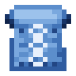{ .mc-icon } | Blueprint: Thurible Chain | a long chain: the cloud lands further away |
| 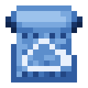{ .mc-icon } | Blueprint: Thurible Bowl | a wide bowl: bigger clouds |
| 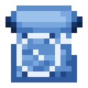{ .mc-icon } | Blueprint: Thurible Orbit Ring | an orbit ring: sneak and use to set the Thurible circling you |

## The Architect's Lens

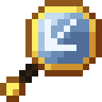{ .mc-icon .mc-inline } A building tool. It builds with Ordo vis from a wand you carry (a twentieth of a vis per block) and the blocks in your
inventory. Sneak and scroll to change its mode; the tooltip names the mode. Motes show where every block will go
before it is placed.

| Mode | What it does |
|---|---|
| Mirror (east-west) | each block you place is copied, mirrored across the anchor east to west |
| Mirror (north-south) | the same, north to south |
| Mirror (both ways) | each block is copied into all four quarters round the anchor |
| Radial (4) | each block is copied round the anchor in four quarter turns |
| Radial (8) | each block is copied round the anchor eight ways, turned and mirrored |
| Line | a straight line between the two corners |
| Wall | an upright wall along the line between the corners, as tall as they are apart |
| Fill | every space in the box between the corners |
| Replace | every block in the box like the first corner's becomes the block in your other hand |
| Copy | writes the box into a blank 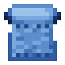{ .mc-icon .mc-inline } Blueprint Scroll in your other hand |
| Paste | builds the written Blueprint Scroll in your other hand, with its corner where you click |

- **Mirror and radial:** right-click a block to set the anchor. Every block you then place with the Lens in either hand
  is copied round it.
- **Line, wall, fill, replace and copy:** right-click two blocks for the corners, then right-click the air to build
  with the block in your other hand.
- **Undo:** sneak and right-click the air. Sneak and right-click a block to clear the corners.

Lab studies and tower vaults sometimes hold written scrolls: a Spiral Stair, a Deepslate Arch and an Alchemist's Bench.

## The Alembic Lattice

Glass pipes that carry essentia one mote at a time, so it can be counted, timed and mixed. Each mote glows in its
aspect's colour and moves one block every half second.

|  | Block | What it does |
|---|---|---|
| 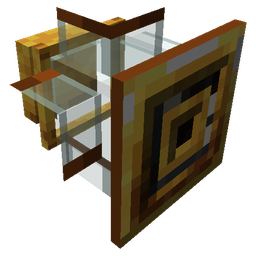{ .mc-icon } | Lattice Intake | set against a jar, draws one mote a second. Use it with an empty hand to change the pace, down to one mote per redstone pulse; otherwise a redstone signal stops it |
| 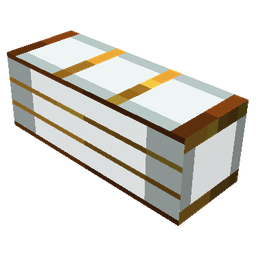{ .mc-icon } | Alembic Pipe | carries motes straight on where it can, and takes turns at forks |
| 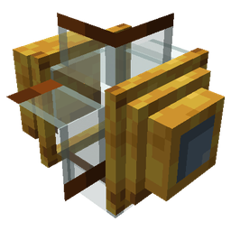{ .mc-icon } | Lattice Outlet | set against a jar, fills it, and waits while the jar is full |
| 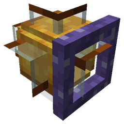{ .mc-icon } | Lattice Junction | joins two motes that reach it from different sides within 8 ticks of each other into their compound, which leaves through the face it was placed facing |
| 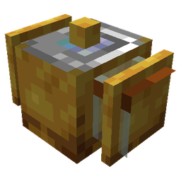{ .mc-icon } | Lattice Synchronizer | holds one mote. A row of them facing the same way lets go together once every one holds a mote. Use one with an empty hand to add a delay; redstone holds the whole row |
| 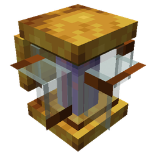{ .mc-icon } | Splitter Prism | takes motes in at the back. A compound splits into its two parents, out of the left and right faces; a primal passes straight through |

A mote with nowhere to go, or one left waiting at a junction too long, spills as flux. Path length is delay: every
pipe adds ten ticks, so timing two paths to meet is the puzzle.
