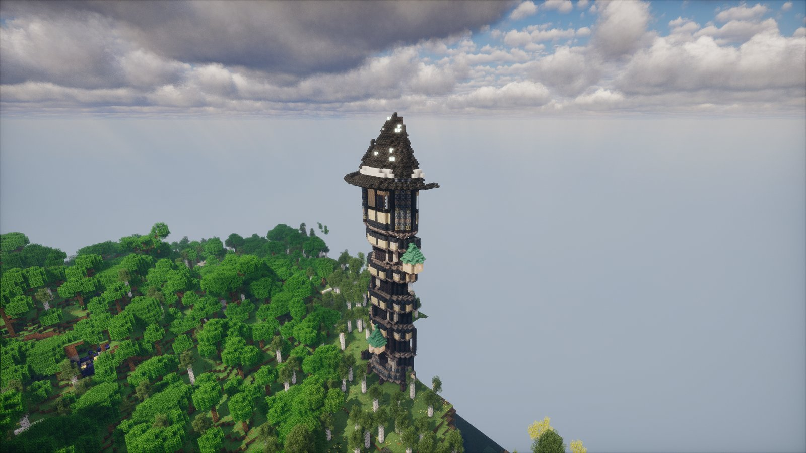
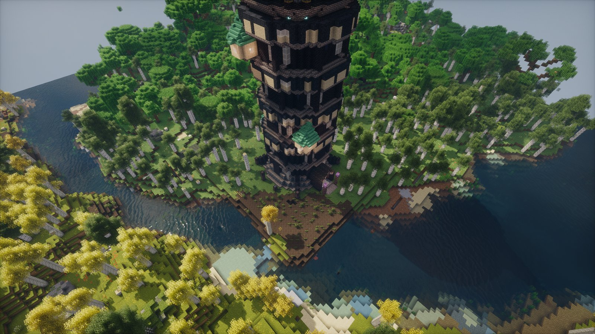
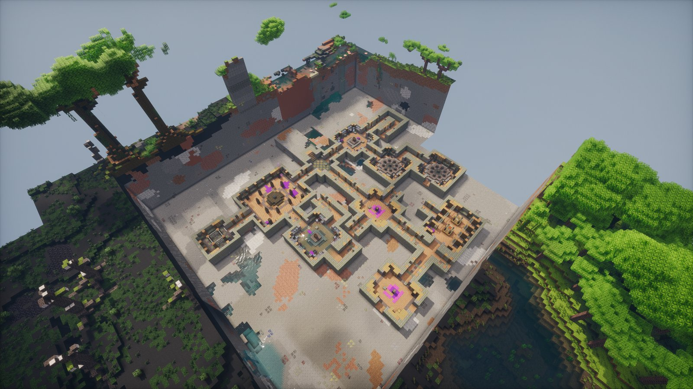
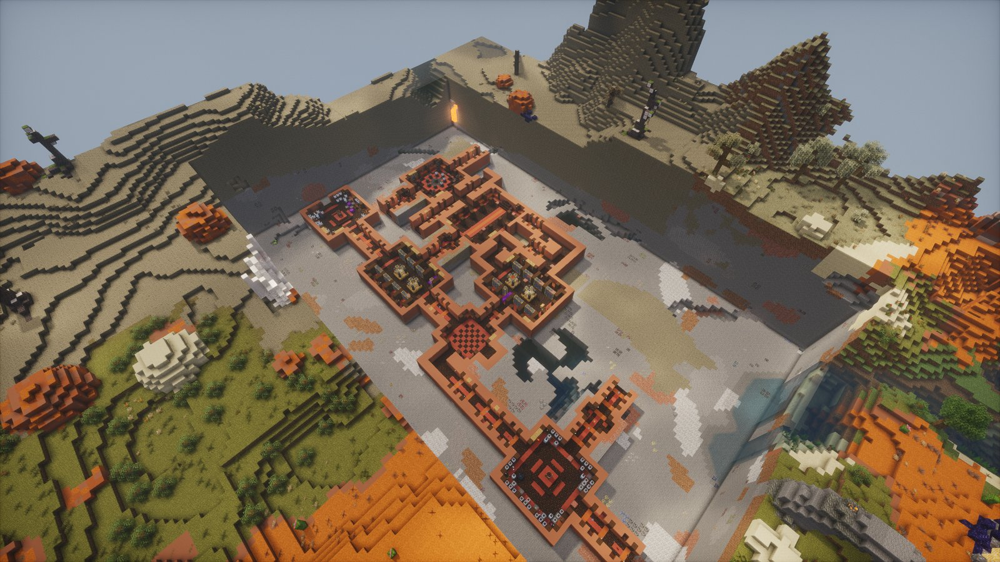

# Towers and labs

Arcana Varia adds two kinds of structure to explore: sealed **Wizard Towers** and ruined **Forsaken Laboratories**.
Both are rare. Towers are about 72 chunks apart (at least 28), labs about 44 (at least 14).

With JEI installed, every lab block, journal and Thurible blueprint has an info page saying what it does and where it is found.

## Wizard Towers

A tower is a climb from the door to the top. It comes in four shapes: **classic**, **thaumic**, **crooked** and
**shattered**. It is built from one of over 200 palettes: 10 vanilla ones, and the rest from about 50 other mods, used
only when that mod is installed.

- **The ward.** Step inside and the ward seals behind you. While it is sealed you can't leave, fly, glide or teleport.
  Ender pearls, chorus fruit and other mods' teleports are turned aside. The walls can't be broken or built on, and
  explosions spare them. You can still place and take torches, lattice parts and essentia jars.
- **Floors.** Each floor is a fight, a puzzle or a parkour run, with a warded hatch to the next one.
- **The top.** A guardian waits at the top. When it dies the ward falls for good and the vault opens.
- **Dying.** You wake outside the tower. Once nobody is left inside (all died, or gone for a minute) the tower resets:
  the locks re-arm, the guardian goes back to sleep and the ward waits for the next climber.

## Forsaken Laboratories

Labs are ruined workshops with locked doors, a guardian chamber and chests. There are 40 kinds. 17 belong to the
vanilla world:

| Overworld | Underground and water | Nether | End |
|---|---|---|---|
| badlands, cherry, cliff, desert, frost, jungle, savanna, swamp | cave, deep dark, dripstone, underwater | basalt, crimson, soul, warped | end |

### Other mods

The other 23 are built for dimension mods and load only when that mod is installed:

| Mod | Labs |
|---|---|
| Twilight Forest | aurora, castle, dark tower, labyrinth, naga |
| The Undergarden | depthrock, shiverstone, tremblecrust |
| The Aether II | agiosite, holystone, icestone, sentry |
| Aerial Hell | catacombs, golden, lunatic, mud |
| Stellaris | crater, forest |
| Tropicraft | mangrove, tiki, volcano |
| Voidscape | thunder, void |

Wizard Tower palettes come from about 50 more mods in the same way.

## Puzzles

Every puzzle block gives a redstone signal when it is solved, so it can open a door, a hatch or a lift.

| Block | How it works |
|---|---|
| { .mc-icon } **Aspect Lock** | wants a set amount of one aspect, poured from a phial, a Thurible, a lattice outlet or a tube |
| { .mc-icon } **Rune Stone** and **Rune Lock** | press the stones in the right order; the clue is somewhere in the room, and a wrong rune starts it over |
| **Sun Lens, Beam Mirror and Beam Receptor** | the lens throws a beam up to 32 blocks; right-click mirrors to turn it until it reaches the receptor |
| **Vis Lift** | lifts whoever stands on it, up to 16 blocks; some run only once a lock is open |
| **Phase Stone** | solid for 2 seconds of every 4; rows of them make a wave to run along |
| **Warded hatch** | the way between tower floors |

A lab's lattice floors use the [Alembic Lattice](thaumaturgy.md#the-alembic-lattice): make the right compound and
bring it to the lock.

## Guardians

Each tower top and each lab has a { .mc-icon .mc-inline } **Guardian Altar**.
The guardian rises from it: a large vanilla mob of one of seven kinds, with one or more traits. The boss bar names
the kind and every trait it has. Killing it drops the altar's reward and, in a tower, opens the ward.

| Guardian | Body | Health | Damage | Armor |
|---|---|---|---|---|
| Blighted Beast | ravager | 260 | 10 | 8 |
| Brass Colossus | iron golem | 320 | 14 | 12 |
| Drowned Thaumaturge | drowned, with a trident | 210 | 8 | 6 |
| Hellforged Fiend | piglin brute, with a golden axe | 240 | 11 | 10 |
| Hollow Magus | wither skeleton | 200 | 9 | 8 |
| Twisted Archmage | evoker | 220 | 6 | 6 |
| Void Stalker | enderman | 200 | 10 | 4 |

| Trait | What it does |
|---|---|
| Blazing | fire resistance; hits set you alight; throws fire volleys |
| Blinking | teleports around the room |
| Eldritch | an aura of Darkness |
| Mighty | hits harder and knocks you back |
| Sickening | an aura of Weakness |
| Spined | hurts whoever hits it |
| Stoneskin | tougher armor; can't be knocked back |
| Summoner | calls up pairs of vexes |
| Swift | moves faster |
| Undying | heals itself every 10 seconds |
| Vampiric | heals from the damage it deals |
| Venomous | hits poison |
| Warded | more armor; pushes you away with a pulse |

## What you find

- **Journals.** Lab studies hold journals that unlock hidden research: *Locks of the Thaumaturges*, *Notes on the
  Failed Experiments* and *The Architect's Diary*.
  { .mc-icon .mc-inline }
- **Chests.** Materials, [lattice](thaumaturgy.md#the-alembic-lattice) parts and
  [Thurible blueprints](thaumaturgy.md#blueprints). Studies sometimes hold a written Blueprint Scroll (a stair, an arch
  or a bench) for the [Architect's Lens](thaumaturgy.md#the-architects-lens).
- **Tower vaults.** One at the top of each tower: blueprints, scrolls, lattice parts and a journal.

## For pack makers

The guardians and the Thurible's effects are datapack JSON, under `data/<namespace>/arcanavaria/`:

| Folder | What it holds |
|---|---|
| `lab_archetype/` | guardian kinds: the mob, health, damage, armor, size, speed, held item and bar colour |
| `lab_trait/` | traits: particles, effects on itself, auras, on-hit effects, attributes and timed abilities (volley, blink, summon, heal, pulse) |
| `lab_pool/` | which kinds and traits a tower or lab draws from (`tower_overworld`, `lab_overworld`, `lab_underwater`, `lab_nether`, `lab_end`, `default`) |
| `thurible_effect/` | what each aspect's cloud does (see [The Thurible](thaumaturgy.md#the-thurible)) |

An archetype or trait entry can list the dimensions it may appear in. Copy one of Arcana Varia's own files from the
jar as a starting point.

The lab blocks are all in the creative tab, so you can build your own rooms by hand. Lab blocks can't be broken outside
creative and drop nothing. The block tag `#arcanavaria:lab_mutable` lists what a player sealed in a tower may still
place and take; add to it if one of your floors needs more.
