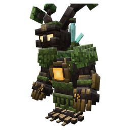

# Weapons and the Warden

## Scythes

{ .mc-icon } { .mc-icon }
{ .mc-icon }

Three scythes on Thaumaturge's metals, after Scythes Vanilla by Drift007_. They have their own research tab entry,
**Scythes**.

| Picture | Scythe | Damage | Speed | Sweep | Reach | How you get it | Extra |
|---|---|---|---|---|---|---|---|
| { .mc-icon } | **Thaumium Scythe**{ #thaumium-scythe } | 7 | 1.2 | 40% | +1 | crafted | |
| { .mc-icon } | **Void Scythe**{ #void-scythe } | 8 | 1.2 | 55% | +1 | crafted (void metal) | repairs itself, hits give Weakness, warp 1 |
| { .mc-icon } | **Elemental Scythe**{ #elemental-scythe } | 8.5 | 1.2 | 75% | +1 | infused from the Thaumium Scythe | Arcing II, like the elemental sword |

All three sweep like swords (built in, so Sweeping Edge isn't offered) and cut leaves, crops and grass quickly. They
take the sword enchantments, plus four of their own:

| Enchantment | Levels | Where | What it does |
|---|---|---|---|
| Soul Devourer | I-III | table | a monster killed with the scythe may heal 1, 2 or 3 hearts (40, 60 or 80% chance) |
| Grim Harvest | I-III | table | a kill may give Grim Harvest: 20% more speed and 20% less damage taken, for 6, 9 or 12 seconds (30, 50 or 70% chance) |
| Eclipse | I-III | table | 2 more damage a level against the undead at night, in total darkness, and always in the Nether and the End. Doesn't go with Smite or Sharpness |
| Reaper's Step | I-III | loot, fishing and librarians only | use to dash forward, hurting everything in the path for 4, 6 or 8. Costs one durability, 1.5 s cooldown, never breaks the scythe. With a shield in the other hand, sneak to dash |

## The Greatwood Warden

{ .mc-icon .mc-mob }

{ .mc-icon } { .mc-icon }

A tree boss. Craft a **Heartseed** from amber, a greatwood sapling and a greatwood log, plant it, and the Greatwood
Warden wakes from the ground. Only one Warden guards a grove at a time.

| Stat | Value |
|---|---|
| **Health** | 220. |
| **Moves** | ground slams, lanes of roots, splinter volleys and an amber ray. It sometimes stops to mend itself with leaves; deal 15 damage to break that off. |
| **Below half health** | it roars into its second phase, with aftershocks after its slams and a burrow that moves it across the field. |
| **Drop** | the **Warden's Amber Heart**. Eat it for 2 more hearts of max health for good, once per player. |

## Whips

{ .mc-icon } { .mc-icon }
{ .mc-icon } { .mc-icon }

Four whips on Fundamentum's whip system. They need **Fundamentum 1.27.2 or newer**. Without it, Arcana Varia loads as
normal and the whips, their recipes and their research stay hidden.

| Picture | Whip | Reach | Tip damage | How you get it | Extra |
|---|---|---|---|---|---|
| { .mc-icon } | **Thaumium Whip**{ #thaumium-whip } | 5 | 6.5 | crafted | marks targets for your summons |
| { .mc-icon } | **Void Whip**{ #void-whip } | 5.5 | 8 | crafted (void metal), warp 1 | hits weaken; a cracking tip heals you 1 heart |
| { .mc-icon } | **Elemental Whip**{ #elemental-whip } | 6 | 8.5 | infused from the Thaumium Whip | each hit carries a primal: lift, burn, slow, shove, glow or wither |
| { .mc-icon } | **Amberbark Lash**{ #amberbark-lash } | 5 | 4 | crafted (greatwood and amber) | a summoner's whip: a 15-second mark that makes your summons hit far harder; a crack roots the target |

In hand they show a 3D handle. Turn on Fundamentum's `whips.flatHandles` setting to show the flat sprite instead.
