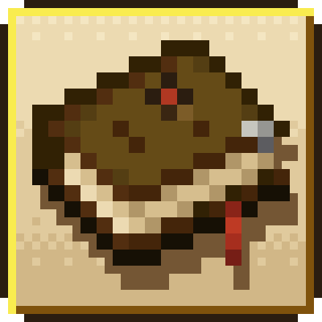
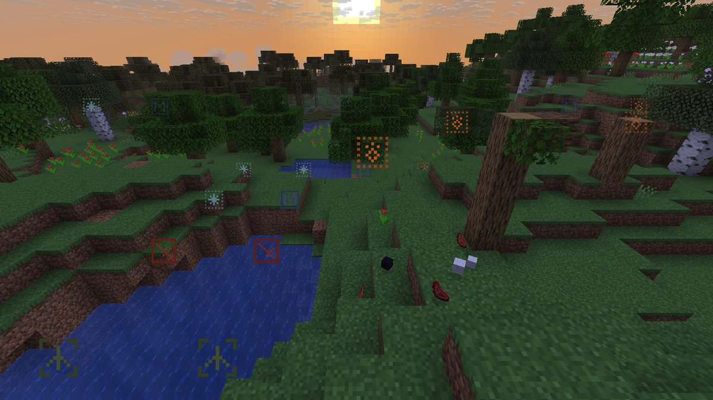
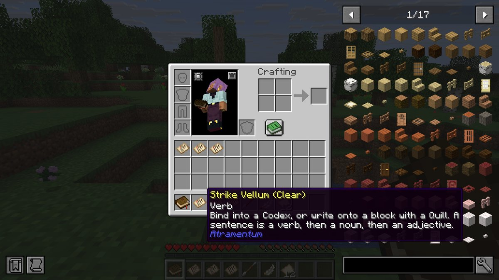
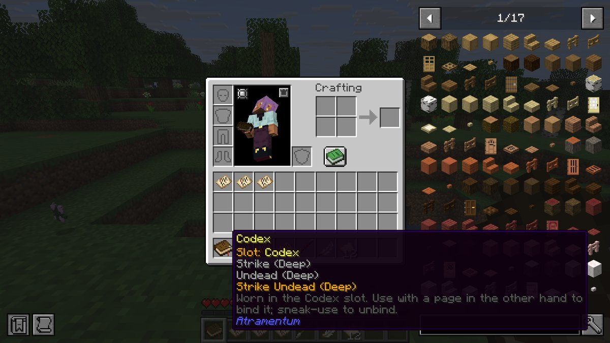
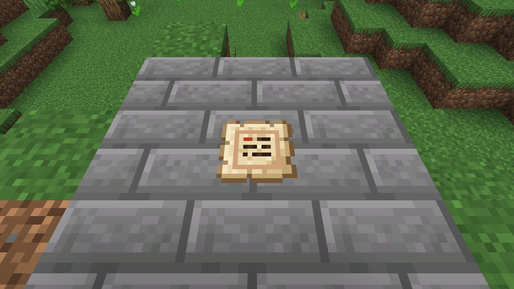
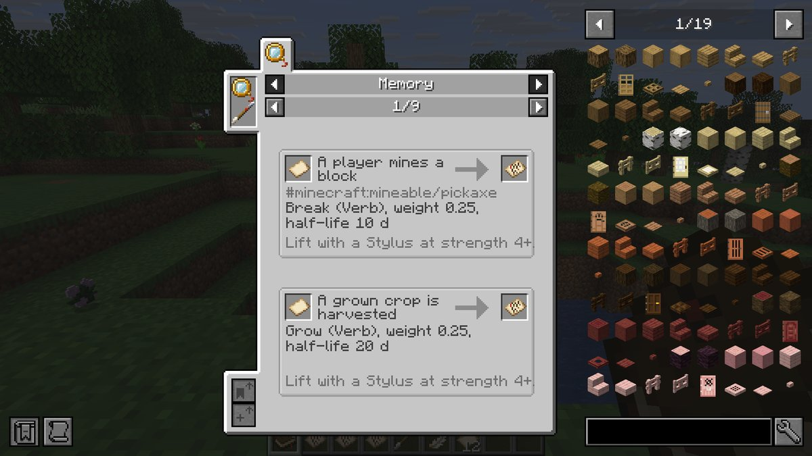

# Atramentum

{ width="140" align=right }

A magic mod where the world remembers what happens in it. Kill enough zombies in one spot and the ground there learns
the word Undead. Harvest the same field every day and it learns Grow. Copy two words onto pages, put them in the
Codex, and they make a spell. Strike plus Undead gives up to 6 extra melee damage against undead.

**Requires** [Fundamentum](../fundamentum/index.md), [Curios](https://www.curseforge.com/projects/309927),
[JEI](https://www.curseforge.com/projects/238222) and [Jade](https://www.curseforge.com/projects/324717).

| Minecraft | Loader | Atramentum | Fundamentum |
|---|---|---|---|
| 26.1.2 | NeoForge | 0.5.0 | 2.0.0 or newer |

This guide covers the built **0.5.0** jar. It is not released yet.

Memories get stronger each time the same thing happens in the same place, and fade after a few in-game days if
nothing adds to them. A bed slept in every night remembers Mend, which heals the player while standing still.

## Getting started

1. Craft the Reading Glass and wear it. Ink runes now show on blocks where something happened.
2. Craft a Stylus and some Blank Vellum. Use the Stylus on a block with runes to copy its word onto a page.
3. Craft the Codex, wear it, and put two pages in it, such as Strike and Undead.
4. The effect works as long as the Codex is worn. If a pair does nothing, its tooltip says why.

## Seeing and copying memories

The Reading Glass is worn in a Curios slot and shows memories as ink runes on nearby blocks. Jade shows the memory on
the block under the crosshair. Using the Stylus on a block copies its memory onto Blank Vellum, and the block forgets
it. A stronger memory makes a stronger page, in four steps from Faint up.

## The Codex

The Codex is worn in its own slot and holds the pages. A verb page (Strike, Mend, Grow, Break) and a noun page
(Undead, Beast, Arthropod, Illager) make a working pair, and an adjective page (Frost, Ember, Storm) changes it
further. Swapping pages causes Ink Fatigue. The pages stay stuck until it wears off.

## Where the words come from

- Melee kills write Strike.
- Dying mobs write their type, such as Undead, Beast, Arthropod or Illager.
- Harvesting crops writes Grow and sleeping in a bed writes Mend.
- Mining stone writes Break and trading with villagers writes Hasten. Fishing writes Tide.
- Fire, falls, lightning, explosions, freezing and drowning each write their own word.
- Ancient cities, strongholds, trial chambers, ruined portals, shipwrecks and ocean monuments already hold words when
  they generate. Abyss is found only in ocean monuments.
- During a Fundamentum moon, everything is written three times as strong.
- A boss leaves a permanent word where it dies. The Wither leaves Wither, the Warden leaves Hush, the Ender Dragon
  leaves Soar. The Elder Guardian leaves Gaze.

## Written Places

The Quill pins a page to a block. For 3 to 16 in-game days it works on everything within 4 to 12 blocks, depending on
the page's strength. A Mend page gives nearby players Regeneration and stops hostile mobs from spawning there. A Grow
page speeds up crops. A Strike page hurts hostile mobs that come close, and a Watch page makes them glow.

## Lararium homes

With [Lararium](../lararium/index.md) installed, Lararium rooms that are lived in write words at their center. A Keeper room
writes Keep, a Shelter writes Ward, a Breather writes Lift and a Listener writes Echo. A room also writes Wake once,
the first time it wakes up.

Keep puts drops from kills and broken blocks straight into the inventory, with a 25 to 100% chance depending on
strength. Ward cuts projectile damage by 15 to 60%. Paired with Wake, Keep, Ward and Mend get one step stronger, but
only within 24 blocks of the center of the player's own room.

## For pack makers

Everything above is datapack JSON, including which events write which words, how fast they fade, and what every word
pair does. Packs can add new words and new spells without code. All tables live under `data/<namespace>/atramentum/`.

| Folder | What it sets |
|---|---|
| `trace_kinds/` | Each memory's word, part of speech, colour and fade time. |
| `sources/` | Which event or creature writes which memory, and how much. |
| `grammar/` | Each word pair's effect and its numbers per strength. |
| `ancient/` | Memories placed into structures when they generate. |
| `scars/` | A boss's own word. |
| `places/` | The reach and duration of Written Places per strength. |

JEI lists which events write which words and every word pair, so pack changes show up there.

Atramentum is licensed under LGPL-3.0-or-later.
