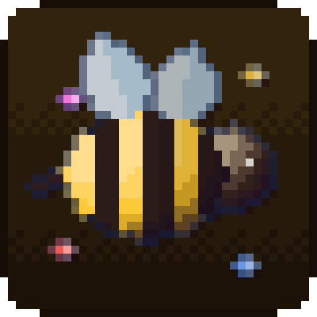
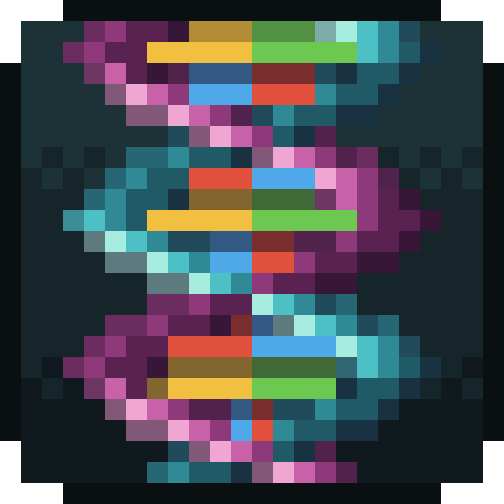
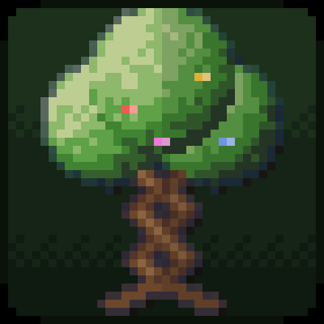
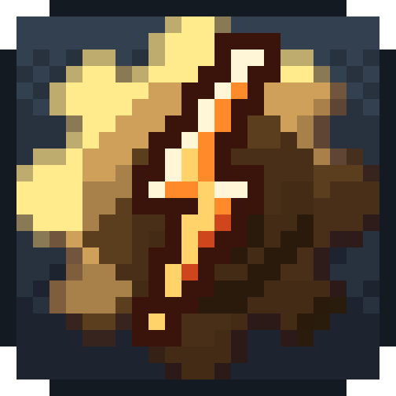
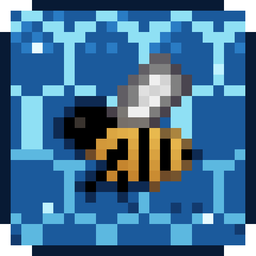

# Complicated Bees

[Complicated Bees](https://www.curseforge.com/projects/1100137) is ACCBDD's Forestry-style bee breeding mod, for
Forge 1.20.1 and NeoForge 1.21.1. Catch princesses and drones, pair them in an apiary, breed new species. These pages
cover our port of it to 26.x and the addons built on top.

| Picture | Mod | What it does | Versions |
|---|---|---|---|
| { .mc-icon } | **[Complicated Bees Unofficial](../complicatedbees/index.md)** | The port. ACCBDD's bees on 26.1.2 and 26.2, ids and recipes kept. 59 species, 23 combs, frames, the Mellarium bee house and the Gyrofuge centrifuge. | NeoForge 26.1.2, 26.2 |
| { .mc-icon } | **[Genetic Industry Unofficial](../ports/genetic-industry/index.md)** | Extract genes from bees, assemble a Genetic Template, and imprint it onto a princess or drone. | NeoForge 26.1.2, 26.2 |
| { .mc-icon } | **[Complicated Trees](../other/complicated-trees.md)** | Tree breeding. Your bees pollinate nearby leaves, you graft the kids. | Forge 1.20.1, NeoForge 1.21.1, 26.1.2, 26.2 |
| { .mc-icon } | **[Rotaflux](../other/rotaflux.md)** | Turns [Create](https://www.curseforge.com/projects/328085) rotation into FE for any machine; can make Complicated Bees run on it alone. | NeoForge 1.21.1 |
| { .mc-icon } | **[Manacomb](../other/manacomb.md)** | Runs Complicated Bees' FE machines on [Botania](https://www.curseforge.com/projects/225643) mana. | NeoForge 1.21.1 |

On 1.20.1 and 1.21.1 the addons use the original Complicated Bees. On 26.1.2 and 26.2 they use
[Complicated Bees Unofficial](../complicatedbees/index.md).
