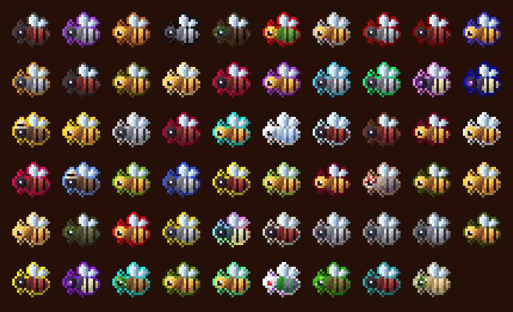

# Complicated Bees Unofficial

Bee breeding in the style of the old Forestry bees. Catch a princess from a wild nest with a
[Scoop](items.md#scoop), pair her with a drone in an [Apiary](items.md#apiary), and the queen you get carries both
parents' genes. Breed the right pairs and new species turn up: **59 species** and **23 kinds of comb**, each bee with
genes for lifespan, speed, fertility, temperature, humidity, flowers, territory and more. A bee that wants hot, dry air
sulks in a jungle, a night bee sleeps through the day, and some mutations only happen over a certain block, in one
biome or in the rain.

This is an unofficial port of [Complicated Bees](https://www.curseforge.com/projects/1100137) by ACCBDD to Minecraft
26.1.2 and 26.2 on NeoForge. It is not made or supported by ACCBDD, so report problems with the port to the
[port's repository](https://github.com/Oculifelis/complicated_bees/issues), not to them. The original's ids, recipes
and bees are all kept, so packs and scripts written for it still line up. The bee and comb item art is new, drawn for
this port.

**Requires** nothing but NeoForge. **Optional:** [JEI](https://www.curseforge.com/projects/238222) (mutation and
centrifuge recipes) and [Jade](https://www.curseforge.com/projects/324717) (a housing's state on the block).

**Versions:** NeoForge for Minecraft 26.1.2 and 26.2, both at 3.6.2-port.5.
[On CurseForge](https://www.curseforge.com/projects/1794903). The original's EMI plugin is kept in the source but left
out of this build, because EMI has no 26.x release yet.

## What's in it

| Section | What's in it |
|---|---|
| **[Bees and nests](items.md#bees-and-nests)** | where wild nests generate, drones, princesses, queens and how breeding works |
| **[Tools](items.md#tools)** | the Scoop, Meter, Analyzer, Bee Staff and the Apiarist's suit |
| **[Machines](items.md#machines)** | Apiary, Centrifuge, generators, Apid Library, Microscope, Bee Sorter and Autolyzer |
| **[Frames](items.md#frames)** | eleven frames that change how a housing works, with their numbers |
| **[Upgrades](items.md#upgrades)** | eight machine upgrades for speed and efficiency |
| **[Combs and products](items.md#combs-and-products)** | what the Centrifuge gets out of a comb, and the food you make from it |
| **[The Mellarium](items.md#the-mellarium)** | the 3x3x3 bee house and its parts |
| **[The Gyrofuge](items.md#the-gyrofuge)** | the 3x3x3 centrifuge and its units |
| **[Building blocks](items.md#building-blocks)** | the wax blocks and the honeyed wood set |

## Sister mods

| Mod | What it does |
|---|---|
| [Complicated Trees](../other/complicated-trees.md) | Breed trees with your bees: bees in a working housing pollinate nearby leaves. |
| [Genetic Industry Unofficial](../ports/genetic-industry/index.md) | Extracts and imprints bee genes with two RF machines. |
| [Apiflux](../other/apiflux.md) | Runs the FE machines on [Create](https://www.curseforge.com/projects/328085) rotation. |
| [Manacomb](../other/manacomb.md) | Runs the FE machines on [Botania](https://www.curseforge.com/projects/225643) mana. |

## For pack makers

Species, combs and flowers are datapack files under `data/<namespace>/complicated_bees/species`, `comb` and `flower`;
mutations and centrifuge outputs are recipes (`recipe/mutation/...`, `recipe/centrifuge/...`). The formats are the
original mod's and are explained on its [GitHub wiki](https://github.com/ACCBDD/complicated_bees/wiki). Ids are
`complicated_bees:<name>`. Biomes O' Plenty nest spawns that pointed at BoP biomes which no longer exist were removed.

## Credits

| By | Work | Licence |
|---|---|---|
| **ACCBDD** and contributors | Complicated Bees, its code and data ([GitHub](https://github.com/ACCBDD/complicated_bees)); the EMI plugin by Abbie5 | MIT |
| **Oculifelis** | the port, a fork of that repository ([source](https://github.com/Oculifelis/complicated_bees)), and the new bee and comb art | MIT |
