# Items and machines

Every item, block and machine in [Complicated Bees Unofficial](index.md), with how to get it. Ids are
`complicated_bees:<name>`. [JEI](https://www.curseforge.com/projects/238222) shows every recipe, mutation and
centrifuge output in game.

## Bees and nests

Wild **Bee Nests** generate in the world, each with its own species inside. Break one with a [Scoop](#scoop) to get
its princess out safely.

| Nest | Where it generates |
|---|---|
| Forest | forest, birch forest, old growth birch forest |
| Plains | plains, meadow |
| Desert | desert and every badlands |
| Jungle | jungle, sparse jungle, bamboo jungle |
| Rocky | lush caves |
| Crimson | crimson forest |
| Warped | warped forest |
| Ender | end highlands |

With [Biomes O' Plenty](https://www.curseforge.com/projects/220318), [Terralith](https://www.curseforge.com/projects/513688)
or [Oh The Biomes We've Gone](https://www.curseforge.com/projects/1070751) installed, nests also generate in their
biomes.

A bee is a **Princess**, a **Drone** or a **Queen**. Put a princess and a drone in an [Apiary](#apiary) and she becomes
a queen carrying both parents' genes. While she lives she makes combs; when she dies she leaves a new princess and
drones, some of them a new species if the parents can mutate. Mutations can need a block under the housing, a biome,
rain or night. The [Apid Library](#apid-library) lists what each species can turn into.

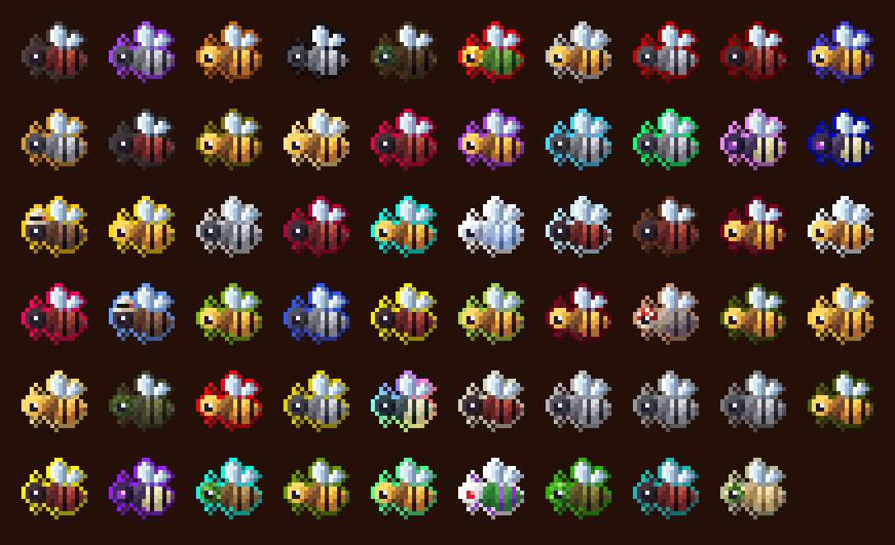

## Tools

|  | Name | What it does | How to get it |
|---|---|---|---|
| 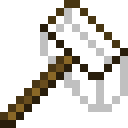{ .mc-icon } | **Scoop**{ #scoop } | Breaks a Bee Nest and gives you the bees inside. | Crafted: 6 sticks and 1 wool. |
| 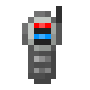{ .mc-icon } | **Meter**{ #meter } | Reads the temperature and humidity where you stand. | Crafted: iron ingots, redstone, a redstone torch, a glass pane and a tripwire hook. |
| 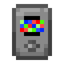{ .mc-icon } | **Analyzer**{ #analyzer } | Fed with Honey Droplets, shows a bee's genes: dominant values in red, recessive ones in blue. | Crafted: gold ingots, redstone, a diamond, a glass pane and a tripwire hook. |
| 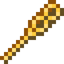{ .mc-icon } | **Bee Staff**{ #bee-staff } | Fires a bee. 100 uses, mended with Royal Jelly. | Crafted: 2 Pollen, 2 Propolis, 2 blaze rods and Royal Jelly. |
| 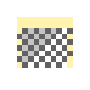{ .mc-icon } | **Apiarist's Helmet**{ #apiarist-suit } | One piece of the Apiarist's suit; the Chestplate, Leggings and Boots go with it. | Crafted from Woven Mesh, shaped like vanilla armour. |
| 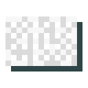{ .mc-icon } | **Woven Mesh** | The suit's cloth. | Crafted: 9 Silk Wisps. |

## Machines

|  | Name | What it does | How to get it |
|---|---|---|---|
| 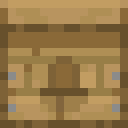{ .mc-icon } | **Apiary**{ #apiary } | The bee house. Takes a princess and a drone, or a queen, plus up to three [Frames](#frames). It tells you why a bee isn't working: wrong temperature, no flowers, can't see the sky, bad weather or asleep. | Crafted: 6 planks, 2 iron ingots and any comb. |
| { .mc-icon } | **Centrifuge**{ #centrifuge } | Spins combs into their [products](#combs-and-products). Runs on FE and takes [Upgrades](#upgrades). | Crafted: 5 iron ingots, a chest, 2 smooth stone and redstone. |
| 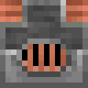{ .mc-icon } | **Furnace Generator**{ #furnace-generator } | Makes FE from furnace fuel. | Crafted: a blast furnace, iron and copper ingots, smooth stone and redstone. |
| 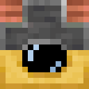{ .mc-icon } | **Honey Generator**{ #honey-generator } | Makes FE from honey products. | Crafted: a Furnace Generator, iron ingots, glass, Propolis and Smooth Wax. |
| 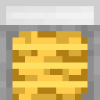{ .mc-icon } | **Apid Library**{ #apid-library } | Put a bee in to see every species it can become, and with what. | Crafted: iron ingots, a glass pane, Propolis and a Wax Block. |
| { .mc-icon } | **Microscope**{ #microscope } | A short sequencing game that makes a bee's mutation more likely. | Crafted: a spyglass, a glass pane, iron ingots and 3 iron blocks. |
| 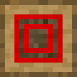{ .mc-icon } | **Bee Sorter**{ #bee-sorter } | Splits bees by filter. | Crafted: Honeyed Planks, a hopper, Propolis, a comparator and a diamond. |
| { .mc-icon } | **Autolyzer**{ #autolyzer } | Analyzes bees for you. | Crafted: an Analyzer, iron ingots and smooth stone. |

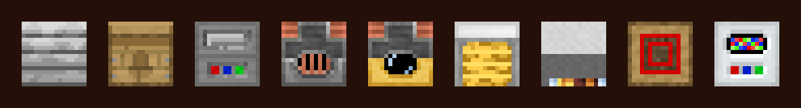

## Frames

Frames go in an [Apiary](#apiary) or a [Mellarium Frame Housing](#the-mellarium) and wear out as the bees work.
Numbers multiply the bee's own: productivity is how fast it makes combs, lifespan how long the queen lives, mutation
how likely her offspring mutate. A temperature or humidity step moves the housing one step warmer, colder, wetter or
drier. Each frame can be switched off in the config.

|  | Name | Effect | Uses | How to get it |
|---|---|---|---|---|
| 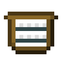{ .mc-icon } | **Frame** | productivity x1.25 | 80 | Crafted: 8 sticks and a string. |
| 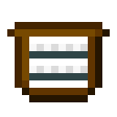{ .mc-icon } | **Waxed Frame** | productivity x1.5 | 240 | Crafted: 8 Waxed Sticks and a string. |
| { .mc-icon } | **Honeyed Frame** | productivity x1.75, lifespan x0.9 | 80 | Crafted: 8 Honeyed Sticks and a string. |
| 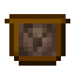{ .mc-icon } | **Twisting Frame** | productivity x0.6, lifespan x0.75, mutation x1.25 | 80 | Crafted: 8 Waxed Sticks and soul sand or soul soil. |
| { .mc-icon } | **Soothing Frame** | productivity x0.75, lifespan x1.5, mutation x0.8 | 80 | Crafted: 8 Honeyed Sticks and Royal Jelly. |
| { .mc-icon } | **Icy Frame** | one step colder, lifespan x0.6 | 60 | Crafted: 8 Waxed Sticks and blue ice. |
| 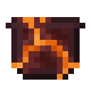{ .mc-icon } | **Hot Frame** | one step warmer, lifespan x0.6 | 60 | Crafted: 8 nether bricks and a magma block. |
| 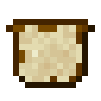{ .mc-icon } | **Dry Frame** | one step drier, lifespan x0.8 | 60 | Crafted: 8 Waxed Sticks and sand. |
| 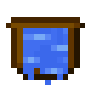{ .mc-icon } | **Wet Frame** | one step wetter, lifespan x0.8 | 60 | Crafted: 8 Waxed Sticks and a water bucket. |
| { .mc-icon } | **Deadly Frame** | lifespan x0.1 | 80 | Crafted: 7 obsidian, crying obsidian and a skeleton skull. |
| 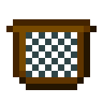{ .mc-icon } | **Restrictive Frame** | territory x0.5, lifespan x0.75, productivity x0.75 | 80 | Crafted: 8 Waxed Sticks and a chain. |

**Waxed Stick:** a stick and 2 Beeswax. **Honeyed Stick:** a stick and 4 Honey Droplets.

## Upgrades

Upgrades go in the [Centrifuge](#centrifuge). Speed is how fast it works; efficiency is how far its FE goes.

|  | Name | Speed | Efficiency | How to get it |
|---|---|---|---|---|
| 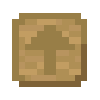{ .mc-icon } | **Basic Upgrade** | x1.1 | x1.1 | Crafted: 4 sticks, 4 Propolis and planks. |
| { .mc-icon } | **Waxed Upgrade** | x1 | x1.25 | Crafted: a Basic Upgrade, 4 Propolis and 4 Beeswax. |
| 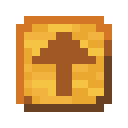{ .mc-icon } | **Honeyed Upgrade** | x1.25 | x1 | Crafted: a Basic Upgrade, 4 Propolis and 4 Honeyed Planks. |
| 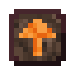{ .mc-icon } | **Twisted Upgrade** | x2 | x0.85 | Crafted: a Basic Upgrade, 4 Propolis, a shroomlight and 3 soul sand or soul soil. |
| { .mc-icon } | **Silky Upgrade** | x0.85 | x2 | Crafted: a Basic Upgrade, 4 Propolis and 4 Woven Mesh. |
| { .mc-icon } | **Royal Upgrade** | x1.5 | x1.5 | Crafted: a Basic Upgrade, 4 Propolis and 4 Royal Jelly. |
| { .mc-icon } | **Endenic Upgrade** | x0.5 | x4 | Crafted: a Royal Upgrade, 4 end stone, a chorus flower and 3 dragon's breath. |
| { .mc-icon } | **Withered Upgrade** | x4 | x0.5 | Crafted: a Royal Upgrade, 4 iron ingots, a nether star, 2 Pollen and netherite scrap. |

## Combs and products

Bees make **Combs**, one kind per species family. The [Centrifuge](#centrifuge) or the [Gyrofuge](#the-gyrofuge)
spins them into products; some species also carry ores and gems, from coal and copper to diamond, quartz and
netherite.

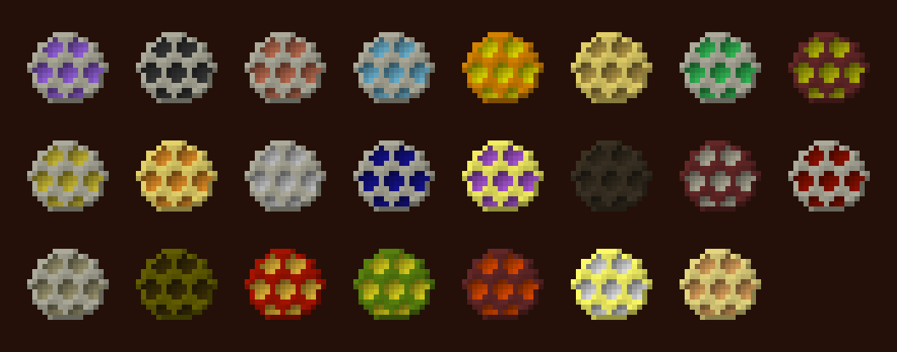

|  | Name | What it does | How to get it |
|---|---|---|---|
| 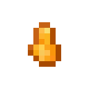{ .mc-icon } | **Honey Droplet** | Feeds the [Analyzer](#analyzer); goes into food, sticks and Honeyed Planks. | Centrifuge |
| 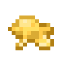{ .mc-icon } | **Beeswax** | Wax blocks, Waxed Sticks and Waxed Upgrades. | Centrifuge |
| 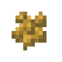{ .mc-icon } | **Pollen** | Crafting ingredient. | Centrifuge |
| 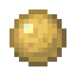{ .mc-icon } | **Propolis** | Crafting ingredient for most machines and upgrades. | Centrifuge |
| 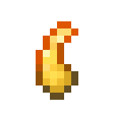{ .mc-icon } | **Royal Jelly** | Crafting ingredient; mends the [Bee Staff](#bee-staff). | Centrifuge |
| 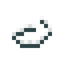{ .mc-icon } | **Silk Wisp** | 9 make a Woven Mesh. | Centrifuge |
| 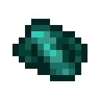{ .mc-icon } | **Pearl Shard** | A specialty product of some species. | Centrifuge |
| 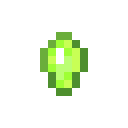{ .mc-icon } | **Experience Droplet** | Use it for 10 experience; crouch to use the whole stack. | Centrifuge |
| 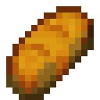{ .mc-icon } | **Honey Bread** | Food: 8 hunger. | Crafted: bread and 4 Honey Droplets. |
| 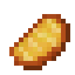{ .mc-icon } | **Honey Porkchop** | Food: 12 hunger. | Crafted: a cooked porkchop and 4 Honey Droplets. |
| 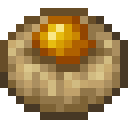{ .mc-icon } | **Ambrosia** | Always edible: Regeneration II (20 s), Jump Boost III (60 s) and Absorption II (2 min). | Crafted: 6 Honey Droplets, 2 Pollen and Royal Jelly. |

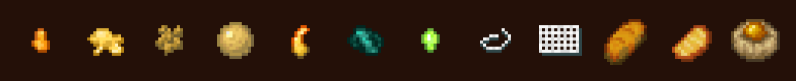

## The Mellarium

A big bee house: a 3x3x3 cube built from Mellarium parts around a queen. Swap parts in to change what it does.
Every part is crafted around a **Mellarium Block** (8 Mellarium Panels around a log); a **Mellarium Panel** is Honeyed
Planks, Beeswax, Royal Jelly and Pollen.

|  | Name | What it does | How to get it |
|---|---|---|---|
| 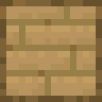{ .mc-icon } | **Mellarium Block** | The shell, and the base of every part. | Crafted: 8 Mellarium Panels and a log. |
| 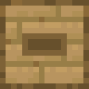{ .mc-icon } | **Basic Mellarium Frame Housing** | Holds [Frames](#frames). | Crafted: a Mellarium Block, 6 panels and 2 copper ingots. |
| 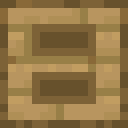{ .mc-icon } | **Mellarium Frame Housing** | Holds more frames. | Crafted: a Basic Mellarium Frame Housing, 6 panels and 2 gold ingots. |
| 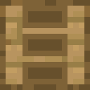{ .mc-icon } | **Large Mellarium Frame Housing** | Holds the most frames. | Crafted: a Mellarium Frame Housing, 7 panels and a netherite ingot. |
| 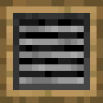{ .mc-icon } | **Mellarium Temperature Unit** | Changes the temperature inside. | Crafted: a Mellarium Block, iron bars and iron ingots. |
| 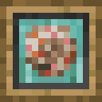{ .mc-icon } | **Mellarium Hydroregulator** | Changes the humidity inside. | Crafted: a Mellarium Block, prismarine bricks and a nautilus shell. |
| 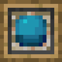{ .mc-icon } | **Mellarium Rain Shield** | Lets the bees work in the rain. | Crafted: a Mellarium Block, prismarine, nautilus shells and a heart of the sea. |
| 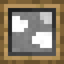{ .mc-icon } | **Mellarium Skybox** | Gives the bees a sky under a roof. | Crafted: a Mellarium Block, panels, redstone lamp, glowstone and a diamond. |
| 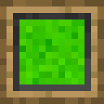{ .mc-icon } | **Mellarium Mutator** | Raises the mutation chance. | Crafted: a Mellarium Block, gold ingots and an eye of ender. |
| 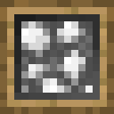{ .mc-icon } | **Mellarium Temporal Simulator** | Speeds the bees up. | Crafted: a Mellarium Block, panels, a clock, gold blocks and a totem of undying. |
| 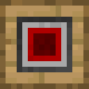{ .mc-icon } | **Mellarium Energy Cell** | Takes FE for the powered parts. | Crafted: a Mellarium Block, panels, copper ingots and redstone blocks. |
| 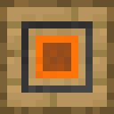{ .mc-icon } | **Mellarium Output Hatch** | Lets products out to pipes and hoppers. | Crafted: a Mellarium Block, panels, a powered rail, a chest and a hopper. |

## The Gyrofuge

A big centrifuge: a 3x3x3 cube built from Gyrofuge parts. Every part is crafted around a **Gyrofuge Block** (8 Gyrofuge
Panels around an iron block). Each unit has a basic, normal and advanced tier; each tier is crafted from the one before.

|  | Name | What it does | How to get it |
|---|---|---|---|
| 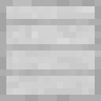{ .mc-icon } | **Gyrofuge Block** | The shell, and the base of every part. | Crafted: 8 Gyrofuge Panels and an iron block. |
| { .mc-icon } | **Gyrofuge Basic Processing Unit** | Lets it spin combs; higher tiers spin more at once. | Crafted: a Gyrofuge Block, panels, a Centrifuge, gold ingots and a diamond. Then gold and diamond blocks, then a nether star and a netherite block. |
| { .mc-icon } | **Gyrofuge Basic Speed Unit** | Makes it faster. | Crafted: a Gyrofuge Block, panels, sugar, redstone and a diamond. Then a golden carrot, then a golden apple, a redstone lamp and netherite. |
| 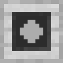{ .mc-icon } | **Gyrofuge Basic Efficiency Unit** | Makes FE go further. | Crafted: a Gyrofuge Block, panels, a bookshelf, copper and gold. Then crying obsidian, then a chorus flower, an Experience Droplet and netherite. |
| { .mc-icon } | **Gyrofuge Basic Extraction Unit** | Gets more out of each comb. | Crafted: a Gyrofuge Block, panels, an amethyst shard, pistons and a diamond. Then an anvil and netherite, then dragon's breath, Ambrosia and an end crystal. |
| { .mc-icon } | **Gyrofuge Energy Cell** | Takes FE. | Crafted: a Gyrofuge Block, panels, copper ingots and redstone blocks. |
| { .mc-icon } | **Gyrofuge Input Hatch** | Takes combs in from pipes and hoppers. | Crafted: a Gyrofuge Block, panels, a hopper, powered rails and a chest. |
| { .mc-icon } | **Gyrofuge Output Hatch** | Lets products out. | Crafted like the Input Hatch, hopper and chest swapped. |

## Building blocks

|  | Name | What it does | How to get it |
|---|---|---|---|
| { .mc-icon } | **Wax Block** | Building block, with stairs, slab and wall. | Crafted: 4 Beeswax. |
| { .mc-icon } | **Wax Bricks** | Building block, with stairs, slab and wall. | Crafted from Wax Blocks. |
| { .mc-icon } | **Smooth Wax** | Building block, with stairs, slab and wall. | From Wax Blocks. |
| { .mc-icon } | **Chiseled Wax** | Decorative block. | From wax slabs. |
| { .mc-icon } | **Honeyed Planks** | A full wood set: stairs, slab, fence, gate, door, trapdoor, button, pressure plate, sign and hanging sign. | Crafted: 8 planks and a Honey Droplet. |

