<p align="center"><i>Some things are better left to take their time.</i></p>

---

Kilns that count in days, not seconds, and everything that comes out of them: ciders, preserves and cured food, mossy stone and green copper, three music discs, a lantern that's brightest at night, a sandglass that measures days, pressed flowers, wood that silvers in the weather, and a Potter villager with old ruins to find.

Its kilns burn no fuel. They have no screen and no progress bar. You put something in, shut the lid and walk away, and when you come back, a day or a week later, it's done. The wait runs on the world's own clock. Sleeping through the night won't hurry it, and leaving the chunk won't lose it: the kiln finds, the next time it ticks, that its days have gone by without it.

Everything else follows from that: a lantern that keeps the opposite hours to everyone else, a sandglass that measures days, flowers pressed over three of them, wood that silvers in the weather, and a few records that take longer to press than to play.

---

<details>
<summary><b>The Kilns</b> · where the waiting happens</summary>


**Patient Kiln.** One thing at a time. Put it in, close the lid, come back another day. It takes items from any side but the bottom and gives its finished work out below, so a hopper or a Create funnel can tend it. A comparator reads how far along it is.

**Long Kiln.** The Patient Kiln's slower sibling. It takes a whole stack, bricks its door shut and finishes all of it at once, in three times the wait of one. It seals when it's full, or once nothing more has gone in for ten seconds.

**Ember Kiln.** A kiln of blackstone, for the Nether. It only works where the world itself is hot, and there it works in half the days. Anywhere cooler, it holds what it's given and waits for the heat.

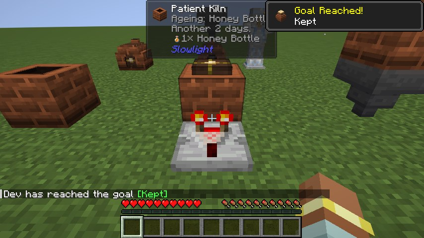

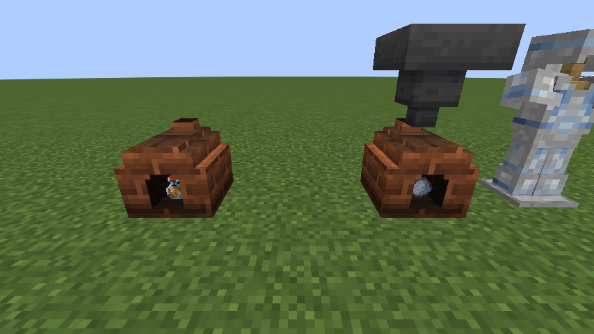

</details>

<details>
<summary><b>What Time Makes</b> · food, drink, and the things time does anyway</summary>

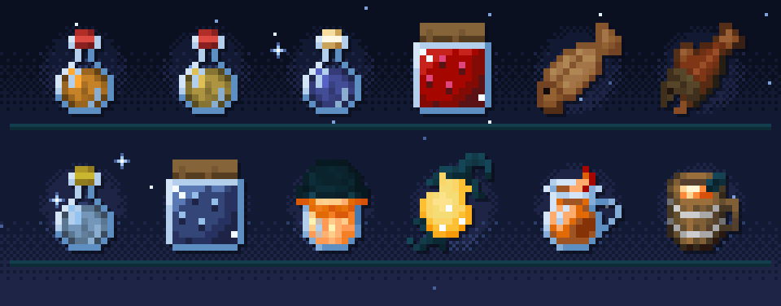

- **To drink:** Amber Draught from a bottle of honey. Cider from apples, and Dusk Cider with dried Duskbloom petals stirred in. Duskbloom Tea, for a minute of night vision. Lanternwine, from Lanternfruit must.
- **To eat:** Preserved Berries and Duskbloom Jam, cured cod and salmon that keep you fed longer, and Lanternfruit preserve and candied peel.
- **What time does anyway:**
  - String gathers into cobweb.
  - Coarse dirt settles into podzol.
  - Cobblestone and stone bricks go mossy. In the Nether, cobblestone turns to blackstone instead.
  - A honey block crystallises into sugar.
  - Cornflowers ferment into a deeper blue dye.
  - Copper weathers, one stage at a time, all the way to green.
  - Rotten flesh, left long enough, becomes leather.

**Some things wait for the right weather.**
- Dirt turns to mud, and a sponge soaks up water, only in the rain.
- Kelp and wet sponges dry only by day under a clear sky.
- Ink takes on its glow only under the night sky.

While the weather is wrong the wait stands still, keeping the days it already has, and the kiln tells you what it's waiting for.

**Old things wake.** The sniffer's ancient seeds open in a kiln: torchflower seeds in two days, a pitcher pod in three. Gravel or sand left a week comes back *suspicious*. Place it, brush it, and find what settled into it while it waited: flint, bones and nuggets mostly, and now and then an emerald, a shard or a pottery sherd.

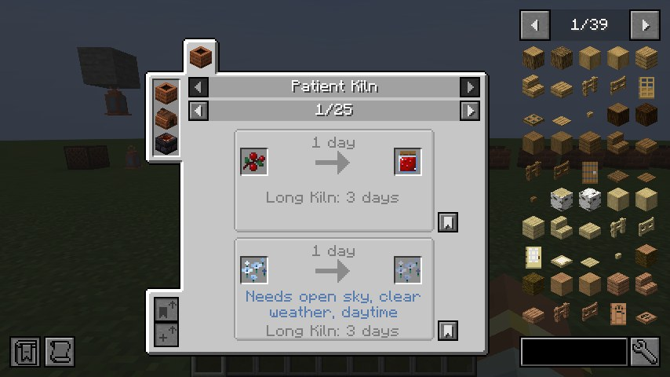

</details>

<details>
<summary><b>Three Records</b> · rather shorter than the wait for them</summary>


Each is pressed slowly out of a vanilla disc in the kiln:
- **Patient Light,** from *mellohi*, over four days.
- **Lantern Hours,** from *stal*, over five.
- **A Week In,** from *far*, over (as you might expect) seven.

They play in any jukebox.

</details>

<details>
<summary><b>Light That Keeps Its Own Hours</b> · the lantern and the shards</summary>

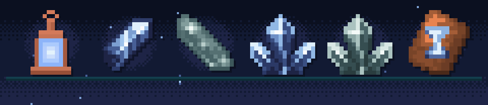

**Slowlight Lantern.** Dim through the day, bright from dusk to dawn. Underground, where the sky never brightens, it simply stays up.

**Slowlight Shard.** An amethyst shard left a week in a kiln. The lantern is built around one. Sniffers now and then dig one up too, an amethyst shard that waited underground on its own.

**Still Shard.** The End has no day and no weather, only an empty sky. Leave an ender pearl ten days in a kiln with nothing above it there, and it goes quiet and still. In the same place, obsidian weeps into crying obsidian and chorus fruit pops.

**Sulfur cubes** (26.2 and later). A sulfur cube that swallows a Slowlight Shard block drifts: it falls at a fifth of the usual speed and floats down. One that swallows a Still Shard block hangs where it is, and stops dead in the air when hit.

**Patience.** Both shards trim armour, and the Patience trim template stamps an hourglass on it.

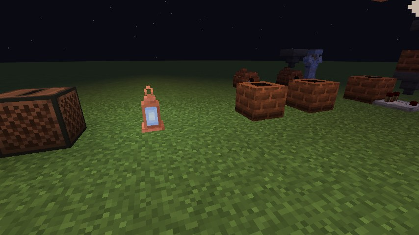

</details>

<details>
<summary><b>Growing Things</b> · Duskbloom and Gloamwood</summary>

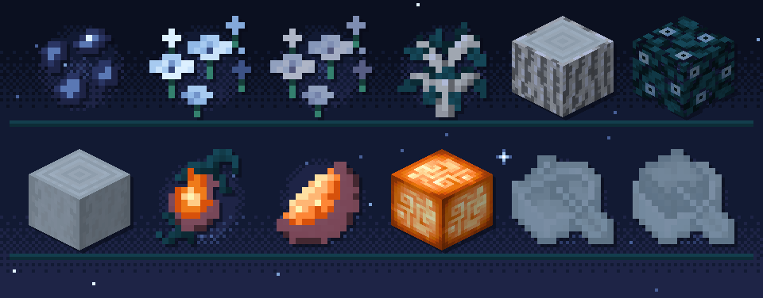

**Duskbloom.** A crop the sniffer digs up, that grows only at night. Ripe, it glows faintly and gives petals:
- light blue dye
- dried in the sun for Duskbloom Tea
- stirred into Preserved Berries for Duskbloom Jam
- left two weeks under the night sky to harden into a Slowlight Shard

**Gloamwood.** A blue-grey tree with a full set of wood: planks, stairs, slabs, doors, signs, hanging signs and boats. **Lanternfruit** hangs under its leaves and glows from within when ripe, and its peel wraps a torch into a Lanternfruit Lamp.

</details>

<details>
<summary><b>Measuring Time</b> · the Sandglass, the Sundial and the Keepsake Urn</summary>


**Sandglass.** An hourglass that measures days. Click it to set from one to seven. The shard sand runs down over those days. When the last grain falls it gives one redstone pulse and turns itself over. A comparator reads how much sand is left. In the Nether and the End it can't find the time, and the sand never settles.

**Sundial.** Where the Sandglass counts days, the Sundial tells the hours of one. Under open sky a comparator reads its shadow: nothing all night, full strength at noon. Roofed over, no shadow falls.

**Keepsake Urn.** Nine slots for putting things away for later. Choose from one day to thirty, then seal it with a honeycomb. Until the days are up it won't open, not for you and not for a hopper. Break it early and it cracks, and everything spills out.

</details>

<details>
<summary><b>Slow Crafts</b> · weathered wood, pressed flowers, a candle that takes four days</summary>

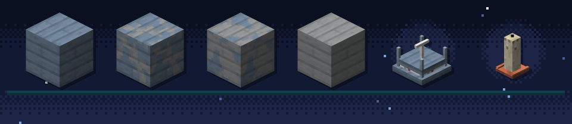

**Weathering Gloamwood.** Gloamwood left under open sky fades, then weathers, then silvers, in patchy steps, the way copper does. Honeycomb waxes it where it is, and an axe scrapes it back.

**Flower Press and Pressed Flowers.** The press takes any flower, modded ones too, and over three days gives back a Pressed Flower. Lay them on the ground, up to four to a block like Pink Petals, or on a wall. Each one is drawn in its own flower's colours, in one of 47 petal shapes chosen by the size of the bloom and whether it has a second colour. A flower that glows still glows when it's pressed.

**Slow Candle.** Burns down over four lit days.

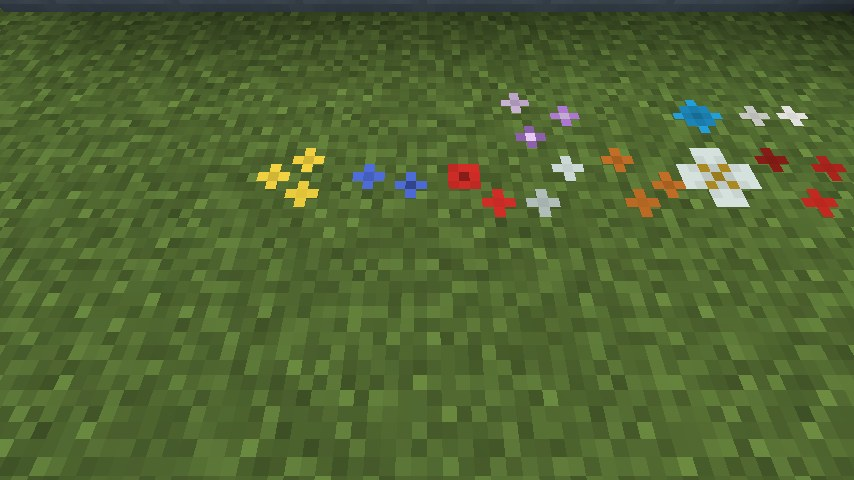

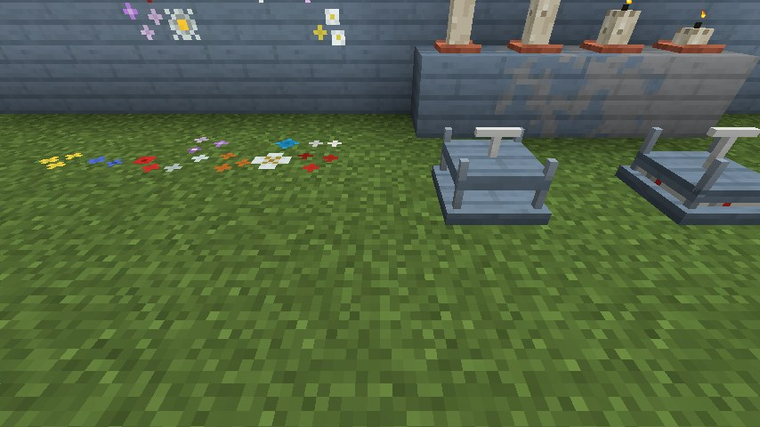

</details>

<details>
<summary><b>To Build With</b> · shard blocks, patterned planks, bookshelves and the Lapse Block</summary>

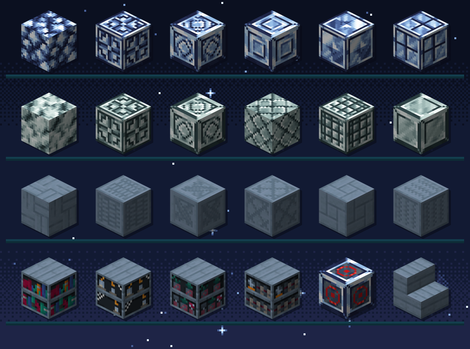

- **Slowlight Shard and Still Shard blocks,** each in eleven cut and tiled designs, with stairs and slabs, and shard clusters.
- **Gloamwood planks** in nineteen patterns, with stairs and slabs.
- **The Gloamwood Bookshelf,** which powers enchanting. With Chipped installed it comes in 33 designs.
- **The Lapse Block.** Powered, it steps out of the world for three seconds, its red ring fading to a green trace, and takes every Lapse Block it touches with it.

</details>

<details>
<summary><b>Potters and Old Yards</b> · villagers, ruins and a sherd</summary>


**The Potter.** A villager with no job takes a Patient Kiln as a workstation and becomes a Potter. Potters buy clay, honey and Duskbloom petals, and sell bricks, terracotta and aged goods. A master Potter parts, at a price, with the Patience sherd and the Patience trim.

**Old potters' yards.** Out on the plains, the savanna and the badlands there are ruins of old potters' yards. Each is a ring of broken brick round a hearth, with a Patient Kiln someone sealed long ago and never came back for. Its batch is long done. Brush the gravel nearby.

**The Patience Pottery Sherd** stamps an hourglass on a decorated pot. It turns up, rarely, in trail ruins and desert wells.

</details>

<details>
<summary><b>A Slow Almanac</b> · the guide, with Patchouli</summary>

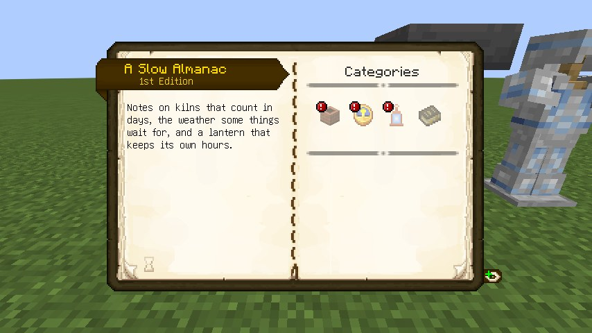

With Patchouli installed, a book and a clay ball make *A Slow Almanac*. It's a guide to everything here: notes on kilns that count in days, the weather some things wait for, and a lantern that keeps its own hours.

</details>

<details>
<summary><b>Other Mods</b> · what Slowlight does when they're there</summary>

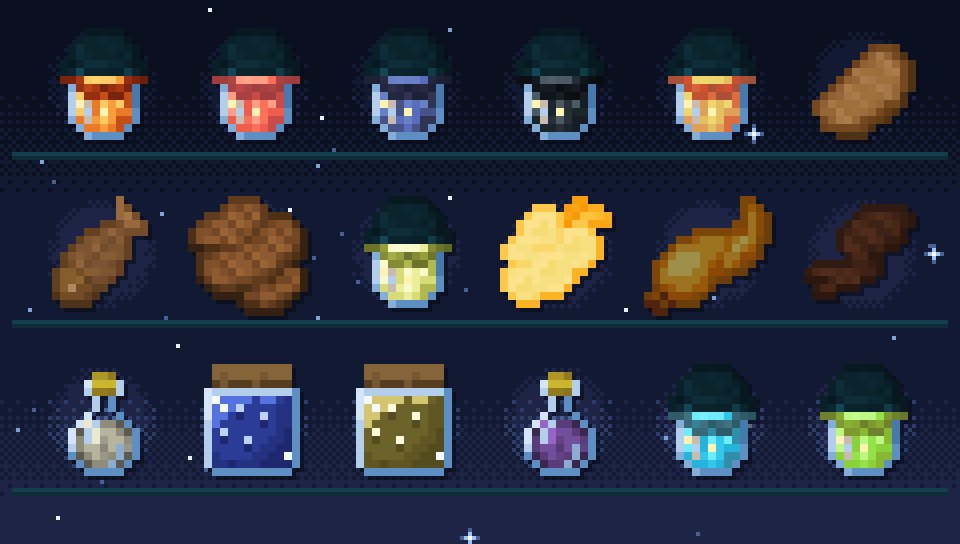

Each of these loads only when its mod is installed. Nothing here is required.

- **Twilight Forest:**
  - preserves for all eight of its berries and the torchberry
  - a cured hydra chop
  - jerky from venison, meef and vanilla's cooked meats
  - moss on castle brick, underbrick and mazestone brick
- **The Undergarden:**
  - cured gwibling, dweller steak and gloomper leg
  - ditchbulb preserve, candied droopfruit and dried glitterkelp
  - blisterberries that rot, and depthrock and shiverstone bricks that crack
- **The Aether:**
  - white apple cider
  - blue berry and enchanted berry preserves
  - aechor petal tea, for a moment of slow falling
- **Aerial Hell:** stellar cobblestone, mud bricks and shadow catacomb bricks grow moss.
- **Rechiseled:** its chisel cuts the shard blocks and Gloamwood planks into their variants. Without it, the stonecutter does.
- **Chipped:** the carpenter's table turns the Gloamwood Bookshelf into Gloamwood versions of all 33 of Chipped's bookshelves.
- **Create:** funnels and belts tend the kilns like any hopper.
- **JEI:** every ageing recipe, with its days, its weather and its Long Kiln wait.
- **Jade:** a kiln, Sandglass or Keepsake Urn tells you how long it has left.
- **Patchouli:** *A Slow Almanac*.
- **KubeJS:** add and remove ageing recipes from scripts (see below).

The foods from other mods show in the creative tab only when their mod is there.

</details>

<details>
<summary><b>For Pack Makers</b> · everything is data</summary>

The kiln has no recipe list in its code. There's one recipe type, `slowlight:ageing`:

```json
{
  "type": "slowlight:ageing",
  "ingredient": { "item": "minecraft:honey_bottle" },
  "result": { "id": "slowlight:mead", "count": 1 },
  "days": 2
}
```

Two fields are optional:
- **`long_days`** sets the Long Kiln's own wait.
- **`condition`** makes the days count only in the right weather:
  - `sky`: `open` or `covered`
  - `weather`: `clear`, `rain` or `thunder`
  - `time`: `day` or `night`
  - `dimension`: a recipe that names a dimension exists only there, and wins over one that names none. That's how cobblestone turns mossy in the Overworld but to blackstone in the Nether.

Drop a recipe into `data/<your pack>/recipe/` and the kiln can make it.

With **KubeJS**, `event.custom({...})` works because the recipe type has a codec. `event.recipes.slowlight.ageing('4x minecraft:bone_meal', 'minecraft:rotten_flesh', 2)` works too, because a schema ships as a data file. Slowlight has no compile-time dependency on KubeJS and nothing to go wrong without it.

</details>

---

### Credits

By **Oculifelis**.

The Pressed Flower petal shapes are cut from:
- vanilla Pink Petals and Wildflowers
- Lithoform's wisteria petals and petal litter (Apache-2.0)
- World of Wonder's mellow petals (LGPL-3.0)
- Cosmopolitan's and Maple's petals (MIT)


