# Slowlight description pictures

Pictures for Slowlight's CurseForge and Modrinth pages. Link the GitHub Pages address; the raw GitHub one is
the fallback. All are PNG with a transparent background except the feature panels, which have their own dark
background. Made by `tools/slowlight_description.py`.

## Feature panels (720 px wide)

| | File | Shows | Links |
|---|---|---|---|
| 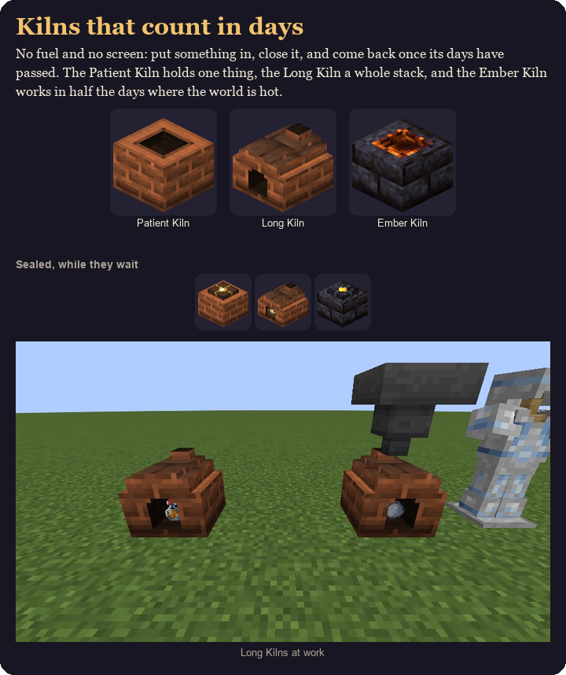{ width=160 } | `features/kilns.png` | the three kilns, sealed kilns, and Long Kilns in game | [Pages](https://oculifelis.github.io/mod-wiki/description/slowlight/features/kilns.png) / [raw](https://raw.githubusercontent.com/Oculifelis/mod-wiki/main/docs/description/slowlight/features/kilns.png) |
| 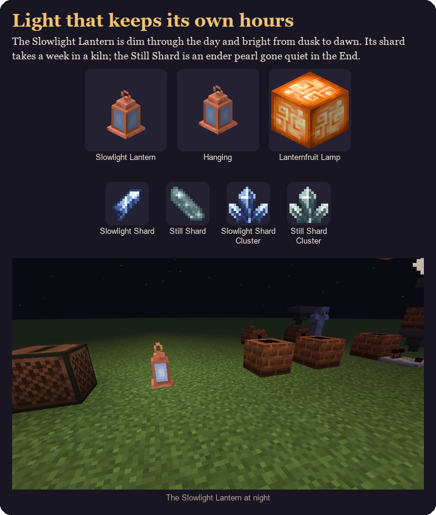{ width=160 } | `features/lanterns.png` | the Slowlight Lantern, Lanternfruit Lamp, both shards and clusters, and the lantern at night | [Pages](https://oculifelis.github.io/mod-wiki/description/slowlight/features/lanterns.png) / [raw](https://raw.githubusercontent.com/Oculifelis/mod-wiki/main/docs/description/slowlight/features/lanterns.png) |
| 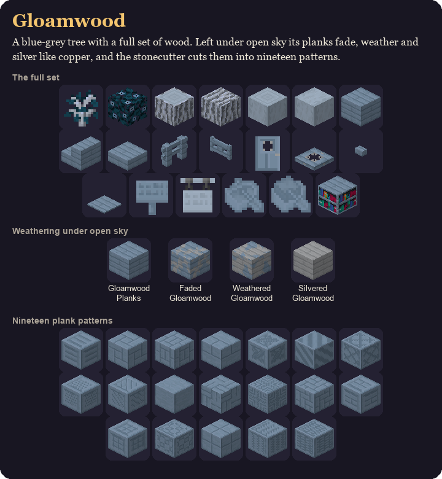{ width=160 } | `features/gloamwood.png` | the whole Gloamwood set, its weathering steps and the nineteen plank patterns | [Pages](https://oculifelis.github.io/mod-wiki/description/slowlight/features/gloamwood.png) / [raw](https://raw.githubusercontent.com/Oculifelis/mod-wiki/main/docs/description/slowlight/features/gloamwood.png) |
| 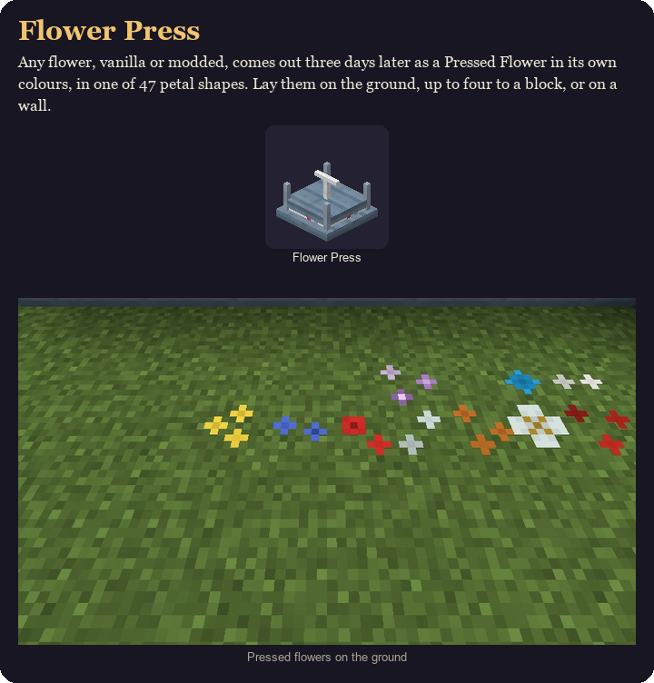{ width=160 } | `features/flower_press.png` | the Flower Press and pressed flowers on the ground | [Pages](https://oculifelis.github.io/mod-wiki/description/slowlight/features/flower_press.png) / [raw](https://raw.githubusercontent.com/Oculifelis/mod-wiki/main/docs/description/slowlight/features/flower_press.png) |
| 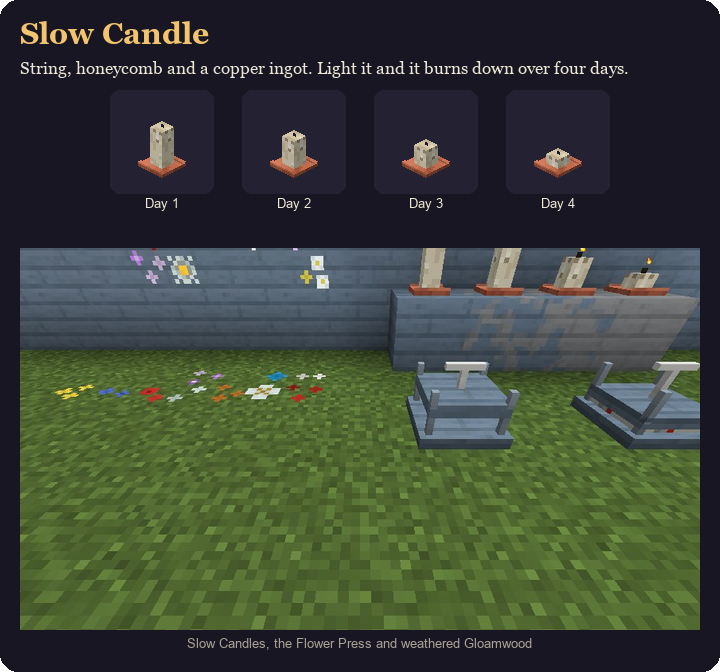{ width=160 } | `features/slow_candle.png` | the Slow Candle burning down over four days, with an in-game shot | [Pages](https://oculifelis.github.io/mod-wiki/description/slowlight/features/slow_candle.png) / [raw](https://raw.githubusercontent.com/Oculifelis/mod-wiki/main/docs/description/slowlight/features/slow_candle.png) |
| 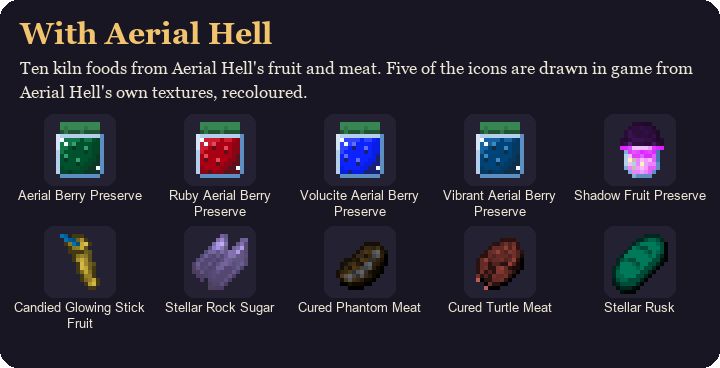{ width=160 } | `features/aerial_hell.png` | the ten Aerial Hell kiln foods | [Pages](https://oculifelis.github.io/mod-wiki/description/slowlight/features/aerial_hell.png) / [raw](https://raw.githubusercontent.com/Oculifelis/mod-wiki/main/docs/description/slowlight/features/aerial_hell.png) |

## Item icons (256 px, nearest-neighbour)

| | File | Shows | Links |
|---|---|---|---|
| 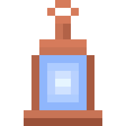{ width=48 } | `icons/slowlight_lantern.png` | Slowlight Lantern | [Pages](https://oculifelis.github.io/mod-wiki/description/slowlight/icons/slowlight_lantern.png) / [raw](https://raw.githubusercontent.com/Oculifelis/mod-wiki/main/docs/description/slowlight/icons/slowlight_lantern.png) |
| 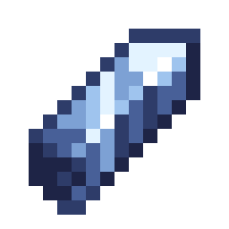{ width=48 } | `icons/slowlight_shard.png` | Slowlight Shard | [Pages](https://oculifelis.github.io/mod-wiki/description/slowlight/icons/slowlight_shard.png) / [raw](https://raw.githubusercontent.com/Oculifelis/mod-wiki/main/docs/description/slowlight/icons/slowlight_shard.png) |
| 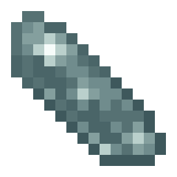{ width=48 } | `icons/still_shard.png` | Still Shard | [Pages](https://oculifelis.github.io/mod-wiki/description/slowlight/icons/still_shard.png) / [raw](https://raw.githubusercontent.com/Oculifelis/mod-wiki/main/docs/description/slowlight/icons/still_shard.png) |
| { width=48 } | `icons/slowlight_shard_cluster.png` | Slowlight Shard Cluster | [Pages](https://oculifelis.github.io/mod-wiki/description/slowlight/icons/slowlight_shard_cluster.png) / [raw](https://raw.githubusercontent.com/Oculifelis/mod-wiki/main/docs/description/slowlight/icons/slowlight_shard_cluster.png) |
| 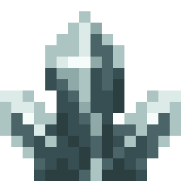{ width=48 } | `icons/still_shard_cluster.png` | Still Shard Cluster | [Pages](https://oculifelis.github.io/mod-wiki/description/slowlight/icons/still_shard_cluster.png) / [raw](https://raw.githubusercontent.com/Oculifelis/mod-wiki/main/docs/description/slowlight/icons/still_shard_cluster.png) |
| 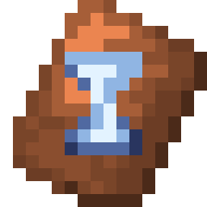{ width=48 } | `icons/patience_armor_trim_smithing_template.png` | Smithing Template | [Pages](https://oculifelis.github.io/mod-wiki/description/slowlight/icons/patience_armor_trim_smithing_template.png) / [raw](https://raw.githubusercontent.com/Oculifelis/mod-wiki/main/docs/description/slowlight/icons/patience_armor_trim_smithing_template.png) |
| 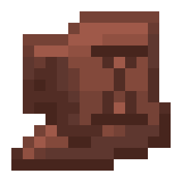{ width=48 } | `icons/patience_pottery_sherd.png` | Patience Pottery Sherd | [Pages](https://oculifelis.github.io/mod-wiki/description/slowlight/icons/patience_pottery_sherd.png) / [raw](https://raw.githubusercontent.com/Oculifelis/mod-wiki/main/docs/description/slowlight/icons/patience_pottery_sherd.png) |
| 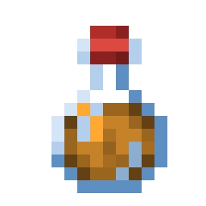{ width=48 } | `icons/mead.png` | Amber Draught | [Pages](https://oculifelis.github.io/mod-wiki/description/slowlight/icons/mead.png) / [raw](https://raw.githubusercontent.com/Oculifelis/mod-wiki/main/docs/description/slowlight/icons/mead.png) |
| 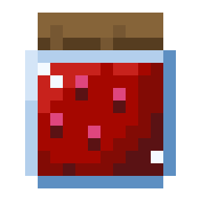{ width=48 } | `icons/preserved_berries.png` | Preserved Berries | [Pages](https://oculifelis.github.io/mod-wiki/description/slowlight/icons/preserved_berries.png) / [raw](https://raw.githubusercontent.com/Oculifelis/mod-wiki/main/docs/description/slowlight/icons/preserved_berries.png) |
| 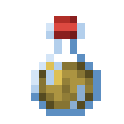{ width=48 } | `icons/cider.png` | Cider | [Pages](https://oculifelis.github.io/mod-wiki/description/slowlight/icons/cider.png) / [raw](https://raw.githubusercontent.com/Oculifelis/mod-wiki/main/docs/description/slowlight/icons/cider.png) |
| 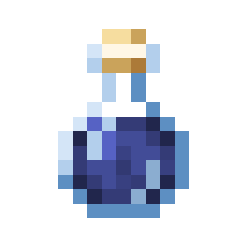{ width=48 } | `icons/dusk_cider.png` | Dusk Cider | [Pages](https://oculifelis.github.io/mod-wiki/description/slowlight/icons/dusk_cider.png) / [raw](https://raw.githubusercontent.com/Oculifelis/mod-wiki/main/docs/description/slowlight/icons/dusk_cider.png) |
| 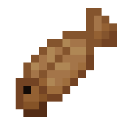{ width=48 } | `icons/cured_cod.png` | Cured Cod | [Pages](https://oculifelis.github.io/mod-wiki/description/slowlight/icons/cured_cod.png) / [raw](https://raw.githubusercontent.com/Oculifelis/mod-wiki/main/docs/description/slowlight/icons/cured_cod.png) |
| 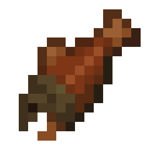{ width=48 } | `icons/cured_salmon.png` | Cured Salmon | [Pages](https://oculifelis.github.io/mod-wiki/description/slowlight/icons/cured_salmon.png) / [raw](https://raw.githubusercontent.com/Oculifelis/mod-wiki/main/docs/description/slowlight/icons/cured_salmon.png) |
| 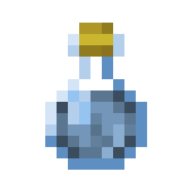{ width=48 } | `icons/duskbloom_tea.png` | Duskbloom Tea | [Pages](https://oculifelis.github.io/mod-wiki/description/slowlight/icons/duskbloom_tea.png) / [raw](https://raw.githubusercontent.com/Oculifelis/mod-wiki/main/docs/description/slowlight/icons/duskbloom_tea.png) |
| 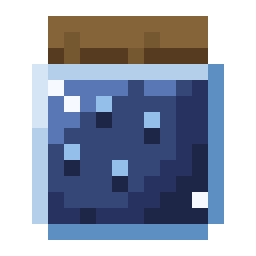{ width=48 } | `icons/duskbloom_jam.png` | Duskbloom Jam | [Pages](https://oculifelis.github.io/mod-wiki/description/slowlight/icons/duskbloom_jam.png) / [raw](https://raw.githubusercontent.com/Oculifelis/mod-wiki/main/docs/description/slowlight/icons/duskbloom_jam.png) |
| 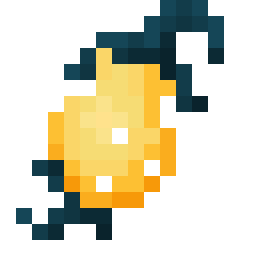{ width=48 } | `icons/candied_lanternfruit.png` | Candied Lanternfruit | [Pages](https://oculifelis.github.io/mod-wiki/description/slowlight/icons/candied_lanternfruit.png) / [raw](https://raw.githubusercontent.com/Oculifelis/mod-wiki/main/docs/description/slowlight/icons/candied_lanternfruit.png) |
| 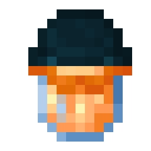{ width=48 } | `icons/lanternfruit_preserve.png` | Lanternfruit Preserve | [Pages](https://oculifelis.github.io/mod-wiki/description/slowlight/icons/lanternfruit_preserve.png) / [raw](https://raw.githubusercontent.com/Oculifelis/mod-wiki/main/docs/description/slowlight/icons/lanternfruit_preserve.png) |
| 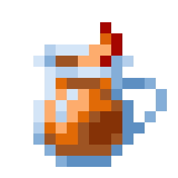{ width=48 } | `icons/lanternfruit_must.png` | Lanternfruit Must | [Pages](https://oculifelis.github.io/mod-wiki/description/slowlight/icons/lanternfruit_must.png) / [raw](https://raw.githubusercontent.com/Oculifelis/mod-wiki/main/docs/description/slowlight/icons/lanternfruit_must.png) |
| 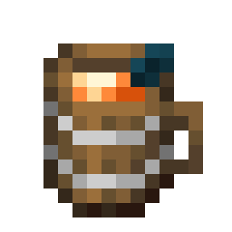{ width=48 } | `icons/lanternwine.png` | Lanternwine | [Pages](https://oculifelis.github.io/mod-wiki/description/slowlight/icons/lanternwine.png) / [raw](https://raw.githubusercontent.com/Oculifelis/mod-wiki/main/docs/description/slowlight/icons/lanternwine.png) |
| 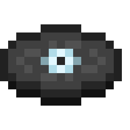{ width=48 } | `icons/music_disc_patient_light.png` | Music Disc | [Pages](https://oculifelis.github.io/mod-wiki/description/slowlight/icons/music_disc_patient_light.png) / [raw](https://raw.githubusercontent.com/Oculifelis/mod-wiki/main/docs/description/slowlight/icons/music_disc_patient_light.png) |
| 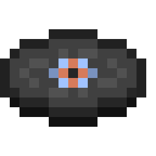{ width=48 } | `icons/music_disc_lantern_hours.png` | Music Disc | [Pages](https://oculifelis.github.io/mod-wiki/description/slowlight/icons/music_disc_lantern_hours.png) / [raw](https://raw.githubusercontent.com/Oculifelis/mod-wiki/main/docs/description/slowlight/icons/music_disc_lantern_hours.png) |
| 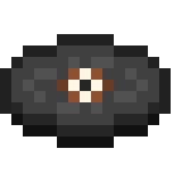{ width=48 } | `icons/music_disc_a_week_in.png` | Music Disc | [Pages](https://oculifelis.github.io/mod-wiki/description/slowlight/icons/music_disc_a_week_in.png) / [raw](https://raw.githubusercontent.com/Oculifelis/mod-wiki/main/docs/description/slowlight/icons/music_disc_a_week_in.png) |
| 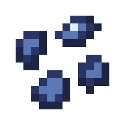{ width=48 } | `icons/duskbloom_seeds.png` | Duskbloom Seeds | [Pages](https://oculifelis.github.io/mod-wiki/description/slowlight/icons/duskbloom_seeds.png) / [raw](https://raw.githubusercontent.com/Oculifelis/mod-wiki/main/docs/description/slowlight/icons/duskbloom_seeds.png) |
| 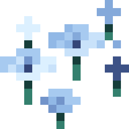{ width=48 } | `icons/duskbloom_petals.png` | Duskbloom Petals | [Pages](https://oculifelis.github.io/mod-wiki/description/slowlight/icons/duskbloom_petals.png) / [raw](https://raw.githubusercontent.com/Oculifelis/mod-wiki/main/docs/description/slowlight/icons/duskbloom_petals.png) |
| 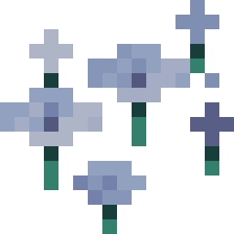{ width=48 } | `icons/dried_duskbloom_petals.png` | Dried Duskbloom Petals | [Pages](https://oculifelis.github.io/mod-wiki/description/slowlight/icons/dried_duskbloom_petals.png) / [raw](https://raw.githubusercontent.com/Oculifelis/mod-wiki/main/docs/description/slowlight/icons/dried_duskbloom_petals.png) |
| 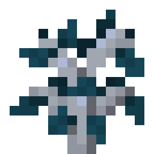{ width=48 } | `icons/gloamwood_sapling.png` | Gloamwood Seedling | [Pages](https://oculifelis.github.io/mod-wiki/description/slowlight/icons/gloamwood_sapling.png) / [raw](https://raw.githubusercontent.com/Oculifelis/mod-wiki/main/docs/description/slowlight/icons/gloamwood_sapling.png) |
| 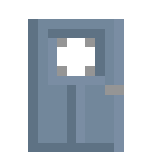{ width=48 } | `icons/gloamwood_door.png` | Gloamwood Door | [Pages](https://oculifelis.github.io/mod-wiki/description/slowlight/icons/gloamwood_door.png) / [raw](https://raw.githubusercontent.com/Oculifelis/mod-wiki/main/docs/description/slowlight/icons/gloamwood_door.png) |
| 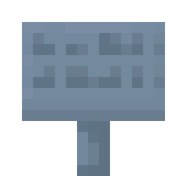{ width=48 } | `icons/gloamwood_sign.png` | Gloamwood Sign | [Pages](https://oculifelis.github.io/mod-wiki/description/slowlight/icons/gloamwood_sign.png) / [raw](https://raw.githubusercontent.com/Oculifelis/mod-wiki/main/docs/description/slowlight/icons/gloamwood_sign.png) |
| 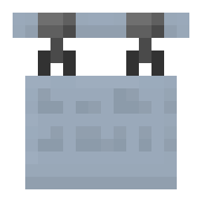{ width=48 } | `icons/gloamwood_hanging_sign.png` | Gloamwood Hanging Sign | [Pages](https://oculifelis.github.io/mod-wiki/description/slowlight/icons/gloamwood_hanging_sign.png) / [raw](https://raw.githubusercontent.com/Oculifelis/mod-wiki/main/docs/description/slowlight/icons/gloamwood_hanging_sign.png) |
| 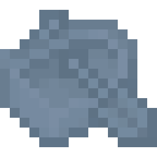{ width=48 } | `icons/gloamwood_boat.png` | Gloamwood Boat | [Pages](https://oculifelis.github.io/mod-wiki/description/slowlight/icons/gloamwood_boat.png) / [raw](https://raw.githubusercontent.com/Oculifelis/mod-wiki/main/docs/description/slowlight/icons/gloamwood_boat.png) |
| 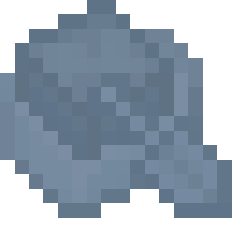{ width=48 } | `icons/gloamwood_chest_boat.png` | Gloamwood Boat with Chest | [Pages](https://oculifelis.github.io/mod-wiki/description/slowlight/icons/gloamwood_chest_boat.png) / [raw](https://raw.githubusercontent.com/Oculifelis/mod-wiki/main/docs/description/slowlight/icons/gloamwood_chest_boat.png) |
| 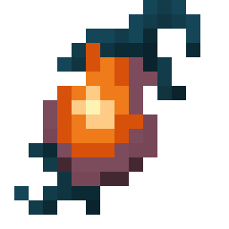{ width=48 } | `icons/lanternfruit.png` | Lanternfruit | [Pages](https://oculifelis.github.io/mod-wiki/description/slowlight/icons/lanternfruit.png) / [raw](https://raw.githubusercontent.com/Oculifelis/mod-wiki/main/docs/description/slowlight/icons/lanternfruit.png) |
| 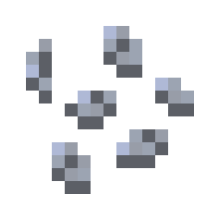{ width=48 } | `icons/lanternfruit_seeds.png` | Lanternfruit Seeds | [Pages](https://oculifelis.github.io/mod-wiki/description/slowlight/icons/lanternfruit_seeds.png) / [raw](https://raw.githubusercontent.com/Oculifelis/mod-wiki/main/docs/description/slowlight/icons/lanternfruit_seeds.png) |
| 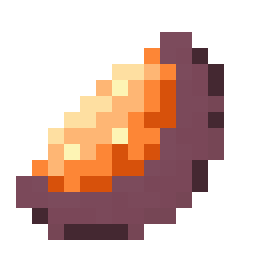{ width=48 } | `icons/lanternfruit_peel.png` | Lanternfruit Peel | [Pages](https://oculifelis.github.io/mod-wiki/description/slowlight/icons/lanternfruit_peel.png) / [raw](https://raw.githubusercontent.com/Oculifelis/mod-wiki/main/docs/description/slowlight/icons/lanternfruit_peel.png) |
| 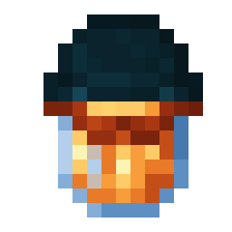{ width=48 } | `icons/torchberry_preserve.png` | Torchberry Preserve | [Pages](https://oculifelis.github.io/mod-wiki/description/slowlight/icons/torchberry_preserve.png) / [raw](https://raw.githubusercontent.com/Oculifelis/mod-wiki/main/docs/description/slowlight/icons/torchberry_preserve.png) |
| 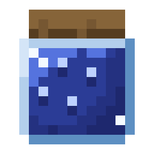{ width=48 } | `icons/blue_berry_preserve.png` | Blue Berry Preserve | [Pages](https://oculifelis.github.io/mod-wiki/description/slowlight/icons/blue_berry_preserve.png) / [raw](https://raw.githubusercontent.com/Oculifelis/mod-wiki/main/docs/description/slowlight/icons/blue_berry_preserve.png) |
| 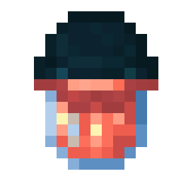{ width=48 } | `icons/raspberry_preserve.png` | Raspberry Preserve | [Pages](https://oculifelis.github.io/mod-wiki/description/slowlight/icons/raspberry_preserve.png) / [raw](https://raw.githubusercontent.com/Oculifelis/mod-wiki/main/docs/description/slowlight/icons/raspberry_preserve.png) |
| 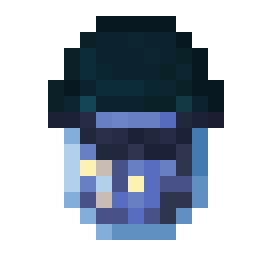{ width=48 } | `icons/twilight_blueberry_preserve.png` | Twilight Blueberry Preserve | [Pages](https://oculifelis.github.io/mod-wiki/description/slowlight/icons/twilight_blueberry_preserve.png) / [raw](https://raw.githubusercontent.com/Oculifelis/mod-wiki/main/docs/description/slowlight/icons/twilight_blueberry_preserve.png) |
| 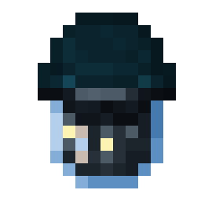{ width=48 } | `icons/blackberry_preserve.png` | Blackberry Preserve | [Pages](https://oculifelis.github.io/mod-wiki/description/slowlight/icons/blackberry_preserve.png) / [raw](https://raw.githubusercontent.com/Oculifelis/mod-wiki/main/docs/description/slowlight/icons/blackberry_preserve.png) |
| 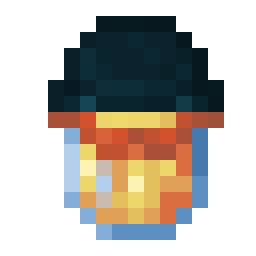{ width=48 } | `icons/maloberry_preserve.png` | Maloberry Preserve | [Pages](https://oculifelis.github.io/mod-wiki/description/slowlight/icons/maloberry_preserve.png) / [raw](https://raw.githubusercontent.com/Oculifelis/mod-wiki/main/docs/description/slowlight/icons/maloberry_preserve.png) |
| 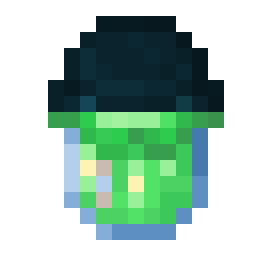{ width=48 } | `icons/blightberry_preserve.png` | Blightberry Preserve | [Pages](https://oculifelis.github.io/mod-wiki/description/slowlight/icons/blightberry_preserve.png) / [raw](https://raw.githubusercontent.com/Oculifelis/mod-wiki/main/docs/description/slowlight/icons/blightberry_preserve.png) |
| 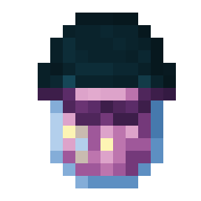{ width=48 } | `icons/duskberry_preserve.png` | Duskberry Preserve | [Pages](https://oculifelis.github.io/mod-wiki/description/slowlight/icons/duskberry_preserve.png) / [raw](https://raw.githubusercontent.com/Oculifelis/mod-wiki/main/docs/description/slowlight/icons/duskberry_preserve.png) |
| 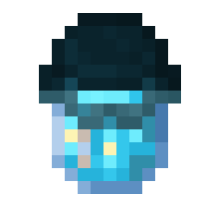{ width=48 } | `icons/skyberry_preserve.png` | Skyberry Preserve | [Pages](https://oculifelis.github.io/mod-wiki/description/slowlight/icons/skyberry_preserve.png) / [raw](https://raw.githubusercontent.com/Oculifelis/mod-wiki/main/docs/description/slowlight/icons/skyberry_preserve.png) |
| 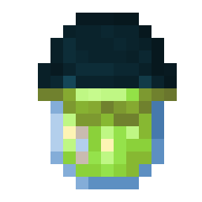{ width=48 } | `icons/stingberry_preserve.png` | Stingberry Preserve | [Pages](https://oculifelis.github.io/mod-wiki/description/slowlight/icons/stingberry_preserve.png) / [raw](https://raw.githubusercontent.com/Oculifelis/mod-wiki/main/docs/description/slowlight/icons/stingberry_preserve.png) |
| 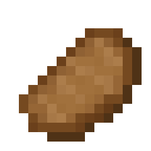{ width=48 } | `icons/cured_hydra_chop.png` | Cured Hydra Chop | [Pages](https://oculifelis.github.io/mod-wiki/description/slowlight/icons/cured_hydra_chop.png) / [raw](https://raw.githubusercontent.com/Oculifelis/mod-wiki/main/docs/description/slowlight/icons/cured_hydra_chop.png) |
| { width=48 } | `icons/cured_gwibling.png` | Cured Gwibling | [Pages](https://oculifelis.github.io/mod-wiki/description/slowlight/icons/cured_gwibling.png) / [raw](https://raw.githubusercontent.com/Oculifelis/mod-wiki/main/docs/description/slowlight/icons/cured_gwibling.png) |
| { width=48 } | `icons/cured_dweller_steak.png` | Cured Dweller Steak | [Pages](https://oculifelis.github.io/mod-wiki/description/slowlight/icons/cured_dweller_steak.png) / [raw](https://raw.githubusercontent.com/Oculifelis/mod-wiki/main/docs/description/slowlight/icons/cured_dweller_steak.png) |
| { width=48 } | `icons/cured_gloomper_leg.png` | Cured Gloomper Leg | [Pages](https://oculifelis.github.io/mod-wiki/description/slowlight/icons/cured_gloomper_leg.png) / [raw](https://raw.githubusercontent.com/Oculifelis/mod-wiki/main/docs/description/slowlight/icons/cured_gloomper_leg.png) |
| { width=48 } | `icons/ditchbulb_preserve.png` | Ditchbulb Preserve | [Pages](https://oculifelis.github.io/mod-wiki/description/slowlight/icons/ditchbulb_preserve.png) / [raw](https://raw.githubusercontent.com/Oculifelis/mod-wiki/main/docs/description/slowlight/icons/ditchbulb_preserve.png) |
| { width=48 } | `icons/candied_droopfruit.png` | Candied Droopfruit | [Pages](https://oculifelis.github.io/mod-wiki/description/slowlight/icons/candied_droopfruit.png) / [raw](https://raw.githubusercontent.com/Oculifelis/mod-wiki/main/docs/description/slowlight/icons/candied_droopfruit.png) |
| { width=48 } | `icons/dried_glitterkelp.png` | Dried Glitterkelp | [Pages](https://oculifelis.github.io/mod-wiki/description/slowlight/icons/dried_glitterkelp.png) / [raw](https://raw.githubusercontent.com/Oculifelis/mod-wiki/main/docs/description/slowlight/icons/dried_glitterkelp.png) |
| { width=48 } | `icons/white_apple_cider.png` | White Apple Cider | [Pages](https://oculifelis.github.io/mod-wiki/description/slowlight/icons/white_apple_cider.png) / [raw](https://raw.githubusercontent.com/Oculifelis/mod-wiki/main/docs/description/slowlight/icons/white_apple_cider.png) |
| { width=48 } | `icons/enchanted_berry_preserve.png` | Enchanted Berry Preserve | [Pages](https://oculifelis.github.io/mod-wiki/description/slowlight/icons/enchanted_berry_preserve.png) / [raw](https://raw.githubusercontent.com/Oculifelis/mod-wiki/main/docs/description/slowlight/icons/enchanted_berry_preserve.png) |
| { width=48 } | `icons/aechor_petal_tea.png` | Aechor Petal Tea | [Pages](https://oculifelis.github.io/mod-wiki/description/slowlight/icons/aechor_petal_tea.png) / [raw](https://raw.githubusercontent.com/Oculifelis/mod-wiki/main/docs/description/slowlight/icons/aechor_petal_tea.png) |
| { width=48 } | `icons/aerial_berry_preserve.png` | Aerial Berry Preserve | [Pages](https://oculifelis.github.io/mod-wiki/description/slowlight/icons/aerial_berry_preserve.png) / [raw](https://raw.githubusercontent.com/Oculifelis/mod-wiki/main/docs/description/slowlight/icons/aerial_berry_preserve.png) |
| { width=48 } | `icons/ruby_aerial_berry_preserve.png` | Ruby Aerial Berry Preserve | [Pages](https://oculifelis.github.io/mod-wiki/description/slowlight/icons/ruby_aerial_berry_preserve.png) / [raw](https://raw.githubusercontent.com/Oculifelis/mod-wiki/main/docs/description/slowlight/icons/ruby_aerial_berry_preserve.png) |
| { width=48 } | `icons/volucite_aerial_berry_preserve.png` | Volucite Aerial Berry Preserve | [Pages](https://oculifelis.github.io/mod-wiki/description/slowlight/icons/volucite_aerial_berry_preserve.png) / [raw](https://raw.githubusercontent.com/Oculifelis/mod-wiki/main/docs/description/slowlight/icons/volucite_aerial_berry_preserve.png) |
| { width=48 } | `icons/vibrant_aerial_berry_preserve.png` | Vibrant Aerial Berry Preserve | [Pages](https://oculifelis.github.io/mod-wiki/description/slowlight/icons/vibrant_aerial_berry_preserve.png) / [raw](https://raw.githubusercontent.com/Oculifelis/mod-wiki/main/docs/description/slowlight/icons/vibrant_aerial_berry_preserve.png) |
| { width=48 } | `icons/shadow_fruit_preserve.png` | Shadow Fruit Preserve | [Pages](https://oculifelis.github.io/mod-wiki/description/slowlight/icons/shadow_fruit_preserve.png) / [raw](https://raw.githubusercontent.com/Oculifelis/mod-wiki/main/docs/description/slowlight/icons/shadow_fruit_preserve.png) |
| { width=48 } | `icons/candied_glowing_stick_fruit.png` | Candied Glowing Stick Fruit | [Pages](https://oculifelis.github.io/mod-wiki/description/slowlight/icons/candied_glowing_stick_fruit.png) / [raw](https://raw.githubusercontent.com/Oculifelis/mod-wiki/main/docs/description/slowlight/icons/candied_glowing_stick_fruit.png) |
| { width=48 } | `icons/stellar_rock_sugar.png` | Stellar Rock Sugar | [Pages](https://oculifelis.github.io/mod-wiki/description/slowlight/icons/stellar_rock_sugar.png) / [raw](https://raw.githubusercontent.com/Oculifelis/mod-wiki/main/docs/description/slowlight/icons/stellar_rock_sugar.png) |
| { width=48 } | `icons/cured_phantom_meat.png` | Cured Phantom Meat | [Pages](https://oculifelis.github.io/mod-wiki/description/slowlight/icons/cured_phantom_meat.png) / [raw](https://raw.githubusercontent.com/Oculifelis/mod-wiki/main/docs/description/slowlight/icons/cured_phantom_meat.png) |
| { width=48 } | `icons/cured_turtle_meat.png` | Cured Turtle Meat | [Pages](https://oculifelis.github.io/mod-wiki/description/slowlight/icons/cured_turtle_meat.png) / [raw](https://raw.githubusercontent.com/Oculifelis/mod-wiki/main/docs/description/slowlight/icons/cured_turtle_meat.png) |
| { width=48 } | `icons/stellar_rusk.png` | Stellar Rusk | [Pages](https://oculifelis.github.io/mod-wiki/description/slowlight/icons/stellar_rusk.png) / [raw](https://raw.githubusercontent.com/Oculifelis/mod-wiki/main/docs/description/slowlight/icons/stellar_rusk.png) |

## Block and model renders (256 px, isometric)

| | File | Shows | Links |
|---|---|---|---|
| { width=48 } | `renders/patient_kiln.png` | Patient Kiln | [Pages](https://oculifelis.github.io/mod-wiki/description/slowlight/renders/patient_kiln.png) / [raw](https://raw.githubusercontent.com/Oculifelis/mod-wiki/main/docs/description/slowlight/renders/patient_kiln.png) |
| { width=48 } | `renders/long_kiln.png` | Long Kiln | [Pages](https://oculifelis.github.io/mod-wiki/description/slowlight/renders/long_kiln.png) / [raw](https://raw.githubusercontent.com/Oculifelis/mod-wiki/main/docs/description/slowlight/renders/long_kiln.png) |
| { width=48 } | `renders/ember_kiln.png` | Ember Kiln | [Pages](https://oculifelis.github.io/mod-wiki/description/slowlight/renders/ember_kiln.png) / [raw](https://raw.githubusercontent.com/Oculifelis/mod-wiki/main/docs/description/slowlight/renders/ember_kiln.png) |
| { width=48 } | `renders/sandglass.png` | Sandglass | [Pages](https://oculifelis.github.io/mod-wiki/description/slowlight/renders/sandglass.png) / [raw](https://raw.githubusercontent.com/Oculifelis/mod-wiki/main/docs/description/slowlight/renders/sandglass.png) |
| { width=48 } | `renders/sundial.png` | Sundial | [Pages](https://oculifelis.github.io/mod-wiki/description/slowlight/renders/sundial.png) / [raw](https://raw.githubusercontent.com/Oculifelis/mod-wiki/main/docs/description/slowlight/renders/sundial.png) |
| { width=48 } | `renders/keepsake_urn.png` | Keepsake Urn | [Pages](https://oculifelis.github.io/mod-wiki/description/slowlight/renders/keepsake_urn.png) / [raw](https://raw.githubusercontent.com/Oculifelis/mod-wiki/main/docs/description/slowlight/renders/keepsake_urn.png) |
| { width=48 } | `renders/gloamwood_log.png` | Gloamwood Log | [Pages](https://oculifelis.github.io/mod-wiki/description/slowlight/renders/gloamwood_log.png) / [raw](https://raw.githubusercontent.com/Oculifelis/mod-wiki/main/docs/description/slowlight/renders/gloamwood_log.png) |
| { width=48 } | `renders/gloamwood_wood.png` | Gloamwood Wood | [Pages](https://oculifelis.github.io/mod-wiki/description/slowlight/renders/gloamwood_wood.png) / [raw](https://raw.githubusercontent.com/Oculifelis/mod-wiki/main/docs/description/slowlight/renders/gloamwood_wood.png) |
| { width=48 } | `renders/stripped_gloamwood_log.png` | Stripped Gloamwood Log | [Pages](https://oculifelis.github.io/mod-wiki/description/slowlight/renders/stripped_gloamwood_log.png) / [raw](https://raw.githubusercontent.com/Oculifelis/mod-wiki/main/docs/description/slowlight/renders/stripped_gloamwood_log.png) |
| { width=48 } | `renders/stripped_gloamwood_wood.png` | Stripped Gloamwood Wood | [Pages](https://oculifelis.github.io/mod-wiki/description/slowlight/renders/stripped_gloamwood_wood.png) / [raw](https://raw.githubusercontent.com/Oculifelis/mod-wiki/main/docs/description/slowlight/renders/stripped_gloamwood_wood.png) |
| { width=48 } | `renders/gloamwood_planks.png` | Gloamwood Planks | [Pages](https://oculifelis.github.io/mod-wiki/description/slowlight/renders/gloamwood_planks.png) / [raw](https://raw.githubusercontent.com/Oculifelis/mod-wiki/main/docs/description/slowlight/renders/gloamwood_planks.png) |
| { width=48 } | `renders/gloamwood_stairs.png` | Gloamwood Stairs | [Pages](https://oculifelis.github.io/mod-wiki/description/slowlight/renders/gloamwood_stairs.png) / [raw](https://raw.githubusercontent.com/Oculifelis/mod-wiki/main/docs/description/slowlight/renders/gloamwood_stairs.png) |
| { width=48 } | `renders/gloamwood_slab.png` | Gloamwood Slab | [Pages](https://oculifelis.github.io/mod-wiki/description/slowlight/renders/gloamwood_slab.png) / [raw](https://raw.githubusercontent.com/Oculifelis/mod-wiki/main/docs/description/slowlight/renders/gloamwood_slab.png) |
| { width=48 } | `renders/gloamwood_fence.png` | Gloamwood Fence | [Pages](https://oculifelis.github.io/mod-wiki/description/slowlight/renders/gloamwood_fence.png) / [raw](https://raw.githubusercontent.com/Oculifelis/mod-wiki/main/docs/description/slowlight/renders/gloamwood_fence.png) |
| { width=48 } | `renders/gloamwood_fence_gate.png` | Gloamwood Fence Gate | [Pages](https://oculifelis.github.io/mod-wiki/description/slowlight/renders/gloamwood_fence_gate.png) / [raw](https://raw.githubusercontent.com/Oculifelis/mod-wiki/main/docs/description/slowlight/renders/gloamwood_fence_gate.png) |
| { width=48 } | `renders/gloamwood_trapdoor.png` | Gloamwood Trapdoor | [Pages](https://oculifelis.github.io/mod-wiki/description/slowlight/renders/gloamwood_trapdoor.png) / [raw](https://raw.githubusercontent.com/Oculifelis/mod-wiki/main/docs/description/slowlight/renders/gloamwood_trapdoor.png) |
| { width=48 } | `renders/gloamwood_button.png` | Gloamwood Button | [Pages](https://oculifelis.github.io/mod-wiki/description/slowlight/renders/gloamwood_button.png) / [raw](https://raw.githubusercontent.com/Oculifelis/mod-wiki/main/docs/description/slowlight/renders/gloamwood_button.png) |
| { width=48 } | `renders/gloamwood_pressure_plate.png` | Gloamwood Pressure Plate | [Pages](https://oculifelis.github.io/mod-wiki/description/slowlight/renders/gloamwood_pressure_plate.png) / [raw](https://raw.githubusercontent.com/Oculifelis/mod-wiki/main/docs/description/slowlight/renders/gloamwood_pressure_plate.png) |
| { width=48 } | `renders/gloamwood_leaves.png` | Gloamwood Leaves | [Pages](https://oculifelis.github.io/mod-wiki/description/slowlight/renders/gloamwood_leaves.png) / [raw](https://raw.githubusercontent.com/Oculifelis/mod-wiki/main/docs/description/slowlight/renders/gloamwood_leaves.png) |
| { width=48 } | `renders/lanternfruit_lamp.png` | Lanternfruit Lamp | [Pages](https://oculifelis.github.io/mod-wiki/description/slowlight/renders/lanternfruit_lamp.png) / [raw](https://raw.githubusercontent.com/Oculifelis/mod-wiki/main/docs/description/slowlight/renders/lanternfruit_lamp.png) |
| { width=48 } | `renders/faded_gloamwood_planks.png` | Faded Gloamwood Planks | [Pages](https://oculifelis.github.io/mod-wiki/description/slowlight/renders/faded_gloamwood_planks.png) / [raw](https://raw.githubusercontent.com/Oculifelis/mod-wiki/main/docs/description/slowlight/renders/faded_gloamwood_planks.png) |
| { width=48 } | `renders/weathered_gloamwood_planks.png` | Weathered Gloamwood Planks | [Pages](https://oculifelis.github.io/mod-wiki/description/slowlight/renders/weathered_gloamwood_planks.png) / [raw](https://raw.githubusercontent.com/Oculifelis/mod-wiki/main/docs/description/slowlight/renders/weathered_gloamwood_planks.png) |
| { width=48 } | `renders/silvered_gloamwood_planks.png` | Silvered Gloamwood Planks | [Pages](https://oculifelis.github.io/mod-wiki/description/slowlight/renders/silvered_gloamwood_planks.png) / [raw](https://raw.githubusercontent.com/Oculifelis/mod-wiki/main/docs/description/slowlight/renders/silvered_gloamwood_planks.png) |
| { width=48 } | `renders/flower_press.png` | Flower Press | [Pages](https://oculifelis.github.io/mod-wiki/description/slowlight/renders/flower_press.png) / [raw](https://raw.githubusercontent.com/Oculifelis/mod-wiki/main/docs/description/slowlight/renders/flower_press.png) |
| { width=48 } | `renders/slow_candle.png` | Slow Candle | [Pages](https://oculifelis.github.io/mod-wiki/description/slowlight/renders/slow_candle.png) / [raw](https://raw.githubusercontent.com/Oculifelis/mod-wiki/main/docs/description/slowlight/renders/slow_candle.png) |
| { width=48 } | `renders/gloamwood_bookshelf.png` | Gloamwood Bookshelf | [Pages](https://oculifelis.github.io/mod-wiki/description/slowlight/renders/gloamwood_bookshelf.png) / [raw](https://raw.githubusercontent.com/Oculifelis/mod-wiki/main/docs/description/slowlight/renders/gloamwood_bookshelf.png) |
| { width=48 } | `renders/lapse_block.png` | Lapse Block | [Pages](https://oculifelis.github.io/mod-wiki/description/slowlight/renders/lapse_block.png) / [raw](https://raw.githubusercontent.com/Oculifelis/mod-wiki/main/docs/description/slowlight/renders/lapse_block.png) |
| { width=48 } | `renders/slowlight_shard_block.png` | Block of Slowlight Shard | [Pages](https://oculifelis.github.io/mod-wiki/description/slowlight/renders/slowlight_shard_block.png) / [raw](https://raw.githubusercontent.com/Oculifelis/mod-wiki/main/docs/description/slowlight/renders/slowlight_shard_block.png) |
| { width=48 } | `renders/slowlight_shard_block_chiseled.png` | Chiseled Block of Slowlight Shard | [Pages](https://oculifelis.github.io/mod-wiki/description/slowlight/renders/slowlight_shard_block_chiseled.png) / [raw](https://raw.githubusercontent.com/Oculifelis/mod-wiki/main/docs/description/slowlight/renders/slowlight_shard_block_chiseled.png) |
| { width=48 } | `renders/slowlight_shard_block_chiseled_cubes.png` | Chiseled Cubes Block of Slowlight Shard | [Pages](https://oculifelis.github.io/mod-wiki/description/slowlight/renders/slowlight_shard_block_chiseled_cubes.png) / [raw](https://raw.githubusercontent.com/Oculifelis/mod-wiki/main/docs/description/slowlight/renders/slowlight_shard_block_chiseled_cubes.png) |
| { width=48 } | `renders/slowlight_shard_block_diagonal_tiles.png` | Diagonal Tiles Block of Slowlight Shard | [Pages](https://oculifelis.github.io/mod-wiki/description/slowlight/renders/slowlight_shard_block_diagonal_tiles.png) / [raw](https://raw.githubusercontent.com/Oculifelis/mod-wiki/main/docs/description/slowlight/renders/slowlight_shard_block_diagonal_tiles.png) |
| { width=48 } | `renders/slowlight_shard_block_grid.png` | Grid Block of Slowlight Shard | [Pages](https://oculifelis.github.io/mod-wiki/description/slowlight/renders/slowlight_shard_block_grid.png) / [raw](https://raw.githubusercontent.com/Oculifelis/mod-wiki/main/docs/description/slowlight/renders/slowlight_shard_block_grid.png) |
| { width=48 } | `renders/slowlight_shard_block_jewel_block.png` | Jewel Block Block of Slowlight Shard | [Pages](https://oculifelis.github.io/mod-wiki/description/slowlight/renders/slowlight_shard_block_jewel_block.png) / [raw](https://raw.githubusercontent.com/Oculifelis/mod-wiki/main/docs/description/slowlight/renders/slowlight_shard_block_jewel_block.png) |
| { width=48 } | `renders/slowlight_shard_block_polished.png` | Polished Block of Slowlight Shard | [Pages](https://oculifelis.github.io/mod-wiki/description/slowlight/renders/slowlight_shard_block_polished.png) / [raw](https://raw.githubusercontent.com/Oculifelis/mod-wiki/main/docs/description/slowlight/renders/slowlight_shard_block_polished.png) |
| { width=48 } | `renders/slowlight_shard_block_rhombuses.png` | Rhombuses Block of Slowlight Shard | [Pages](https://oculifelis.github.io/mod-wiki/description/slowlight/renders/slowlight_shard_block_rhombuses.png) / [raw](https://raw.githubusercontent.com/Oculifelis/mod-wiki/main/docs/description/slowlight/renders/slowlight_shard_block_rhombuses.png) |
| { width=48 } | `renders/slowlight_shard_block_shiny.png` | Shiny Block of Slowlight Shard | [Pages](https://oculifelis.github.io/mod-wiki/description/slowlight/renders/slowlight_shard_block_shiny.png) / [raw](https://raw.githubusercontent.com/Oculifelis/mod-wiki/main/docs/description/slowlight/renders/slowlight_shard_block_shiny.png) |
| { width=48 } | `renders/slowlight_shard_block_shiny_bordered.png` | Shiny Bordered Block of Slowlight Shard | [Pages](https://oculifelis.github.io/mod-wiki/description/slowlight/renders/slowlight_shard_block_shiny_bordered.png) / [raw](https://raw.githubusercontent.com/Oculifelis/mod-wiki/main/docs/description/slowlight/renders/slowlight_shard_block_shiny_bordered.png) |
| { width=48 } | `renders/slowlight_shard_block_small_tiles.png` | Small Tiles Block of Slowlight Shard | [Pages](https://oculifelis.github.io/mod-wiki/description/slowlight/renders/slowlight_shard_block_small_tiles.png) / [raw](https://raw.githubusercontent.com/Oculifelis/mod-wiki/main/docs/description/slowlight/renders/slowlight_shard_block_small_tiles.png) |
| { width=48 } | `renders/slowlight_shard_block_smooth.png` | Smooth Block of Slowlight Shard | [Pages](https://oculifelis.github.io/mod-wiki/description/slowlight/renders/slowlight_shard_block_smooth.png) / [raw](https://raw.githubusercontent.com/Oculifelis/mod-wiki/main/docs/description/slowlight/renders/slowlight_shard_block_smooth.png) |
| { width=48 } | `renders/still_shard_block.png` | Block of Still Shard | [Pages](https://oculifelis.github.io/mod-wiki/description/slowlight/renders/still_shard_block.png) / [raw](https://raw.githubusercontent.com/Oculifelis/mod-wiki/main/docs/description/slowlight/renders/still_shard_block.png) |
| { width=48 } | `renders/still_shard_block_chiseled.png` | Chiseled Block of Still Shard | [Pages](https://oculifelis.github.io/mod-wiki/description/slowlight/renders/still_shard_block_chiseled.png) / [raw](https://raw.githubusercontent.com/Oculifelis/mod-wiki/main/docs/description/slowlight/renders/still_shard_block_chiseled.png) |
| { width=48 } | `renders/still_shard_block_chiseled_cubes.png` | Chiseled Cubes Block of Still Shard | [Pages](https://oculifelis.github.io/mod-wiki/description/slowlight/renders/still_shard_block_chiseled_cubes.png) / [raw](https://raw.githubusercontent.com/Oculifelis/mod-wiki/main/docs/description/slowlight/renders/still_shard_block_chiseled_cubes.png) |
| { width=48 } | `renders/still_shard_block_diagonal_tiles.png` | Diagonal Tiles Block of Still Shard | [Pages](https://oculifelis.github.io/mod-wiki/description/slowlight/renders/still_shard_block_diagonal_tiles.png) / [raw](https://raw.githubusercontent.com/Oculifelis/mod-wiki/main/docs/description/slowlight/renders/still_shard_block_diagonal_tiles.png) |
| { width=48 } | `renders/still_shard_block_grid.png` | Grid Block of Still Shard | [Pages](https://oculifelis.github.io/mod-wiki/description/slowlight/renders/still_shard_block_grid.png) / [raw](https://raw.githubusercontent.com/Oculifelis/mod-wiki/main/docs/description/slowlight/renders/still_shard_block_grid.png) |
| { width=48 } | `renders/still_shard_block_jewel_block.png` | Jewel Block Block of Still Shard | [Pages](https://oculifelis.github.io/mod-wiki/description/slowlight/renders/still_shard_block_jewel_block.png) / [raw](https://raw.githubusercontent.com/Oculifelis/mod-wiki/main/docs/description/slowlight/renders/still_shard_block_jewel_block.png) |
| { width=48 } | `renders/still_shard_block_polished.png` | Polished Block of Still Shard | [Pages](https://oculifelis.github.io/mod-wiki/description/slowlight/renders/still_shard_block_polished.png) / [raw](https://raw.githubusercontent.com/Oculifelis/mod-wiki/main/docs/description/slowlight/renders/still_shard_block_polished.png) |
| { width=48 } | `renders/still_shard_block_rhombuses.png` | Rhombuses Block of Still Shard | [Pages](https://oculifelis.github.io/mod-wiki/description/slowlight/renders/still_shard_block_rhombuses.png) / [raw](https://raw.githubusercontent.com/Oculifelis/mod-wiki/main/docs/description/slowlight/renders/still_shard_block_rhombuses.png) |
| { width=48 } | `renders/still_shard_block_shiny.png` | Shiny Block of Still Shard | [Pages](https://oculifelis.github.io/mod-wiki/description/slowlight/renders/still_shard_block_shiny.png) / [raw](https://raw.githubusercontent.com/Oculifelis/mod-wiki/main/docs/description/slowlight/renders/still_shard_block_shiny.png) |
| { width=48 } | `renders/still_shard_block_shiny_bordered.png` | Shiny Bordered Block of Still Shard | [Pages](https://oculifelis.github.io/mod-wiki/description/slowlight/renders/still_shard_block_shiny_bordered.png) / [raw](https://raw.githubusercontent.com/Oculifelis/mod-wiki/main/docs/description/slowlight/renders/still_shard_block_shiny_bordered.png) |
| { width=48 } | `renders/still_shard_block_small_tiles.png` | Small Tiles Block of Still Shard | [Pages](https://oculifelis.github.io/mod-wiki/description/slowlight/renders/still_shard_block_small_tiles.png) / [raw](https://raw.githubusercontent.com/Oculifelis/mod-wiki/main/docs/description/slowlight/renders/still_shard_block_small_tiles.png) |
| { width=48 } | `renders/still_shard_block_smooth.png` | Smooth Block of Still Shard | [Pages](https://oculifelis.github.io/mod-wiki/description/slowlight/renders/still_shard_block_smooth.png) / [raw](https://raw.githubusercontent.com/Oculifelis/mod-wiki/main/docs/description/slowlight/renders/still_shard_block_smooth.png) |
| { width=48 } | `renders/gloamwood_planks_beams.png` | Beams Gloamwood Planks | [Pages](https://oculifelis.github.io/mod-wiki/description/slowlight/renders/gloamwood_planks_beams.png) / [raw](https://raw.githubusercontent.com/Oculifelis/mod-wiki/main/docs/description/slowlight/renders/gloamwood_planks_beams.png) |
| { width=48 } | `renders/gloamwood_planks_brick_pattern.png` | Brick Pattern Gloamwood Planks | [Pages](https://oculifelis.github.io/mod-wiki/description/slowlight/renders/gloamwood_planks_brick_pattern.png) / [raw](https://raw.githubusercontent.com/Oculifelis/mod-wiki/main/docs/description/slowlight/renders/gloamwood_planks_brick_pattern.png) |
| { width=48 } | `renders/gloamwood_planks_brick_paving.png` | Brick Paving Gloamwood Planks | [Pages](https://oculifelis.github.io/mod-wiki/description/slowlight/renders/gloamwood_planks_brick_paving.png) / [raw](https://raw.githubusercontent.com/Oculifelis/mod-wiki/main/docs/description/slowlight/renders/gloamwood_planks_brick_paving.png) |
| { width=48 } | `renders/gloamwood_planks_bricks.png` | Bricks Gloamwood Planks | [Pages](https://oculifelis.github.io/mod-wiki/description/slowlight/renders/gloamwood_planks_bricks.png) / [raw](https://raw.githubusercontent.com/Oculifelis/mod-wiki/main/docs/description/slowlight/renders/gloamwood_planks_bricks.png) |
| { width=48 } | `renders/gloamwood_planks_crate.png` | Crate Gloamwood Planks | [Pages](https://oculifelis.github.io/mod-wiki/description/slowlight/renders/gloamwood_planks_crate.png) / [raw](https://raw.githubusercontent.com/Oculifelis/mod-wiki/main/docs/description/slowlight/renders/gloamwood_planks_crate.png) |
| { width=48 } | `renders/gloamwood_planks_diagonal_stripes.png` | Diagonal Stripes Gloamwood Planks | [Pages](https://oculifelis.github.io/mod-wiki/description/slowlight/renders/gloamwood_planks_diagonal_stripes.png) / [raw](https://raw.githubusercontent.com/Oculifelis/mod-wiki/main/docs/description/slowlight/renders/gloamwood_planks_diagonal_stripes.png) |
| { width=48 } | `renders/gloamwood_planks_diagonal_tiles.png` | Diagonal Tiles Gloamwood Planks | [Pages](https://oculifelis.github.io/mod-wiki/description/slowlight/renders/gloamwood_planks_diagonal_tiles.png) / [raw](https://raw.githubusercontent.com/Oculifelis/mod-wiki/main/docs/description/slowlight/renders/gloamwood_planks_diagonal_tiles.png) |
| { width=48 } | `renders/gloamwood_planks_dotted.png` | Dotted Gloamwood Planks | [Pages](https://oculifelis.github.io/mod-wiki/description/slowlight/renders/gloamwood_planks_dotted.png) / [raw](https://raw.githubusercontent.com/Oculifelis/mod-wiki/main/docs/description/slowlight/renders/gloamwood_planks_dotted.png) |
| { width=48 } | `renders/gloamwood_planks_flooring.png` | Flooring Gloamwood Planks | [Pages](https://oculifelis.github.io/mod-wiki/description/slowlight/renders/gloamwood_planks_flooring.png) / [raw](https://raw.githubusercontent.com/Oculifelis/mod-wiki/main/docs/description/slowlight/renders/gloamwood_planks_flooring.png) |
| { width=48 } | `renders/gloamwood_planks_large_tiles.png` | Large Tiles Gloamwood Planks | [Pages](https://oculifelis.github.io/mod-wiki/description/slowlight/renders/gloamwood_planks_large_tiles.png) / [raw](https://raw.githubusercontent.com/Oculifelis/mod-wiki/main/docs/description/slowlight/renders/gloamwood_planks_large_tiles.png) |
| { width=48 } | `renders/gloamwood_planks_mosaic.png` | Mosaic Gloamwood Planks | [Pages](https://oculifelis.github.io/mod-wiki/description/slowlight/renders/gloamwood_planks_mosaic.png) / [raw](https://raw.githubusercontent.com/Oculifelis/mod-wiki/main/docs/description/slowlight/renders/gloamwood_planks_mosaic.png) |
| { width=48 } | `renders/gloamwood_planks_pattern.png` | Pattern Gloamwood Planks | [Pages](https://oculifelis.github.io/mod-wiki/description/slowlight/renders/gloamwood_planks_pattern.png) / [raw](https://raw.githubusercontent.com/Oculifelis/mod-wiki/main/docs/description/slowlight/renders/gloamwood_planks_pattern.png) |
| { width=48 } | `renders/gloamwood_planks_rotated_bricks.png` | Rotated Bricks Gloamwood Planks | [Pages](https://oculifelis.github.io/mod-wiki/description/slowlight/renders/gloamwood_planks_rotated_bricks.png) / [raw](https://raw.githubusercontent.com/Oculifelis/mod-wiki/main/docs/description/slowlight/renders/gloamwood_planks_rotated_bricks.png) |
| { width=48 } | `renders/gloamwood_planks_small_bricks.png` | Small Bricks Gloamwood Planks | [Pages](https://oculifelis.github.io/mod-wiki/description/slowlight/renders/gloamwood_planks_small_bricks.png) / [raw](https://raw.githubusercontent.com/Oculifelis/mod-wiki/main/docs/description/slowlight/renders/gloamwood_planks_small_bricks.png) |
| { width=48 } | `renders/gloamwood_planks_small_tiles.png` | Small Tiles Gloamwood Planks | [Pages](https://oculifelis.github.io/mod-wiki/description/slowlight/renders/gloamwood_planks_small_tiles.png) / [raw](https://raw.githubusercontent.com/Oculifelis/mod-wiki/main/docs/description/slowlight/renders/gloamwood_planks_small_tiles.png) |
| { width=48 } | `renders/gloamwood_planks_squares.png` | Squares Gloamwood Planks | [Pages](https://oculifelis.github.io/mod-wiki/description/slowlight/renders/gloamwood_planks_squares.png) / [raw](https://raw.githubusercontent.com/Oculifelis/mod-wiki/main/docs/description/slowlight/renders/gloamwood_planks_squares.png) |
| { width=48 } | `renders/gloamwood_planks_tiles.png` | Tiles Gloamwood Planks | [Pages](https://oculifelis.github.io/mod-wiki/description/slowlight/renders/gloamwood_planks_tiles.png) / [raw](https://raw.githubusercontent.com/Oculifelis/mod-wiki/main/docs/description/slowlight/renders/gloamwood_planks_tiles.png) |
| { width=48 } | `renders/gloamwood_planks_wavy.png` | Wavy Gloamwood Planks | [Pages](https://oculifelis.github.io/mod-wiki/description/slowlight/renders/gloamwood_planks_wavy.png) / [raw](https://raw.githubusercontent.com/Oculifelis/mod-wiki/main/docs/description/slowlight/renders/gloamwood_planks_wavy.png) |
| { width=48 } | `renders/gloamwood_planks_woven.png` | Woven Gloamwood Planks | [Pages](https://oculifelis.github.io/mod-wiki/description/slowlight/renders/gloamwood_planks_woven.png) / [raw](https://raw.githubusercontent.com/Oculifelis/mod-wiki/main/docs/description/slowlight/renders/gloamwood_planks_woven.png) |
| { width=48 } | `renders/patient_kiln_sealed.png` | Patient Kiln, sealed | [Pages](https://oculifelis.github.io/mod-wiki/description/slowlight/renders/patient_kiln_sealed.png) / [raw](https://raw.githubusercontent.com/Oculifelis/mod-wiki/main/docs/description/slowlight/renders/patient_kiln_sealed.png) |
| { width=48 } | `renders/long_kiln_sealed.png` | Long Kiln, bricked shut | [Pages](https://oculifelis.github.io/mod-wiki/description/slowlight/renders/long_kiln_sealed.png) / [raw](https://raw.githubusercontent.com/Oculifelis/mod-wiki/main/docs/description/slowlight/renders/long_kiln_sealed.png) |
| { width=48 } | `renders/ember_kiln_sealed.png` | Ember Kiln, sealed | [Pages](https://oculifelis.github.io/mod-wiki/description/slowlight/renders/ember_kiln_sealed.png) / [raw](https://raw.githubusercontent.com/Oculifelis/mod-wiki/main/docs/description/slowlight/renders/ember_kiln_sealed.png) |
| { width=48 } | `renders/slowlight_lantern_placed.png` | Slowlight Lantern, placed | [Pages](https://oculifelis.github.io/mod-wiki/description/slowlight/renders/slowlight_lantern_placed.png) / [raw](https://raw.githubusercontent.com/Oculifelis/mod-wiki/main/docs/description/slowlight/renders/slowlight_lantern_placed.png) |
| { width=48 } | `renders/slowlight_lantern_hanging.png` | Slowlight Lantern, hanging | [Pages](https://oculifelis.github.io/mod-wiki/description/slowlight/renders/slowlight_lantern_hanging.png) / [raw](https://raw.githubusercontent.com/Oculifelis/mod-wiki/main/docs/description/slowlight/renders/slowlight_lantern_hanging.png) |
| { width=48 } | `renders/slow_candle_1.png` | Slow Candle, nearly out | [Pages](https://oculifelis.github.io/mod-wiki/description/slowlight/renders/slow_candle_1.png) / [raw](https://raw.githubusercontent.com/Oculifelis/mod-wiki/main/docs/description/slowlight/renders/slow_candle_1.png) |
| { width=48 } | `renders/slow_candle_2.png` | Slow Candle, half burnt | [Pages](https://oculifelis.github.io/mod-wiki/description/slowlight/renders/slow_candle_2.png) / [raw](https://raw.githubusercontent.com/Oculifelis/mod-wiki/main/docs/description/slowlight/renders/slow_candle_2.png) |
| { width=48 } | `renders/slow_candle_3.png` | Slow Candle, a day burnt | [Pages](https://oculifelis.github.io/mod-wiki/description/slowlight/renders/slow_candle_3.png) / [raw](https://raw.githubusercontent.com/Oculifelis/mod-wiki/main/docs/description/slowlight/renders/slow_candle_3.png) |
| { width=48 } | `renders/slow_candle_4.png` | Slow Candle, new | [Pages](https://oculifelis.github.io/mod-wiki/description/slowlight/renders/slow_candle_4.png) / [raw](https://raw.githubusercontent.com/Oculifelis/mod-wiki/main/docs/description/slowlight/renders/slow_candle_4.png) |
