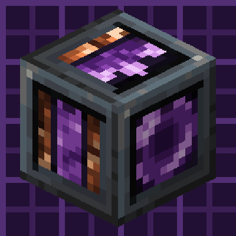

# Fieldframe Arcana

{ width="128" align=right }

Burn essentia for RF, charge wands on a chassis and take powered Thaumaturge gear into the field. Fieldframe Arcana connects [Fieldframe](../fieldframe/index.md) machines to [Thaumaturge](https://www.curseforge.com/projects/1628024).

**Requires** Fieldframe 0.1 or newer and Thaumaturge 1.1.0 or newer. Fieldframe also needs [Metallurgy: Recast](../metallurgy/index.md). Version **0.6.6** is published for NeoForge 26.1.2. [Public downloads](https://www.curseforge.com/projects/1796760)

## Machines and gear

Chassis modules turn essentia into RF, buy vis with RF, draw from the aura, condense vis crystals and scrub flux. The Vis Cradle uses relay networks and the Etheric Crusher processes ore.

Galvanic and voltaic wand parts, the Arc Focus, a Thaumium Field Drill, a Field Saw and galvanic flight gear use stored power. The Thaumonomicon's research tab gives their recipes and use.

Tool costs, module costs, essentia fuel values and condenser conditions are datapack data, so a pack can tune the workshop's power balance.

Optional [JEI](https://www.curseforge.com/projects/238222) shows dynamo fuels, condenser conditions and module information.

**Licence:** LGPL-3.0-or-later. Inspired by Electromagic Tools without using its code or art. Third-party art keeps the terms in the jar's CREDITS.md.
