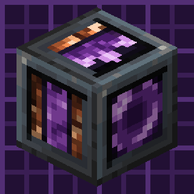

# Fieldframe Arcana

{ width="128" align=right }

Burn essentia for RF, charge wands on a chassis and take powered Thaumaturge gear into the field. Fieldframe Arcana connects [Fieldframe](../fieldframe/index.md) machines to [Thaumaturge](https://www.curseforge.com/projects/1628024).

**Requires** Fieldframe 0.3.5 or newer and Thaumaturge 1.1.0 or newer. Fieldframe also needs [Metallurgy: Recast](../metallurgy/index.md), and from Fieldframe 0.3.7 on, [Fundamentum](../fundamentum/index.md). Version **0.8.0** is for NeoForge 26.1.2 and 1.21.1. [Public downloads](https://www.curseforge.com/projects/1796760)

## Machines and gear

Chassis modules turn essentia into RF, buy vis with RF, draw from the aura, condense vis crystals and scrub flux. The Vis Cradle uses relay networks and the Etheric Crusher processes ore.

Galvanic and voltaic wand parts, a Thaumium Field Drill, a Field Saw and galvanic flight gear use stored power. The Thaumonomicon's research tab gives their recipes and use.

Arcane recipes use Metallurgy metals, such as silver for the first machines, astral silver for the condenser and scrubber, and mithril for the galvanic rod.

The Arc spell part works in any focus. A spell that holds it pays half of its vis cost in RF from a charged item in the inventory, and the full vis cost when no item can cover the RF.

Tool costs, module costs, essentia fuel values and condenser conditions are datapack data, so a pack can tune the workshop's power balance.

Optional [JEI](https://www.curseforge.com/projects/238222) shows dynamo fuels, condenser conditions and module information.

The licence is LGPL-3.0-or-later. The mod is inspired by Electromagic Tools without using its code or art. Third-party art keeps the terms in the jar's CREDITS.md.
