# Fieldframe Frameworks

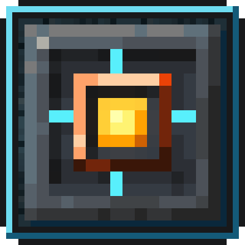{ width="128" align=right }

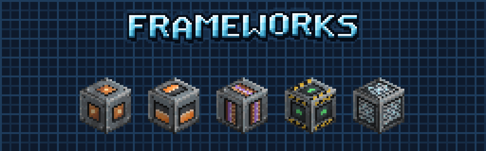

*Big multiblock machines for Fieldframe.*

Frameworks is an addon for [Fieldframe](../fieldframe/index.md) that adds big multiblock machines. You build a frame out
of casing blocks, put a core in its wall, and the whole frame turns into one machine. Fieldframe modules go on its walls
and drive it, the same way they drive a single chassis. Still no pipes and no cables.

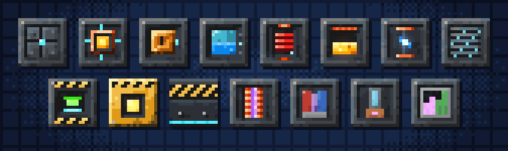

**Requires** [Fieldframe](../fieldframe/index.md) and [Metallurgy: Recast](../metallurgy/index.md). **Optional:** [JEI](https://www.curseforge.com/projects/238222),
[Jade](https://www.curseforge.com/projects/324717), [KubeJS](https://www.curseforge.com/projects/238086).

**Packages:** 0.1.5 for NeoForge 26.1.2, NeoForge 1.21.1 and Forge 1.20.1. See [Versions](../fieldframe/versions.md) and the [CurseForge project](https://www.curseforge.com/projects/1794653).

## The Grand Frame

A hollow box of 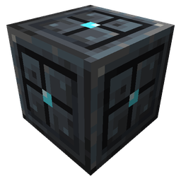{ .mc-icon .mc-inline } **Frame Casing**, anywhere from 5 to 9 blocks a side, with a 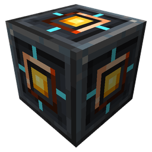{ .mc-icon .mc-inline } **Frame Core** in the shell. Every wall
casing can take a Fieldframe module, and all of them share one machine. 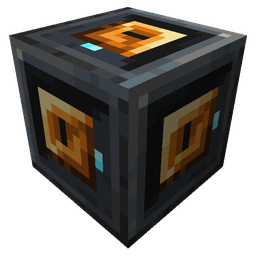{ .mc-icon .mc-inline } **Frame Vaults**, 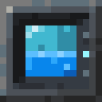{ .mc-icon .mc-inline } **Frame Tanks** and 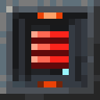{ .mc-icon .mc-inline } **Frame Cells**
inside add room for items, fluids and power. Every frame shows its state on its core, and the Engineering Field
Manual has pages for all of them.

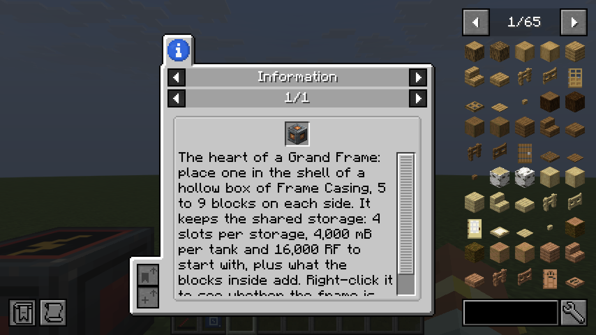

## Foundry

Put 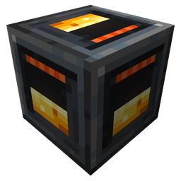{ .mc-icon .mc-inline } **Frame Crucibles** inside a frame and it becomes a Foundry. They melt metals into one pool, mix them into alloys
and pour the result into a tank.

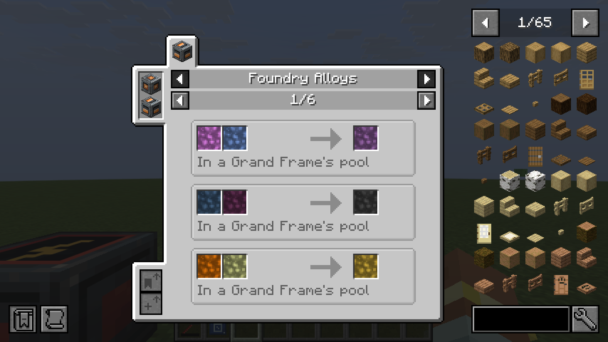

## Arc Furnace

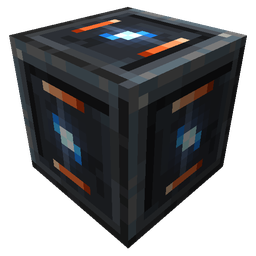{ .mc-icon .mc-inline } **Arc Electrodes** make the frame an Arc Furnace instead. Every second each electrode fires a burst of 40,000 RF that
smelts up to 16 items, and it makes steel, damascus steel, hepatizon and tartarite. A Storm Coil on the roof charges it
from lightning: 200,000 RF a strike.

## Cooling Tower

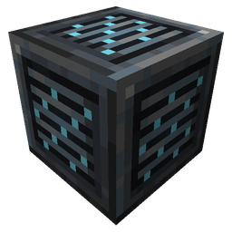{ .mc-icon .mc-inline } **Cooling Fins** turn the frame's steam back into water, so the water goes round again and a steam loop closes.

## Gantry

A 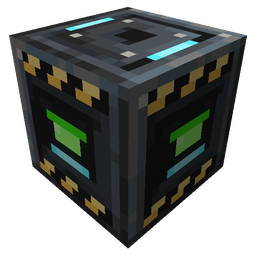{ .mc-icon .mc-inline } **Gantry Controller** sits in a ring of 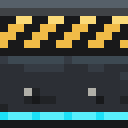{ .mc-icon .mc-inline } **Gantry Rails**, from 3 up to 64 blocks a side, and moves a { .mc-icon .mc-inline } **Gantry Head**
over the whole area. The module on the head decides the job: a Block Breaker quarries, a Crop Tender farms, a World
Fluid Pump pumps.

## Starcore

The Starcore is a fusion reactor inside 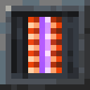{ .mc-icon .mc-inline } **Containment Coils**. Its plasma never settles on its own. You build a control
circuit to hold it, and if your program lets it drift, it goes out. Lighting it takes 5,000,000 RF.

| Picture | Part | What it does |
|---|---|---|
| 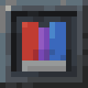{ .mc-icon } | **Field Magnet**{ #field-magnet } | 2 field per signal level, at 40 RF/t per level. A coil holds 60. |
| 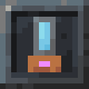{ .mc-icon } | **Plasma Injector**{ #plasma-injector } | feeds deuterium, up to 1 mB a tick, and one Ender Alloy dust per 250 mB. |
| 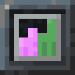{ .mc-icon } | **Plasma Probe**{ #plasma-probe } | reports pressure (0 to 15) and temperature (20 MK a level) as signals. |

Deuterium comes from Fieldframe's [Centrifuge](../fieldframe/modules.md#centrifuge): 1,000 mB of water makes 100 mB. Reactor explosions are a server setting
in `fieldframe_frameworks-server.toml`, off by default.

## For pack makers

Frameworks is built only on Fieldframe's public API. Every number is data:

| To change | Where (`data/<pack>/...`) |
|---|---|
| Frame tuning | `fieldframe_frameworks/tuning/*.json` |
| Frame components | `fieldframe/frame_components/*.json` |
| Foundry alloys | `fieldframe_frameworks/alloys/*.json` |
| Arc Furnace alloys | `fieldframe_frameworks/arc_alloys/*.json` |

KubeJS and Java addons can change the same values ([Fieldframe for pack makers](../fieldframe/pack-makers.md)).

## Credits

By **Oculifelis**.

**Licence:** LGPL-3.0-or-later.
