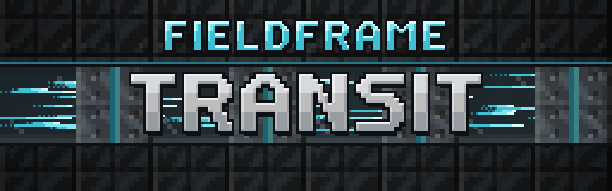
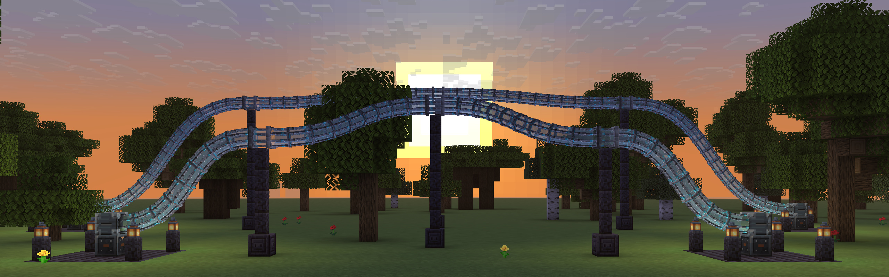
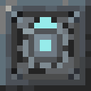
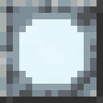
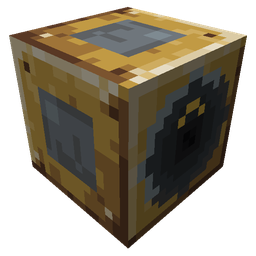
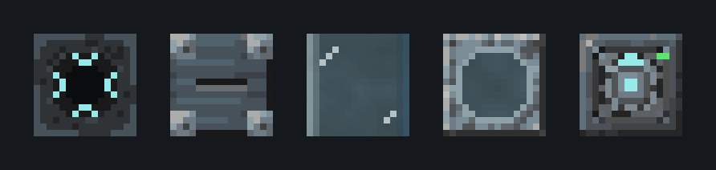

# Fieldframe Transit

*Ride glass tubes in smooth curves, and send mobs through them.*

Fieldframe Transit adds glass travel tubes to [Fieldframe](../fieldframe/index.md). Lay a tube in smooth curves from one
Tube Mouth to another, step in, and you ride it to the other end. Mobs that walk into an entrance go too, so it also
moves animals between pens.

**Requires** [Fieldframe](../fieldframe/index.md) and [Fundamentum](../fundamentum/index.md) 1.17.0
or later (which needs [Curios](https://www.curseforge.com/projects/309927)).

**Local build:** 0.2.1, for NeoForge 26.1.2 ([Versions](../fieldframe/versions.md)).

A { .mc-icon .mc-inline } **Tube Drive** module on a chassis next to the entrance pays for each trip in RF: 200 RF plus 20 RF per block of tube.
Tubes carry players and mobs only, never items, fluids or power.

| Picture | Block | What it does |
|---|---|---|
| { .mc-icon } | **[Transit Tube](#the-tubes)** | laid in smooth curves between mouths; eight come from brass and glass |
| { .mc-icon } | **[Tube Mouth](#mouths-and-the-drive)** | opens on its front and takes a tube at its back; every mouth is an exit |
| { .mc-icon } | **[Tube Drive](#mouths-and-the-drive)** | a module on a chassis next to the entrance that pays for each trip in RF |

## The tubes

Place a { .mc-icon .mc-inline } **Transit Tube** on a block and it becomes a straight one-block node. Right-click one of its free ends with
tubes in hand, then right-click another free end, or any block to put a new node there. A glowing preview shows the
curve, green when it fits and red with the reason when it doesn't. The tube bends between the ends in a smooth curve
that leaves and enters each end straight, and you keep laying from the far end. Sneak-right-click stops.

A curve costs one tube per block of its length. It can be up to 32 blocks long, can't bend tighter than one block,
can't double back, and can't pass through anything solid. Breaking any part of a curve removes the whole curve and gives
the tubes back.

Eight tubes come from brass and glass.

## Mouths and the drive

A { .mc-icon .mc-inline } **Tube Mouth** opens on its front and takes a tube at its back. Every mouth is an exit. An entrance takes in mobs that
step in front of it and players who walk in looking at it or right-click it. Sneaking never goes in, and a redstone
signal locks the entrance.

The **Tube Drive** goes on a chassis side facing an entrance mouth. It fills its own charge from the chassis and pays
each trip up front. Speed upgrades on the chassis make trips faster, and its signal can switch it off. If a trip can't
start, the mouth tells you why: no drive, no power, a dead end, an unloaded area or a blocked exit. Logging out during a
trip puts you at the exit.

## Built on Fundamentum

Transit uses Fundamentum's curve code for the shape of its tubes. Tube lengths and costs use Fieldframe's tuning data below.

## For pack makers

Every number is a Tube Drive tunable, set with Fieldframe's tuning data (`data/<ns>/fieldframe/tuning/*.json`) or
[KubeJS](https://www.curseforge.com/projects/238086) `FieldframeEvents.tuning`:

| Tunable | Default |
|---|---|
| `charge_capacity` | 20,000 RF |
| `charge_rf_per_tick` | 200 |
| `rf_per_trip` | 200 |
| `rf_per_block` | 20 |
| `speed` | 0.8 blocks per tick, times the chassis speed |
| `max_length` | 256 blocks for a whole line |

The longest curve (32) and the tightest bend (1 block) are in the server config `fieldframe_transit-server.toml`.
Recipes are plain data under `data/fieldframe_transit/recipe/`.

## Credits

By **Oculifelis**.

**Licence:** LGPL-3.0-or-later from 0.2.1. Earlier builds were All Rights Reserved.
