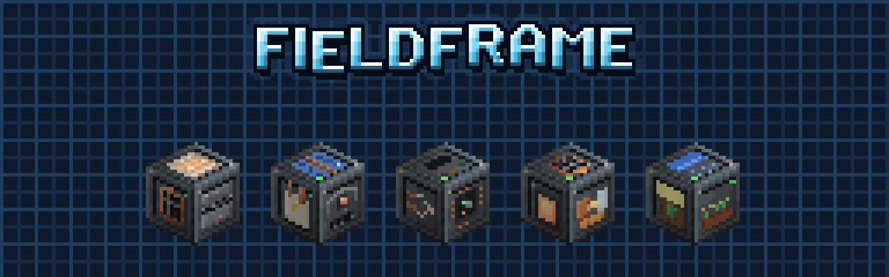
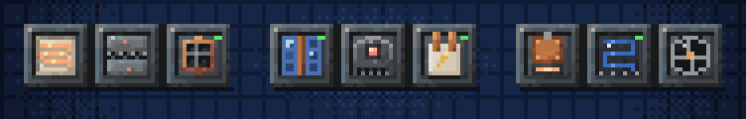
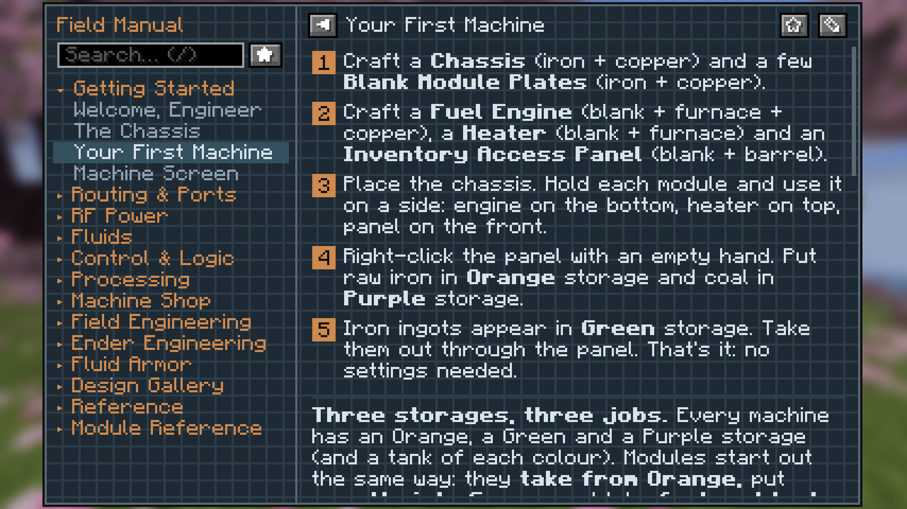

# Fieldframe

*Build each machine from parts: a chassis with a module on every side.*

Fieldframe is a tech mod where you build each machine yourself. You place a chassis and put a module on each of its six
sides, and those six modules are the machine. A Heater, a Crusher and an Item Port make an ore line. Swap the Heater for
a Fuel Engine and it's something else.

There are no pipes, cables or wireless links. A machine works with what's inside it and the blocks it touches, so a
factory is just machines standing next to each other.

**Requires** [Metallurgy: Recast](../metallurgy/index.md), for its metals, ores and dusts. **Optional:** [JEI](https://www.curseforge.com/projects/238222),
[Jade](https://www.curseforge.com/projects/324717), [KubeJS](https://www.curseforge.com/projects/238086).

**Versions:** 0.3.5 for NeoForge 26.1.2, 0.1.3 for NeoForge 1.21.1 and Forge 1.20.1. See [Versions](versions.md) and the [CurseForge project](https://www.curseforge.com/projects/1794634).

## What's in it

| Section | What's in it |
|---|---|
| **[Machines](machines.md)** | how a chassis works, tiers, upgrades, overclocking, Bolted Chassis and Blueprints |
| **[Modules](modules.md)** | all 77 modules, by kind |
| **[The Controller Plate](machines.md#the-controller-plate)** | small state programs, and Program Cards to copy them |
| **[Gear](machines.md#gear)** | [Fluid Armor](machines.md#fluid-armor), the [Arc](machines.md#arc-whip) and [Tesla Whips](machines.md#tesla-whip) and the [Graviton Hook](machines.md#graviton-hook) |
| **[For pack makers](pack-makers.md)** | datapacks, KubeJS and the Java API |

## Addons

| Addon | What it adds |
|---|---|
| **[Fieldframe Frameworks](../fieldframe-frameworks/index.md)** | big multiblock frames, a [Foundry](../fieldframe-frameworks/index.md#foundry), an [Arc Furnace](../fieldframe-frameworks/index.md#arc-furnace), a [Gantry](../fieldframe-frameworks/index.md#gantry) and the [Starcore](../fieldframe-frameworks/index.md#starcore) fusion reactor |
| **[Fieldframe Transit](../fieldframe-transit/index.md)** | glass tubes you ride from one mouth to another |

## Built on Fundamentum

On 26.1.2, optional [Fundamentum](../fundamentum/index.md) 1.22.3 or newer adds the Arc Whip, Tesla Whip and Graviton Hook. The hook has a range of 30 blocks, a shoot speed of 2.4 and pull speed of 1.1, with up to three hooks out at once.

| Override | Path | Format |
|---|---|---|
| Graviton Hook | <code>data/fieldframe/fundamentum/hooks/graviton_hook.json</code> | [Hooks](../fundamentum/datapack/hooks.md) |
| Arc Whip and Tesla Whip | <code>data/fieldframe/fundamentum/whips/{arc_whip,tesla_whip}.json</code> | [Whips](../fundamentum/datapack/whips.md) |

## The manual

The **Engineering Field Manual** is built in, so you don't need a guidebook mod. It shows each module's live numbers,
its recipes and a checklist for your first machine.

## Credits

By **Oculifelis**. Inspired by Emasher's Engineer's Toolbox, with none of its code or art. The classic EnderTech and
FLORA textures, the Painterly item templates and the NeoVitae armor art are credited in `CREDITS.md` in the jar.

**Licence:** LGPL-3.0-or-later. Third-party art keeps the terms in the jar credits.
