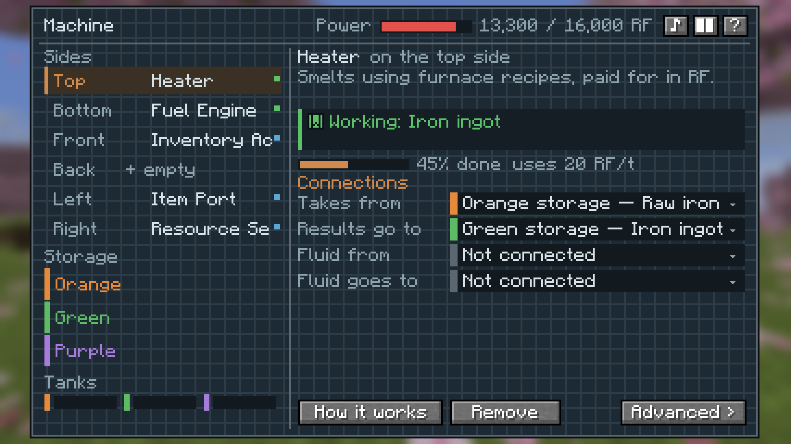
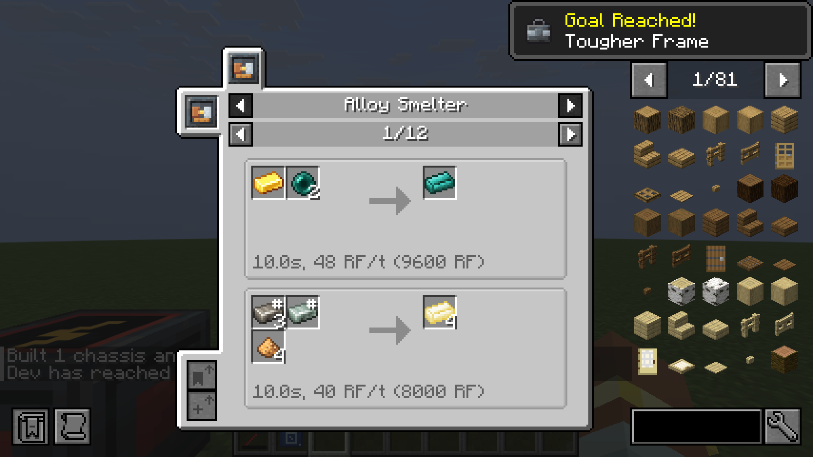

# Machines

## The chassis

Every chassis has **three item stores**, **three tanks**, an **RF buffer** and **eight signal channels**, and all six
modules on it share them. That's how a Crusher gets the ore an Item Port pulled in, or a Fuel Engine charges the buffer
a Power Terminal pays out from.

Three machines from the manual:

- **Ore line:** Heater, Crusher and Item Port.
- **Generator:** Solar Collector, Fuel Engine and Power Terminal.
- **Steam loop:** Boiler, Condenser and Steam Turbine.

Faceplates light up while a module is working, and each machine sounds like what it's doing.

## Tiers and upgrades

Chassis come in tiers: Basic, Hardened, Reinforced, Signalum and Resonant. An Upgrade Kit raises a chassis one tier in
place, and each tier is faster and holds more. Upgrades add storage, bigger tanks, more power and faster throughput.

**Overclocking** speeds a machine up but heats it, so you keep it cool with ice.

## Bigger machines

**Bolted Chassis** join two to eight chassis into one machine. **Blueprints** (Blueprint Sheets) save a machine you
built, and you can build it again from your inventory or copy one straight out of the manual.

For frames bigger than that, see [Fieldframe Frameworks](../fieldframe-frameworks/index.md).

## The Controller Plate

The Controller Plate is a module that runs a small program with states, so a machine can do one thing until something
changes and then do another. It reads and writes the chassis' eight signal channels.

A **Program Card** copies a program: sneak-use it on a Controller Plate to copy, use it on another to paste, sneak-use
it in the air to wipe it.

## Gear

- **Fluid Armor** in copper, iron, gold and Ender Alloy. Fill it with a fluid and the fluid gives you an effect.
- **Arc Whip:** a copper lash fed from a cell in the grip. Charged tip cracks shock and stagger. Each swing costs RF;
  charge it in an Item Charger.
- **Tesla Whip:** a reinforced Arc Whip. Charged cracks arc on to up to four more hostiles and stun the first.
- **Graviton Hook:** three hooks. While one holds and it has charge, gravity lets go of you: fly where you look, sneak
  to sink. Wear it in the hook slot.

## Works with

[JEI](https://www.curseforge.com/projects/238222) shows the recipes. [Jade](https://www.curseforge.com/projects/324717)
shows what a machine is doing when you look at it. Both are optional.
