# Modules

A module goes on one side of a chassis. All the modules on a chassis share its item stores, tanks, RF buffer and signal
channels. Names and descriptions are the in-game ones; the manual has each module's live numbers and recipes.

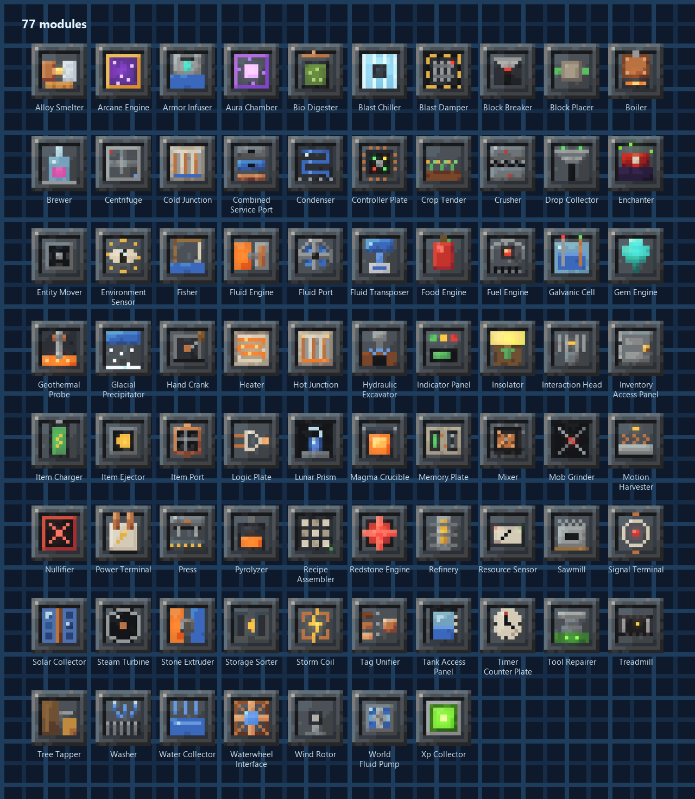

## Processing

Turn one thing into another, using items, fluids and RF from the chassis. 24 modules.

| Picture | Module | What it does |
|---|---|---|
| 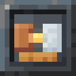{ .mc-icon } | **Alloy Smelter**{ #alloy-smelter } | Melts metals together into alloys: bronze, invar, electrum and more (Induction Smelter). |
| { .mc-icon } | **Armor Infuser**{ #armor-infuser } | Fills fluid armor in a lane with effect fluid from a reservoir (FLORA's Fluidic Armor Infuser). |
| 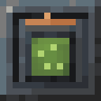{ .mc-icon } | **Bio-Digester**{ #bio-digester } | Turns seeds, saplings, leaves and other farm waste with water into biogas (for a Fluid Engine) and compost (bone meal for the Crop Tender). |
| { .mc-icon } | **Blast Chiller**{ #blast-chiller } | Freezes fluids into solids: water into ice, lava into obsidian. |
| 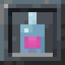{ .mc-icon } | **Brewer**{ #brewer } | Brews potions like a brewing stand, paid in RF (Alchemical Imbuer). |
| 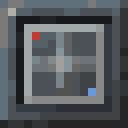{ .mc-icon } | **Centrifuge**{ #centrifuge } | Spins items (and fluids) apart into their parts (Centrifugal Separator). |
| 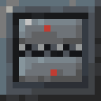{ .mc-icon } | **Crusher**{ #crusher } | Breaks items down; some recipes yield byproducts. |
| 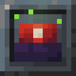{ .mc-icon } | **Enchanter**{ #enchanter } | Enchants items like an enchanting table, paid in liquid experience and RF (Arcane Ensorcellator). |
| { .mc-icon } | **Fluid Transposer**{ #fluid-transposer } | Fills containers from a reservoir or empties them into one. |
| 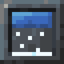{ .mc-icon } | **Glacial Precipitator**{ #glacial-precipitator } | Turns water into snow and ice with RF. |
| 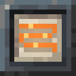{ .mc-icon } | **Heater**{ #heater } | Smelts using furnace recipes, paid for in RF. |
| 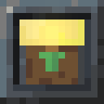{ .mc-icon } | **Insolator**{ #insolator } | Grows crops and saplings from a catalyst seed with water and RF (Phytogenic Insolator). |
| 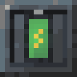{ .mc-icon } | **Item Charger**{ #item-charger } | Charges RF-holding items; full items move to the output lane (Energetic Infuser). |
| 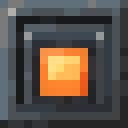{ .mc-icon } | **Magma Crucible**{ #magma-crucible } | Melts items into fluids: stone into lava, redstone into redstone flux. |
| 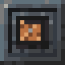{ .mc-icon } | **Mixer**{ #mixer } | Combines items with a fluid. |
| 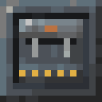{ .mc-icon } | **Press**{ #press } | Compacts and presses items. |
| 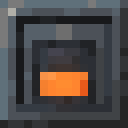{ .mc-icon } | **Pyrolyzer**{ #pyrolyzer } | Bakes coal and wood into coke and charcoal, releasing creosote (Pyrolytic Converter). |
| 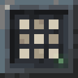{ .mc-icon } | **Recipe Assembler**{ #recipe-assembler } | Crafts from a ghost pattern using items in the input lane. |
| 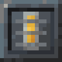{ .mc-icon } | **Refinery**{ #refinery } | Refines one fluid into another plus a solid byproduct (Fractionating Still). |
| 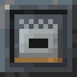{ .mc-icon } | **Sawmill**{ #sawmill } | Saws logs into planks with sawdust as a byproduct (Thermal's Sawmill). |
| { .mc-icon } | **Stone Extruder**{ #stone-extruder } | Makes cobblestone, stone or obsidian from lava and water (Igneous Extruder). |
| 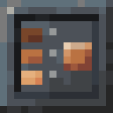{ .mc-icon } | **Tag Unifier**{ #tag-unifier } | Turns ingots, nuggets, dusts, plates and gears from any mod into the one your pack prefers (Metallurgy's, then vanilla's), for a little RF. |
| { .mc-icon } | **Tool Repairer**{ #tool-repairer } | Mends damaged tools and armour from Orange storage with liquid experience from the Orange tank, at the Mending rate; finished items go to Green. |
| 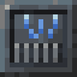{ .mc-icon } | **Washer**{ #washer } | Washes items with water to separate useful byproducts. |

## Power

Make RF into the chassis buffer. 22 modules.

| Picture | Module | What it does |
|---|---|---|
| 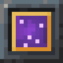{ .mc-icon } | **Arcane Engine**{ #arcane-engine } | Consumes enchanted items for RF by their enchantment levels (Disenchantment Dynamo). |
| 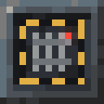{ .mc-icon } | **Blast Damper**{ #blast-damper } | Cancels explosions within 6 blocks and stores their energy (a creeper: 31,500 RF). On a Reinforced chassis it also detonates TNT from Purple storage. |
| 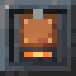{ .mc-icon } | **Boiler**{ #boiler } | Turns water from a tank into steam. Burns furnace fuel, or runs on heat alone when lava or magma touches it. |
| 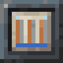{ .mc-icon } | **Cold Junction**{ #cold-junction } | The cold side for a Hot Junction on the same machine: put it against water, ice or snow. |
| 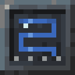{ .mc-icon } | **Condenser**{ #condenser } | Lets a Steam Turbine on the same machine return its steam as water: most of it when this side touches water, ice or snow, half in open air. |
| 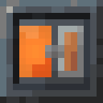{ .mc-icon } | **Fluid Engine**{ #fluid-engine } | Burns fluid fuels listed in the fuels data into RF (Magmatic/Compression Dynamo). |
| 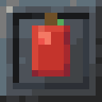{ .mc-icon } | **Food Engine**{ #food-engine } | Turns food into RF by its hunger value (Gourmand Dynamo). |
| 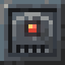{ .mc-icon } | **Fuel Engine**{ #fuel-engine } | Burns furnace fuel into the RF buffer. |
| 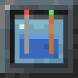{ .mc-icon } | **Galvanic Cell**{ #galvanic-cell } | A battery from two metals: the less noble one in Orange storage is used up, the nobler one in Purple stays. Needs water in the Orange tank. |
| 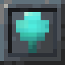{ .mc-icon } | **Gem Engine**{ #gem-engine } | Turns gems listed in the fuels data into RF (Lapidary/Numismatic Dynamo). |
| 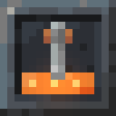{ .mc-icon } | **Geothermal Probe**{ #geothermal-probe } | Bottom side only: taps the ground's heat. Works deep down (best below height 0), much better over lava or magma, at any height in the Nether. Probes close together share the heat. |
| 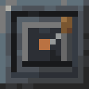{ .mc-icon } | **Hand Crank**{ #hand-crank } | Right-click it with an empty hand to turn it: 20 RF/t while it turns, for a little hunger. Hold the button to keep it going. Your first power before any fuel. |
| 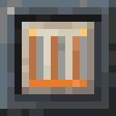{ .mc-icon } | **Hot Junction**{ #hot-junction } | Makes RF from the temperature difference between the block in front of it and the block in front of a Cold Junction on the same machine. A working Heater counts as warm. Two different metals in Purple storage (zinc and gold, say) make it up to twice as strong. |
| 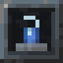{ .mc-icon } | **Lunar Prism**{ #lunar-prism } | Top side only: the Solar Collector's night twin. Makes up to 16 RF/t under a full moon, less as the moon wanes, nothing at new moon. |
| 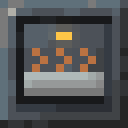{ .mc-icon } | **Motion Harvester**{ #motion-harvester } | Turns the movement of nearby creatures into a trickle of RF. |
| { .mc-icon } | **Redstone Engine**{ #redstone-engine } | Turns redstone into RF (Enervation Dynamo). |
| 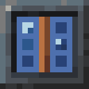{ .mc-icon } | **Solar Collector**{ #solar-collector } | Generates RF in daylight with open sky. Top face only. |
| 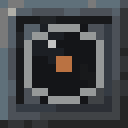{ .mc-icon } | **Steam Turbine**{ #steam-turbine } | Burns steam for RF. The rotor takes about 15 seconds to reach full speed; a Condenser on the same machine turns the spent steam back into water. |
| 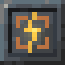{ .mc-icon } | **Storm Coil**{ #storm-coil } | Top side only, under a Lightning Rod: each strike stores 200,000 RF and feeds it to the machine. Signals each strike and how full it is. |
| { .mc-icon } | **Treadmill**{ #treadmill } | Lead an adult animal into the block in front: it walks in place for RF while it eats its food from Purple storage (a cow 6 RF/t, a fast horse up to 13). |
| 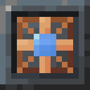{ .mc-icon } | **Waterwheel/Turbine Interface**{ #waterwheelturbine-interface } | Flowing water makes RF; turbine mode burns a stored fluid. |
| { .mc-icon } | **Wind Rotor**{ #wind-rotor } | Turns in the wind: better high up, in open air and in storms. Rotors close together share the wind. |

## World

Work on the blocks and mobs in front of them. 12 modules.

| Picture | Module | What it does |
|---|---|---|
| 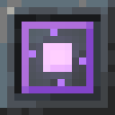{ .mc-icon } | **Aura Chamber**{ #aura-chamber } | Takes a batch of metal blocks and surrounds nearby players with that metal's effect while it runs on RF (Metallurgy's chamber). |
| 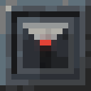{ .mc-icon } | **Block Breaker**{ #block-breaker } | Breaks the block in front with a real tool and collects the real drops. |
| 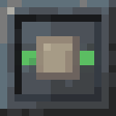{ .mc-icon } | **Block Placer**{ #block-placer } | Places blocks from a lane in front of the face. |
| 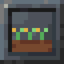{ .mc-icon } | **Crop Tender**{ #crop-tender } | Harvests ripe crops in a small area and replants them. |
| { .mc-icon } | **Entity Mover**{ #entity-mover } | Pushes or pulls creatures in front of the face. |
| 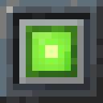{ .mc-icon } | **Experience Collector**{ #experience-collector } | Absorbs experience orbs in front into liquid experience. |
| 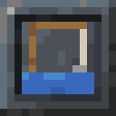{ .mc-icon } | **Fisher**{ #fisher } | Fishes from open water in front; bait speeds it up. |
| 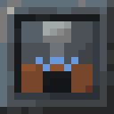{ .mc-icon } | **Hydraulic Excavator**{ #hydraulic-excavator } | Works a bounded area layer by layer with a tool, water and RF. |
| 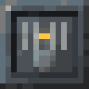{ .mc-icon } | **Interaction Head**{ #interaction-head } | Right-clicks the block in front with the held stack, as the chassis owner. |
| 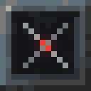{ .mc-icon } | **Mob Grinder**{ #mob-grinder } | Attacks mobs in front with the weapon in Purple storage (its enchantments count, and it wears); drops go to Green, experience to a tank. Never players; named mobs only if you allow it. |
| 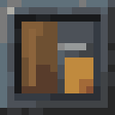{ .mc-icon } | **Tree Tapper**{ #tree-tapper } | Draws tree sap (or latex) from the log in front without harming it (Tree Extractor). |
| 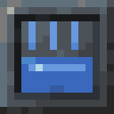{ .mc-icon } | **Water Collector**{ #water-collector } | Collects water from two or more source blocks in front (Aqueous Accumulator). |

## Handling

Move items, fluids and power in and out of the chassis. 11 modules.

| Picture | Module | What it does |
|---|---|---|
| { .mc-icon } | **Combined Service Port**{ #combined-service-port } | Item, fluid and RF access through one face, each with its own per-tick limit. |
| { .mc-icon } | **Drop Collector**{ #drop-collector } | Picks up dropped items from a small area in front of the face. |
| { .mc-icon } | **Fluid Port**{ #fluid-port } | Connects one fluid reservoir to the neighbouring tank; never mixes fluids. |
| { .mc-icon } | **Inventory Access Panel**{ #inventory-access-panel } | Lets players open the item lanes this panel permits. |
| { .mc-icon } | **Item Ejector**{ #item-ejector } | Drops items into the world in front of the face, with delay and quantity limits. |
| { .mc-icon } | **Item Port**{ #item-port } | Connects one item lane to the neighbouring inventory: passive access or active import/export. |
| { .mc-icon } | **Nullifier**{ #nullifier } | Destroys matching items (and a bound fluid) once armed. Deletion is permanent. |
| { .mc-icon } | **Power Terminal**{ #power-terminal } | Exchanges RF with neighbours through the standard energy interface. |
| { .mc-icon } | **Storage Sorter**{ #storage-sorter } | Moves items matching its filter from one of the machine's storages to another (Green to Purple unless you change it), never out of the machine. |
| { .mc-icon } | **Tank Access Panel**{ #tank-access-panel } | Lets players fill and empty permitted reservoirs with containers. |
| { .mc-icon } | **World Fluid Pump**{ #world-fluid-pump } | Collects source blocks from a small area, or places fluid back into it. |

## Control

Read and write the eight signal channels. 7 modules.

| Picture | Module | What it does |
|---|---|---|
| { .mc-icon } | **Controller Plate**{ #controller-plate } | Runs a small rule program over lanes, RF, channels, registers and states. |
| { .mc-icon } | **Environment Sensor**{ #environment-sensor } | Signals daylight, rain or open sky. |
| { .mc-icon } | **Logic Plate**{ #logic-plate } | AND / OR / XOR / NAND / NOR / XNOR / NOT / BUFFER over two channels. |
| { .mc-icon } | **Memory Plate**{ #memory-plate } | Set / reset / toggle latch. Reset beats set beats toggle. |
| { .mc-icon } | **Resource Sensor**{ #resource-sensor } | Signals when a lane, reservoir or the RF buffer crosses thresholds. |
| { .mc-icon } | **Signal Terminal**{ #signal-terminal } | Bridges world redstone and an internal control channel. |
| { .mc-icon } | **Timer/Counter Plate**{ #timercounter-plate } | Emits timed pulses or counts rising edges. |

## Display

Show what is going on. 1 modules.

| Picture | Module | What it does |
|---|---|---|
| { .mc-icon } | **Indicator Panel**{ #indicator-panel } | Shows a channel on its face: the green lamp lights when it is on, amber from 8, red at 15, and the bar fills with the level. |
