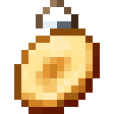
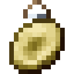
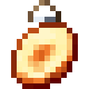
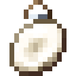
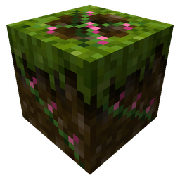

# Bestiary

All 29 Flora Ferox creatures, grouped by where they live. Stats are ♥ health, ⚔ attack and ◈ armour. Each creature takes full
damage from its family's weakness and half from everything else:

| Family | Weak to |
|---|---|
| [Pulse](index.md#the-four-families) | ranged |
| [Dusk](index.md#the-four-families) | magic |
| [Moon](index.md#the-four-families) | summons |
| [Mire](index.md#the-four-families) | melee |

Every creature is hostile unless marked **neutral**. A neutral creature leaves you alone until you hit it, and then it
calls its kind within 16 blocks. Minibosses give 50 XP (the others give 6), have no boss bar and never despawn. Unless
noted, every creature drops its family token (50%) and seeds (30%).

## The first monsters

The four creatures that wake from picked flowers and common herbs. All four are 24 / 4 / 4.

| Picture | Name | Family | ♥ ⚔ ◈ | Spawns | What it does | Drops |
|---|---|---|---|---|---|---|
| { .mc-icon .mc-mob loading=lazy } | **Pulse Gnat**{ #pulse-gnat } | [Pulse](index.md#the-four-families), by day | ♥ 24 · ⚔ 4 · ◈ 4 | plains, sunflower plains, meadow, flower forest, cherry grove. | Flutters about, then darts at you in a heart-shaped dive. | pink dye (30%). |
| { .mc-icon .mc-mob loading=lazy } | **Dusk Sprig**{ #dusk-sprig } | [Dusk](index.md#the-four-families), at night | ♥ 24 · ⚔ 4 · ◈ 4 | plains, sunflower plains, forest, birch forest, flower forest, meadow. | Lunges and bites. In daylight it roots itself in place. | yellow dye (30%). |
| { .mc-icon .mc-mob loading=lazy } | **Moon Tick**{ #moon-tick } | [Moon](index.md#the-four-families), at night | ♥ 24 · ⚔ 4 · ◈ 4 | plains, snowy plains, taiga, snowy taiga, meadow, sunflower plains. Twice as common under a full moon. | Hops at you in long bounds. | light blue dye (30%), amethyst shard (15%). |
| { .mc-icon .mc-mob loading=lazy } | **Mire Ghast**{ #mire-ghast } | [Mire](index.md#the-four-families), by day | ♥ 24 · ⚔ 4 · ◈ 4 | swamp, mangrove swamp. | Walks up and slams you with its arms. | mud (50%), sticks (50%). |

## The hunters

The burning (-flare) and frozen (-rime) herb strains wake these instead. All six are 24 / 4 / 4, and they also spawn in
the wild.

| Strain picked | Wakes |
|---|---|
| Duskflare, Duskrime | Snap Drake |
| Pulseflare, Pulserime | Burr Crawler |
| Moonflare, Moonrime | Lantern Leech or Orchid Mantis |
| Mireflare, Mirerime | Reed Wretch or Dew Crab |

Each drops its **trophy** (35%, plus 10% per level of Looting). Killed by a player, one can also drop its family's
burning seeds (10%), an Ember Graft (4%) or a Rime Graft (2%). A trophy crafts into its charm, and every trophy charm
also gives its family +15% damage.

| Picture | Name | Family | ♥ ⚔ ◈ | Spawns | What it does | Drops |
|---|---|---|---|---|---|---|
| { .mc-icon .mc-mob loading=lazy } | **Snap Drake**{ #snap-drake } | [Dusk](index.md#the-four-families) | ♥ 24 · ⚔ 4 · ◈ 4 | flower forest, meadow, cherry grove. | Its snap carries it forward, and it snaps twice. | Trophy: Snapjaw Petal. { .mc-icon .mc-inline } **Snapjaw Charm:** 15% chance that a magic hit does 1.5x damage. |
| { .mc-icon .mc-mob loading=lazy } | **Burr Crawler**{ #burr-crawler } | [Pulse](index.md#the-four-families) | ♥ 24 · ⚔ 4 · ◈ 4 | forest, birch forests, savanna. | Its hooks slow you. From 3.5 to 9 blocks away it throws burrs. | Trophy: Hookburr, which also makes Burr Pellets. { .mc-icon .mc-inline } **Hookburr Charm:** your ranged hits slow. |
| { .mc-icon .mc-mob loading=lazy } | **Lantern Leech**{ #lantern-leech } | [Moon](index.md#the-four-families), at night | ♥ 24 · ⚔ 4 · ◈ 4 | dark forest, forest. | Floats. Its bite heals it by 3, and then it backs off. | Trophy: Lantern Husk. { .mc-icon .mc-inline } **Lantern Charm:** your summons' hits heal you by 1. |
| { .mc-icon .mc-mob loading=lazy } | **Orchid Mantis**{ #orchid-mantis } | [Moon](index.md#the-four-families) | ♥ 24 · ⚔ 4 · ◈ 4 | jungles. | Stands still and passes for a flower, then slashes twice. | Trophy: Orchid Blade. { .mc-icon .mc-inline } **Orchid Charm:** whips recover 25% sooner, and your pets get Speed. |
| { .mc-icon .mc-mob loading=lazy } | **Reed Wretch**{ #reed-wretch } | [Mire](index.md#the-four-families) | ♥ 24 · ⚔ 4 · ◈ 4 | swamp, mangrove swamp, river. | Its scythe sweeps a wide arc in front of it. | Trophy: Cattail Fluff. { .mc-icon .mc-inline } **Cattail Charm:** slow falling while you sneak in the air. |
| { .mc-icon .mc-mob loading=lazy } | **Dew Crab**{ #dew-crab } | [Mire](index.md#the-four-families), neutral | ♥ 24 · ⚔ 4 · ◈ 4 | swamp, mangrove swamp. | Sidles round you. Its grip gives Slowness III. | Trophy: Sundew Glue. { .mc-icon .mc-inline } **Sundew Charm:** your melee hits slow. |

## Plains, meadows and flower forests

| Picture | Name | Family | ♥ ⚔ ◈ | Spawns | What it does | Drops |
|---|---|---|---|---|---|---|
| { .mc-icon .mc-mob loading=lazy } | **Thorn Hopper**{ #thorn-hopper } | [Pulse](index.md#the-four-families) | ♥ 20 · ⚔ 4 · ◈ 2 | only from a { .mc-icon .mc-inline } **Thorn Hopper Den**, a bramble burrow ringed with sweet berry bushes in about one chunk in 40 of plains, sunflower plains, meadow and flower forest. By day a den sends out one or two while fewer than 3 are near, and they stay within 10 blocks of it. With Silk Touch the den drops itself. | Leaps and bites, then springs away. | sweet berries (40%). |
| { .mc-icon .mc-mob loading=lazy } | **Pollen Puff**{ #pollen-puff } | [Dusk](index.md#the-four-families), neutral | ♥ 14 · ⚔ 3 · ◈ 0 | flower forest, meadow, sunflower plains, cherry grove. | Flies. Its pollen burst gives Weakness, and then it drifts off. | yellow dye (40%). |
| { .mc-icon .mc-mob loading=lazy } | **Thorn Matriarch**{ #thorn-matriarch } | [Pulse](index.md#the-four-families), miniboss | ♥ 120 · ⚔ 8 · ◈ 6 | plains, meadow, flower forest (rare). | Her leap lands in a shockwave. At two thirds and one third health she calls two Thorn Hoppers. | sweet berries (1–6), rose bush (50%), token and seeds (1–3 each), grafts when killed by a player. |

## Forests and taigas

| Picture | Name | Family | ♥ ⚔ ◈ | Spawns | What it does | Drops |
|---|---|---|---|---|---|---|
| { .mc-icon .mc-mob loading=lazy } | **Graft Twin**{ #graft-twin } | [Moon](index.md#the-four-families) | ♥ 26 · ⚔ 4 · ◈ 4 | forest, birch forest, flower forest. | Keeps its distance and shoots flame, then frost. Every third volley fires both. | blaze powder (15%), snowball (40%). |
| { .mc-icon .mc-mob loading=lazy } | **Root Grub**{ #root-grub } | [Mire](index.md#the-four-families), at night | ♥ 22 · ⚔ 5 · ◈ 4 | forest, dark forest, taiga, old growth spruce taiga. | When you're more than 5 blocks away it burrows, then erupts under your feet and flings you up. | hanging roots (40%). |
| { .mc-icon .mc-mob loading=lazy } | **Bell Stalker**{ #bell-stalker } | [Moon](index.md#the-four-families), at night | ♥ 22 · ⚔ 5 · ◈ 2 | dark forest, birch forests, flower forest. | Moves only while you aren't looking at it. Its toll does damage and gives Slowness and Darkness. | amethyst shard (25%), string (40%). |
| { .mc-icon .mc-mob loading=lazy } | **Briar King**{ #briar-king } | [Mire](index.md#the-four-families), miniboss, at night | ♥ 140 · ⚔ 9 · ◈ 8 | dark forest, forest. | Charges from 6 to 16 blocks away, trampling whatever is in the way. Under half health, its thorns hurt anything that hits it. | rose bush, oak log, token and seeds (1–3 each), grafts when killed by a player. |

## Swamps and jungles

| Picture | Name | Family | ♥ ⚔ ◈ | Spawns | What it does | Drops |
|---|---|---|---|---|---|---|
| { .mc-icon .mc-mob loading=lazy } | **Pitcher Spitter**{ #pitcher-spitter } | [Mire](index.md#the-four-families) | ♥ 22 · ⚔ 3 · ◈ 4 | jungles, swamps. | Spits nectar that gives Slowness. Up close it gulps you, with Nausea. | pitcher pod (10%), honey bottle (10%). |

## Lush caves

| Picture | Name | Family | ♥ ⚔ ◈ | Spawns | What it does | Drops |
|---|---|---|---|---|---|---|
| { .mc-icon .mc-mob loading=lazy } | **Carrion Bloom**{ #carrion-bloom } | [Mire](index.md#the-four-families), miniboss | ♥ 100 · ⚔ 7 · ◈ 6 | lush caves. | Rooted in place. Every 5 seconds it pulls you in from up to 10 blocks, and its spores poison. | spore blossom, glow berries, moss. |

## The Nether

Every Nether creature is fireproof.

| Picture | Name | Family | ♥ ⚔ ◈ | Spawns | What it does | Drops |
|---|---|---|---|---|---|---|
| { .mc-icon .mc-mob loading=lazy } | **Wartback**{ #wartback } | [Mire](index.md#the-four-families) | ♥ 26 · ⚔ 5 · ◈ 4 | crimson forest, nether wastes. | Lunges and tosses you on its tusks. | nether wart (50%). |
| { .mc-icon .mc-mob loading=lazy } | **Nylium Lurker**{ #nylium-lurker } | [Mire](index.md#the-four-families) | ♥ 22 · ⚔ 5 · ◈ 4 | crimson forest, warped forest. | Waits in its lair. When you come within 6 blocks it lunges; its jaws give Slowness IV. Then it goes back to its lair. | crimson roots (50%). |
| { .mc-icon .mc-mob loading=lazy } | **Soulwick**{ #soulwick } | [Pulse](index.md#the-four-families) | ♥ 20 · ⚔ 4 · ◈ 2 | soul sand valley. | Leaps and burns. Near death it lets out one ring of soul fire. | soul torch (30%), bone meal (40%). |
| { .mc-icon .mc-mob loading=lazy } | **Cinder Thistle**{ #cinder-thistle } | [Pulse](index.md#the-four-families) | ♥ 18 · ⚔ 4 · ◈ 2 | basalt deltas, nether wastes. | Fires a fan of three burning spikes, then backs off. | blaze powder (25%), coal (40%). |
| { .mc-icon .mc-mob loading=lazy } | **Warped Stilt**{ #warped-stilt } | [Dusk](index.md#the-four-families), neutral | ♥ 22 · ⚔ 3 · ◈ 2 | warped forest. | Its spore burst gives Poison and Nausea. | warped fungus (40%). |
| { .mc-icon .mc-mob loading=lazy } | **Lanternpuff**{ #lanternpuff } | [Moon](index.md#the-four-families), neutral | ♥ 16 · ⚔ 3 · ◈ 0 | crimson forest, nether wastes, basalt deltas. | Shoots embers. When struck, it blinds you. | glowstone dust (50%). |
| { .mc-icon .mc-mob loading=lazy } | **Crimson Behemoth**{ #crimson-behemoth } | [Mire](index.md#the-four-families), miniboss | ♥ 160 · ⚔ 10 · ◈ 10 | crimson forest. | Stamps the ground in fire and charges. From more than 8 blocks away it throws 3 fireballs. | crimson stem, shroomlight, magma cream. |

## The End

| Picture | Name | Family | ♥ ⚔ ◈ | Spawns | What it does | Drops |
|---|---|---|---|---|---|---|
| { .mc-icon .mc-mob loading=lazy } | **Pearl Pod**{ #pearl-pod } | [Dusk](index.md#the-four-families) | ♥ 16 · ⚔ 4 · ◈ 2 | End highlands, midlands, small End islands, End barrens. | Bursts, then blinks away. When struck, it blinks half the time. | ender pearl (35%). |
| { .mc-icon .mc-mob loading=lazy } | **Void Jelly**{ #void-jelly } | [Dusk](index.md#the-four-families) | ♥ 20 · ⚔ 4 · ◈ 0 | End highlands, midlands, small End islands, End barrens. | Its sting poisons, and every other sting gives Levitation. | chorus fruit (50%). |
| { .mc-icon .mc-mob loading=lazy } | **Rift Narwhal**{ #rift-narwhal } | [Moon](index.md#the-four-families), neutral | ♥ 80 · ⚔ 7 · ◈ 6 | End highlands, midlands, small End islands. | Its gore flings you, then it wheels round and charges. **Taming:** feed it chorus fruit (1 chance in 4 each). Ride it with an empty hand: it flies where you look, and jump takes it up. | chorus fruit (60%), phantom membrane (30%). |

## Peace Lily Charm

Crafted from 4 family tokens, a lily of the valley and a gold ingot. Worn in a charm slot, carried or held, it makes
every Flora Ferox creature leave you alone. A creature you strike fights back until 5 seconds after your last blow.
