# Bestiary

All 29 Flora Ferox creatures, grouped by where they live. Stats are health / attack / armour. Each creature takes full
damage from its family's weakness and half from everything else:

- **Pulse:** weak to ranged.
- **Dusk:** weak to magic.
- **Moon:** weak to summons.
- **Mire:** weak to melee.

Every creature is hostile unless marked **neutral**. A neutral creature leaves you alone until you hit it, and then it
calls its kind within 16 blocks. Minibosses give 50 XP (the others give 6), have no boss bar and never despawn. Unless
noted, every creature drops its family token (50%) and seeds (30%).

## The first monsters

The four creatures that wake from picked flowers and common herbs. All four are 24 / 4 / 4.

??? note "Pulse Gnat · Pulse · by day"
    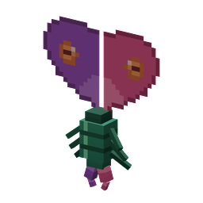{ .mc-3d .mc-mob loading=lazy }

    **Spawns:** plains, sunflower plains, meadow, flower forest, cherry grove.

    Flutters about, then darts at you in a heart-shaped dive.

    **Drops:** pink dye (30%).

??? note "Dusk Sprig · Dusk · at night"
    { .mc-3d .mc-mob loading=lazy }

    **Spawns:** plains, sunflower plains, forest, birch forest, flower forest, meadow.

    Lunges and bites. In daylight it roots itself in place.

    **Drops:** yellow dye (30%).

??? note "Moon Tick · Moon · at night"
    { .mc-3d .mc-mob loading=lazy }

    **Spawns:** plains, snowy plains, taiga, snowy taiga, meadow, sunflower plains. Twice as common under a full moon.

    Hops at you in long bounds.

    **Drops:** light blue dye (30%), amethyst shard (15%).

??? note "Mire Ghast · Mire · by day"
    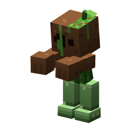{ .mc-3d .mc-mob loading=lazy }

    **Spawns:** swamp, mangrove swamp.

    Walks up and slams you with its arms.

    **Drops:** mud (50%), sticks (50%).

## The hunters

The burning (-flare) and frozen (-rime) herb strains wake these instead. All six are 24 / 4 / 4, and they also spawn in
the wild.

| Strain picked | Wakes |
|---|---|
| Duskflare, Duskrime | Snap Drake |
| Pulseflare, Pulserime | Burr Crawler |
| Moonflare, Moonrime | Lantern Leech or Orchid Mantis |
| Mireflare, Mirerime | Reed Wretch or Dew Crab |

Each drops its **trophy** (35%, plus 10% per level of Looting). Killed by a player, one can also drop its family's
burning seeds (10%), an Ember Graft (4%) or a Rime Graft (2%). A trophy crafts into its charm, and every trophy charm
also gives its family +15% damage.

??? note "Snap Drake · Dusk"
    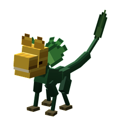{ .mc-3d .mc-mob loading=lazy }

    **Spawns:** flower forest, meadow, cherry grove.

    Its snap carries it forward, and it snaps twice.

    **Trophy:** Snapjaw Petal. **Snapjaw Charm:** 15% chance that a magic hit does 1.5x damage.

??? note "Burr Crawler · Pulse"
    { .mc-3d .mc-mob loading=lazy }

    **Spawns:** forest, birch forests, savanna.

    Its hooks slow you. From 3.5 to 9 blocks away it throws burrs.

    **Trophy:** Hookburr, which also makes Burr Pellets. **Hookburr Charm:** your ranged hits slow.

??? note "Lantern Leech · Moon · at night"
    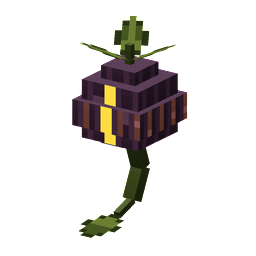{ .mc-3d .mc-mob loading=lazy }

    **Spawns:** dark forest, forest.

    Floats. Its bite heals it by 3, and then it backs off.

    **Trophy:** Lantern Husk. **Lantern Charm:** your summons' hits heal you by 1.

??? note "Orchid Mantis · Moon"
    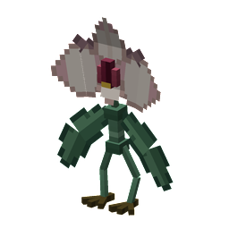{ .mc-3d .mc-mob loading=lazy }

    **Spawns:** jungles.

    Stands still and passes for a flower, then slashes twice.

    **Trophy:** Orchid Blade. **Orchid Charm:** whips recover 25% sooner, and your pets get Speed.

??? note "Reed Wretch · Mire"
    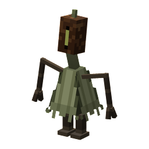{ .mc-3d .mc-mob loading=lazy }

    **Spawns:** swamp, mangrove swamp, river.

    Its scythe sweeps a wide arc in front of it.

    **Trophy:** Cattail Fluff. **Cattail Charm:** slow falling while you sneak in the air.

??? note "Dew Crab · Mire · neutral"
    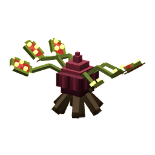{ .mc-3d .mc-mob loading=lazy }

    **Spawns:** swamp, mangrove swamp.

    Sidles round you. Its grip gives Slowness III.

    **Trophy:** Sundew Glue. **Sundew Charm:** your melee hits slow.

## Plains, meadows and flower forests

??? note "Thorn Hopper · Pulse · 20 / 4 / 2"
    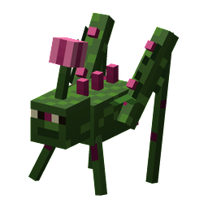{ .mc-3d .mc-mob loading=lazy }

    **Spawns:** only from a **Thorn Hopper Den**, a bramble burrow ringed with sweet berry bushes in about one chunk in
    40 of plains, sunflower plains, meadow and flower forest. By day a den sends out one or two while fewer than 3 are
    near, and they stay within 10 blocks of it. With Silk Touch the den drops itself.

    Leaps and bites, then springs away.

    **Drops:** sweet berries (40%).

??? note "Pollen Puff · Dusk · neutral · 14 / 3 / 0"
    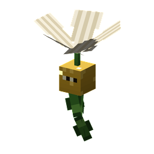{ .mc-3d .mc-mob loading=lazy }

    **Spawns:** flower forest, meadow, sunflower plains, cherry grove.

    Flies. Its pollen burst gives Weakness, and then it drifts off.

    **Drops:** yellow dye (40%).

??? warning "Thorn Matriarch · Pulse · miniboss · 120 / 8 / 6"
    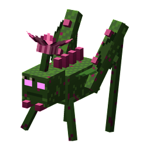{ .mc-3d .mc-mob loading=lazy }

    **Spawns:** plains, meadow, flower forest (rare).

    Her leap lands in a shockwave. At two thirds and one third health she calls two Thorn Hoppers.

    **Drops:** sweet berries (1–6), rose bush (50%), token and seeds (1–3 each), grafts when killed by a player.

## Forests and taigas

??? note "Graft Twin · Moon · 26 / 4 / 4"
    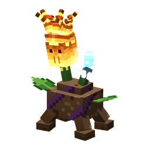{ .mc-3d .mc-mob loading=lazy }

    **Spawns:** forest, birch forest, flower forest.

    Keeps its distance and shoots flame, then frost. Every third volley fires both.

    **Drops:** blaze powder (15%), snowball (40%).

??? note "Root Grub · Mire · at night · 22 / 5 / 4"
    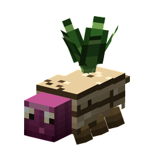{ .mc-3d .mc-mob loading=lazy }

    **Spawns:** forest, dark forest, taiga, old growth spruce taiga.

    When you're more than 5 blocks away it burrows, then erupts under your feet and flings you up.

    **Drops:** hanging roots (40%).

??? note "Bell Stalker · Moon · at night · 22 / 5 / 2"
    { .mc-3d .mc-mob loading=lazy }

    **Spawns:** dark forest, birch forests, flower forest.

    Moves only while you aren't looking at it. Its toll does damage and gives Slowness and Darkness.

    **Drops:** amethyst shard (25%), string (40%).

??? warning "Briar King · Mire · miniboss · at night · 140 / 9 / 8"
    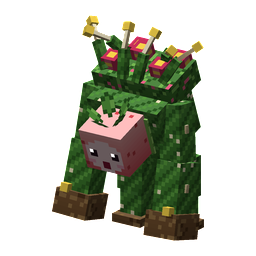{ .mc-3d .mc-mob loading=lazy }

    **Spawns:** dark forest, forest.

    Charges from 6 to 16 blocks away, trampling whatever is in the way. Under half health, its thorns hurt anything that
    hits it.

    **Drops:** rose bush, oak log, token and seeds (1–3 each), grafts when killed by a player.

## Swamps and jungles

??? note "Pitcher Spitter · Mire · 22 / 3 / 4"
    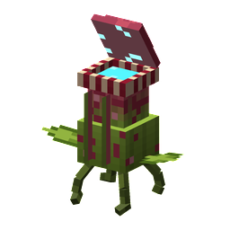{ .mc-3d .mc-mob loading=lazy }

    **Spawns:** jungles, swamps.

    Spits nectar that gives Slowness. Up close it gulps you, with Nausea.

    **Drops:** pitcher pod (10%), honey bottle (10%).

## Lush caves

??? warning "Carrion Bloom · Mire · miniboss · 100 / 7 / 6"
    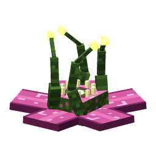{ .mc-3d .mc-mob loading=lazy }

    **Spawns:** lush caves.

    Rooted in place. Every 5 seconds it pulls you in from up to 10 blocks, and its spores poison.

    **Drops:** spore blossom, glow berries, moss.

## The Nether

Every Nether creature is fireproof.

??? note "Wartback · Mire · 26 / 5 / 4"
    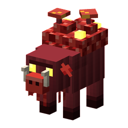{ .mc-3d .mc-mob loading=lazy }

    **Spawns:** crimson forest, nether wastes.

    Lunges and tosses you on its tusks.

    **Drops:** nether wart (50%).

??? note "Nylium Lurker · Mire · 22 / 5 / 4"
    { .mc-3d .mc-mob loading=lazy }

    **Spawns:** crimson forest, warped forest.

    Waits in its lair. When you come within 6 blocks it lunges; its jaws give Slowness IV. Then it goes back to its
    lair.

    **Drops:** crimson roots (50%).

??? note "Soulwick · Pulse · 20 / 4 / 2"
    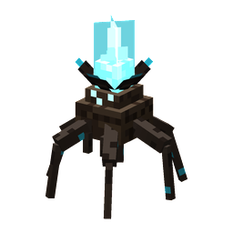{ .mc-3d .mc-mob loading=lazy }

    **Spawns:** soul sand valley.

    Leaps and burns. Near death it lets out one ring of soul fire.

    **Drops:** soul torch (30%), bone meal (40%).

??? note "Cinder Thistle · Pulse · 18 / 4 / 2"
    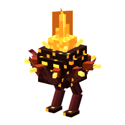{ .mc-3d .mc-mob loading=lazy }

    **Spawns:** basalt deltas, nether wastes.

    Fires a fan of three burning spikes, then backs off.

    **Drops:** blaze powder (25%), coal (40%).

??? note "Warped Stilt · Dusk · neutral · 22 / 3 / 2"
    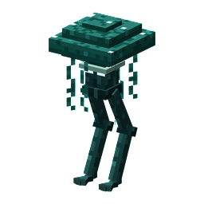{ .mc-3d .mc-mob loading=lazy }

    **Spawns:** warped forest.

    Its spore burst gives Poison and Nausea.

    **Drops:** warped fungus (40%).

??? note "Lanternpuff · Moon · neutral · 16 / 3 / 0"
    { .mc-3d .mc-mob loading=lazy }

    **Spawns:** crimson forest, nether wastes, basalt deltas.

    Shoots embers. When struck, it blinds you.

    **Drops:** glowstone dust (50%).

??? warning "Crimson Behemoth · Mire · miniboss · 160 / 10 / 10"
    { .mc-3d .mc-mob loading=lazy }

    **Spawns:** crimson forest.

    Stamps the ground in fire and charges. From more than 8 blocks away it throws 3 fireballs.

    **Drops:** crimson stem, shroomlight, magma cream.

## The End

??? note "Pearl Pod · Dusk · 16 / 4 / 2"
    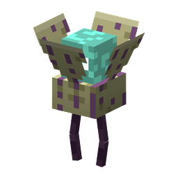{ .mc-3d .mc-mob loading=lazy }

    **Spawns:** End highlands, midlands, small End islands, End barrens.

    Bursts, then blinks away. When struck, it blinks half the time.

    **Drops:** ender pearl (35%).

??? note "Void Jelly · Dusk · 20 / 4 / 0"
    { .mc-3d .mc-mob loading=lazy }

    **Spawns:** End highlands, midlands, small End islands, End barrens.

    Its sting poisons, and every other sting gives Levitation.

    **Drops:** chorus fruit (50%).

??? note "Rift Narwhal · Moon · neutral · 80 / 7 / 6"
    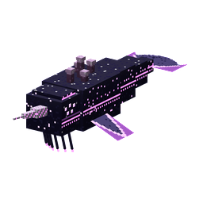{ .mc-3d .mc-mob loading=lazy }

    **Spawns:** End highlands, midlands, small End islands.

    Its gore flings you, then it wheels round and charges.

    **Taming:** feed it chorus fruit (1 chance in 4 each). Ride it with an empty hand: it flies where you look, and
    jump takes it up.

    **Drops:** chorus fruit (60%), phantom membrane (30%).

## Peace Lily Charm

Crafted from 4 family tokens, a lily of the valley and a gold ingot. Worn in a charm slot, carried or held, it makes
every Flora Ferox creature leave you alone. A creature you strike fights back until 5 seconds after your last blow.
