# Flora Ferox

{ width="140" align=right }

29 plant creatures across the Overworld, the Nether and the End. You grow and splice herbs and brew from them, then
fight what they wake with bows, arbalests, seed guns, whips, sceptres and cleavers.

**Requires** [Fundamentum](../fundamentum/index.md) and [Curios](https://www.curseforge.com/projects/309927). **Optional:** [JEI](https://www.curseforge.com/projects/238222), for the Grafting Bench splices, the
brews and info pages.

**Optional:** [Boss Checklist](https://www.curseforge.com/projects/1355708) for tracking bosses.

| Minecraft | Loader | Flora Ferox | Fundamentum |
|---|---|---|---|
| 26.1.2 | NeoForge | 1.19.0 | 1.25.5 or newer |
| 26.2 | NeoForge | 1.19.0 | 1.26.1 or newer |
| 26.3 | NeoForge | 1.19.0 | 1.26.1 or newer |
| 1.21.1 | NeoForge | 1.19.0 | 1.26.1 or newer |
| 1.20.1 | Forge | 1.19.0 | 1.26.1 or newer |

In 1.19.0, the Briar King and Crimson Behemoth take on different appearances by biome, and the Thorn Matriarch has a new body.

[CurseForge project](https://www.curseforge.com/projects/1788773)

## The four families

Every creature, herb, weapon and charm belongs to one of four herb families. Each family takes full damage from one
kind of damage, and half from every other kind. Untyped damage, such as fire and falling, is not scaled.

| Picture | Family | Herb | Weak to | Weapon line |
|---|---|---|---|---|
| 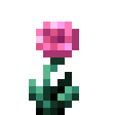{ .mc-icon } | **Pulse**{ #pulse } | Pulseroot | ranged | bows and arbalests |
| 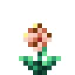{ .mc-icon } | **Dusk**{ #dusk } | Duskpetal | magic | sceptres |
| 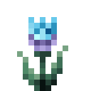{ .mc-icon } | **Moon**{ #moon } | Moonwisp | summons | whips |
| 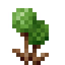{ .mc-icon } | **Mire**{ #mire } | Mirecap | melee | cleavers |

The [bestiary](bestiary.md) lists every creature with its family, stats, moves and drops.

## How it plays

1. **Pick a flower.** Picking a sunflower (Pulse), a rose, poppy, peony or pink tulip (Dusk), a blue orchid or
   cornflower (Moon), or a lily pad, moss or mangrove propagule (Mire) has a 1 in 6 chance of waking that family's
   first monster.
2. **Splice a herb.** At the 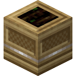{ .mc-icon .mc-inline } **Grafting Bench**{ #grafting-bench }, splice wheat seeds with that flower to get the family's herb seeds.
   Splice those with an 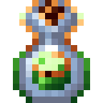{ .mc-icon .mc-inline } **Ember Graft** for the burning strain, then with a 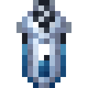{ .mc-icon .mc-inline } **Rime Graft** for the frozen strain.
3. **Grow and pick it.** Herbs grow on farmland like any crop. Picking a grown herb always wakes a monster: the common
   herb wakes its family's first monster, and the burning and frozen strains wake the [hunters](bestiary.md#the-hunters).
4. **Spend the drops.** Tokens, trophies and grafts buy and craft better gear.

The **Weedwarden**{ #weedwarden } is a villager who works at the Grafting Bench. She trades seeds, grafts, pellets, charms and weapons
for tokens and trophies. The three 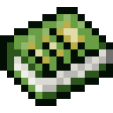{ .mc-icon .mc-inline }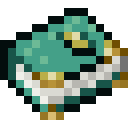{ .mc-icon .mc-inline }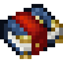{ .mc-icon .mc-inline } **Grower's Almanac** books explain each step: the first is crafted, and the
Weedwarden sells the other two.

## Brewing

Each herb brewed into an Awkward Potion gives its family's drink: twelve in all, with splash, lingering and arrow
versions. Each boosts its family's damage type and adds a vanilla effect to go with it. The burning strains add fire
resistance, and the frozen strains add one more effect.

## Gear

Every weapon line has three tiers: a plain one, a burning one that sets targets alight, and a frozen one that slows
and chills them. Each later tier is crafted from the one before, with herbs, a graft and the family's trophy.

| Picture | Line | What it does |
|---|---|---|
| 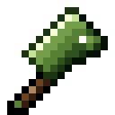{ .mc-icon } 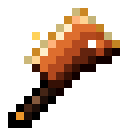{ .mc-icon } 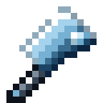{ .mc-icon } | **Cleavers (melee)**{ #cleavers-melee } | Right click sends a slash flying a few blocks. |
| 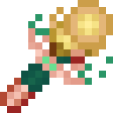{ .mc-icon } 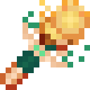{ .mc-icon } 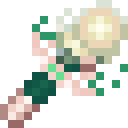{ .mc-icon } | **Sceptres (magic)**{ #sceptres-magic } | Left click casts petal bolts. Right click is the tier's support: Dusk Bloom heals you and allies within 4 blocks, Ember Ward rings you in fire and makes you fireproof, Rime Shell gives Resistance and Absorption and freezes hostiles near you. |
| 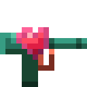{ .mc-icon } 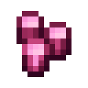{ .mc-icon } | **Seed guns (magic)**{ #seed-guns-magic } | One-handed pistols that fire bolts of seed magic, using Seed Pellets, on left or right click. They have their own enchantments: Heartsight, Seed Hopper, Weedkiller, Quickdraw, Bloom Shot, Heartmend and Infinity. |
| 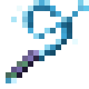{ .mc-icon } 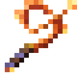{ .mc-icon } 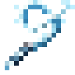{ .mc-icon } | **Whips (summon or melee)**{ #whips-summon-or-melee } | Fundamentum cord whips. Your pets attack whatever the whip hits. A whip hit counts as summon or melee, never both at once. |
| 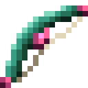{ .mc-icon } 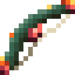{ .mc-icon } 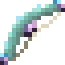{ .mc-icon } | **Bows (ranged)**{ #bows-ranged } | Heartstring, Scorchstring and Rimestring. A full draw leaves a heart seed in what it hits, which bursts 0.75 seconds later for 4, 5 or 6 damage within 2.5 blocks. The Scorchstring's burst sets things alight, the Rimestring's slows and chills them. |
| 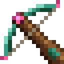{ .mc-icon } 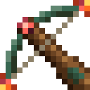{ .mc-icon } 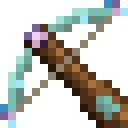{ .mc-icon } | **Arbalests (ranged)**{ #arbalests-ranged } | Crossbows whose bolt pierces one mob and roots the first it hits. The Scorch Arbalest sets the rooted mob alight, the Rime Arbalest slows and chills it. |
| 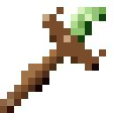{ .mc-icon } 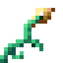{ .mc-icon } 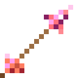{ .mc-icon } 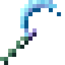{ .mc-icon } | **Grappling hooks**{ #grappling-hooks } | One for every weapon, worn in the hook slot and fired with H. Mire grapples pull hardest, Dusk tendrils hang in the air on a miss, Pulse hooks reach furthest, Moon grapnels hold you still. |
| 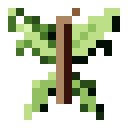{ .mc-icon } 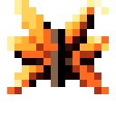{ .mc-icon } 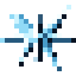{ .mc-icon } | **Wings**{ #wings } | Leafwing, Emberwing and Rimewing, each flying further than the last. |
| 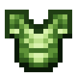{ .mc-icon } 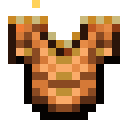{ .mc-icon } 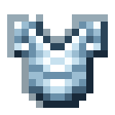{ .mc-icon } | **Armour**{ #armour } | Leafguard, Emberbark and Rimebark. Each set has four helmets, one per damage type. Sets add no damage or critical chance: the helmet decides the set effect (twelve in all, each on its helmet's tooltip), and Rimebark adds a class perk: the melee helmet gives Speed and 20% faster swings and Cleaver slashes, the ranged one winds bows and crossbows 20% faster, the magic one makes sceptres and guns recover 20% faster, and the summon one strengthens your pets nearby. |
| 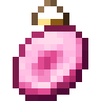{ .mc-icon } 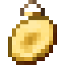{ .mc-icon } 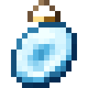{ .mc-icon } 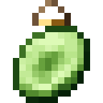{ .mc-icon } | **Charms**{ #charms } | A charm for each family, and one for each hunter's trophy. Each adds to its family's damage; the trophy charms add a small effect too. Worn in a Curios charm slot or carried. |
| 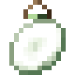{ .mc-icon } | **Peace Lily Charm**{ #peace-lily-charm } | Every Flora Ferox creature leaves you alone until you strike it. |

## Built on Fundamentum

The wings, grappling hooks and whips are [Fundamentum](../fundamentum/index.md)'s, and so are the slots they go in.
Wings go in the wings slot and lift you for their flight time, then glide. Hooks go in the hook slot and fire with
**H**. Whips swing Fundamentum's cord, where the tip hits hardest and cracks for a crit. The guns and bows also use
Fundamentum's poses for how they're held.

| Picture | Wings | Flight time | Rise speed | Air speed | Glide fall |
|---|---|---|---|---|---|
| { .mc-icon } | **Leafwing**{ #leafwing } | 1.5 s | 0.35 | x1.0 | 0.15 |
| { .mc-icon } | **Emberwing**{ #emberwing } | 2.25 s | 0.42 | x1.15 | 0.12 |
| { .mc-icon } | **Rimewing**{ #rimewing } | 3 s | 0.5 | x1.3 | 0.09 |

| Picture | Hook | Family | Range | Pull | Out at once | Special |
|---|---|---|---|---|---|---|
| { .mc-icon } | **Pulse Hook**{ #pulse-hook } | Pulse | 26 | 0.9 | 1 | |
| 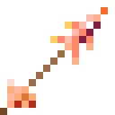{ .mc-icon } | **Scorch Hook**{ #scorch-hook } | Pulse | 30 | 1.05 | 1 | |
| 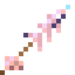{ .mc-icon } | **Rime Hook**{ #rime-hook } | Pulse | 34 | 1.2 | 1 | |
| { .mc-icon } | **Dusk Tendril**{ #dusk-tendril } | Dusk | 18 | 0.8 | 1 | hangs in the air 1.5 s on a miss |
| 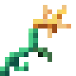{ .mc-icon } | **Ember Tendril**{ #ember-tendril } | Dusk | 22 | 0.95 | 1 | hangs 2 s |
| 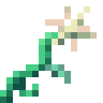{ .mc-icon } | **Rime Tendril**{ #rime-tendril } | Dusk | 26 | 1.1 | 1 | hangs 2.5 s |
| { .mc-icon } | **Moonwisp Grapnel**{ #moonwisp-grapnel } | Moon | 18 | 0.75 | 2 | holds you still |
| 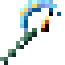{ .mc-icon } | **Moonflare Grapnel**{ #moonflare-grapnel } | Moon | 22 | 0.9 | 2 | holds you still |
| 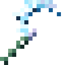{ .mc-icon } | **Moonrime Grapnel**{ #moonrime-grapnel } | Moon | 26 | 1.05 | 2 | holds you still |
| { .mc-icon } | **Mirecap Grapple**{ #mirecap-grapple } | Mire | 15 | 1.1 | 3 | |
| 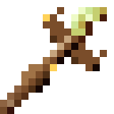{ .mc-icon } | **Flare Grapple**{ #flare-grapple } | Mire | 19 | 1.25 | 3 | |
| 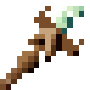{ .mc-icon } | **Rime Grapple**{ #rime-grapple } | Mire | 23 | 1.4 | 3 | |

Fundamentum's `whips.flatHandles` option (`config/fundamentum-client.toml`) draws the whips in hand as flat icons.

## For pack makers

Creature spawns are standard NeoForge biome modifiers (`data/floraferox/neoforge/biome_modifier/`), so a datapack can
move or remove them. The chance of a picked flower waking a monster is the config value `verdureHarvestChance`.

The wings and hooks are Fundamentum data, so a datapack can retune them by putting a file at the same path. Fundamentum
merges files field by field, so a file needs only the fields it changes.

| What | Path | Format |
|---|---|---|
| Wings | `data/floraferox/fundamentum/wings/<name>.json` | [Wings](../fundamentum/datapack/wings.md) |
| Hooks | `data/floraferox/fundamentum/hooks/<name>.json` | [Hooks](../fundamentum/datapack/hooks.md) |
| Whips | `data/floraferox/fundamentum/whips/<name>.json` (none ship; a file keyed by `item` overrides a whip's tuning) | [Whips](../fundamentum/datapack/whips.md) |

## Credits

By Oculifelis: code, design and art. Inspired by Violent Verdure, the Terraria mod by Violytta Ran.

| By | Work | Licence | Used for |
|---|---|---|---|
| Rhodox | Painterly Pack | used with permission | |
| Malcolm Riley | [Unused Textures](https://github.com/malcolmriley/unused-textures) | [CC BY 4.0](https://creativecommons.org/licenses/by/4.0/) | recoloured |
| TriQue06 | Mythic Upgrades | MIT | the base of the armour |

**Licence:** LGPL-3.0-or-later. Third-party art keeps the terms above.
