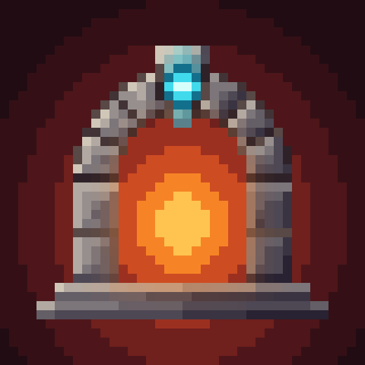

# Fundamentum

{ width="128" align=right }

A library mod: it doesn't add much on its own. Mods built on it use it for the systems they share, so their items,
stats and events work together instead of each mod rolling its own. Nearly everything is set up through datapacks.

**Requires:** Curios. **Optional:** JEI (shows portal crafting recipes).

## Mods that use Fundamentum

??? note "Mods that require Fundamentum (1)"

    - [Ostentum](../ostentum/index.md): weapons, relics and summons built on Fundamentum's wings, mounts, hooks,
      summons and whips.

## For players

- **Wings** in their own Curios slot (with a cosmetic twin). Hold jump to fly, then glide. No fall damage while flying.
- **Mounts.** A mount item in the `mount` slot plus **V** calls a creature to ride. V again, getting off, unequipping,
  dying or changing dimension puts it away.
- **Grappling hooks.** A hook in the `hook` slot plus **H** fires it. It latches onto a block and pulls you there;
  jump to let go. A latched player takes no fall damage.
- **Summons.** Items in the `summon` slot call minions that follow you and fight what you fight.
- **Whips** with a simulated cord: the whole cord hits, the tip hits hardest, and a crack at the tip is a crit.
- **Cosmetic armour**: four slots in their own screen (the button at the top right of the inventory's player preview).
- **3D arrows** in place of the flat vanilla ones.
- **Special moons and night events** that tint the fog and sky, with their own spawns, effects, loot and messages.
- **Fractal skies**: a moon, event or dimension can draw a fractal sky with an optional melting-vision effect.
- **Elements**: hits can be fire, ice, water, electric, earth, air, poison, holy, shadow or arcane, leave auras and
  set off reactions.
- **Portal crafting**: some items change when thrown through a portal.
- **Use sickness** for potions and other consumables.
- **Tooltips** for whips and hooks; any item's `.desc` lang lines show under its name.
- **Max health up to 1,000,000** instead of 1,024.

## Keys

| Key | Default | Does |
|---|---|---|
| Mount | V | calls or dismisses the mount in the `mount` slot |
| Hook | H | fires a hook from the `hook` slot |

Both are in the Fundamentum key category.

## Config

| File | Option | Default | Meaning |
|---|---|---|---|
| `config/fundamentum-client.toml` | `whips.flatHandles` | false | flat whip handles in hand instead of 3D ones |
| `config/fundamentum-client.toml` | `tooltips.shiftForDetails` | true | item descriptions and stats fold behind "Hold [Shift] for details"; false always shows them |
| `config/fundamentum-sky-client.toml` | `sky.fractalSkies` | true | draw fractal skies |
| | `sky.melt` | true | the melting-vision effect |
| | `sky.meltIntensity` | 0.5 | 0 to 1 |
| `config/fundamentum-common.toml` | `moons.psychedelicMoon` | false | lets the Psychedelic Moon roll (3% of nights, never a full moon) |

## Compatibility

| Mod | What Fundamentum adds | Needed? |
|---|---|---|
| [Jade](https://modrinth.com/mod/jade) | looking at a playing jukebox shows the disc, a progress bar and "1:12 / 3:05"; toggle it in Jade's plugin settings ("Jukebox song progress"); 26.1.2 for now | optional |
| [JEI](https://modrinth.com/mod/jei) | portal crafting recipes | optional |

Item tooltips: other mods' lines added through Fundamentum fold behind Shift too. Tag items `#fundamentum:tooltip_always`
to keep their text open, or `#fundamentum:tooltip_fold` to fold a short one.

## Pages

- [Versions](versions.md): what each Minecraft version has.
- [Datapacks](datapack/index.md): every JSON format, with examples.
- [KubeJS](kubejs.md)
- [API](api.md): for mod makers.
- [Commands](commands.md)
