# Oculifelis's Mods

Guides for the Minecraft mods by Oculifelis. Pick a mod from the tabs at the top.

| Picture | Mod | What it does |
|---|---|---|
| 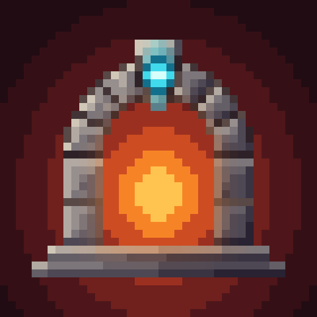{ width="64" } | **[Fundamentum](fundamentum/index.md)** | The shared library under the other mods. Wings, mounts, hooks, summons, whips, moons, elements and more, nearly all set up through datapacks. |
| 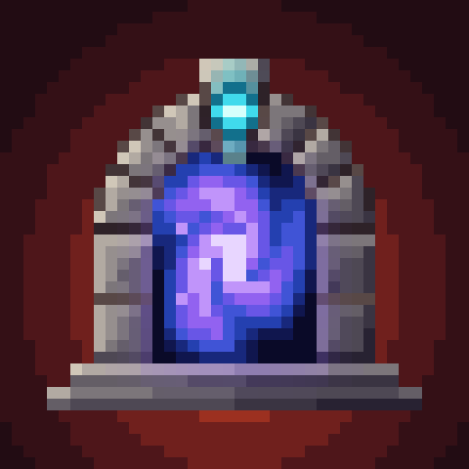{ width="64" } | **[Ostentum](ostentum/index.md)** | A vanilla expansion built on Fundamentum: summoning saddles, grappling hooks, summon charms, special weapons, whips, special moons, a Pillager Siege and boss relics. |
| 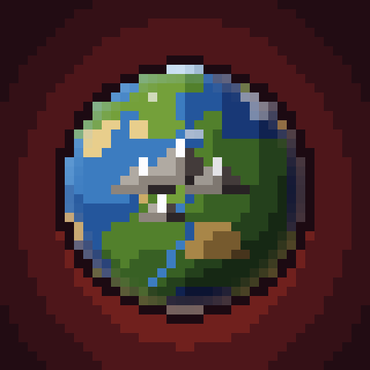{ width="64" } | **[Orbis Novus](orbisnovus/index.md)** | Two mods for new worlds. [Terrain](orbisnovus/terrain.md) adds realistic mountains, eroded valleys and rivers in ten styles; [Dungeons](orbisnovus/dungeons.md) adds 23 dungeon kinds, 30 settlements, castles and walled citadels. |
| { width="64" } | **[Flora Ferox](floraferox/index.md)** | 29 plant monsters across the Overworld, Nether and End. Grow and splice herbs, brew from them, and fight back with bows, arbalests, seed guns, whips, sceptres and cleavers. Built on Fundamentum. With a full [bestiary](floraferox/bestiary.md). |
| { width="64" } | **[Slowlight](slowlight/index.md)** | Kilns that burn no fuel and count in days on the world clock. Age honey into draught, press flowers, weather wood and grow a lantern that keeps the opposite hours. With paired [Waystones](slowlight/waystones.md) and [moon and cellar recipes](slowlight/recipes.md). |
| 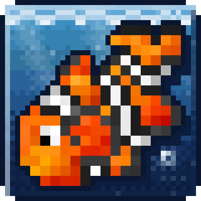{ width="64" } | **[Mariculture](mariculture/index.md)** | Joshiejack's 1.7.10 sea mod, brought back. Catch and breed more than 60 kinds of fish, grow pearls for magic jewelry, dive in scuba gear and run a workshop of crucibles, vats and machines. For Forge 1.20.1, NeoForge 1.21.1 and NeoForge 26.1.2. |
| 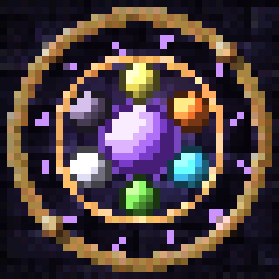{ width="64" } | **[Arcana Varia](arcanavaria/index.md)** | A Thaumaturge addon. Climb sealed wizard towers and break into 40 kinds of ruined lab, then bring home a censer of essentia clouds, a mirroring building lens, glass essentia pipes, scythes, whips and a tree boss. |
| 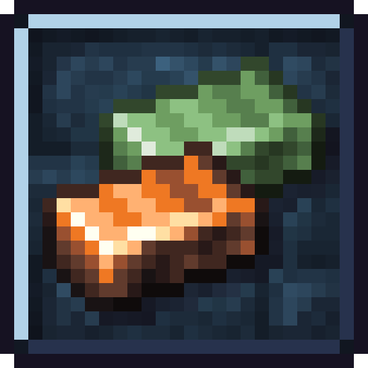{ width="64" } | **[Metallurgy: Recast](metallurgy/index.md)** | Metallurgy 4: Reforged on modern Minecraft, with Metallurgy Chests built in. 49 metals with their own powers: new ores, alloys, tools, armour, machines and fluids. |
| 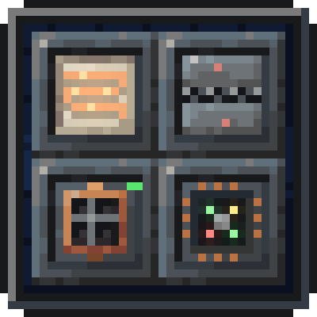{ width="64" } | **[Fieldframe](fieldframe/index.md)** | Build each machine from parts, a chassis with a module on every side. 77 modules, a programmable controller, no pipes or cables. With the addons [Frameworks](fieldframe-frameworks/index.md) (big multiblock machines and a fusion reactor) and [Transit](fieldframe-transit/index.md) (glass tubes you ride). |

## Complicated Bees

ACCBDD's [Complicated Bees](https://www.curseforge.com/projects/1100137), our 26.x port of it, and the addons. All on one page: [Complicated Bees](bees/index.md).

| Picture | Mod | What it does |
|---|---|---|
| 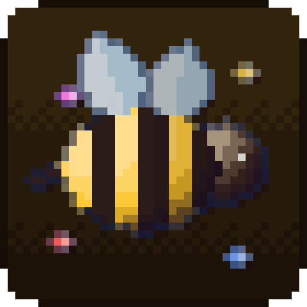{ width="64" } | **[Complicated Bees Unofficial](complicatedbees/index.md)** | ACCBDD's Forestry-style bee breeding, ported to 26.1.2 and 26.2 on NeoForge. 59 species, 23 combs, frames, the Mellarium bee house and the Gyrofuge centrifuge. |
| { width="64" } | **[Genetic Industry Unofficial](ports/genetic-industry/index.md)** | Extract genes from bees, assemble a Genetic Template, and imprint it onto a princess or drone. |
| 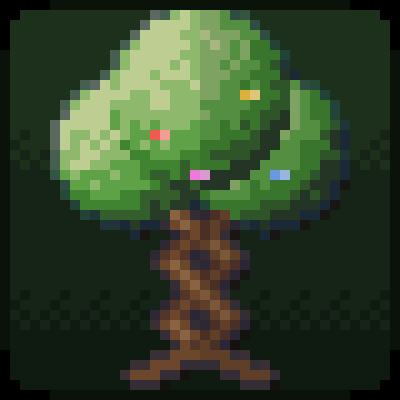{ width="64" } | **[Complicated Trees](other/complicated-trees.md)** | Tree breeding. Your bees pollinate nearby leaves, you graft the kids. 1.20.1 to 26.2. |
| 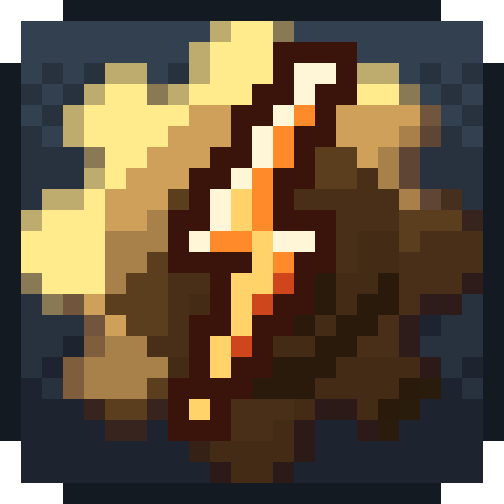{ width="64" } | **[Rotaflux](other/rotaflux.md)** | Turns Create rotation into FE for any machine. |
| 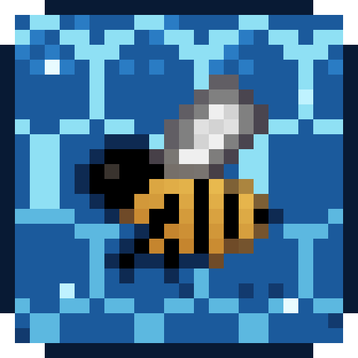{ width="64" } | **[Manacomb](other/manacomb.md)** | Runs Complicated Bees' FE machines on Botania mana. |

## Ports

Other authors' mods, ported to newer versions. Not made or supported by the original authors.

| Picture | Mod | What it does |
|---|---|---|
| 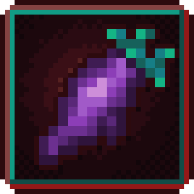{ width="64" } | **[Nether Agriculture (Unofficial)](netheragriculture/index.md)** | NetherDon's Nether farming mod, ported to 26.1.2, 26.2 and 26.3 on NeoForge and Fabric. Berries, Lothun, Blaze Fruit and Azure Melons, hoglin and strider meat, the Black Furnace and a glowing wood set. |

## Other mods

Smaller ones; the full list is on [Other mods](other/index.md).

| Mod | What it does |
|---|---|
| [Spartan x Better Combat Unofficial](other/spartan-bettercombat.md) | gives every [Spartan Weaponry Unofficial](https://www.curseforge.com/projects/1450963) melee weapon its own [Better Combat](https://www.curseforge.com/projects/639842) attack animation |
