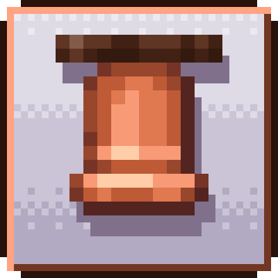
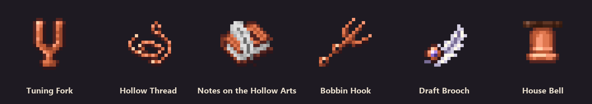

# Lacuna

{ width="140" align=right }

Lacuna adds rooms that work like machines. A small room catches and stores every item thrown into it. A tall shaft
lifts players up like an elevator. A hallway looped around a pillar is a redstone clock, and a long, low hall is a
safe room where arrows slow to a crawl.

**Requires** [Fundamentum](../fundamentum/index.md), [Ostentum](../ostentum/index.md) and
[Curios](https://www.curseforge.com/projects/309927). [Jade](https://www.curseforge.com/projects/324717) is optional.

| Minecraft | Loader | Lacuna | Fundamentum | Ostentum |
|---|---|---|---|---|
| 26.1.2 | NeoForge | 0.2.0 | 2.0.0 or newer | 1.9.10 or newer |

This guide covers the built **0.2.0** jar. It is not released yet.

Each room runs on a Hollow Heart, a block that sits on the room's floor. The shape of the room decides what it does,
so it can be built from any blocks and fit any base. A Tuning Fork shows where the walls have gaps, and amethyst
shards keep the heart running.

## Getting started

1. Get a Hollow Heart and a Tuning Fork. The first heart also gives the guide book, Notes on the Hollow Arts.
2. Build a room with no gaps in the walls, floor or roof, and put the heart on the floor. Doors are fine.
3. Right-click the heart with the Tuning Fork. A line of stitches traces the room, and amber stitches show where a
   gap is.
4. Right-click the heart with an amethyst shard to fuel it. Once the gaps are closed, the room wakes up.

## Building a room

A room can reach 8 blocks out from the heart on each side and 12 blocks up, and each heart needs its own room. A
Threshold Veil hangs in an open doorway and still counts as a wall, so players can walk through. If a wall is broken,
the room stops working until it is closed again. Nothing inside is lost.

One amethyst shard runs about 32 pickups, lifts or arrows, and a heart holds 8 shards. Breaking the heart drops what
it was storing and keeps its fuel.

## The four rooms

| Room | Shape | What it does |
|---|---|---|
| **Keeper**{ #keeper } (drop box) | 3 by 3 by 3 inside | Stores up to 9 stacks of what its owner throws on the floor. |
| **Breather**{ #breather } (elevator) | A shaft 3 by 3 and at least 5 tall | Jumping inside lifts the player with Slow Falling. |
| **Listener**{ #listener } (redstone clock) | 5 by 5 inside, a solid pillar in the middle, a hallway at least 2 tall around it | Repeats a learned redstone pattern. |
| **Shelter**{ #shelter } (safe room) | A hall at least 5 long and 3 wide, ceiling no higher than 3 | Projectiles that fly in slow to about a quarter of their speed. |

The Keeper never touches items other players drop. An empty hand takes a stack back out, and hoppers can't pull from
it. Sneaking and right-clicking the heart with the Tuning Fork, with an item in the off hand, makes it grab that item
first and give off a short redstone pulse each time.

In the Breather, sneaking steps out at the right floor.

A lever flipped on and off beside the Listener heart's marked side teaches it a pattern over 4 seconds, and it repeats
that pattern out of its other sides until paused with the Tuning Fork.

The Shelter never slows shots from the owner and teammates. Dragon fireballs and Wither skulls are not slowed either.

## Tools and charms

The Bobbin Hook is a short grappling hook that reaches 18 blocks and fires 2 hooks. Copper Perches placed along an
elevator shaft give it a spot to grab.

The Draft Brooch is a charm worn in a Curios slot. Falling more than 5 blocks while wearing it gives 5 seconds of Slow
Falling, 16 times, with 20 seconds between uses.

## Thread and the House Bell

Any working heart can also spin thread. Right-clicking it with string spins Hollow Thread, one every 4 seconds. A
hopper on top or on a side feeds string and amethyst in, a hopper underneath takes the thread out, and a comparator
shows how much fuel is left.

With all four rooms working within 24 blocks of each other, ringing the House Bell makes the hearts share fuel for 1
minute, so a full one tops up an empty one.

## Compatibility

| Mod | What it does |
|---|---|
| [Jade](https://www.curseforge.com/projects/324717) | Shows the owner how much fuel a heart has and how full its storage is. |
| [Atramentum](../atramentum/index.md) | Lived-in rooms write words at their heart. See [Lacuna homes](../atramentum/index.md#lacuna-homes). |

## For pack makers

Everything above is datapack JSON, including what shape each room needs and what it does. Packs can change every
number without code. The tables live under `data/<namespace>/lacuna/`.

| Path | What it sets |
|---|---|
| `rules/` | The heart's fuel capacity, fuel per amethyst shard, room size limits, the shape each room needs, the elevator speed, how much the Shelter slows projectiles, and the Draft Brooch's fall distance, uses and cooldown. |
| `weaving/` | More things a heart can spin, with the input, output, time and fuel cost of each. |
| `data/lacuna/fundamentum/hooks/bobbin.json` | The Bobbin Hook's reach, hook count and look. |
| `data/lacuna/fundamentum/unlocks/` | The five unlocks, one for each room plus the House Bell. |
| `lacuna:ward_immune` entity tag | Projectiles the Shelter never slows. |

Lacuna is licensed under LGPL-3.0.
