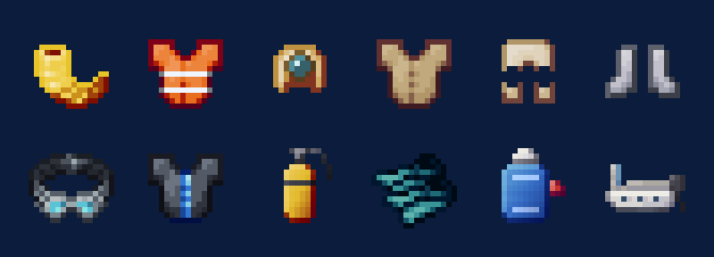
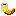
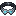
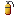
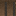
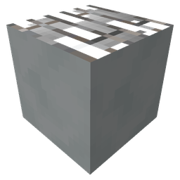
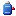

# Diving

Diving gear goes from a snorkel up to full scuba.

| Picture | Name | What it does |
|---|---|---|
| { .mc-icon } | **Snorkel**{ #snorkel } | the simplest gear: worn under water it tops up your air now and then, so you stay down far longer |
| { .mc-icon } | **Diving gear**{ #diving-gear } | Diving Helmet, Diving Air Supply, Diving Suit and Diving Boots; the helmet takes air from a nearby Air Pump |
| { .mc-icon } | **Scuba Mask** and { .mc-icon .mc-inline } **Scuba Tank** | air you carry with you |
| { .mc-icon } | **Swimfins**{ #swimfins } | worn on your feet for swimming |
| { .mc-icon } | **Buoyancy Aid**{ #buoyancy-aid } | worn in the chest slot, carries you quickly up to the surface |

## Air

{ .mc-icon .mc-inline } The **Air Pump** feeds a Diving Helmet within 64 blocks across and
128 blocks up and down. It uses 100 FE every 15 seconds.

The { .mc-icon .mc-inline } **Air Compressor** fills scuba tanks: 1,000 FE for each unit of air, holding up to 480. A Scuba Tank holds 240 and
uses one unit every 7.5 seconds.

The `hardcore_diving` setting in the [config](config.md#general) makes your air run out faster under water.

## Getting around

| Picture | Name | What it does |
|---|---|---|
| { .mc-icon } | **F.L.U.D.D.**{ #fludd } | a water pack: holds 20,000 units of water, filled in a Pressure Vessel's special slot or on its stand |
| { .mc-icon } | **Speed Boat**{ #speed-boat } | about 7 blocks a second on water |

### F.L.U.D.D. modes

Sneak and press the activate key (V) to switch mode; each tick a mode runs uses water.

| Mode | Holding V |
|---|---|
| Hover | lifts you gently and holds you up for up to 15 seconds; walk to drift, jump to sink |
| Rocket | a short, strong boost upward |
| Turbo | drives you forward very fast |
| Squirt | shoots a squirt of water that hurts what it hits |

Use the F.L.U.D.D. on a block and it sets up there as a stand; break it to get it back with its water.

How steeply the Speed Boat climbs is `speedboat_vertical_percent` in the [config](config.md#general).
