# Fish and breeding

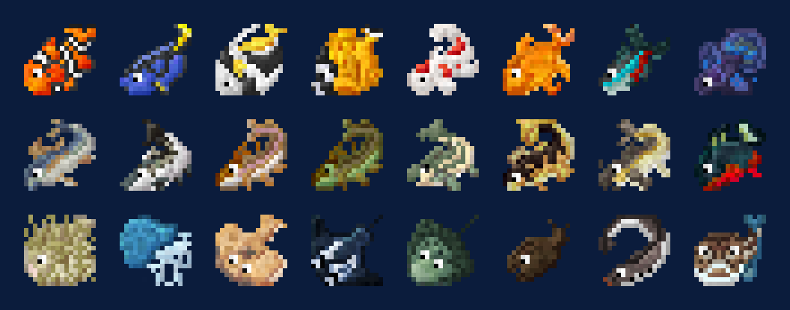

## Breeding

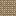{ .mc-icon .mc-inline } Catch a male and a female and put them in a **Fish Feeder**
with fish food. While they live they work through their lives making things, from water droplets up to lapis and
dragon eggs. Build a tank of water around the feeder: each fish wants a tank of its own size, and the right salt and
heat ([Fishing](fishing.md#salt-and-heat)).

When a female dies she leaves { .mc-icon .mc-inline } **Fish Eggs**. Hatch them in a 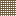{ .mc-icon .mc-inline }
**Hatchery**, or in an 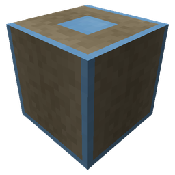{ .mc-icon .mc-inline } **Incubator** (runs on FE, nine stacks at a time). Eggs from two different species can hatch into
a third: that is how every fish that isn't wild is first made.

### Traits

Every fish carries genes for:

| Trait | What it does |
|---|---|
| Species | what it is and what it makes |
| Fertility | how many eggs a female leaves |
| Food usage | how fast it eats fish food |
| Lifespan | how long it lives in the feeder |
| Tank size | how much water it needs around the feeder |
| Work ethic | how fast it makes things |
| Area | how far its effect reaches |

{ .mc-icon .mc-inline } The **DNA Extractor** (10,000 mB of fish oil) copies one
trait from a fish onto a DNA sample. The 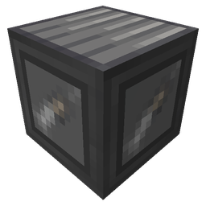{ .mc-icon .mc-inline } **DNA Injector** (5,000 mB of blood, plus power) writes it into another fish.
Each sample lasts 32 uses.

### Upgrades

Fish Feeders and most machines take upgrades, most in a basic and an advanced grade: **speed**, **storage**, **RF**,
**heating**, **cooling**, **salinator**, **filter**, **purity** and **impurity**, plus the **Ethereal**, **AquaScum**,
**Eternal Male** and **Eternal Female** upgrades. Each machine uses them in its own way, and the Compendium page for the
machine says how. In a Fish Feeder, heating, cooling, salinator and filter change the water; Ethereal lets fish live in
other dimensions; the Eternal upgrades keep that fish alive. In a Hatchery, Purity raises the chance of an egg hatching.

## Species

The lowest rod that can catch it, and what it does. "RF" means the Flux Rod.

| Picture | Fish | Wild | Lowest rod | Specialty |
|---|---|---|---|---|
| 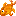{ .mc-icon } | **Goldfish**{ #goldfish } | yes | Fishing Rod | gold nuggets when melted |
| 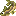{ .mc-icon } | **Minnow**{ #minnow } | yes | Fishing Rod | good bait |
| 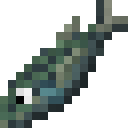{ .mc-icon } | **Silver-Stripe Blaasop**{ #silver-stripe-blaasop } | yes | Fishing Rod | withers and confuses |
| 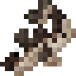{ .mc-icon } | **Cod**{ #cod } | yes | Fishing Rod | leather when melted |
| 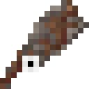{ .mc-icon } | **Squid**{ #squid } | yes | Fishing Rod | ink sacs |
| 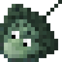{ .mc-icon } | **Sting Ray**{ #sting-ray } | yes | Fishing Rod | poisons in its water |
| 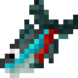{ .mc-icon } | **Neon Tetra**{ #neon-tetra } | yes | Fishing Rod | neon lamps |
| 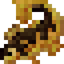{ .mc-icon } | **Walleye**{ #walleye } | yes | Fishing Rod | zoom when eaten raw |
| 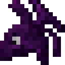{ .mc-icon } | **Nightfish**{ #nightfish } | yes | Reed | strength at night |
| 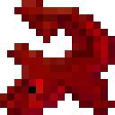{ .mc-icon } | **Netherfish**{ #netherfish } | yes | Reed | burns as fuel |
| 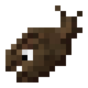{ .mc-icon } | **Anglerfish**{ #anglerfish } | no | Wooden | light |
| 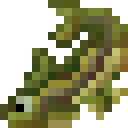{ .mc-icon } | **Stickleback**{ #stickleback } | no | Wooden | kelp |
| 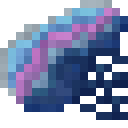{ .mc-icon } | **Man O' War**{ #man-o-war } | no | Reed | blinds and confuses |
| 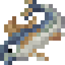{ .mc-icon } | **Tuna**{ #tuna } | no | Reed | speed |
| 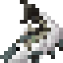{ .mc-icon } | **Salmon**{ #salmon } | no | Fishing Rod | leather |
| 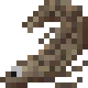{ .mc-icon } | **Lungfish**{ #lungfish } | no | Reed | water breathing |
| 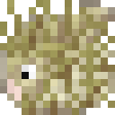{ .mc-icon } | **Pufferfish**{ #pufferfish } | no | Fishing Rod | nothing |
| 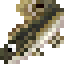{ .mc-icon } | **Bowfin**{ #bowfin } | no | Wooden | arrows |
| 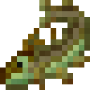{ .mc-icon } | **Northern Pike**{ #northern-pike } | no | Wooden | flint |
| 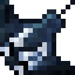{ .mc-icon } | **Manta Ray**{ #manta-ray } | no | Wooden | heals |
| 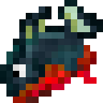{ .mc-icon } | **Piranha**{ #piranha } | no | Wooden | attacks |
| 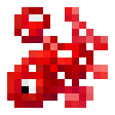{ .mc-icon } | **Red Shroom Fish**{ #red-shroom-fish } | no | Fishing Rod | mycelium and red mushrooms |
| 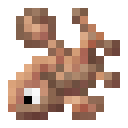{ .mc-icon } | **Brown Shroom Fish**{ #brown-shroom-fish } | no | Fishing Rod | mycelium and brown mushrooms |
| 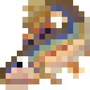{ .mc-icon } | **Chub**{ #chub } | no | Wooden | restores hunger |
| 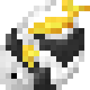{ .mc-icon } | **Angelfish**{ #angelfish } | no | Wooden | moves items |
| 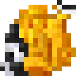{ .mc-icon } | **Butterflyfish**{ #butterflyfish } | no | Wooden | feathers |
| 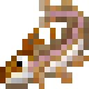{ .mc-icon } | **Rainbow Trout**{ #rainbow-trout } | no | Reed | +10 attack, dyes |
| 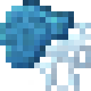{ .mc-icon } | **Jellyfish**{ #jellyfish } | no | Reed | slimeballs |
| 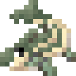{ .mc-icon } | **Bass**{ #bass } | no | Reed | thrown like dynamite |
| 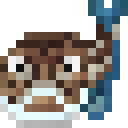{ .mc-icon } | **Whitemargin Stargazer**{ #whitemargin-stargazer } | no | Wooden | stops mob spawns within 16 blocks (8 up and down) |
| 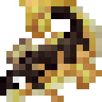{ .mc-icon } | **Perch**{ #perch } | no | Reed | bats |
| 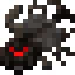{ .mc-icon } | **Spiderfish**{ #spiderfish } | no | Titanium | spiders |
| 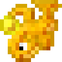{ .mc-icon } | **Glowfish**{ #glowfish } | no | Titanium | turns stone to glowstone |
| 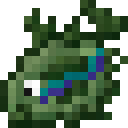{ .mc-icon } | **Undead Fish**{ #undead-fish } | no | Titanium | zombies |
| 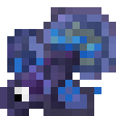{ .mc-icon } | **Siamese Fightin' Fish**{ #siamese-fightin-fish } | no | Titanium | attacks anything but players |
| 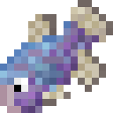{ .mc-icon } | **Pupfish**{ #pupfish } | no | Reed | wolves |
| 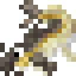{ .mc-icon } | **Catfish**{ #catfish } | no | Reed | ocelots |
| 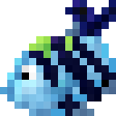{ .mc-icon } | **Damselfish**{ #damselfish } | no | Reed | animals breed |
| 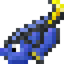{ .mc-icon } | **Blue Tang**{ #blue-tang } | no | RF | lapis |
| 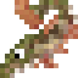{ .mc-icon } | **Pickerel**{ #pickerel } | no | Reed | harvests crops |
| 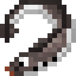{ .mc-icon } | **Lamprey**{ #lamprey } | no | Titanium | wither; makes wither skeletons |
| 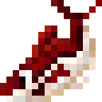{ .mc-icon } | **Red Herring**{ #red-herring } | no | RF | redstone |
| 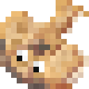{ .mc-icon } | **Electric Ray**{ #electric-ray } | no | RF | 200 RF/s from each side of the feeder |
| 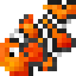{ .mc-icon } | **Clownfish**{ #clownfish } | no | Titanium | cows, chickens, sheep and pigs |
| 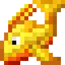{ .mc-icon } | **Blazefish**{ #blazefish } | no | RF | blazes |
| { .mc-icon } | **Enderfish**{ #enderfish } | no | Titanium | endermen |
| { .mc-icon } | **Boneless Fish**{ #boneless-fish } | no | RF | skeletons |
| { .mc-icon } | **Dragonfish**{ #dragonfish } | no | RF | dragon eggs |
| { .mc-icon } | **Koi**{ #koi } | no | RF | dungeon and ocean loot |
| { .mc-icon } | **Minecraft Fish**{ #minecraft-fish } | no | Reed | XP |

The Stargazer's spawn block can be turned off with `stargazer_prevents_spawns` in the [config](config.md#fishery).

### Metal fish

Ironfish, Copperfish, Goldeneye, Aluminiumfish, Magnesiumfish, Rutilefish and the other metal fish make droplets of
molten metal instead. They are never wild and can't be eaten. Some, such as Tinfish, Leadfish, Zincfish, Osmiumfish,
Cobaltfish and Arditefish, belong to metals other mods add.

## Fish as food and fuel

{ .mc-icon .mc-inline } Fish can be eaten raw, cooked, made into sushi and calamari, or ground
into Fish Meal. Melted in a Crucible Furnace they give fish oil, the fuel for most of the workshop
([Workshop](workshop.md#the-vat)).
