# Fishing

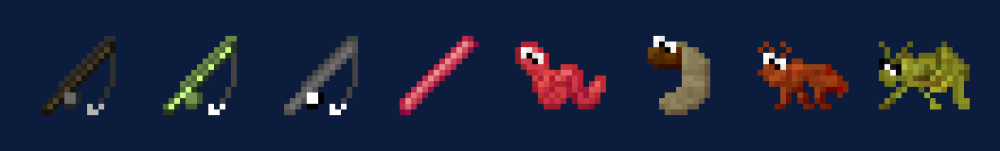

## Rods

Mariculture's rods all catch better than the vanilla rod, and each takes its own baits. Put bait in the rod's
inventory; most bait comes from the Sifter.

| Picture | Rod | Lasts | Baits |
|---|---|---|---|
| { .mc-icon } | **Reed Fishing Rod**{ #reed-fishing-rod } | 96 casts | ant, bread, grasshopper |
| { .mc-icon } | **Wooden Fishing Rod**{ #wooden-fishing-rod } | 320 casts | grasshopper, maggot, worm |
| { .mc-icon } | **Titanium Fishing Rod**{ #titanium-fishing-rod } | 640 casts | worm, bee, minnow |
| { .mc-icon } | **Flux Rod**{ #flux-rod } | never wears out | every bait; 100 FE a cast, holds 250,000 FE |

Some fish only bite on a good enough rod: [Fish and breeding](fish.md#species) lists the lowest rod for each.

In the Nether a Mariculture hook floats on lava, and fish bite there too.

How fast fish bite is set by `fishing_speed_multiplier` in the [config](config.md#fishery), and per rod by a
[datapack](packs.md#fishing-speed).

## Salt and heat

{ .mc-icon .mc-inline } Every fish likes its own
water. Two things matter:

| What | How it is set |
|---|---|
| **Salinity** | fixed by the biome: fresh, brackish or saline |
| **Temperature** | starts from the biome and changes with height, weather, the sun and light |

The Aquatic Environment Analyser shows both where you stand.

| Biome | Water | Temperature (°C) |
|---|---|---|
| Beach | brackish | 25 |
| Desert | fresh | 45 |
| Extreme Hills | fresh | 5 |
| Forest | fresh | 10 |
| Frozen Ocean | saline | -1 |
| Frozen River | fresh | -1 |
| Ice Plains | fresh | -1 |
| Jungle | fresh | 25 |
| Mushroom Island | fresh | 15 |
| Nether | fresh | 80 |
| Ocean | saline | 4 |
| Plains | fresh | 10 |
| River | fresh | 10 |
| The End | fresh | 3 |
| Swamp | fresh | 8 |
| Taiga | fresh | 1 |

## Wild fish

These bite in the wild. Every other species has to be [bred](fish.md#breeding).

| Picture | Fish | Water | Height | Temperature (°C) |
|---|---|---|---|---|
| 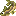{ .mc-icon } | **Minnow**{ #minnow } | fresh | Y 70 and up | -1 to 45 |
| 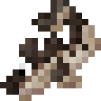{ .mc-icon } | **Cod**{ #cod } | saline | any | -3 to 20 |
| 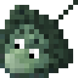{ .mc-icon } | **Sting Ray**{ #sting-ray } | brackish | any | 19 to 29 |
| 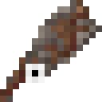{ .mc-icon } | **Squid**{ #squid } | saline | any | 3 to 20 |
| 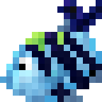{ .mc-icon } | **Damselfish**{ #damselfish } | fresh | any | 22 to 27 |
| 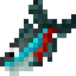{ .mc-icon } | **Neon Tetra**{ #neon-tetra } | fresh | any | 20 to 28 |
| 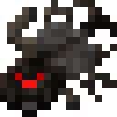{ .mc-icon } | **Spiderfish**{ #spiderfish } | fresh | below Y -48 | -5 to 20 |
| 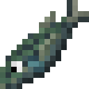{ .mc-icon } | **Silver-Stripe Blaasop**{ #silver-stripe-blaasop } | saline | below Y -16 | -3 to 5 |
| 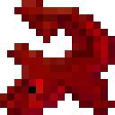{ .mc-icon } | **Netherfish**{ #netherfish } | the Nether | any | 45 to 100 |
| 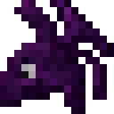{ .mc-icon } | **Nightfish**{ #nightfish } | the End, or at night | any | -10 to 66 |

Goldfish, Cod, Walleye and the other wild species in the [species table](fish.md#species) bite wherever their water
suits them.

## Odd catches

| Picture | Catch | What happens |
|---|---|---|
| | **Zombies**{ #zombies } | sometimes spawn with a fishing rod or a bucket hat and can drop them |
| 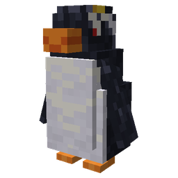{ .mc-icon } | **Rockhoppers**{ #rockhoppers } | penguins on cold shores. Feed them fish to tame them; it works about one time in three. |
