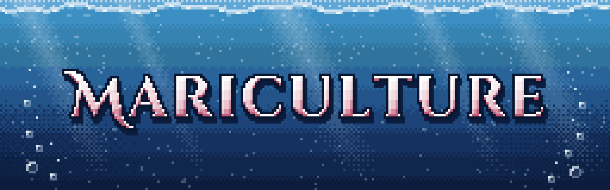
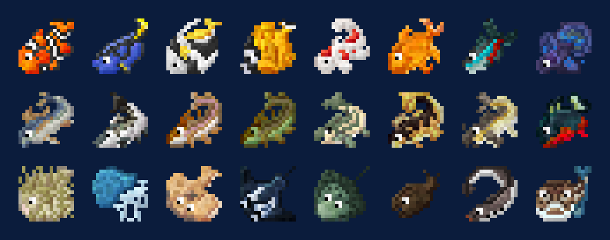

# Mariculture

*Fish it, breed it, dive it and put it to work.*

Mariculture is a mod about the sea. It is joshiejack's Mariculture from Minecraft 1.7.10, brought back as an
unofficial port: more than 60 kinds of fish to catch and breed, pearl oysters, jewelry you enchant yourself, diving gear
from a snorkel up to scuba, and a workshop of vats, crucibles and casters that makes the titanium for the best of it.

Everything is explained in the Mariculture Compendium, the in-game book.

**Requires** Patchouli. **Optional:** JEI (every machine recipe, fishing loot and jewelry), Jade, KubeJS, CraftTweaker,
and the mods listed under [For pack makers](packs.md#other-mods).

**Versions:** 0.4.1, for Forge 1.20.1, NeoForge 1.21.1 and NeoForge 26.1.2. See [Versions](versions.md) for what
differs on each.

## What's in it

| | | |
|---|---|---|
| { .mc-icon } | **[Fishing](fishing.md)** | the four rods, bait, salinity and temperature, and where each wild fish bites |
| { .mc-icon } | **[Fish and breeding](fish.md)** | every species, what it makes in a Fish Feeder, traits, hatching and DNA |
| { .mc-icon } | **[Pearls and jewelry](jewelry.md)** | oysters, rings, bracelets, necklaces, mirrors and the 13 jewelry enchantments |
| { .mc-icon } | **[Diving](diving.md)** | snorkel, diving suit, scuba, the air pump, the FLUDD and the Speed Boat |
| { .mc-icon } | **[Workshop and factory](workshop.md)** | ores, the vat, crucible and casting, titanium, power and automation |
| | **[For pack makers](packs.md)** | datapack tweaks, KubeJS, CraftTweaker, fishing speed, other mods |
| | **[Config](config.md)** | every setting in `mariculture-common.toml` |

## Credits

By **Oculifelis**, after the original Mariculture by **joshiejack** (MIT).

Textures after Poppycocks' Mariculture art. Thanks also to SlimeKnights and Team CoFH, whose mods the original
worked with.
