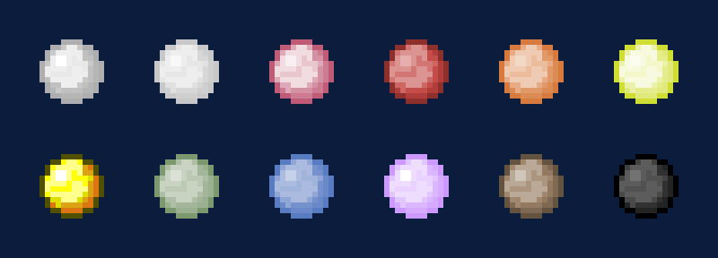
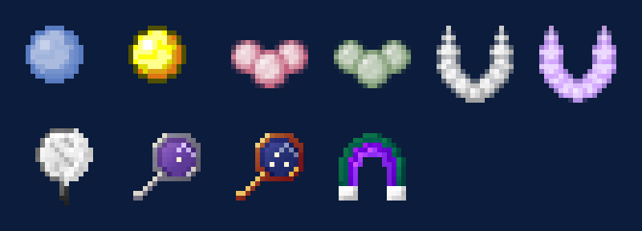
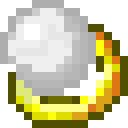
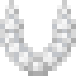

# Pearls and jewelry

## Oysters and pearls

{ .mc-icon .mc-inline } Pearl oysters grow on the sea floor. About one in three holds
something. The block under an oyster sets the colour of its pearl: put a **Pearl Block** of a colour underneath to farm
that colour. In the End, oysters make ender pearls.

There are twelve colours: white, green, yellow, orange, red, gold, brown, purple, blue, black, pink and silver. Pearls
also go into pearl bricks, and the colour matters for jewelry (below) and the Bucket Hat
([Workshop](workshop.md#the-vat)).

## Making jewelry

Rings, bracelets and necklaces are pearls plus a binding:

| Picture | Piece | Bindings | Shape in the crafting grid |
|---|---|---|---|
| { .mc-icon } | **Ring**{ #ring } | iron or gold | seven bindings in a ring, the pearl at the top middle |
| { .mc-icon } | **Bracelet**{ #bracelet } | string or golden silk | two bindings in the top corners over four pearls in a U |
| { .mc-icon } | **Necklace**{ #necklace } | wool or golden thread | seven pearls in a ring, the binding at the top middle |

That makes a rough piece. Finish it on the { .mc-icon .mc-inline } **Blacksmith's Anvil** with
the hammer, or in an { .mc-icon .mc-inline } **Autohammer**. Worn jewelry is repaired on the anvil for XP.

## Enchanting

{ .mc-icon .mc-inline } Jewelry isn't enchanted at an enchanting table. Instead:

1. Enchant **pearls**, best inside a mirror, which steers the roll.
2. Combine enchanted pearls with a piece of jewelry of the same colour.
3. Work it on the anvil to set the enchantments.

Better bindings give a better chance that the enchantments stick.

| Picture | Name | Lasts |
|---|---|---|
| { .mc-icon } | **Mirror**{ #mirror } | 100 uses |
| { .mc-icon } | **Magic Mirror**{ #magic-mirror } | enchants up to level 30 |
| { .mc-icon } | **Celestial Mirror**{ #celestial-mirror } | enchants at levels 31 to 60 |

### Jewelry enchantments

| Enchantment | Max level | Effect |
|---|---|---|
| Sonic the Hedgehog | 5 | faster sprinting |
| Leapfrog | 4 | jump higher; wears the piece every 10 jumps |
| Step Up | 3 | step up one more block per level |
| Fall Resistance | 4 | less fall damage |
| Spiderman | 1 | climb walls |
| Paraglide | 2 | fall slowly; sneak to drop |
| Superman | 3 | fly; double-jump to take off |
| Reaper | 3 | I keeps your items, II respawns you where you died, III adds a moment of immunity after respawning |
| Blink | 3 | teleport with the V key, 16 blocks per level |
| Restoration | 3 | repairs the held item, then the hotbar, then armour |
| 1 Up | 3 | brings you back when you die |
| Never Hungry | 5 | restores hunger |
| Elemental Affinity | 1 | depends on the pearl's colour (below) |

**Elemental Affinity** by pearl colour:

| Colour | Effect |
|---|---|
| Black | more damage at night |
| White | more damage by day |
| Blue | no drowning |
| Brown | digging dirt finds bait |
| Gold | kills drop gold nuggets |
| Green | no poison |
| Orange | more XP |
| Pink | kills heal you |
| Purple | no magic damage |
| Red | no fire or lava damage |
| Silver | silverfish drop cooked cod |
| Yellow | no earthly damage |

How fast Leapfrog, Sonic and Restoration work, and Blink's range and cooldown, are in the
[config](config.md#jewelry). Worn jewelry stays with you on death unless `drops_on_death` is on.

## Magical tools

| | | |
|---|---|---|
| { .mc-icon } | **Mob Magnet**{ #mob-magnet } | binds to the first kind of mob you kill with it, then pulls that kind to you from 32 blocks; never wears out |
| { .mc-icon } | **Hydrophobic Initiator**{ #hydrophobic-initiator } | places blocks on water |
| { .mc-icon } | **Infinity Water**{ #infinity-water } | never runs dry |
