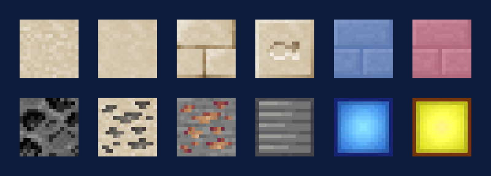

# Workshop and factory

## Ores and the sea floor

| | | |
|---|---|---|
| { .mc-icon } | **Bauxite** | aluminium ore; veins of up to 8 between Y 64 and 255; needs a stone pickaxe |
| { .mc-icon } | **Rutile** | titanium ore; in the limestone of the sea bed, twice as common under rivers; needs an iron pickaxe |
| { .mc-icon } | **Limestone** | the sea bed's stone, with bricks and other building blocks |
| { .mc-icon } | **Pearl bricks** | building blocks in each pearl colour |

**Coral** comes in eight colours. Bleach it in the vat with 50 mB of quicklime; bring it back to life in 100 mB of
water. **Ancient Sand** smelts into Heat Resistant Glass.

## The crucible and casting

{ .mc-icon .mc-inline } The **Crucible Furnace** melts ores, metals and fish
into fluids. Ores melt for up to twice the metal of smelting. Pour with the **Ladle** (244 mB) or cast the fluid into
ingots, nuggets and blocks.

Fluids are kept in tanks:

| Tank | Holds |
|---|---|
| Copper tank | 32,000 mB |
| Aluminium tank | 64,000 mB |
| Titanium tank | 128,000 mB |
| Heat bottle | 2,000 mB |
| Titanium bucket | 16,000 mB |

{ .mc-icon .mc-inline } The **Blacksmith's Anvil** shapes metal with the hammer. The
**Autohammer** does it for you.

## The vat

{ .mc-icon .mc-inline } The **Vat** mixes two fluids, or a fluid and an item. One vat holds
6,000 mB; four in a 2×2 square hold 30,000 mB.

| Makes | From | Time |
|---|---|---|
| { .mc-icon .mc-inline } Molten titanium | molten magnesium + molten rutile | 1 s |
| Molten magnesium (144 mB) | 3,000 mB quicklime + 1,000 mB water | 5 s |
| Burnt Brick | brick + 250 mB lava | 5 s |
| Burnt Brick | nether brick + 100 mB lava | 3 s |
| Heat Resistant Glass | glass + 1 nugget of molten aluminium + 900 mB quicklime | 15 s |
| Polished Stick | stick + 5,000 mB fish oil | 15 s |
| Polished Titanium Rod | titanium rod + 6,500 mB fish oil | 30 s |
| Polished Planks | planks + 10,000 mB fish oil | 30 s |
| Polished Log | log + 30,000 mB fish oil | 45 s |
| { .mc-icon .mc-inline } Bucket Hat | leather cap + 16,000 mB fish oil | 25 s |

Fish oil comes from melting fish in the Crucible Furnace.

The **Bucket Hat** takes a pearl, and the pearl's colour changes what you catch: white for fresh water, silver for salt,
yellow for brackish, green for the jungle, red for the Nether, brown for underground (below Y 10), orange for fish only,
gold for junk and treasure, purple for enchanted catches, blue for males, pink for females, and black for raw.

## Power

Mariculture makes FE from water. **Sluices** pour water onto **rotors** on a water turbine; rotors come in copper
(×1), aluminium (×2) and titanium (×5). The **Gas Turbine** runs on natural gas pumped into its tank by an air pump:
the tank holds 512 buckets, the turbine uses 1 mB every quarter-second and makes 5,000 power.

## Machines

| | Machine | |
|---|---|---|
| { .mc-icon } | **Sawmill** | builds custom blocks from plans, copying the faces of other blocks; the Paintbrush repaints them |
| { .mc-icon } | **Sifter** | right-click items onto it, then again to sift them; where most bait comes from |
| { .mc-icon } | **Automatic Fisher** | does your fishing for you |
| | **Fishing Net** | placed on water, slowly catches fish as a Reed Rod would |
| | **Fish Sorter** | sorts fish by species |
| | **Unpacker** | unpacks items |
| | **Automatic Dictionary Converter** | turns items into another mod's version of the same tag; 24 slots, 216 filters |
| | **Fluid Auto-Dictionary** | the same for fluids |
| | **Mechanized Sponge** | clears fluid from a 97×97 area, 40 FE per block; needs five more Sponge blocks with it |
| | **Pressure Vessel** | holds 200 buckets, plus 8 per upgrade |
| | **Geyser** | pushes entities along, 8 or 16 blocks |

How fast each machine works is set in the [config](config.md#machines).
