# Metal effects

Most metals give their gear an effect. *Weapon* effects work on that metal's sword and weapons, *Tools* on its tools,
*Armour* while you wear the full set, and *Everything* on any piece made from it. The names and descriptions are the
in-game tooltips.

| Picture | Metal | On | Effect | What it does |
|---|---|---|---|---|
| { .mc-icon } | **Adamantine**{ #adamantine } | Armour (full set) | **Symbiosis** | Receiving fatal damage will cause one of the armor pieces to sacrifice itself. Every Armor piece will increase the chance of surviving death by 25% (with a maximum of 100% when wearing full set) |
| 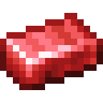{ .mc-icon } | Adamantine | Everything | **Inclusions** | Eating food regenerates equipment durability, not eating any food slowly destroys equipment. Durability repair amount depends on how many food points the item gives. Durability decreases with a frequence of 1 to 6 seconds depending on how hungry the player is |
| 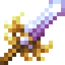{ .mc-icon } | **Amordrine**{ #amordrine } | Weapon | **Divine Grace** | Bonus Damage depending on target's health, the less health target has the more damage the weapon does (up to 200% damage boost) |
| 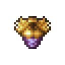{ .mc-icon } | Amordrine | Armour (full set) | **Sky-High** | Grants extra jumps (from 1 to 4) depending on how many armor pieces the player is wearing |
| 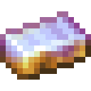{ .mc-icon } | Amordrine | Everything | **Soulbound** | This item will persist in your inventory after death |
| 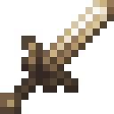{ .mc-icon } | **Angmallen**{ #angmallen } | Weapon | **Reactive I** | Deals Bonus Damage to armored enemies |
| { .mc-icon } | Angmallen | Armour (full set) | **Reactive II** | Plays a sound sometimes when you're near some rare ore, every armor piece increases the chance to detect rare ores |
| 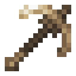{ .mc-icon } | Angmallen | Pickaxe | **Transmute** | Mining an ore sometimes drops another ore of +1/-1/+0 harvest level (50% chance) |
| { .mc-icon } | **Astral Silver**{ #astral-silver } | Weapon | **Extraterrestrial** | 45% more damage if the player is in another dimension |
| { .mc-icon } | Astral Silver | Armour (full set) | **Starlight** | Gives Night Vision and Speed depending on how many pieces of armor are worn, effects are only applied when the player is directly under the night-sky or in The End. |
| { .mc-icon } | Astral Silver | Tools | **Extraterrastrial** | Increased speed when breaking blocks in dimensions that aren't the Overworld |
| 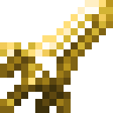{ .mc-icon } | **Atlarus**{ #atlarus } | Weapon | **Gust of Wind** | A strong gust of wind pushes enemies away from you and breaks leaves and vines in a range of 5 blocks around you |
| 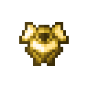{ .mc-icon } | Atlarus | Armour (full set) | **Whirlwind** | A whirlwind barrier will deviate any projectile going towards you from a certain distance. |
| 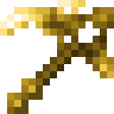{ .mc-icon } | Atlarus | Hoe | **Wind Scythe** | Wind helps you remove bushes and crops around you |
| 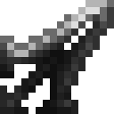{ .mc-icon } | **Black Steel**{ #black-steel } | Weapon | **Mountain** | Tools & weapons act like armor, for example holding a black steel sword while getting attacked will damage the sword but absorb a small portion of the damage. |
| { .mc-icon } | Black Steel | Armour (full set) | **Reinforcement** | Receiving damage sometimes grants resistance but also slowness, at the same time. ( Repeated strikes stack the effect, aka slowness I and resistance I become slowness II and resistance II. Can stack up to 3 times, chance based.) |
| 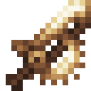{ .mc-icon } | **Carmot**{ #carmot } | Weapon | **Abattoir** | Attacking a mob will also attack mobs of the same type in a radius around the initial strike |
| 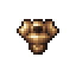{ .mc-icon } | Carmot | Armour (full set) | **Power User** | You can consume and use items faster depending on how many armor pieces you wear; if you wear a full set you also get a Haste III buff |
| 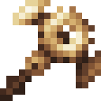{ .mc-icon } | Carmot | Tools | **Autonomous** | Harvesting a block will mine surrounding blocks of the same type in a spherical range |
| 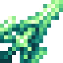{ .mc-icon } | **Celenegil**{ #celenegil } | Weapon | **Glory Seeker** | On right click, Grants a small damage buff to the weapon damage but when you damage an entity without killing it, it'll go on a short cooldown while it will give the player some short speed and strength buff if they manage to kill the entity |
| 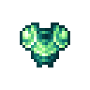{ .mc-icon } | Celenegil | Armour (full set) | **Perseverance** | After being attacked five times over a short period, all the enemies are knocked back away from the player and the player receives a very short regen buff and all negative effects are cleared. |
| 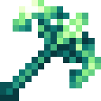{ .mc-icon } | Celenegil | Tools | **Escalation** | Continuously breaking blocks without stopping doesn't use durability and increases mining speed. (Resets after pausing for more than a second, the unbreakable effect is enabled after 5 blocks mined) |
| 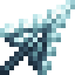{ .mc-icon } | **Ceruclase**{ #ceruclase } | Weapon | **Flash Freeze** | Has a 75% chance to completely freeze an enemy in place on hit for 3 seconds. |
| { .mc-icon } | Ceruclase | Armour (full set) | **Blizzard** | Mobs are slowed, fatigued and weakened depending on how much armor you wear, both players and entities are extinguished if they were on fire. |
| 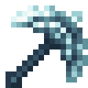{ .mc-icon } | Ceruclase | Tools | **Cold Snap** | Blocks will be mined instantly if they can be harvested and if they're harvested with the correct tool type. |
| 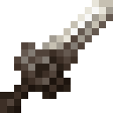{ .mc-icon } | **Damascus Steel**{ #damascus-steel } | Weapon | **Brilliance** | Mobs drop significantly more experience. |
| { .mc-icon } | Damascus Steel | Armour (full set) | **Royal Blood** | A minion will be spawned to aid you in your fights against enemies (minion health will scale with the armor count) |
| 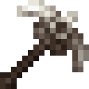{ .mc-icon } | Damascus Steel | Pickaxe | **Dazzle** | Mining ores sometimes grants a bit of experience depending on the harvest level. |
| 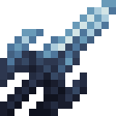{ .mc-icon } | **Deep Iron**{ #deep-iron } | Weapon | **Diver** | Enhanced weapon damage when underwater (+3 hearts of damage) |
| { .mc-icon } | Deep Iron | Armour (full set) | **Aquatic** | Grants Water Breathing and improved Mobility in water depending on how many armor pieces are worn (it also grants night vision with 2 or more armor pieces). |
| 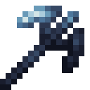{ .mc-icon } | Deep Iron | Tools | **Diver** | Improved tool harvest speed when underwater (3 times the normal underwater speed) |
| 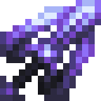{ .mc-icon } | **Desichalkos**{ #desichalkos } | Weapon | **Nullifier** | When attacking, the damage is dealt straight to the opponent's health bar, unaffected by armor or any resistance the opponent might have. |
| 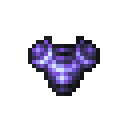{ .mc-icon } | Desichalkos | Armour (full set) | **Orb** | The wearer can fully absorb X instances of damage (X scales with armor) without taking damage, the “Layers” regenerate one at a time every 7 seconds after the last time the wearer took damage. |
| 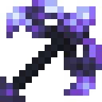{ .mc-icon } | Desichalkos | Tools | **Wormhole** | Tool Reach is 3 blocks higher than normal (Metal trait) - Block Drops are teleported to the player inventory directly |
| 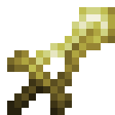{ .mc-icon } | **Electrum**{ #electrum } | Weapon | **Magnet** | Activating the effect with a right click on the weapon will cause entities in line of sight of the player to be moved towards the player. |
| { .mc-icon } | Electrum | Armour (full set) | **Static** | Receiving damage charges items in the player inventory with Energy. Energy is distributed equally among all items. Energy value scales based on damage received prior to armor reduction calculations. |
| 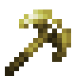{ .mc-icon } | Electrum | Tools | **Voltage Control** | Harvesting blocks while the effect is active (right-click) will make the tool use 10x durability but mine significantly faster and gain a higher harvest level. |
| { .mc-icon } | **Etherium**{ #etherium } | Weapon | **Siphon** | When attacking, sometimes extra damage is dealt and the user regenerates health equal to the extra damage. If the player has full HP they gain an absorption buff for that amount of hp (Absorption doesn't stack). |
| { .mc-icon } | Etherium | Armour (full set) | **Ethereal** | Allows the player to clip through walls when sneaking for at most 15 seconds after which the player remains stuck in the wall |
| 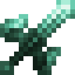{ .mc-icon } | **Eximite**{ #eximite } | Weapon | **Outworlder** | Grants bonus damage and a looting effect to mobs in the End. |
| { .mc-icon } | Eximite | Armour (full set) | **End Domestic** | Shulkers become neutral, but you're not immune to the effect of lingering bullets. |
| { .mc-icon } | **Haderoth**{ #haderoth } | Weapon | **Apex** | Becomes active only after Metamorph. Builds up bonus damage when continually killing mobs of the same type. Bonus damage per kill: +1.0 Maximum bonus damage: +12.0 |
| 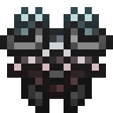{ .mc-icon } | Haderoth | Armour (full set) | **Adaptability** | Becomes active only after Metamorph. Helmet: Immunity to hunger effect. Chestplate: Permanent Fire resistance. Leggings: Immunity to slowness effect. Boots: Immunity to levitation effect. |
| { .mc-icon } | Haderoth | Everything | **Metamorph** | After breaking once, the item is replaced with a new and better version of itself. Along with significantly higher durability, the second generation gains bonuses depending on the item type: Armor: higher protection and toughness values, "Adaptability" effect becomes active. Weapons: higher damage, "Apex" effect becomes active. Tools: higher efficiency when breaking blocks. |
| 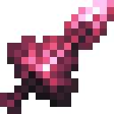{ .mc-icon } | **Hepatizon**{ #hepatizon } | Weapon | **Disarm** | When attacking you have a chance to rob the enemy of some of their equipment. |
| { .mc-icon } | Hepatizon | Armour (full set) | **Cloak & Dagger** | Mobs lose track of you outside of a certain radius depending on how much armor you're wearing. |
| 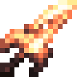{ .mc-icon } | **Ignatius**{ #ignatius } | Weapon | **Molten Blade** | Auto-smelts entity loot if they can be smelted. Auto-smelt chance is based on the Fortune enchantment |
| 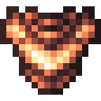{ .mc-icon } | Ignatius | Armour (full set) | **Hot-Blooded** | Fire and lava heals you proportionally to the damage it would otherwise deal, but water and rain damages you as if it were lava and fire; The effect of Fire Protection is inverted, to protect water damage. |
| 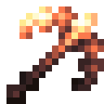{ .mc-icon } | Ignatius | Tools | **Molten Core** | Auto-smelts block drops if they can be smelted. Auto-smelt chance is based on the Fortune enchantment |
| 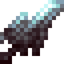{ .mc-icon } | **Inolashite**{ #inolashite } | Weapon | **Time Cleave** | When attacking, another attack will be time-collapsed to your first attack allowing you to attack two times at full power in quick succession. |
| 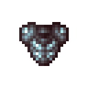{ .mc-icon } | Inolashite | Armour (full set) | **Warp** | Shift + Jump will teleport the player back in time of 2..8 seconds depending on how much armor is worn |
| 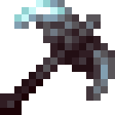{ .mc-icon } | Inolashite | Tools | **Time Leap** | Upon activation, transports the player 7 blocks in the direction they are looking breaking all the blocks in the way (as long as the tool can harvest them). |
| 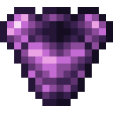{ .mc-icon } | **Kalendrite**{ #kalendrite } | Armour (full set) | **Tranquil** | If the player has not received any damage for the past 10 seconds and they don't have full hp, they gain a regeneration buff. |
| 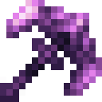{ .mc-icon } | Kalendrite | Tools | **Restoration** | Breaking blocks restores half a heart but tools lose more durability the lower the user's health is. |
| 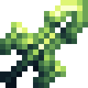{ .mc-icon } | **Krik**{ #krik } | Weapon | **Flak** | Deals double damage to airborne entities and gives a short levitation debuff. |
| 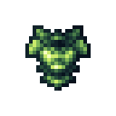{ .mc-icon } | Krik | Armour (full set) | **Weight-Controlled Flight** | Makes you float at a certain height depending on how much filled your inventory is. You can press the UP arrow or the DOWN arrow to float respectively up and down. You have a height limit you can't go over while floating, that limit depends on how full your inventory is (excluding the hotbar). There's also an HUD in the bottom-right corner of the screen that shows you, your height level and your limit. |
| 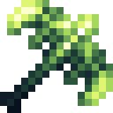{ .mc-icon } | Krik | Tools | **Krik-Drives** | Activating the item launches the player in the general direction of where they are looking. |
| 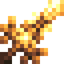{ .mc-icon } | **Midasium**{ #midasium } | Weapon | **Bounty** | Mobs occasionally drop extra loot, has a small chance to convert all drops into gold ingots. Bonus loot chance: 30% / 60% / 90% / 100% Gold chance: 1% / 5% / 12% / 18% (Scales with Looting enchantment) |
| 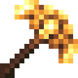{ .mc-icon } | Midasium | Tools | **Greed** | Chance based fortune effect that stacks with the fortune enchantment. All drops have a small chance to be turned into gold ingots. |
| 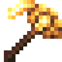{ .mc-icon } | Midasium | Hoe | **Midas Touch** | Harvesting crops with this hoe will turn the crop drops into gold items (ingots, dusts and nuggets) instead. |
| 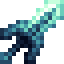{ .mc-icon } | **Mithril**{ #mithril } | Weapon | **Magic Aspect** | Deals additional magic damage 1 second after the last entity was attacked |
| 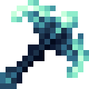{ .mc-icon } | Mithril | Pickaxe | **Multiply** | Breaking ore sometimes drops an additional ore along with the one mined. Effect chance scales with Fortune Enchantment |
| 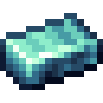{ .mc-icon } | Mithril | Everything | **Arcane** | The more enchantments the item has the better it performs. (damage for weapons, mining speed for tools and more protection from armor) |
| 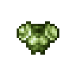{ .mc-icon } | **Orichalcum**{ #orichalcum } | Armour (full set) | **Berserker** | Killing a mob grants a strength buff, level of which is equal to the count of every other remaining hostile mob around the wearer. (Max Potion Level: 6) (Armor scales the radius and duration of the bonus) |
| 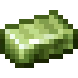{ .mc-icon } | Orichalcum | Everything | **Champion** | Killing monsters restores durability to Orichalcum Items (Amount is equal to the max health of the killed monster) |
| 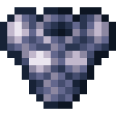{ .mc-icon } | **Osmium**{ #osmium } | Armour (full set) | **Titan** | Enemies are knocked back when they attack you |
| { .mc-icon } | **Oureclase**{ #oureclase } | Weapon | **Pulverize** | Deals 2x the original damage to enemies with full health. |
| { .mc-icon } | Oureclase | Armour (full set) | **Stampede** | Sprinting slightly damages and knocks back nearby entities. |
| { .mc-icon } | Oureclase | Pickaxe | **Crushing** | Mining ores drops 1 dust of that metal instead of the ore. |
| { .mc-icon } | **Platinum**{ #platinum } | Weapon | **Cathartic Strike** | Extra cathartic damage will be dealt to undead enemies as well as setting them on fire. |
| { .mc-icon } | Platinum | Armour (full set) | **Purification** | Purifies negative effects like Weakness, Slowness and Poison to their positive counterparts. |
| { .mc-icon } | Platinum | Everything | **Flawless** | This tool is unbreakable |
| { .mc-icon } | **Prometheum**{ #prometheum } | Armour (full set) | **Freyr** | Shifting affects nearby crops and grass growth giving it a boost at the cost of a bit of armor durability. |
| { .mc-icon } | Prometheum | Hoe | **Harvest** | When harvested with this hoe: leaves, crops and grass drops are increased. |
| { .mc-icon } | Prometheum | Everything | **Photosynthesis** | Item durability regenerates slowly overtime when under direct sunlight. |
| { .mc-icon } | **Quicksilver**{ #quicksilver } | Weapon | **Sleight of blade** | On every successful attack you're launched through the enemy damaging them more. |
| { .mc-icon } | Quicksilver | Armour (full set) | **Acceleration** | Sprinting will allow you to build up momentum, once full speed is reached you'll be able to run on liquids, but you will sink as soon as you stop or slow down. |
| { .mc-icon } | Quicksilver | Tools | **Tailwind** | Mining speed will remain the same over any block independently from harvest level or block hardness |
| { .mc-icon } | Quicksilver | Everything | **Aerodynamic** | Equipping this item gives you a speed boost. |
| { .mc-icon } | **Sanguinite**{ #sanguinite } | Weapon | **Devour** | You deal more damage as you grow hungry, killing enemies appeases your hunger depending on the max health of the enemy but also makes you hungry for more. |
| { .mc-icon } | Sanguinite | Armour (full set) | **Necromastery** | Killing a hostile mob might revive its corpse with lower health allowing it to be killed again for more drops and experience. |
| { .mc-icon } | Sanguinite | Tools | **Blood Tap** | Activating the tool will exchange some of your life for increased harvest speed and level also restoring a bit of durability |
| { .mc-icon } | Sanguinite | Everything | **Deceitful** | This item will disappear completely after death. |
| { .mc-icon } | **Shadow Iron**{ #shadow-iron } | Weapon | **Chaos Crit** | Attacks occasionally become critical hits dealing random increased damage up to more than 3 times the base attack value. |
| { .mc-icon } | Shadow Iron | Armour (full set) | **Broken Evasion** | Has a chance of absorbing attack damage completely at the cost of durability from one of the armor pieces |
| { .mc-icon } | Shadow Iron | Pickaxe | **Incompatible** | Mining Shadow Iron ore will sometimes drop a different ore. |
| { .mc-icon } | **Shadow Steel**{ #shadow-steel } | Weapon | **Harmony** | This weapon hits faster in the dark and stronger in the light. |
| { .mc-icon } | Shadow Steel | Armour (full set) | **Eclipse** | Whether if you're attacked in light or in darkness you either blind and damage enemies with fire or evade anymore damage and gain speed boost for a few seconds |
| { .mc-icon } | Shadow Steel | Everything | **Umbral-synthesis** | This item regenerates durability in the darkness, regen speed is relative to the darkness level |
| { .mc-icon } | **Tartarite**{ #tartarite } | Everything | **Paragon absorb** | Surrounding the item with 4 blocks of another metal will allow it to absorb its effects in an increased ratio while also increasing item durability. |
| { .mc-icon } | **Vulcanite**{ #vulcanite } | Weapon | **Fuse** | Right clicking the weapon ignites it, and on the next strike within 5 seconds will create an explosion whose strength depends on how much time is left on the fuse, if 5 seconds run out before you attack any enemy the explosion will affect the user. |
| { .mc-icon } | Vulcanite | Armour (full set) | **Explosion** | Receiving damage causes explosions that damage all the entities around the player damage scales with armor level, when more than 2 pieces are worn explosions also cause fire in the area around and the user is given 10 seconds of fire resistance. |
| { .mc-icon } | Vulcanite | Tools | **Fissure** | Breaking a block has a chance of breaking another one adjacent to it, chance scales with fortune. |
| { .mc-icon } | **Vyroxeres**{ #vyroxeres } | Weapon | **Toxin** | Poisons the target on every hit, if the target is already poisoned, the level of poison debuff increases. |
| { .mc-icon } | Vyroxeres | Armour (full set) | **Dissolve** | Additional Damage Reduction for every active potion effect on the user. |
