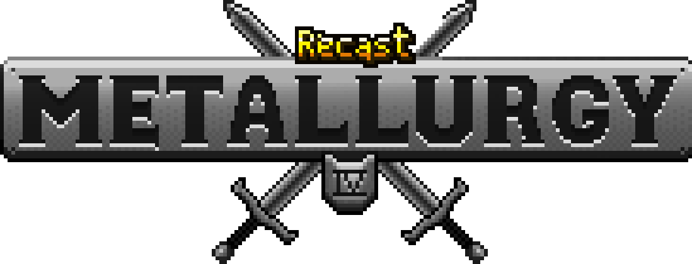
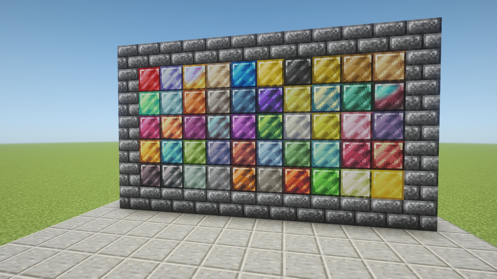
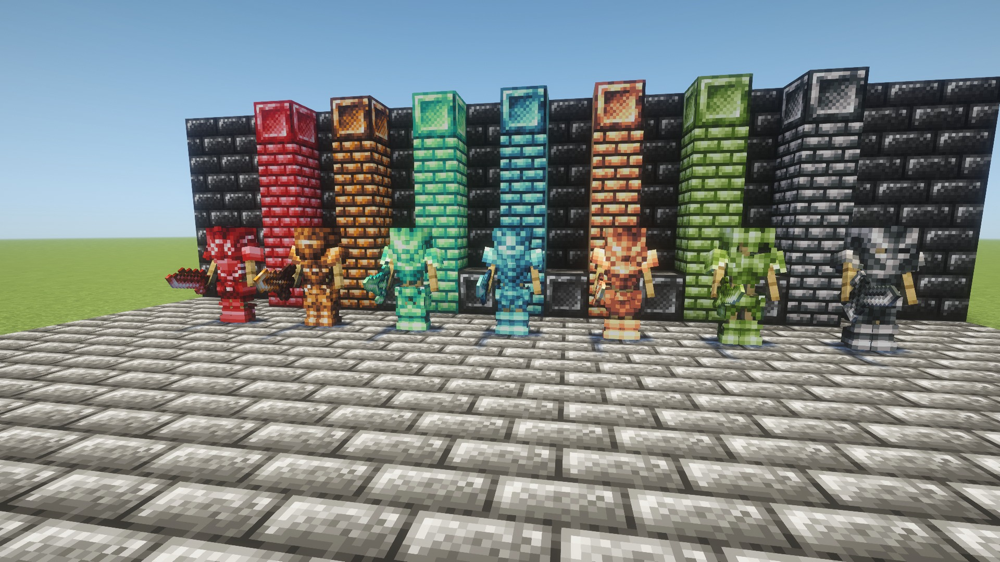

# Metallurgy: Recast

*49 metals, and nearly every one does something.*

Metallurgy: Recast brings Metallurgy 4: Reforged back on modern Minecraft, with Metallurgy Chests built in. Mine new
ores in the Overworld, the Nether and the End, smelt and alloy them, and wear or wield the results. The metals steal
life, see in the dark, shrug off fire and poison, keep your gear when you die, or fuse other metals' powers into
Tartarite.

**Requires** nothing but NeoForge. **Optional:** JEI, Patchouli, Silent Gear, and on 26.1.2 Hephaestus Tools and
Thaumaturge ([Works with](#works-with)).

**Versions:** 1.4.1-port.27, for NeoForge 26.1.2. See [Versions](versions.md).

## What's in it

| | |
|---|---|
| **[Ores and alloys](metals.md)** | 34 ores across three dimensions, tar lakes, and the 18 Alloyer recipes |
| **[Metal effects](effects.md)** | what every metal's weapons, tools and armour do, 95 effects in all |
| **[Machines and gear](machines.md)** | the Crusher, Alloyer and Sublimation Chamber, bucklers, the Rubracium Gauntlet, detectors, magnets and chests |

## Works with

- **JEI** shows every machine recipe, detector programming and every form of Tartarite absorption.
- **Patchouli** adds an in-game handbook covering all 49 metals, the machines, gear and fluids. Its chapters about other
  mods only appear when those mods are installed.
- **Silent Gear** gets the metals as gear materials.
- **Hephaestus Tools** (26.1.2): the metals as tool materials, smeltery recipes, and the original Tinkers' Construct
  traits on 12 materials.
- **Thaumaturge** (26.1.2): a wand cap and rod for each metal.

## Credits

Metallurgy 4: Reforged is by Davoleo, Matpac and contributors, based on Metallurgy 4 by ShadowClaimer and its team.
Metallurgy Chests is by KreloX. This modern port is by **Oculifelis**. It is an unofficial continuation and not endorsed
by the original authors.

GPL-3.0, like the original. Source: [Oculifelis/Metallurgy-Recast-Source](https://github.com/Oculifelis/Metallurgy-Recast-Source).
