# Machines and gear

## Machines

| Picture | Machine | What it does |
|---|---|---|
| 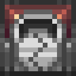{ .mc-icon } | **Crusher**{ #crusher } | grinds ores and ingots into dust, two dusts per ore. It has 141 recipes. |
| 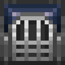{ .mc-icon } | **Alloyer**{ #alloyer } | mixes two metals into an alloy. The recipes are on [Ores and alloys](metals.md#alloys). |
| { .mc-icon } | **[Sublimation Chamber](#sublimation-chamber)** | burns blocks of metal into an aura: every player nearby gets the effect (table below) |

### Sublimation Chamber

{ .mc-icon .mc-inline } Burns blocks of metal into an aura: every player nearby gets the effect.

| Picture | Metal | Uses | Effect | Lasts |
|---|---|---|---|---|
| 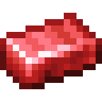{ .mc-icon } | **Adamantine**{ #adamantine } | 3 blocks | Health Boost IV | 15 min |
| { .mc-icon } | **Amordrine**{ #amordrine } | 3 blocks | Jump Boost | 15 min |
| { .mc-icon } | **Astral Silver**{ #astral-silver } | 3 blocks | Night Vision | 15 min |
| 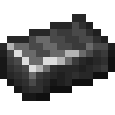{ .mc-icon } | **Black Steel**{ #black-steel } | 3 blocks | Resistance | 15 min |
| 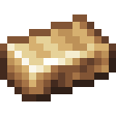{ .mc-icon } | **Carmot**{ #carmot } | 4 blocks | Haste | 18 min |
| 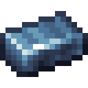{ .mc-icon } | **Deep Iron**{ #deep-iron } | 4 blocks | Water Breathing | 20 min |
| { .mc-icon } | **Ignatius**{ #ignatius } | 4 blocks | Fire Resistance | 15 min |
| 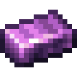{ .mc-icon } | **Kalendrite**{ #kalendrite } | 4 blocks | Regeneration II | 20 min |
| 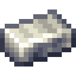{ .mc-icon } | **Lemurite**{ #lemurite } | 3 blocks | Invisibility | 16 min |
| 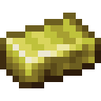{ .mc-icon } | **Lutetium**{ #lutetium } | 4 blocks | Levitation | 20 min |
| 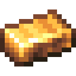{ .mc-icon } | **Midasium**{ #midasium } | 3 blocks | Luck | 18 min |
| 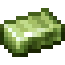{ .mc-icon } | **Orichalcum**{ #orichalcum } | 3 blocks | Strength II | 18 min |
| 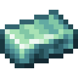{ .mc-icon } | **Quicksilver**{ #quicksilver } | 4 blocks | Speed II | 20 min |
| 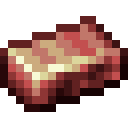{ .mc-icon } | **Sanguinite**{ #sanguinite } | 3 blocks | Saturation | 16 min |

## Gear

| Picture | Name | What it does |
|---|---|---|
| | **Armour and tools**{ #armour-and-tools } | for almost every metal: 41 armour sets and 39 tool sets. See [Metal effects](effects.md). |
| { .mc-icon } { .mc-icon } 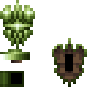{ .mc-icon } | **Bucklers**{ #bucklers } | light shields that block for a few seconds and then cool down, without slowing you. The Zinc Buckler is plain; the Vulcanite Buckler knocks melee attackers back with a small blast; the Orichalcum Buckler reflects ranged damage and pulls the shooter into reach. |
| 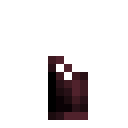{ .mc-icon } | **Rubracium Gauntlet**{ #rubracium-gauntlet } | mines like an iron pickaxe and shovel, takes tool enchantments, and shows your own arm in first person. |
| 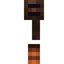{ .mc-icon } | **Metal Detector**{ #metal-detector } | craft it with one to three non-alloy metal ingots to program it, then right-click to scan 8 blocks in every direction for those ores. |
| 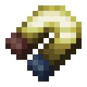{ .mc-icon } | **Electrum Magnet**{ #electrum-magnet } | pulls dropped items to you. Three modes: off, metals only, everything. |
| { .mc-icon } | **Etherium Goggles**{ #etherium-goggles } | worn in the helmet slot, they show redstone blocks and circuits behind walls. |
| 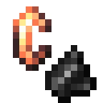{ .mc-icon } 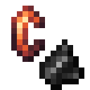{ .mc-icon } | **Lighters**{ #lighters } | |
| 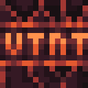{ .mc-icon } | **Vulcanite TNT**{ #vulcanite-tnt } | |

## Building

Every metal has a block, bricks, large bricks, an engraved block, a hazard block, reinforced glass and crystals. There
are metal lamps and roads too.

| Picture | Block | Made for |
|---|---|---|
| 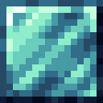{ .mc-icon } | block | every metal (Mithril shown) |
| { .mc-icon } | bricks | every metal (Mithril shown) |
| { .mc-icon } | large bricks | every metal (Mithril shown) |
| 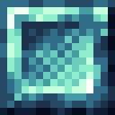{ .mc-icon } | engraved block | every metal (Mithril shown) |
| { .mc-icon } | hazard block | every metal (Mithril shown) |
| { .mc-icon } | reinforced glass | every metal (Mithril shown) |
| { .mc-icon } | crystals | every metal (Mithril shown) |
| 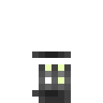{ .mc-icon } | metal lamps | |
| { .mc-icon } | roads | |

## Metallurgy Chests

Five chest tiers, merged in from Metallurgy Chests.

| Picture | Chest | Slots |
|---|---|---|
| 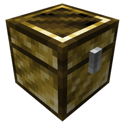{ .mc-icon } | **Brass Chest**{ #brass-chest } | 54 |
| 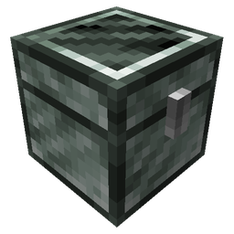{ .mc-icon } | **Silver Chest**{ #silver-chest } | 72 |
| 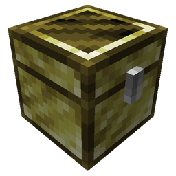{ .mc-icon } | **Electrum Chest**{ #electrum-chest } | 81 |
| 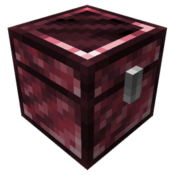{ .mc-icon } | **Rubracium Chest**{ #rubracium-chest } | 90 |
| 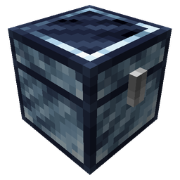{ .mc-icon } | **Platinum Chest**{ #platinum-chest } | 108 |
