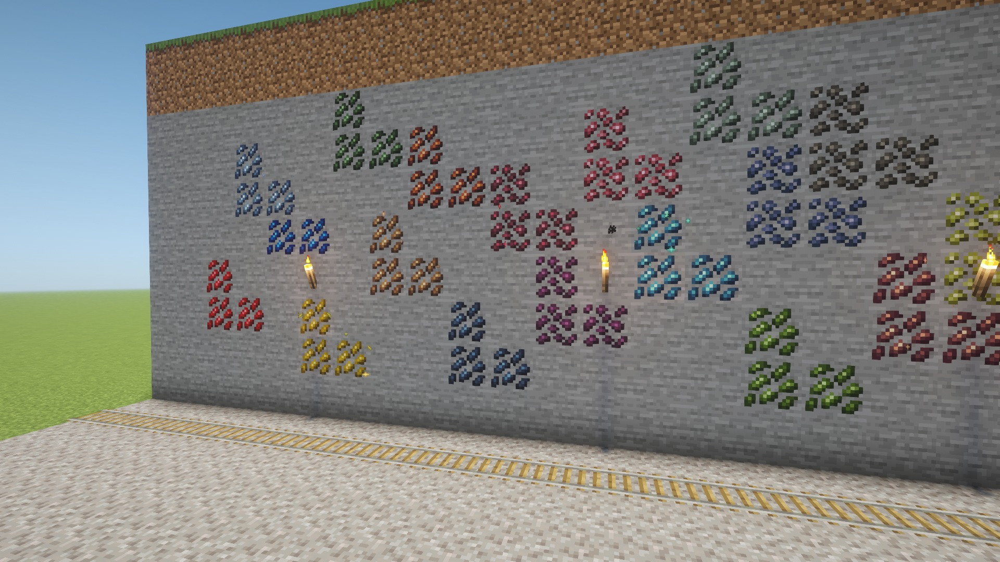
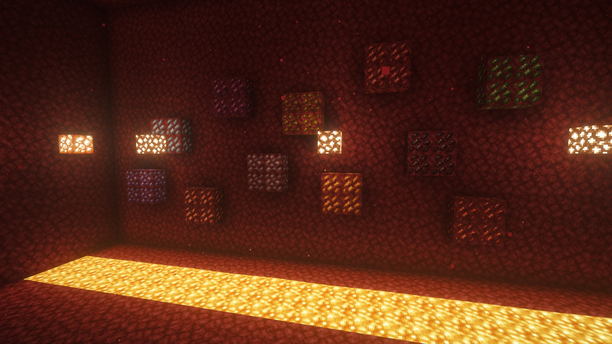

# Ores and alloys

Metallurgy has 49 metals. Some are mined as ore, the rest are alloys made in the [Alloyer](machines.md#alloyer).
Every metal has an ingot, nugget, dust, block, bricks and a molten fluid with its own bucket.

## Ores

| Dimension | Ores |
|---|---|
| Overworld | Adamantine, Astral Silver, Atlarus, Carmot, Copper, Deep Iron, Infuscolium, Manganese, Mithril, Orichalcum, Osmium, Oureclase, Phosphorite, Platinum, Potash, Prometheum, Rubracium, Silver, Sulfur, Tin, Zinc |
| Nether | Alduorite, Ceruclase, Ignatius, Kalendrite, Lemurite, Lutetium, Midasium, Sanguinite, Shadow Iron, Vulcanite, Vyroxeres |
| The End | Eximite, Meutoite |

**Tar** also spawns in the Overworld, as lakes of Liquid Tar. Tar kept away from other tar cools into Tar Ore. How
often ores and tar lakes spawn, and which pickaxe tier each ore needs, can be changed in the config.

## Alloys

All made in the Alloyer from ingots or dust.

| Alloy | From | Makes |
|---|---|---|
| **Amordrine** | Kalendrite + Platinum | 2 |
| **Angmallen** | Gold + Iron | 2 |
| **Black Steel** | 3 Deep Iron + Infuscolium | 4 |
| **Brass** | 3 Copper + Zinc | 4 |
| **Bronze** | 3 Copper + Tin | 4 |
| **Celenegil** | Orichalcum + Platinum | 2 |
| **Damascus Steel** | Iron + 2 Bronze | 3 |
| **Desichalkos** | Eximite + Meutoite | 2 |
| **Electrum** | Silver + Gold | 2 |
| **Etherium** | Sanguinite + Alduorite | 2 |
| **Haderoth** | Mithril + 2 Rubracium | 3 |
| **Hepatizon** | Infuscolium + Steel | 2 |
| **Inolashite** | Alduorite + Ceruclase | 2 |
| **Krik** | Lutetium + Osmium | 2 |
| **Quicksilver** | Silver + Astral Silver | 2 |
| **Shadow Steel** | 2 Shadow Iron + Lemurite | 3 |
| **Steel** | Iron + 2 Manganese | 2 |
| **Tartarite** | Adamantine + Atlarus | 1 |

**Tartarite**, made from Adamantine and Atlarus, is a living metal: it can absorb the powers of other metals. JEI lists
every form of absorption.
