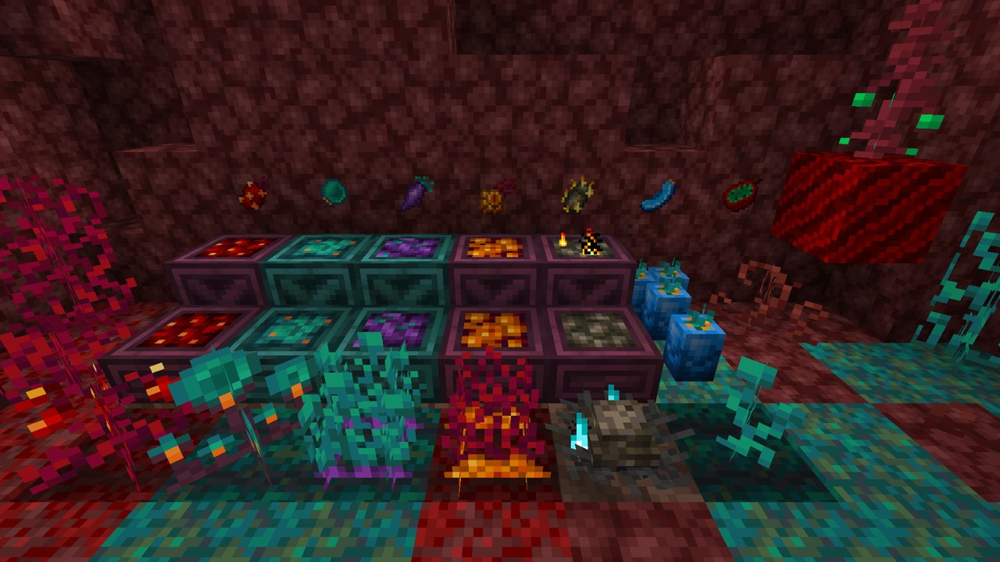
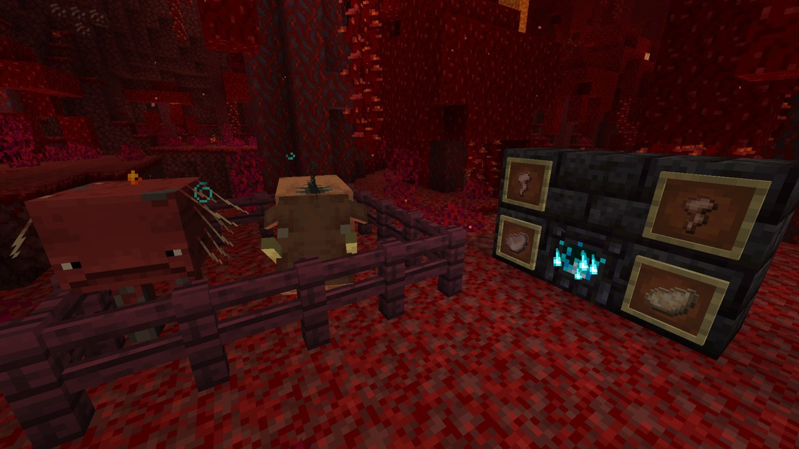

# Nether Agriculture (Unofficial)

A mod that adds new crops and new food to the Nether. Berries, Lothun, Sinful Eyes, Blaze Fruit, Azure Melons and
Mortofruct grow there; hoglins and striders drop meat; the Black Furnace cooks the bigger dishes; and the Glowing
Fungus gives a whole new wood set.

This is an unofficial port of [Nether Agriculture](https://www.curseforge.com/projects/504384) by NetherDon to
Minecraft 26.1.2, 26.2 and 26.3. It is not made or supported by NetherDon, so report problems with the port to the
[port's repository](https://github.com/Oculifelis/NetherAgriculture/issues), not to them. Everything is kept as it was
in Nether Agriculture 2.1-beta2 for 1.21.1: ids, textures, recipes, loot and config.

**Requires** nothing on NeoForge. On Fabric: [Fabric API](https://www.curseforge.com/projects/306612) and
[Forge Config API Port](https://www.curseforge.com/projects/547434). **Optional:** [JEI](https://www.curseforge.com/projects/238222)
(the Black Furnace's Nether Cooking recipes), Farmer's Delight and My Nether's Delight (extra cooking and cutting
recipes; on Fabric their Refabricated builds), [Cloth Config API](https://www.curseforge.com/projects/348521) (the
in-game config screen) and, on Fabric, [Mod Menu](https://www.curseforge.com/projects/308702).

**Versions:** NeoForge and Fabric for Minecraft 26.1.2, 26.2 and 26.3, all at 2.1.1. The original's EMI plugin is left
out because EMI has no 26.x build yet.

## What's in it

| | |
|---|---|
| **[Crops and plants](items.md#crops-and-plants)** | what grows, where it generates and how to get the seeds |
| **[Meat and cooking](items.md#meat-and-cooking)** | hoglin and strider meat, the Black Furnace and every dish |
| **[Effects](items.md#effects)** | Blaze Flight, Warp, Internal Heat and Long Legs |
| **[Glowing Fungus](items.md#glowing-fungus)** | the glowing wood set and its spores |
| **[Crates](items.md#crates)** | small and large storage crates for the harvest |
| **[Config](config.md)** | every switch, its file and its default |

## Credits

Nether Agriculture, its code and textures are by **NetherDon**
([GitHub](https://github.com/NetherDonMC/NetherAgriculture)), under the LGPL-3.0, and the two screenshots on this page
are theirs. The port is by **Oculifelis**, a fork of that repository under the same licence:
[source](https://github.com/Oculifelis/NetherAgriculture).
