# Items

Every item and block in Nether Agriculture (Unofficial), with how to get it. Ids are `netheragriculture:<name>`.

## Crops and plants

Crops grow on **Crimson Farmland** and **Warped Farmland**: till crimson or warped nylium with a hoe.

|  | Plant | Where it comes from |
|---|---|---|
| 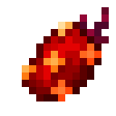{ .mc-icon } | Crimson Berry (Crimson Berry Roots, Sprouts, Seeds) | Crimson Berry Sprouts generate in crimson forests; seeds from piglin bartering and nether fortress chests |
| 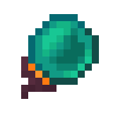{ .mc-icon } | Warped Berry (Warped Berry Roots, Sprouts, Seeds) | Warped Berry Sprouts generate in warped forests; seeds from nether fortress chests |
| 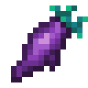{ .mc-icon } | Lothun | Wild Lothun generates in warped forests; Lothun from nether fortress chests |
| 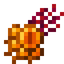{ .mc-icon } | Sinful Eyes | Wild Sinful Eyes generate in crimson forests; also from piglin bartering and nether fortress chests |
| 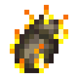{ .mc-icon } | Blaze Fruit (Blaze Fruit Seed) | seeds and fruit from nether fortress chests |
| { .mc-icon } | Azure Melon (stem, slice, seeds) | Azure Melons generate in warped forests; seeds from nether fortress chests |
| 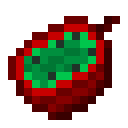{ .mc-icon } | Mortofruct (Mortofruct Half) | generates in crimson forests, hung with Dead Vines; halves from piglin bartering |
| 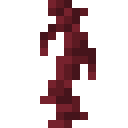{ .mc-icon } | Dead Vines | grow on Mortofruct; also from piglin bartering |
| { .mc-icon } | Nether Roots | generate in nether wastes |
| 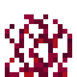{ .mc-icon } | Tall Crimson Roots, Tall Warped Roots | generate in crimson and warped forests |
| 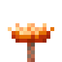{ .mc-icon } | Glowing Fungus | mixed into crimson and warped forest vegetation, and grows from bonemeal on nylium |

Roots can be crushed into 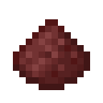{ .mc-icon .mc-inline } **Crushed Nether Roots**, 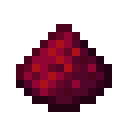{ .mc-icon .mc-inline } **Crushed Crimson Roots** and 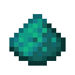{ .mc-icon .mc-inline } **Crushed Warped Roots**.

Each world-generation addition can be switched off in the [config](config.md).

## Meat and cooking

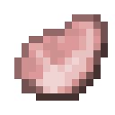{ .mc-icon .mc-inline } **Raw Hoglin Meat** drops from hoglins, and { .mc-icon .mc-inline } **Raw Strider Leg** (1 to 2) from striders. Both cook in a furnace or
smoker, and in the 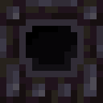{ .mc-icon .mc-inline } **Black Furnace**, the mod's own Nether cooker, which also makes the bigger dishes.

Food: 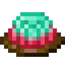{ .mc-icon .mc-inline } Nether Berry Jelly, 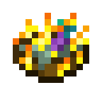{ .mc-icon .mc-inline } Blaze Cream Soup, { .mc-icon .mc-inline } Nether Fruit Salad, 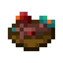{ .mc-icon .mc-inline } Nether Mushroom Stew, 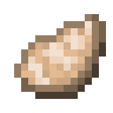{ .mc-icon .mc-inline } Cooked Hoglin Meat, { .mc-icon .mc-inline } Cooked Strider
Leg, { .mc-icon .mc-inline } Crimson Berry Jam, { .mc-icon .mc-inline } Warped Berry Jam, 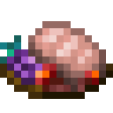{ .mc-icon .mc-inline } Glazed Hoglin Meat, 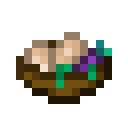{ .mc-icon .mc-inline } Nether Pork Roast, 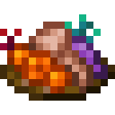{ .mc-icon .mc-inline } Strider with Vegetables, 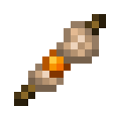{ .mc-icon .mc-inline } Nether
Barbecue on a Stick, { .mc-icon .mc-inline } Blazing Blend, 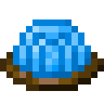{ .mc-icon .mc-inline } Azure Melon Jelly, { .mc-icon .mc-inline } Azure Melon Puree, 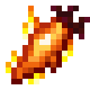{ .mc-icon .mc-inline } Blazing Golden Lothun, 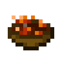{ .mc-icon .mc-inline } Glowing Mushroom Stew.

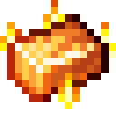{ .mc-icon .mc-inline } **Blazing Gold Ingot** and { .mc-icon .mc-inline } **Blazing Gold Nugget** go into the Blazing Golden Lothun.

The 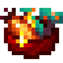{ .mc-icon .mc-inline } **Strider Treat** is fed to a strider: for 5 minutes it gets Internal Heat, Long Legs, Speed and Resistance.

With [JEI](https://www.curseforge.com/projects/238222) installed, the Black Furnace's recipes show under
*Nether Cooking*. With Farmer's Delight or My Nether's Delight, the food joins their cooking pot, cutting board and
Nether cooking recipes.

## Effects

|  | Effect | What it does |
|---|---|---|
| { .mc-icon } | Blaze Flight | lets a player fly, and sets them on fire while flying |
| { .mc-icon } | Warp | a small chance to spawn an Endermite; endermen turn hostile to the one affected |
| 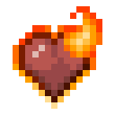{ .mc-icon } | Internal Heat | a strider with it doesn't shiver away from lava and other heat |
| 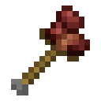{ .mc-icon } | Long Legs | slightly raises step height |

Blaze Flight and Warp also come as potions, splash and lingering potions, and tipped arrows.

## Glowing Fungus

The Glowing Fungus grows into a huge fungus with bonemeal on nylium, like crimson and warped fungi, and gives a full wood set (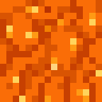{ .mc-icon .mc-inline } 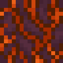{ .mc-icon .mc-inline } 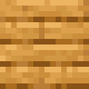{ .mc-icon .mc-inline }): Glowing Wart
Block, Glowing Stem and Hyphae (plain and stripped), Planks, Stairs, Slab, Fence, Fence Gate, Door, Trapdoor, Pressure
Plate, Button, Sign and Hanging Sign.

**Glowing Spores** come as a block and in a bottle ({ .mc-icon .mc-inline } **Glowing Spores in a Bottle**), and go into the Glowing Mushroom
Stew.

## Crates

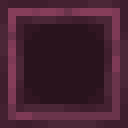{ .mc-icon .mc-inline } 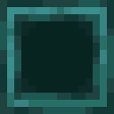{ .mc-icon .mc-inline } 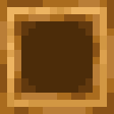{ .mc-icon .mc-inline } 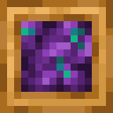{ .mc-icon .mc-inline } Crates in crimson, warped and glowing wood, small and large, store the harvest. Each is empty or filled with Crimson
Berries, Warped Berries, Lothun, Blazing Golden Lothun, Blaze Fruit or Sinful Eyes: a filled crate is crafted from an empty crate and
eight of its crop.

## Loot added to vanilla

| Loot table | What is added |
|---|---|
| `minecraft:gameplay/piglin_bartering` | Crimson Berry Seeds, Crimson Berries, Sinful Eyes, Mortofruct Halves, Dead Vines |
| `minecraft:entities/hoglin` | Raw Hoglin Meat in place of porkchops |
| `minecraft:entities/strider` | Raw Strider Leg, 1 to 2 |
| `minecraft:chests/nether_bridge` | Blaze Fruit Seed or Blaze Fruit; and berry seeds, Azure Melon Seeds, Lothun, Sinful Eyes, berries, melon slices or Blazing Blend |
| `minecraft:chests/bastion_hoglin_stable` | Raw and Cooked Hoglin Meat in place of porkchops |
