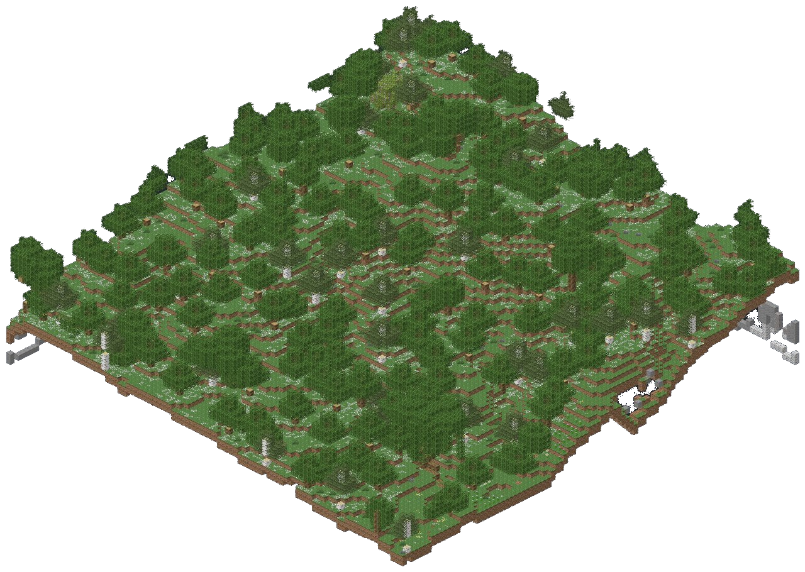
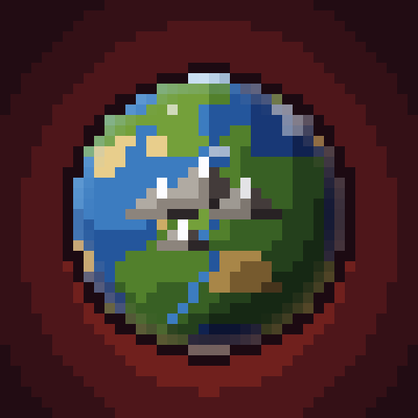
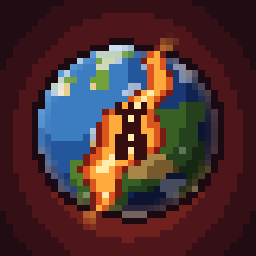

# Orbis Novus

*A new world, and things to find in it.*

Orbis Novus is two mods that work alone or together:

| Picture | Part | What it does |
|---|---|---|
| { width="96" } | **[Orbis Novus: Terrain](terrain.md)** | realistic mountains, eroded valleys and river networks. One new world type, Orbis Novus, with sixteen [terrain styles](terrain.md#the-styles), a [Custom Mix](terrain.md#custom-mix) of any of them, and a Customize screen. |
| { width="96" } | **[Orbis Novus: Dungeons](dungeons.md)** | 23 dungeon kinds, 30 settlements and landmarks, extra village houses, castles in three styles and walled castle towns, built from the blocks of whatever building mods you have. |

Together, Dungeons' structures generate in every Terrain world type. Apart, Terrain's worlds keep vanilla's and other
mods' structures, and Dungeons builds in any world, vanilla or modded.

There's also **[Orbis Novus Lite](lite.md)**, six terrain world types as a plain datapack, for a game with no mods at all.

## Versions

These pages cover the **1.1.0** release of both mods on the four targets below. [Terrain on CurseForge](https://www.curseforge.com/projects/1786843) and [Dungeons on CurseForge](https://www.curseforge.com/projects/1786849).

| Minecraft | Loader |
|---|---|
| 26.1.2 | NeoForge 26.1.2.122 or newer |
| 1.21.1 | NeoForge 21.1 (tested on 21.1.233) |
| 26.2 | NeoForge 26.2.0.93 or newer |
| 26.3 | NeoForge 26.3.0.101 or newer |

No other mods are required. On a dedicated server, install Terrain on the server and Dungeons on both the server and the client. In single player, install them on the client.

The one difference between versions: on **26.1.2, 26.2 and 26.3**, Terrain also adds natural features to the
Overworld's biomes in every world, not only its own world types (procedural trees, rocks, fallen logs, standing
stones, sea stacks, hot springs, waterfalls). The 1.21.1 build doesn't have them yet.

## Credits

By **Oculifelis**. Code and data under the MIT licence. Every structure, piece, loot table and terrain setting was
made with Oculifelis's Worldforge tool; the mods contain no textures, models or sounds.

## Added in 1.1.0

Terrain adds six styles and more customization controls. Dungeons adds seven wonders, six stacked deep dungeons and marked surface entrances for buried dungeons. See [Terrain](terrain.md#added-in-110) and [Dungeons](dungeons.md#added-in-110).
