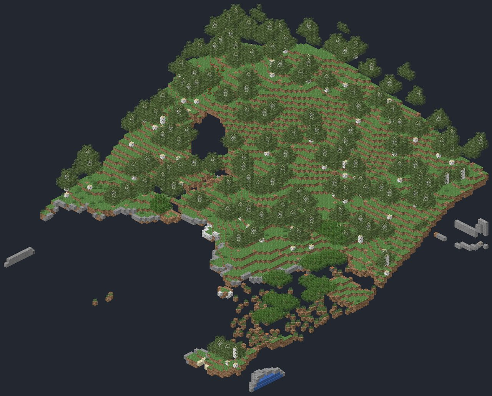
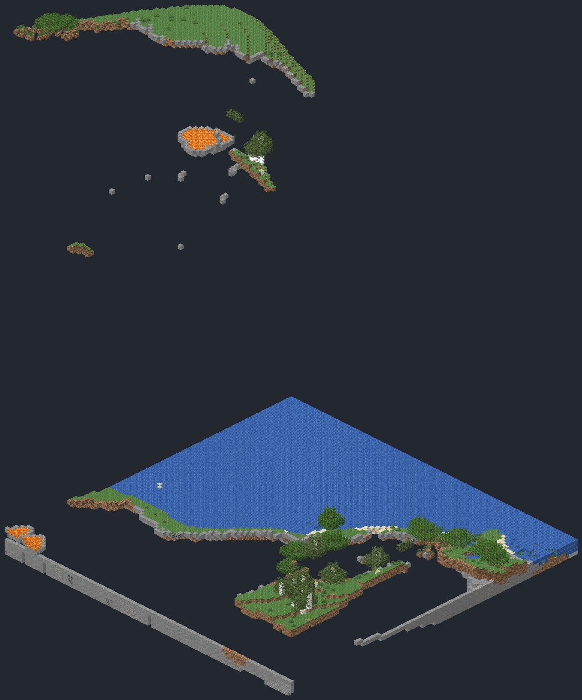

# Orbis Novus Lite

Six terrain world types as a plain datapack. You need no mods and no loader, so it runs on an unmodded game, a vanilla
server or any loader.

Each world type is made only from vanilla density functions and noise settings. Caves, ores, structures and biomes are
all vanilla. Lite is the lighter cousin of [Orbis Novus: Terrain](terrain.md): it has no erosion or river networks,
and fewer world types.

| World type | id | What it looks like |
|---|---|---|
| ON Lite: Rolling Hills | `orbisnovus_lite:rolling` | Green rolling hills, forests and rivers. |
| ON Lite: Alpine | `orbisnovus_lite:alpine` | Ridged snowy peaks over pine valleys. |
| ON Lite: Mesa Steps | `orbisnovus_lite:mesa` | Terraced badlands plateaus and canyons. |
| ON Lite: Archipelago | `orbisnovus_lite:archipelago` | Islands in a shallow sea. |
| ON Lite: Old Amplified | `orbisnovus_lite:amplified` | Towers and gorges in the old amplified style. |
| ON Lite: Floating Isles | `orbisnovus_lite:floating_isles` | Grassy islands drifting high over a shallow sea. |

It comes for **26.1.2** and **1.21.1**, with an optional resource pack that gives the world types their names on the
World Type button.
