# Orbis Novus: Terrain

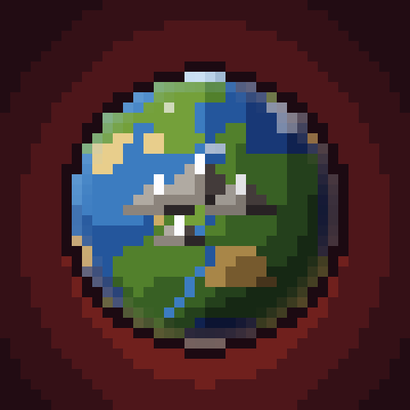{ width="128" align=right }

Realistic mountains, eroded valleys and river networks. Valleys are worn down by erosion and rivers run in networks
down to the sea.

The terrain comes from the game's own noise generator, driven by the mod's density functions. That keeps vanilla
caves, aquifers, ore veins, biome features and other mods' structures and features working. The Nether and the End
stay vanilla. Every world is infinite and seeded, so one seed always makes the same world. Chunks generate at close
to vanilla's speed: 28 to 33 ms each in testing, against vanilla's 27.

## Making a world

On the Create World screen, use the **World Type** button to pick **Orbis Novus**. It starts as [Patchwork Earth](#patchwork-earth).
**Customize** opens the settings screen, laid out like the old Customized world screen:

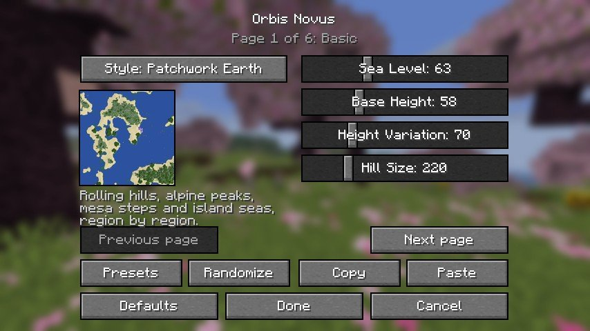

| Page | Settings |
|---|---|
| **Style** | One of the ten [styles](#the-styles), or [Custom Mix](#custom-mix). |
| **Basic** | Sea level, base height, height variation and hill size. |
| **Mountains & Erosion** | Detail, peak sharpness, ridges, twist, erosion, slope limit, terraces and the snow line. |
| **Water** | Rivers, how many lakes, and islands. |
| **Mix** | How much of each style [Patchwork Earth](#patchwork-earth) or [Custom Mix](#custom-mix) uses, and how big the regions are. |
| **Advanced** | Basins, craters, spires, and floating islands with their heights. |
| **Features** | Grass, flowers and trees; ores; lava and water pools; structures. All are on by default. |
| **Presets** | Every style, plus Sky Teeth, Flatlands, Drowned World, Lake District, Endless Canyons, Shattered Shards, Sky Archipelago and Crater Sea. |
| Buttons | **Randomize**, **Copy** and **Paste** (the settings as JSON), **Defaults**, **Done** and **Cancel**. |

The settings are saved with the world.

## The styles

| Picture | Style | What it is | `level-type` |
|---|---|---|---|
| 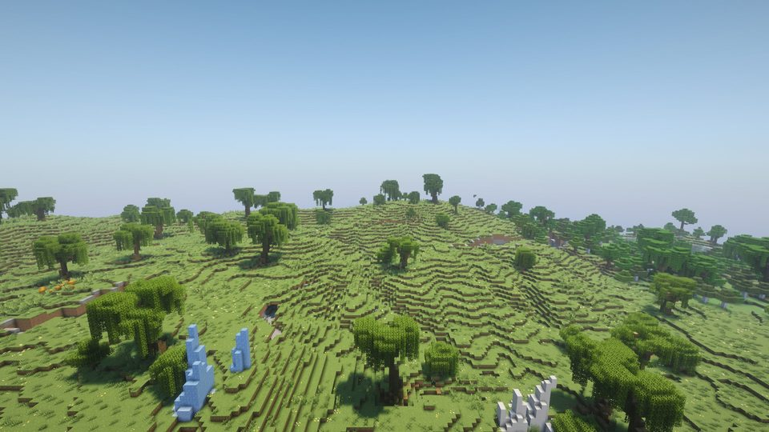{ width="200" } | **Green Vale**{ #green-vale } | Rolling green hills with oak woods and rivers. | `orbisnovus_terrain:green_vale` |
| 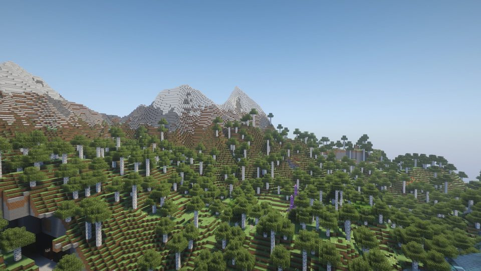{ width="200" } | **High Teeth**{ #high-teeth } | Snowy alpine peaks over pine valleys. | `orbisnovus_terrain:high_teeth` |
| 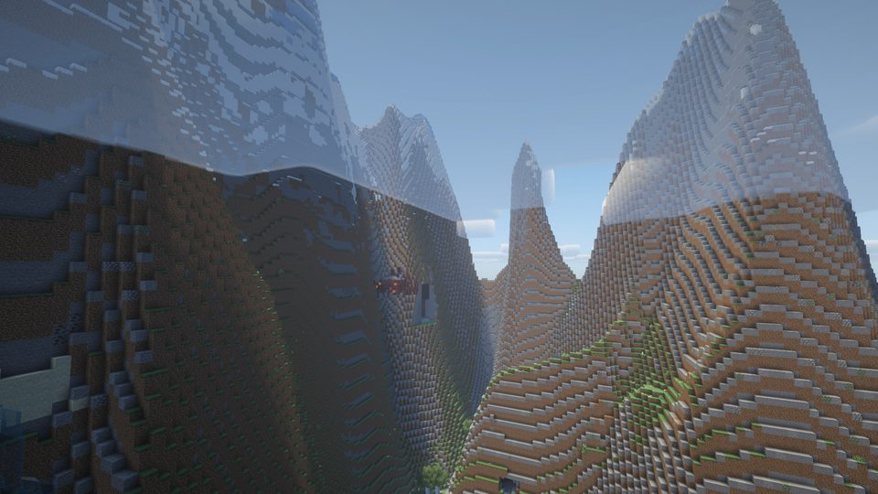{ width="200" } | **Far Spires**{ #far-spires } | Towering amplified spires and gorges. | `orbisnovus_terrain:far_spires` |
| 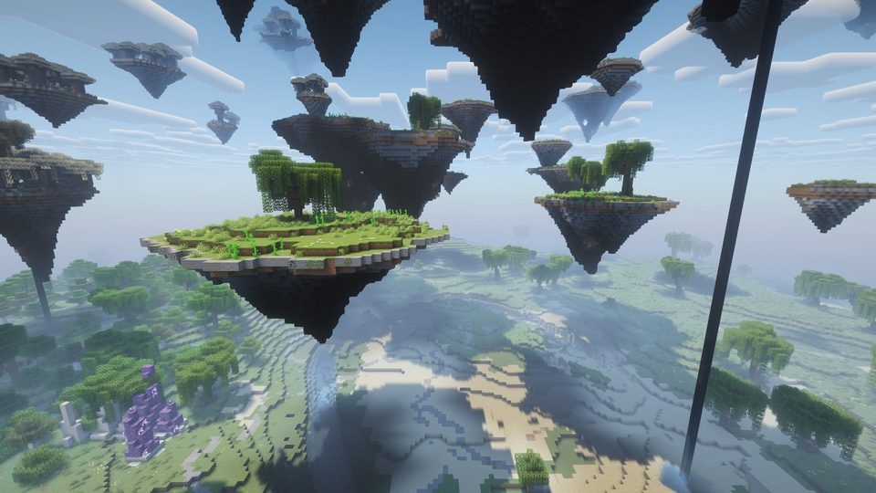{ width="200" } | **Skyreach**{ #skyreach } | Grassy islands floating over a shallow sea. | `orbisnovus_terrain:skyreach` |
| 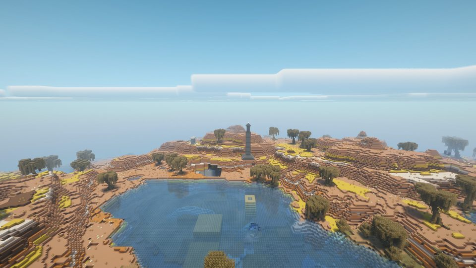{ width="200" } | **Red Steps**{ #red-steps } | Terraced badlands canyons. | `orbisnovus_terrain:red_steps` |
| 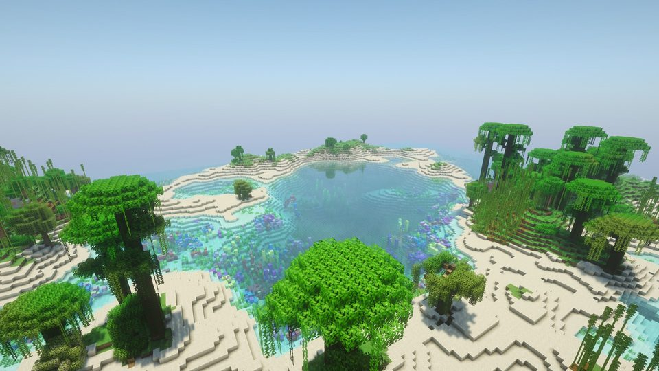{ width="200" } | **Warm Shoals**{ #warm-shoals } | Jungle islands in a warm shallow sea. | `orbisnovus_terrain:warm_shoals` |
| 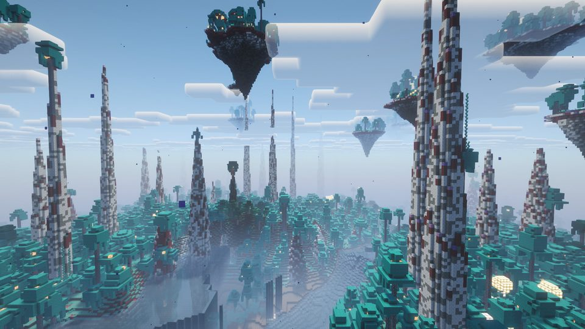{ width="200" } | **Verdigris Reach**{ #verdigris-reach } | A teal fungal alien world under needle spires. | `orbisnovus_terrain:verdigris_reach` |
| 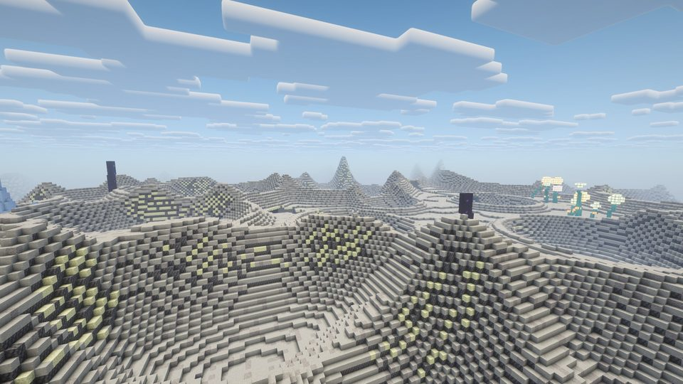{ width="200" } | **Grey Silence**{ #grey-silence } | A dead grey moon covered in craters. | `orbisnovus_terrain:grey_silence` |
| 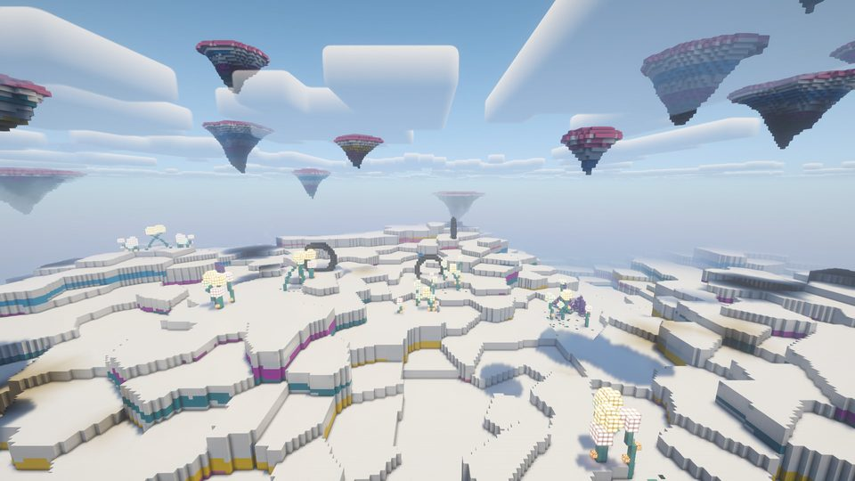{ width="200" } | **Painted Stillness**{ #painted-stillness } | Flat pastel-banded columns, like a sculpture field. | `orbisnovus_terrain:painted_stillness` |
| 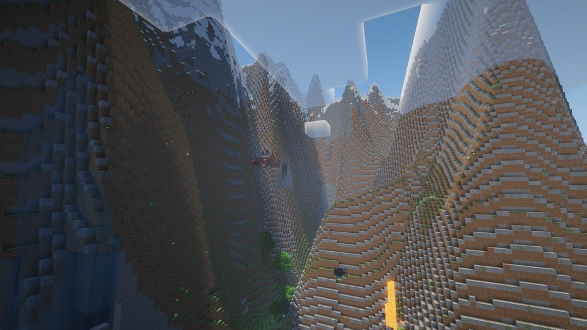{ width="200" } | **Patchwork Earth**{ #patchwork-earth } | Rolling hills, alpine peaks, mesa steps and island seas, region by region. The default. | `orbisnovus_terrain:patchwork_earth` or `orbisnovus_terrain:orbis_novus` |
| 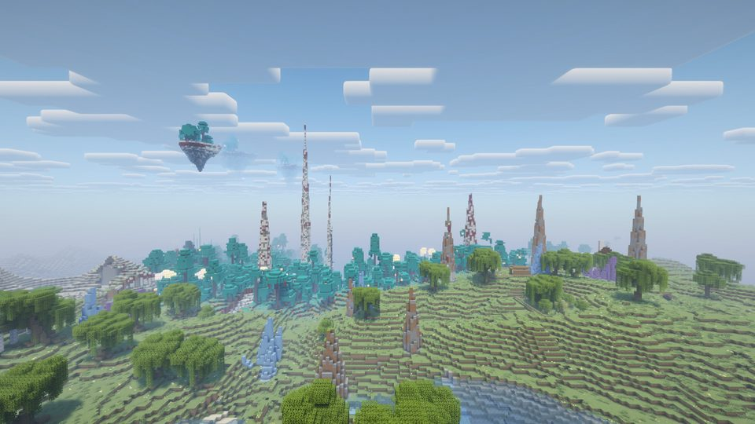{ width="200" } | **Custom Mix** | Any of the nine styles above (but [Patchwork Earth](#patchwork-earth)) region by region, weighed on the Mix page. The [Custom Mix](#custom-mix) section below has more. | `orbisnovus_terrain:custom_mix` |

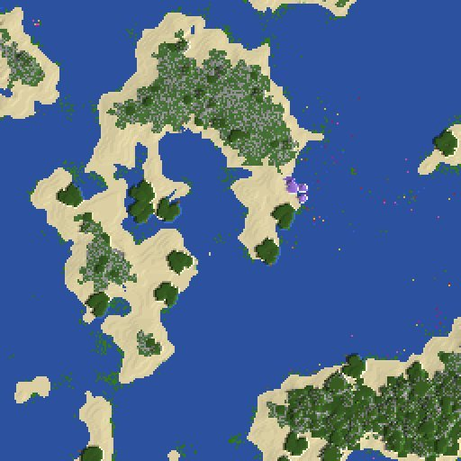

### Custom Mix

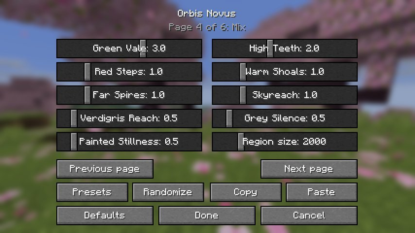

**Custom Mix** sets the single styles side by side, region by region. The Mix page has a slider from 0 to 5 for each
style, plus one for region size.

Each region keeps its own style's land, biomes and ground. A Grey Silence region is grey moon dust even right next to
Green Vale, and at the border the ground speckles from one to the other. Dry styles keep clear of a neighbour's sea,
and floating islands thin out near the border. The sliders on the other pages apply to every region.

## Natural features (26.1.2, 26.2, 26.3)

On these versions Terrain also adds natural features to the Overworld's biomes, by biome tag, in every world:
procedural trees (redwoods, willows, baobabs, twisted pines, a rare world tree and more), rocks, fallen logs,
standing stones, sea stacks, hot springs, waterfalls and other landforms. If a wood mod such as [Biomes O' Plenty](https://www.curseforge.com/projects/220318) is
installed, its logs can stand in for vanilla wood. The 1.21.1 build doesn't have these yet.

## Dedicated servers

On a dedicated server, set these in `server.properties` before the world is first created:

```properties
level-type=orbisnovus_terrain:orbis_novus
generator-settings={"values":{"sea_level":70,"amp":120},"off":["ores"]}
```

`level-type` picks the style: the id in the last column of the [styles table](#the-styles). `orbis_novus` is Patchwork
Earth.

`generator-settings` is optional. It takes the JSON that the Customize screen's **Copy** button gives you:

| Key | What it holds |
|---|---|
| `values` | The slider numbers, by key. |
| `mix` and `region` | [Patchwork Earth](#patchwork-earth) and [Custom Mix](#custom-mix) only: each style's weight by style id, and the region size. |
| `off` | Any of `vegetation`, `ores` and `lakes`. |

For example, a Custom Mix of three styles:

```properties
level-type=orbisnovus_terrain:custom_mix
generator-settings={"mix":{"green_vale":2,"verdigris_reach":1,"grey_silence":1,"high_teeth":0,"red_steps":0,"warm_shoals":0,"far_spires":0,"skyreach":0,"painted_stillness":0},"region":1500}
```

Structures follow the usual `generate-structures` setting. Once the world exists, its settings live in its
`level.dat`, and changing `server.properties` no longer affects it.

## Datapacks

The Customize screen covers each world. Beyond that, everything is datapack JSON:

| File | What it does |
|---|---|
| `data/orbisnovus_terrain/worldgen/noise_settings/<type>.json` | Sets the shape and the surface blocks. Every field is optional: heights, ridges, terraces, islands, rivers, spires and craters. |
| `data/orbisnovus_terrain/worldgen/world_preset/<type>.json` | Holds the biome rules. The first match wins, and each rule names a biome or biome tag, with optional ranges of height, depth, temperature, humidity and river. |
| `data/minecraft/tags/worldgen/world_preset/normal.json` | To add a world type of your own to the World Type button, add a new `world_preset` and an entry here. |
| `data/orbisnovus_terrain/tags/worldgen/biome/nature/<feature>.json` | [Natural features](#natural-features-2612-262-263) (26.1.2, 26.2, 26.3): says where each feature goes. To turn a feature off, override its tag with an empty list. |

## Compatibility

| Mod | How it works |
|---|---|
| [Orbis Novus: Dungeons](dungeons.md) | Its dungeons, settlements, castles and citadels generate in every Orbis Novus world type. |
| Structure and feature mods | Their structures and features generate, since the world runs on the vanilla generator. |
| Biome mods ([Biomes O' Plenty](https://www.curseforge.com/projects/220318), [Regions Unexplored](https://www.curseforge.com/projects/659110) and others) | The Orbis Novus world types use their own biome rules, which pick vanilla biomes and a few common biome tags. Normal worlds are unchanged. Modded cave biomes and their carvers are handled. |
| [Distant Horizons](https://www.curseforge.com/projects/508933) | Works in its normal mode, where it runs the world generator itself for far chunks. |

**Uninstalling:** a world made with an Orbis Novus world type needs the mod to generate new chunks. Normal worlds keep
working without it.
