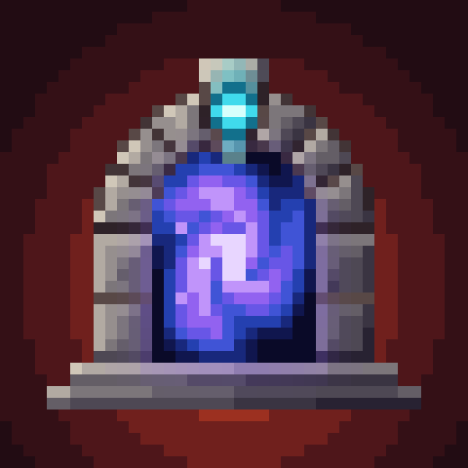
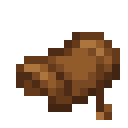
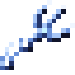
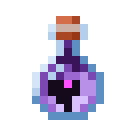
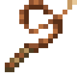
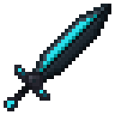
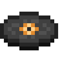
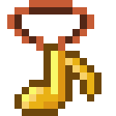
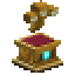

# Ostentum

{ width="140" align=right }

A vanilla expansion built on [Fundamentum](../fundamentum/index.md): summoning saddles for vanilla mounts, grappling
hooks, summon charms, whips, special weapons with a trick each, three special moons, a Pillager Siege night and boss
relics.

Most of Ostentum is Fundamentum data. The mounts, hooks, summons, whips, moons, siege, elemental damage and portal
crafting all run on Fundamentum; Ostentum adds the items, creatures, art, music and recipes that use them.

**Requires** [Fundamentum](../fundamentum/index.md) and [Curios](https://www.curseforge.com/projects/309927). **Optional:** [Patchouli](https://www.curseforge.com/projects/306770), for a guide book (crafted from a book and a saddle), and
[JEI](https://www.curseforge.com/projects/238222) to see the recipes.

**Versions:** NeoForge 26.1.2 and 1.21.1. (The happy ghast harness and the nautilus saddle are 26.1.2 only, since
those creatures don't exist on 1.21.1.)

## What's in it

| Picture | Section | What's in it |
|---|---|---|
| { .mc-icon } | **[Summoning saddles](items.md#summoning-saddles)** | saddles for twelve vanilla mounts, in the Curios mount slot |
| { .mc-icon } | **[Grappling hooks](items.md#grappling-hooks)** | from amethyst to the [Stillwind Hook](items.md#stillwind-hook) |
| { .mc-icon } | **[Summons](items.md#summons)** | wolves, a baby iron golem, a chibi ender dragon, a flying pink dolphin and more |
| { .mc-icon } | **[Whips](items.md#whips)** | real cord whips, from the [Leather Whip](items.md#leather-whip) to the [Destruction Whip](items.md#destruction-whip) |
| { .mc-icon } | **[Special weapons](items.md#special-weapons)** | each with one trick of its own |
| { .mc-icon } | **[Moons and the siege](items.md#moons-and-the-siege)** | the Harvest, Enchanted and Glimmer Moons, and the Pillager Siege, each with its own music track and disc |
| { .mc-icon } | **[Records](items.md#records)** | [record shelves](items.md#record-shelf), and the Record Pendant, which shows what the nearest jukebox is playing |
| { .mc-icon } | **[Boss relics](items.md#boss-relics)** | a gold likeness of each boss on a pedestal |

### Small changes

| Change | What it does |
|---|---|
| Pickaxes on golems | pickaxes hit iron, snow and copper golems for 1.5x |
| Enchanted golden apple | gives a minute of use sickness |
| Elemental hits | Fire Aspect weapons hit as fire, snowballs as ice and tridents as water |
| Netherite armour | resists a little fire per piece |

## Credits

By Oculifelis: code, design, music and the hand-drawn art.

| By | Work | Licence | Used for |
|---|---|---|---|
| Malcolm Riley | [Unused Textures](https://github.com/malcolmriley/unused-textures) | [CC BY 4.0](https://creativecommons.org/licenses/by/4.0/) | the base of the [Duelist's Saber](items.md#duelists-saber), the Hearthblades, the [Echo Blade](items.md#echo-blade) and the Resonant Hilt (recoloured and redrawn) |
| Rhodox | Painterly | used with permission | the [Delver's Pick](items.md#delvers-pick) head |
| Mojang | Minecraft | Mojang keeps its rights | many item and creature textures, recoloured or reworked |

From 1.9.8, Ostentum's code and Oculifelis's own art and music are open source under the
[GNU LGPL 3.0 or later](https://www.gnu.org/licenses/lgpl-3.0.html). Art from others keeps its own licence: the
Unused Textures art stays CC BY 4.0, the Painterly art is used by permission and isn't covered, and Mojang keeps its
rights to art reworked from Minecraft. Versions before 1.9.8 were All Rights Reserved.
