# Items and how to get them

Every crafted item's recipe shows in JEI. Items found in loot list where and how often.

## Summoning saddles

Wear one in the Curios **mount** slot and press **V** to call the creature and ride it; press V again or get off and
it goes away. Each is a saddle plus the creature's item, shapeless:

|  | Saddle | Plus |
|---|---|---|
| { .mc-icon } | Horse | golden carrot |
| { .mc-icon } 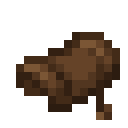{ .mc-icon } | Donkey / Mule | chest |
| { .mc-icon } | Skeleton Horse | bone block |
| 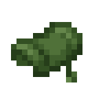{ .mc-icon } | Zombie Horse | rotten flesh |
| { .mc-icon } | Camel | cactus |
| { .mc-icon } | Pig | carrot on a stick |
| { .mc-icon } | Strider | warped fungus on a stick |
| 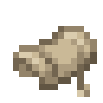{ .mc-icon } | Llama | any carpet |
| { .mc-icon } | Dolphin | cod |
| 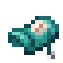{ .mc-icon } | Nautilus (26.1.2) | nautilus shell |
| 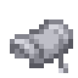{ .mc-icon } | Happy Ghast Harness (26.1.2) | white harness |

The pig is slowed to about a sprinting player; its speed is the `speed` field of
`data/ostentum/fundamentum/mounts/pig.json`, so a datapack can change it (see [Config](config.md)).

## Grappling hooks

Wear one in the Curios **hook** slot and press **H** to fire it. Jump to let go.

|  | Hook | Range | Hooks out | How to get it |
|---|---|---|---|---|
| 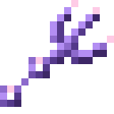{ .mc-icon } | Amethyst Hook | 14 | 1 | tripwire hook, iron chain, 3 amethyst shards; 3 s of Slow Falling when it lets go |
| 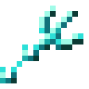{ .mc-icon } | Diamond Hook | 20 | 1 | tripwire hook, iron chain, 3 diamonds |
| 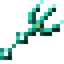{ .mc-icon } | Ender Hook | 24 | 2 | diamond hook, 2 ender pearls, ender eye |
| 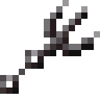{ .mc-icon } | Netherite Hook | 32 | 1 | smithing: netherite upgrade on a diamond hook |
| 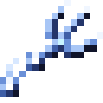{ .mc-icon } | Stillwind Hook | 40 | 2 | trial chamber vaults only (2%, ominous 8%) |

The Stillwind Hook holds you dead still between its two hooks, and a hook that reaches its full range without meeting
a block anchors on the wind there for four seconds.

## Summons

Wear them in the Curios **summon** slot. Minions follow you and fight what you fight, and never hurt you or each other.
All are shapeless recipes.

|  | Item | Calls |
|---|---|---|
| 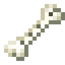{ .mc-icon } | Bone Whistle | 2 wolves |
| 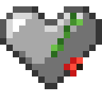{ .mc-icon } | Golem Heart | a baby iron golem |
| 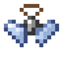{ .mc-icon } | Vex Charm | a vex |
| 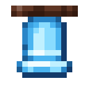{ .mc-icon } | Allay Chime | an allay whose note does air damage |
| 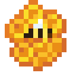{ .mc-icon } | Hive Charm | 3 half-size bees; a bee that stings pops away and comes back 3 s later |
| 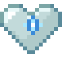{ .mc-icon } | Snow Heart | a snow golem whose snowballs deal ice damage |
| 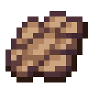{ .mc-icon } | Bat Wing | a bat that bites |
| 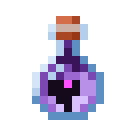{ .mc-icon } | Bottled Dragonling | a chibi ender dragon that spits arcane puffs |
| 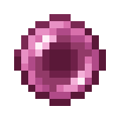{ .mc-icon } | Pink Pearl | a baby pink dolphin that flies and squirts water |
| 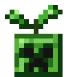{ .mc-icon } | Creeper Sprout | a half-size creeper whose pop breaks no blocks; back after 5 s |
| 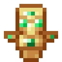{ .mc-icon } | Guardian Totem | a small totem at your shoulder that saves you from death once per Minecraft day |

## Whips

Left click to swing. The whole cord hits as it swings, the tip hits hardest, and a crack at the tip is a crit. Whips
take Sharpness, Smite, Bane of Arthropods, Fire Aspect and Curse of Vanishing. Most are a **Leather Whip** upgraded at
a crafting table.

|  | Whip | What it does | How to get it |
|---|---|---|---|
| 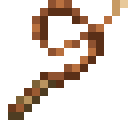{ .mc-icon } | Leather Whip | the plain whip the others are made from | leather, string, sticks |
| 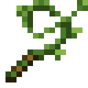{ .mc-icon } | Vine Whip | a tip hit yanks the target toward you | vines and sticks |
| 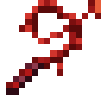{ .mc-icon } | Weeping Vine Whip | every hit heals you half a heart (a tip hit a full heart) | Vine Whip, 3 weeping vines, crimson stem, crimson fungus |
| 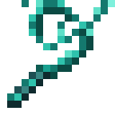{ .mc-icon } | Twisting Vine Whip | a tip hit throws the target into the air | Vine Whip, 3 twisting vines, warped stem, warped fungus |
| 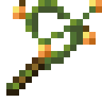{ .mc-icon } | Glow Berry Whip | outlines what it hits in glow-berry orange | Vine Whip, 3 glow berries, moss block, glow lichen |
| 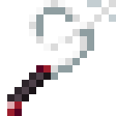{ .mc-icon } | Spider Silk Whip | three wisps, each going for its own hostile; hits slow | string, cobweb, stick, spider eye |
| 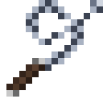{ .mc-icon } | Chain Whip | a tip hit wraps the target in chain (Slowness II) | Leather Whip, iron chains, iron ingot |
| 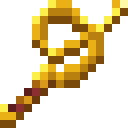{ .mc-icon } | Golden Heavy Whip | the slowest, hardest-hitting swing; knocks hard | Leather Whip, gold ingots, gold blocks |
| 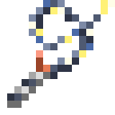{ .mc-icon } | Thunderstorm Whip | a tip hit arcs to five more hostiles and stuns each | lightning striking a dropped Golden Heavy Whip |
| 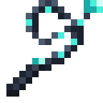{ .mc-icon } | Diamond Whip | light cord, a bladed tip that hits hard | Leather Whip, diamonds, obsidian |
| 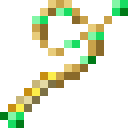{ .mc-icon } | Emerald Whip | each crack fires three homing emerald bolts | Leather Whip, emeralds, gold ingot |
| 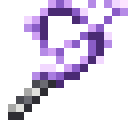{ .mc-icon } | Amethyst Whip | a tip hit shatters into five shards that fly on | Leather Whip, amethyst shards, amethyst cluster |
| 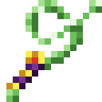{ .mc-icon } | Royal Slime Whip | bounces what it hits; quick hits stack and shorten the cooldown | Leather Whip, slime balls, slime block, gold block |
| 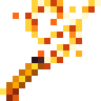{ .mc-icon } | Blaze Whip | sets targets on fire and cuts deeper into burning foes; lights campfires and candles | Leather Whip, blaze rods, blaze powder, magma cream |
| 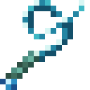{ .mc-icon } | Untamed Sea Whip | hits soak and slow; hold use to charge a crashing wave | Leather Whip, prismarine shards, heart of the sea, nautilus shell |
| 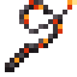{ .mc-icon } | Destruction Whip | each crack fires four lasers at nearby hostiles | Chain Whip, netherite ingots, TNT, blaze rod |
| 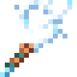{ .mc-icon } | Breeze Whip | the fastest whip; hits blow targets away, a tip hit bursts like a wind charge | trial chamber vaults only (4%, ominous 15%) |
| { .mc-icon } | Ender Whip | homes in on the hostile nearest your crosshair; hits levitate | End city ship chests only (30%) |
| 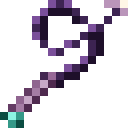{ .mc-icon } | End Rift Whip | the Ender Whip with its cord drawn through the End | throw an Ender Whip into an End portal (enchantments kept) |

## Special weapons

Each has one trick of its own; the tooltip says what.

|  | Weapon | Trick | How to get it |
|---|---|---|---|
| 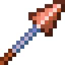{ .mc-icon } | Weathervane Spear | sprinting builds static that the next jab discharges; jabs power redstone | ordinary trial chamber vaults (5%) |
| 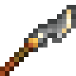{ .mc-icon } | Pathfinder's Glaive | plant it as a waypoint: a gold beacon beam to the sky marks it from any distance; call it back | crafted |
| 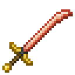{ .mc-icon } | Duelist's Saber | hold use to guard (hits from the front are halved); the first half second is a perfect parry, and a riposte right after is a guaranteed crit; a guard that blocks nothing has a short cooldown | sold by master weaponsmiths |
| 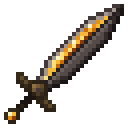{ .mc-icon } 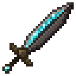{ .mc-icon } | Hearthblade (and Soul Hearthblade) | kills cook their drops and store food to eat later | find a 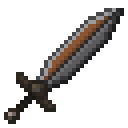{ .mc-icon .mc-inline } Cold Hearthblade brushing trail ruins (8%), then set it on a lit campfire (a soul campfire makes the soul one) |
| 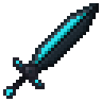{ .mc-icon } | Echo Blade | every hit echoes 1.5 s later for half | smithing: netherite sword, 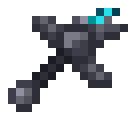{ .mc-icon .mc-inline } Resonant Hilt (ancient city chests, 8%), echo shard |
| 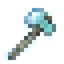{ .mc-icon } | Frostbite Hatchet | thrown as a returning boomerang that comes back to the slot it left; freezes water and mobs | crafted |
| 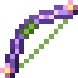{ .mc-icon } | Bloom Bow | arrows bonemeal where they land and heal your pets | crafted |
| 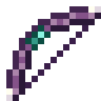{ .mc-icon } | Voidstring Bow | arrows fly straight and curve to mobs; a full draw swaps places with the target (players too, under the server's PvP rules), and a fully drawn kill takes you to where it fell; recipe uses an ender pearl | crafted |
| { .mc-icon } | Engineer's Crossbow | rope mode strings a zipline; combat mode is a 5-bolt magazine; while held, beside the hotbar it shows the mode, bolts loaded and arrows carried ("Combat 3/5", "Arrow x23"; in rope mode whether the first anchor is set) | crafted |
| { .mc-icon } | Bastion Crossbow | fast, three bolts, can fire flame bolts; piglins don't mind it | bastion treasure chests (20%) |
| { .mc-icon } | Fisher King's Trident | thrown into water it fishes; bonus damage to aquatic mobs | crafted |
| { .mc-icon } | Coral Trident | leaves a whirlpool underwater that pulls you in | crafted |
| { .mc-icon } | Abyssal Trident | leaves a drowning field, even on land | crafted |
| { .mc-icon } | Quake Hammer | sneak and attack the ground to send a fissure 8 blocks forward | crafted |
| { .mc-icon } | Delver's Pick | mines a 1x3 line (sneak for one block) | a { .mc-icon .mc-inline } Rusted Delver's Head from mineshaft chest minecarts, smithed onto a diamond pickaxe ({ .mc-icon .mc-inline } Dormant Delver's Pick), then thrown through a Nether portal |
| { .mc-icon } | Recall Chime | ring to set a mark, ring again to be pulled back to it | End city chests (8%) |
| { .mc-icon } | Phantom Veil | a cloak (Curios back slot): mobs notice you from half as far in the dark, no phantoms | crafted: phantom membranes, a long invisibility potion, echo shards |

## Moons and the siege

| Night | When | What happens |
|---|---|---|
| Harvest Moon | a quarter of full moons | ripe crops broken under it drop twice |
| Enchanted Moon | a tenth of full moons | enchanting needs and spends no levels (lapis is still used) |
| Glimmer Moon | about one full moon in six | mobs and ores drop twice their experience |
| Pillager Siege | 5% of nights from day 10, at least 5 nights apart, never with a special moon | pillagers and vindicators come at players near a village in up to six waves; win to get Hero of the Village |

Each has its own music while it's up. The Glimmer Moon has three tracks (Moonlit Lullaby, Teal Tide, Starwater Dance),
and one is picked at random each time, on its disc too.

### Music discs

|  | Disc | How to get it |
|---|---|---|
| { .mc-icon } { .mc-icon } { .mc-icon } | Harvest Moon, Enchanted Moon, Glimmer Moon | 2% from a hostile mob a player kills under that moon |
| { .mc-icon } | Fundamentum | 25% from the siege's captain, who leads the last wave |

## Records

|  | Item | What it does | How to get it |
|---|---|---|---|
| { .mc-icon } | Record Shelf | a bookshelf of record sleeves; powers an enchanting table like a bookshelf | crafted |
| { .mc-icon } | Chiseled Record Shelf | holds six music discs, clicked in and out like a chiseled bookshelf; a comparator reads the last slot used; powers an enchanting table while it holds three discs or more; the discs drop when it's broken | crafted |
| { .mc-icon } | Record Pendant | a Curios necklace: shows what the nearest jukebox you can hear is playing, as one line top left with the time and a thin progress bar ("C418 - cat  1:32 / 3:05"); hidden with F1; placed and styled in the [config](config.md#client-config) | crafted: string, any music disc, a gold nugget |

## Boss relics

A gold likeness of the boss floating over a gold pedestal, glowing in the boss's colour.

|  | Relic | How to get it |
|---|---|---|
| { .mc-icon } | Wither Relic | drops on every Wither kill |
| { .mc-icon } | Elder Guardian Relic | drops on every Elder Guardian kill |
| { .mc-icon } | Warden Relic | drops on every Warden kill |
| { .mc-icon } | Ender Dragon Relic (3x3) | goes into the killer's inventory; needs the eight blocks around it free |
