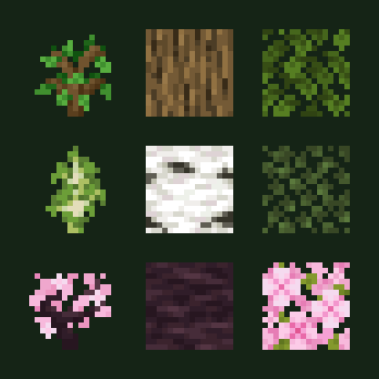
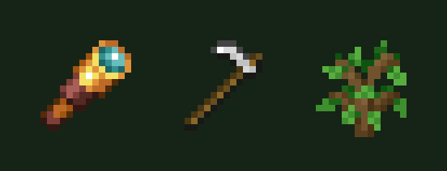

# Complicated Trees

Breed trees with your bees. Bees in a working [Complicated Bees](https://www.curseforge.com/projects/1100137) housing
pollinate the leaves of nearby trees; take the offspring with the [Grafter](#grafter), plant it, and new kinds turn
up. Oak and birch can give Silver Birch, and Silver Birch and oak can give cherry.

It adds no new wood blocks: it breeds the trees you already have, and a datapack can add species and crosses for any
mod's trees.

**Requires** [Complicated Bees](https://www.curseforge.com/projects/1100137).

| Minecraft | Loader | Version | Availability |
|---|---|---|---|
| 1.20.1 | Forge | 0.1.0 | CurseForge project |
| 1.21.1 | NeoForge | 0.1.0 | CurseForge project |
| 26.1.2 | NeoForge | 0.1.0 | CurseForge project |
| 26.2 | NeoForge | 0.1.0 | CurseForge project |

The 26.x builds use [Complicated Bees Unofficial](../complicatedbees/index.md). [CurseForge project](https://www.curseforge.com/projects/1794603)

## How it works

1. Hold an oak, birch or cherry sapling in your other hand and use the [Arborist's Analyzer](#arborists-analyzer). The
   sapling becomes **Genetic** planting stock; plant it like any sapling.
2. Keep a working bee housing near the canopy. When the bees pollinate the leaves, green sparkles show on them.
3. Use the [Grafter](#grafter) on pollinated leaves to take the offspring as a sapling. Breaking the leaves the normal
   way gives it too, at a lower chance.

| Parents | Offspring | Chance |
|---|---|---|
| Oak + birch | Silver Birch | 15% |
| Oak + Silver Birch | cherry | 8% |

## Items

| Name | What it does | How to get it |
|---|---|---|
| **Arborist's Analyzer**{ #arborists-analyzer } | Turns a sapling held in your other hand into Genetic planting stock. Use it on a tree to read its genetics. | Crafted, shapeless: a book, a glass pane and a copper ingot. |
| **Grafter**{ #grafter } | Takes the offspring from pollinated leaves. | Crafted, shapeless: an iron ingot and 2 sticks. |
| **Genetic Sapling** | A sapling that carries its tree's genes. | From the Analyzer or the Grafter. |

## Commands

| Command | What it does |
|---|---|
| `/trees` | Help in game. |
| `/trees species` | Lists the tree species. |
| `/trees crosses` | Lists the crosses and their chances. |
| `/trees stock <id>` | Gives you Genetic stock of a species (creative). |

## For pack makers

Species, crosses, alleles and species tags are datapack files under
`data/<namespace>/complicated_trees/species`, `breeding`, `alleles` and `species_tags`. Run `/reload` after changing
them. Ids are `complicated_trees:<name>`.

**Licence:** All Rights Reserved in the released 0.1.0 jars.
