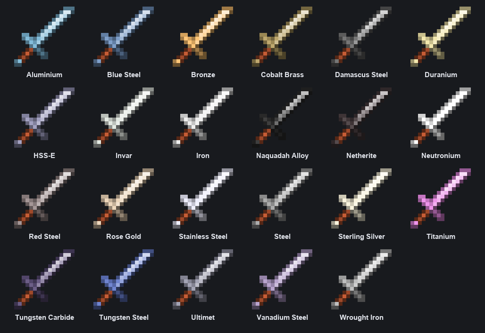
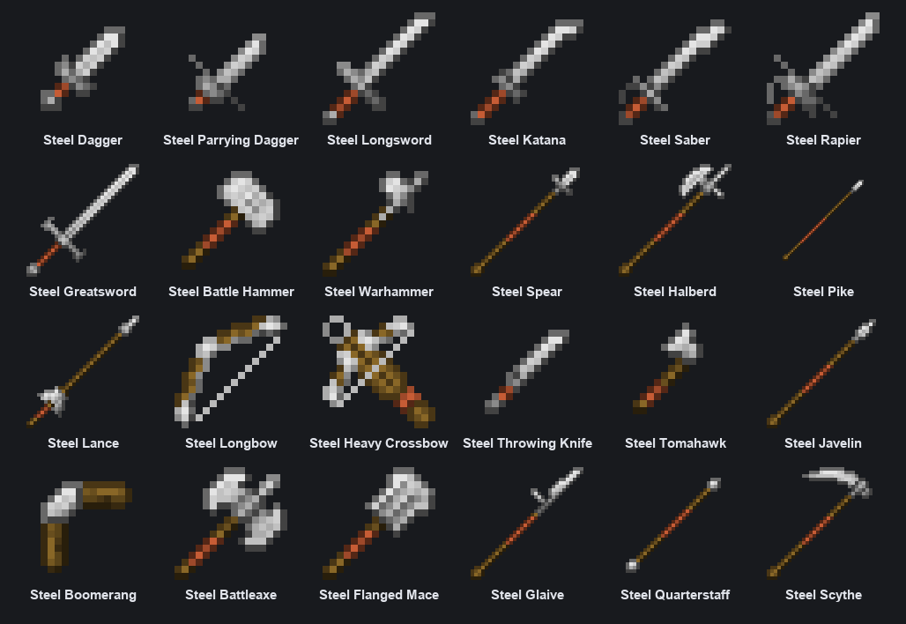

# GT Spartan Modern

{ width="128" align=right }

GT Spartan Modern adds 552 Spartan Weaponry weapons to GregTech CEu Modern, and they work as real GregTech tools. They show up in GT's Tools tab and use GT's durability bar.

It is data-driven. Each weapon's stats come from GregTech's material data, so changing a metal in GregTech changes its weapons, and a datapack can give them all traits through the weapon-trait tag `gt_spartan:metals`.

Every metal GregTech makes swords from gets weapons. That's 23 metals in plain GTCEu, from bronze and steel up through titanium, tungsten steel, HSS-E and neutronium. Each one gets all 24 Spartan weapon types: 18 melee weapons, 4 throwing weapons, the longbow and the heavy crossbow.

There's no fixed list. The mod reads GregTech's material registry when the game starts, so metals added by GT addons get weapons too. Durability, damage, speed and enchantability come from the GT material's tool stats, and each weapon is Spartan's own art recolored to its metal.

Weapons are crafted on a crafting table from plates and rods with a GregTech hammer and file. Bows also take string.

## Versions and requirements

| Minecraft | Loader | Version | Needs |
|---|---|---|---|
| 1.20.1 | Forge | 0.2.0 | [GregTech CEu Modern](https://www.curseforge.com/projects/890405) 7.5, [Spartan Weaponry](https://www.curseforge.com/projects/278141) 3.2 |
| 1.21.1 | NeoForge | 0.2.0 | [GregTech CEu Modern](https://www.curseforge.com/projects/890405) 7.0.2 or later 7.x, [Spartan Weaponry Unofficial](https://www.curseforge.com/projects/1450963) 1.2.3 or newer |

GTCEu 8 isn't supported yet. [KubeJS](https://www.curseforge.com/projects/238086) is optional; the weapons work with it when it is installed.

With [Better Combat](https://www.curseforge.com/projects/639842) installed, every weapon except the longbow and heavy crossbow gets Better Combat attacks. Those files load only when Better Combat is there.

[CurseForge project](https://www.curseforge.com/projects/1804180)

## For pack makers

The weapons are registered as GregTech tool types, so their ids are in GT's namespace, like gtceu:titanium_longsword. The scythe is gtceu:titanium_spartan_scythe, since GT has its own scythe. Recipes have ids like gt_spartan:shaped/gtceu/titanium_longsword and are added only where no datapack supplies that id, so a datapack recipe with the same id replaces the default. The file config/gt_spartan/weapons.json sets which metals get weapons and each kind's stats and pattern. Repair uses the material's ingot tag.

??? note "weapons.json keys"

    | Key | What it changes |
    | --- | --- |
    | `include_materials` | Metals that get weapons even if GregTech gives them no sword. Names like `"steel"` or `"gtceu:steel"`. The metal still needs an ingot and tool stats. |
    | `exclude_materials` | Metals that never get weapons. |
    | `kinds.<kind>.enabled` | Turns a weapon kind off for every metal. |
    | `kinds.<kind>.damage`, `damage_multiplier`, `attack_speed` | A melee kind's base damage, how strongly the metal's own damage bonus counts, and its attack speed. |
    | `kinds.<kind>.pattern` | The crafting pattern for that kind on every metal, 1 to 3 rows of up to 3 characters. `P` plate (required), `R` rod, `S` string, `h` hammer, `f` file, space for empty. The plate and rod count also sets how much metal the weapon recycles into. |

`damage` goes from 0 to 1000, `damage_multiplier` 0 to 100, `attack_speed` 0 to 100. A pattern has 1 to 3 rows, every row the same length, and at least one `P`. Ranged and thrown kinds take their stats from Spartan and the metal, so those three numbers do nothing for them.

??? note "Default stats and patterns for each kind (· is an empty slot)"

    | Kind | `damage` | `damage_multiplier` | `attack_speed` | `pattern` |
    | --- | --- | --- | --- | --- |
    | `dagger` | 2.5 | 1 | 2.5 | `hPf` / `·R·` |
    | `parrying_dagger` | 2.5 | 1 | 2.5 | `hPf` / `PR·` |
    | `longsword` | 4.5 | 1.5 | 1.4 | `hPf` / `·P·` / `·R·` |
    | `katana` | 3.5 | 0.5 | 2 | `h·P` / `·Pf` / `R··` |
    | `saber` | 3.5 | 0.5 | 1.6 | `hPP` / `·Pf` / `·R·` |
    | `rapier` | 2 | 0.5 | 2.4 | `h·P` / `·fP` / `·R·` |
    | `greatsword` | 4 | 1.5 | 1.4 | `hPP` / `PPf` / `·R·` |
    | `battle_hammer` | 5 | 2 | 0.8 | `PPP` / `hRf` / `·R·` |
    | `warhammer` | 4 | 1.5 | 1.1 | `PPf` / `hR·` / `·R·` |
    | `spear` | 5.5 | 0.5 | 1.4 | `hPf` / `·R·` / `·R·` |
    | `halberd` | 5 | 1.5 | 1.2 | `hPP` / `PRf` / `·R·` |
    | `pike` | 4 | 1 | 1.4 | `hPf` / `·R·` / `RR·` |
    | `lance` | 4 | 1 | 1 | `hPP` / `·Rf` / `·R·` |
    | `longbow` | - | - | - | `PSP` / `RhR` / `PfP` |
    | `heavy_crossbow` | - | - | - | `PSP` / `PRP` / `hRf` |
    | `throwing_knife` | - | - | - | `hPf` / `R··` |
    | `tomahawk` | - | - | - | `hPP` / `·Rf` |
    | `javelin` | - | - | - | `hPf` / `R··` / `R··` |
    | `boomerang` | - | - | - | `hPf` / `PR·` / `·P·` |
    | `battleaxe` | 4 | 2 | 1 | `PPP` / `PRP` / `hRf` |
    | `flanged_mace` | 3 | 1.5 | 1.2 | `hPf` / `PRP` / `·R·` |
    | `glaive` | 4 | 1.5 | 1 | `hPP` / `PRf` / `RR·` |
    | `quarterstaff` | 3 | 1.5 | 1.4 | `hPf` / `RRR` / `·P·` |
    | `scythe` | 5 | 1 | 1 | `PPP` / `hRf` / `R··` |

## Credits and license

By Oculifelis, MIT. The idea comes from trinsdar's original GT Spartan for GregTech Reimagined (1.18.2), but none of its code or art is used. The weapons use Spartan Weaponry's own models by ObliviousSpartan.
