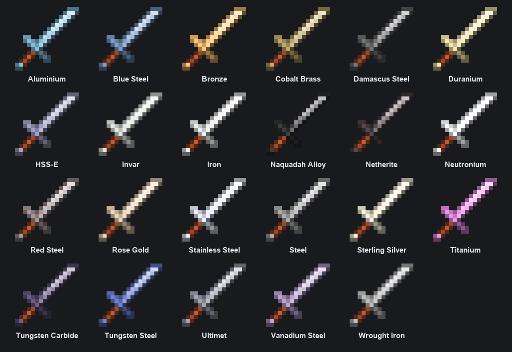

# GT Spartan Modern

{ width="128" align=right }

GT Spartan Modern adds 552 Spartan Weaponry weapons to GregTech CEu Modern, and they work as real GregTech tools. They show up in GT's Tools tab and use GT's durability bar.

Every metal GregTech makes swords from gets weapons. That's 23 metals in plain GTCEu, from bronze and steel up through titanium, tungsten steel, HSS-E and neutronium. Each one gets all 24 Spartan weapon types: 18 melee weapons, 4 throwing weapons, the longbow and the heavy crossbow.

There's no fixed list. The mod reads GregTech's material registry when the game starts, so metals added by GT addons get weapons too. Durability, damage, speed and enchantability come from the GT material's tool stats, and each weapon is Spartan's own art recolored to its metal.

You make them the GregTech way, on a crafting table from plates and rods with a hammer and a file. Bows also take string.

## Versions and requirements

| Minecraft | Loader | Version | Needs |
|---|---|---|---|
| 1.20.1 | Forge | 0.1.0 | [GregTech CEu Modern](https://www.curseforge.com/projects/890405) 7.5, [Spartan Weaponry](https://www.curseforge.com/projects/278141) 3.2 |
| 1.21.1 | NeoForge | 0.1.0 | [GregTech CEu Modern](https://www.curseforge.com/projects/890405) 7.0.2 or later 7.x, [Spartan Weaponry Unofficial](https://www.curseforge.com/projects/1450963) 1.2.3 or newer |

GTCEu 8 isn't supported yet. [KubeJS](https://www.curseforge.com/projects/238086) is optional; the weapons work with it when it is installed.

[CurseForge project](https://www.curseforge.com/projects/1804180)

## For pack makers

The weapons are registered as GregTech tool types, so their ids are in GT's namespace, like gtceu:titanium_longsword. The scythe is gtceu:titanium_spartan_scythe, since GT has its own scythe. Recipes come from a built-in data pack with ids like gt_spartan:shaped/gtceu/titanium_longsword, so a datapack can replace them. Repair uses the material's ingot tag.

## Credits and license

By Oculifelis, MIT. The idea comes from trinsdar's original GT Spartan for GregTech Reimagined (1.18.2), but none of its code or art is used. The weapons use Spartan Weaponry's own models by ObliviousSpartan.
