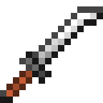
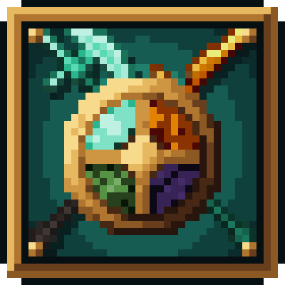
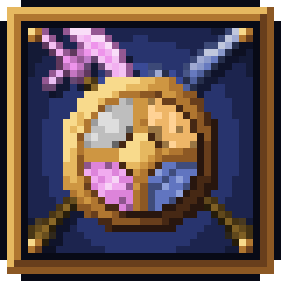
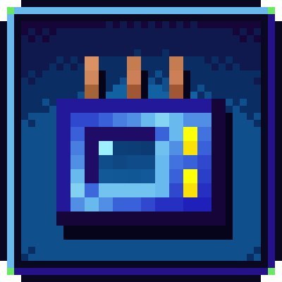
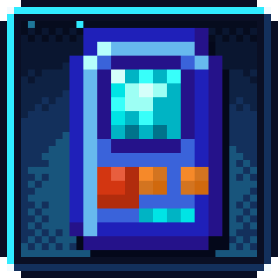

# Other mods

Smaller mods by Oculifelis that don't need a whole section.

| Picture | Mod | What it does | Versions |
|---|---|---|---|
| { .mc-icon } | [Spartan x Better Combat Unofficial](spartan-bettercombat.md) | Gives every [Spartan Weaponry Unofficial](https://www.curseforge.com/projects/1450963) melee weapon its own [Better Combat](https://www.curseforge.com/projects/639842) attack animation. | NeoForge 1.21.1 |
| { .mc-icon } | [Spartan Compat](spartan-compat.md) | Spartan weapon families in other mods’ materials. | Forge 1.20.1, NeoForge 1.21.1 |
| { .mc-icon } | [GT Spartan Modern](gt-spartan.md) | Spartan Weaponry weapons in every GregTech CEu Modern sword metal, as real GT tools. | Forge 1.20.1, NeoForge 1.21.1 |
| { .mc-icon } | [Mana Prospector](mana-prospector.md) | GregTech's prospector map running on Botania mana. | Forge 1.20.1, NeoForge 1.21.1 |
| { .mc-icon } | [Mana Gadgets](mana-gadgets.md) | Building Gadgets 2 powered by Botania mana. | Forge 1.20.1, NeoForge 1.21.1 |

The Complicated Bees addons (Complicated Trees, Rotaflux, Manaflux) are under [Complicated Bees](../bees/index.md).

The Thaumaturge addons (Arcana Varia, Automagia, Node Atlas, Classic Foci, Fieldframe Arcana) are under [Thaumaturge addons](../thaumaturge/index.md).
