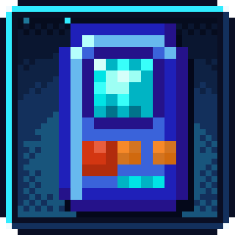

# Mana Gadgets

{ width="128" align=right }

Run [Building Gadgets 2](https://www.curseforge.com/projects/298187) on [Botania](https://www.curseforge.com/projects/225643) mana. Building, exchanging, copying, cutting and destroying pay from mana tablets, rings and other mana items you carry. The charge bar turns blue and the tooltip shows the mana available.

By default, the gadgets refuse FE. This mod changes the five existing gadgets and adds no new blocks or items.

## Crafting

The gadgets are made on Botania’s runic altar, with manasteel, mana powder, livingwood twigs and a rune. Mana diamonds, mana pearls and manasteel shears replace the corresponding ordinary materials. The destruction recipe still uses ender pearls. The gadgets use manasteel textures.

The recipes keep Building Gadgets 2’s recipe ids, so a datapack can override them.

## Config

The file is <code>config/managadgets-common.toml</code>.

| Key | Default | Meaning |
|---|---|---|
| <code>mode</code> | <code>MANA_ONLY</code> | Use mana only. <code>MANA_FIRST</code> falls back to the gadget’s FE; <code>FE_ONLY</code> uses ordinary FE behavior. |
| <code>manaPerFE</code> | <code>1</code> | Mana per FE of the original operation cost. A cost of 50 FE becomes 50 mana at the default rate. Zero makes operations free. |

## Versions and requirements

Botania and Building Gadgets 2 are both required.

| Minecraft | Loader | Documented build | Building Gadgets 2 |
|---|---|---|---|
| 1.20.1 | Forge 47 or newer | 1.0.0 | 1.0.7 or newer |
| 1.21.1 | NeoForge 21.1 or newer | 1.0.0 | 1.3 or newer |

[CurseForge project](https://www.curseforge.com/projects/1803149)

## Credits and license

Made by Oculifelis, under MIT. Building Gadgets 2 is by Direwolf20 and the Building Gadgets team; Botania is by Vazkii and the Botania team.
