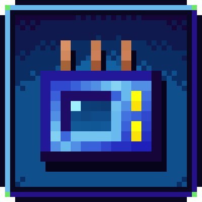
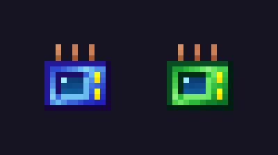

# Mana Prospector

{ width="128" align=right }

Mana Prospector adds two ore prospectors for packs that have both GregTech and Botania. They open GregTech's own prospecting map, the same screen as the GT prospector, but they run on Botania mana instead of EU. There are no batteries to charge, and a full mana tablet holds 250 manasteel scans.

## The prospectors

| Prospector | Area | Mana per scan | Modes |
|---|---|---|---|
| Manasteel Prospector | 5x5 chunks, like GT's LV prospector | 2,000 | ores |
| Terrasteel Prospector | 9x9 chunks | 8,000 | ores, underground fluids, bedrock ores (when GregTech has them on) |

Sneak and use the terrasteel one to switch modes. Mana comes out of any mana item in your inventory, the same way Botania's rods draw it. A scan is paid once, when the map opens, so you can keep the map up as long as you like.

You craft the manasteel one from manasteel ingots, a mana pearl, an LV circuit, an LV emitter and an LV sensor. The terrasteel one takes the manasteel prospector, terrasteel ingots, a mana diamond, an HV circuit, an HV emitter and an HV sensor.

## Versions and requirements

| Minecraft | Loader | Version | Needs |
|---|---|---|---|
| 1.20.1 | Forge | 0.1.0 | [GregTech CEu Modern](https://www.curseforge.com/projects/890405) 7.5, [Botania](https://www.curseforge.com/projects/225643) |
| 1.21.1 | NeoForge | 0.1.0 | [GregTech CEu Modern](https://www.curseforge.com/projects/890405) 7.0.2 or newer, [Botania](https://www.curseforge.com/projects/225643) 1.21.1 |

[CurseForge project](https://www.curseforge.com/projects/1804192)

## For pack makers

The scan radius and mana cost of both prospectors are in the server config, manaprospector-server.toml, and you can change them while the server runs. Recipes are plain crafting recipes at manaprospector:manasteel_prospector and manaprospector:terrasteel_prospector, so a datapack can replace them. KubeJS scripts can edit them too.

## Credits and license

By Oculifelis, MIT. The item textures are GregTech's portable scanner recolored to Botania's metals (LGPL-3.0, from GregTech CEu Modern).
