# Spartan x Better Combat Unofficial

Gives all 364 [Spartan Weaponry Unofficial](https://www.curseforge.com/projects/1450963) melee weapons their own
[Better Combat](https://www.curseforge.com/projects/639842) attack animation: katanas combo, halberds sweep, warhammers
slam. Without it, they all swing like a sword.

Since 0.2.0 it also animates the 220 dragon bone, dragonsteel and myrmex weapons of
[Spartan Weaponry: Ice and Fire Unofficial](https://www.curseforge.com/projects/1610003), when that addon is installed.
It's optional; nothing changes without it.

It's data only, with no code. Damage, speed and reach stay as Spartan sets them.

| Needs | Where |
|---|---|
| [Spartan Weaponry Unofficial](https://www.curseforge.com/projects/1450963) | client and server |
| [Better Combat](https://www.curseforge.com/projects/639842) | client and server |
| [Spartan Weaponry: Ice and Fire Unofficial](https://www.curseforge.com/projects/1610003) | optional, for its 220 weapons |

| Minecraft | Loader | Latest built |
|---|---|---|
| 1.21.1 | NeoForge | 0.2.0 |
| 1.20.1 | Forge | 0.2.0 |

On Forge 1.20.1, use Spartan Weaponry and Spartan Weaponry: Ice and Fire for that loader.

**Licence:** MIT. [On CurseForge](https://www.curseforge.com/projects/1786749).

| Picture | Spartan weapon | Better Combat animation | Hands | Combo hits |
|---|---|---|---|---|
| 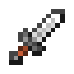{ .mc-icon .mc-inline } 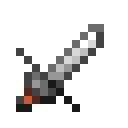{ .mc-icon .mc-inline } | Dagger, Parrying Dagger | Dagger | One | 3 |
| 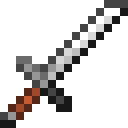{ .mc-icon .mc-inline } | Longsword | Sword | One | 3 |
| 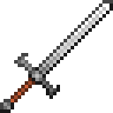{ .mc-icon .mc-inline } | Greatsword | Claymore | Two | 3 |
| 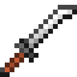{ .mc-icon .mc-inline } | Katana | Katana | Two | 4 |
| 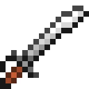{ .mc-icon .mc-inline } | Saber | Cutlass | One | 2 |
| 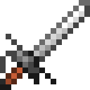{ .mc-icon .mc-inline } | Rapier | Rapier | One | 2 |
| 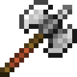{ .mc-icon .mc-inline } | Battleaxe | Double axe | Two | 2 |
| 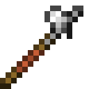{ .mc-icon .mc-inline } 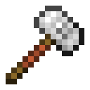{ .mc-icon .mc-inline } | Warhammer, Battle Hammer | Hammer | Two | 1 |
| 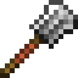{ .mc-icon .mc-inline } 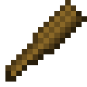{ .mc-icon .mc-inline } | Flanged Mace, Club | Mace | One | 3 |
|  | Cestus | Fist | One | 1 |
| 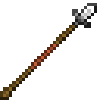{ .mc-icon .mc-inline } 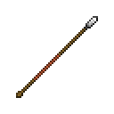{ .mc-icon .mc-inline } | Spear, Pike | Spear | Two | 1 |
| 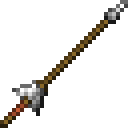{ .mc-icon .mc-inline } | Lance | Lance | One | 2 |
| 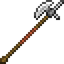{ .mc-icon .mc-inline } | Halberd | Halberd | Two | 2 |
| 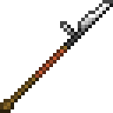{ .mc-icon .mc-inline } | Glaive | Glaive | Two | 3 |
| 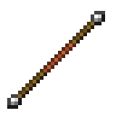{ .mc-icon .mc-inline } | Quarterstaff | Battlestaff | Two | 6 |
| 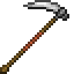{ .mc-icon .mc-inline } | Scythe | Scythe | Two | 2 |
| 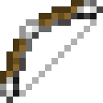{ .mc-icon .mc-inline } | Longbow | Heavy bow (hold pose) | Two | - |
| 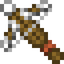{ .mc-icon .mc-inline } | Heavy Crossbow | Heavy crossbow (hold pose) | Two | - |

Every material is covered, and Ice and Fire weapons (dragon bone, flamed/iced/lightning dragon bone,
fire/ice/lightning dragonsteel, desert/jungle myrmex chitin and stinger) get the same animation per type. Javelins, throwing knives, tomahawks and boomerangs are left alone so they can still be
thrown.
