# Spartan x Better Combat

Gives every [Spartan Weaponry](https://www.curseforge.com/projects/278141) melee weapon its own
[Better Combat](https://www.curseforge.com/projects/639842) attack animation. Katanas combo, halberds sweep, warhammers
slam. Without it, they all swing like a sword.

Since 0.3.0 it works with whichever Spartan Weaponry port is installed:
[Spartan Weaponry Unofficial](https://www.curseforge.com/projects/1450963), the
[Vladeezy port](https://www.curseforge.com/projects/1750947), the
[sanufsoii Fabric port](https://www.curseforge.com/projects/1684730), or the original
[Spartan Weaponry](https://www.curseforge.com/projects/278141) on Forge 1.20.1. The dragon bone, dragonsteel and myrmex
weapons of the Ice and Fire addon for Spartan Weaponry are covered too. Any Better Combat build works, Rekindled Combat
included.

The mod is pure datapack data. Each weapon has its own file at `data/<namespace>/weapon_attributes/<item>.json`, so a
datapack can give any weapon a different Better Combat preset. Damage, speed and reach stay as Spartan sets them.

| Needs | Where |
|---|---|
| [Better Combat](https://www.curseforge.com/projects/639842) (or Rekindled Combat) | client and server |
| One Spartan Weaponry port | client and server |
| Spartan Weaponry: Ice and Fire ([1.21.1](https://www.curseforge.com/projects/1610003), [1.20.1](https://www.curseforge.com/projects/606315)) | optional, for its weapons |

| Minecraft | Loader | Latest built |
|---|---|---|
| 26.3 | NeoForge, Fabric | 0.3.0 |
| 26.2 | NeoForge, Fabric | 0.3.0 |
| 26.1 | NeoForge, Fabric | 0.3.0 |
| 1.21.11 | NeoForge, Fabric | 0.3.0 |
| 1.21.1 | NeoForge, Fabric | 0.3.0 |
| 1.20.1 | Forge | 0.3.0 |

One file runs on both NeoForge and Fabric for each version from 1.21.1 up.

The licence is MIT. [On CurseForge](https://www.curseforge.com/projects/1786749).

| Picture | Spartan weapon | Better Combat animation | Hands | Combo hits |
|---|---|---|---|---|
| 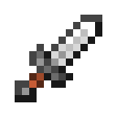{ .mc-icon .mc-inline } 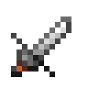{ .mc-icon .mc-inline } | Dagger, Parrying Dagger | Dagger | One | 3 |
| 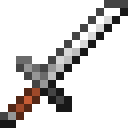{ .mc-icon .mc-inline } | Longsword | Sword | One | 3 |
| 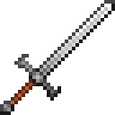{ .mc-icon .mc-inline } | Greatsword | Claymore | Two | 3 |
| 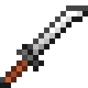{ .mc-icon .mc-inline } | Katana | Katana | Two | 4 |
| 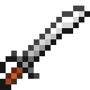{ .mc-icon .mc-inline } | Saber | Cutlass | One | 2 |
| 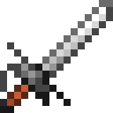{ .mc-icon .mc-inline } | Rapier | Rapier | One | 2 |
| 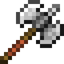{ .mc-icon .mc-inline } | Battleaxe | Double axe | Two | 2 |
| 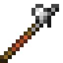{ .mc-icon .mc-inline } 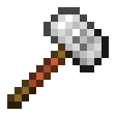{ .mc-icon .mc-inline } | Warhammer, Battle Hammer | Hammer | Two | 1 |
| 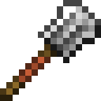{ .mc-icon .mc-inline } 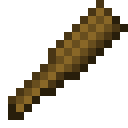{ .mc-icon .mc-inline } | Flanged Mace, Club | Mace | One | 3 |
|  | Cestus | Fist | One | 1 |
| 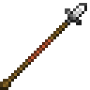{ .mc-icon .mc-inline } 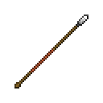{ .mc-icon .mc-inline } | Spear, Pike | Spear | Two | 1 |
| 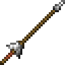{ .mc-icon .mc-inline } | Lance | Lance | One | 2 |
| 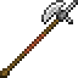{ .mc-icon .mc-inline } | Halberd | Halberd | Two | 2 |
| 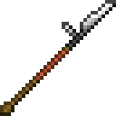{ .mc-icon .mc-inline } | Glaive | Glaive | Two | 3 |
| 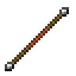{ .mc-icon .mc-inline } | Quarterstaff | Battlestaff | Two | 6 |
| 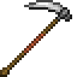{ .mc-icon .mc-inline } | Scythe | Scythe | Two | 2 |
| 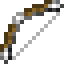{ .mc-icon .mc-inline } | Longbow | Heavy bow (hold pose) | Two | - |
| 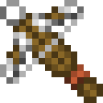{ .mc-icon .mc-inline } | Heavy Crossbow | Heavy crossbow (hold pose) | Two | - |

Every material of every port is covered, and Ice and Fire weapons get the same animation per type. Javelins, throwing
knives, tomahawks and boomerangs are left alone so they can still be thrown.
