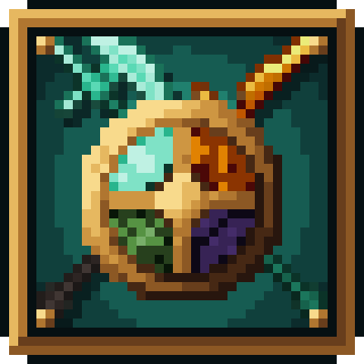

# Spartan Compat

{ width="128" align=right }

Spartan Compat adds all 24 Spartan Weaponry weapon types in the metals and gems of other mods. Version 1.1.0 has 63 materials from 24 mods on NeoForge 1.21.1, and 51 materials from 21 mods on Forge 1.20.1.

It is data-driven. Traits, repair items and recipes are datapack tags and JSON (`spartan_compat:materials/<name>` weapon-trait tags, `spartan_compat:repair/<name>` item tags), so a datapack can change any of them. Trait numbers (chances, damage, effect lengths) can also be set by datapack files in `data/<namespace>/spartan_compat/traits/`. Every key is listed under For pack makers below. Materials can be turned off or retuned in `config/spartan_compat/materials.json`.

Each material has its own trait. Fiery weapons set things on fire, Knightmetal breaks armor, Neptunium hits anything in water 50% harder and Warden weapons blind what they hit. Botania weapons mend themselves from mana in the inventory, Eternal Starlight ones freeze, poison or burn, and Psi weapons hold spell bullets and cast on hit. A few materials, like Amaramber and Sculkium, have no ability and just bring their own stats.

Most are crafted like the iron versions. The late Cataclysm metals are smithed up from netherite weapons, Ignitium and Cursium with Cataclysm's own upgrade templates. Cataclysm weapons use Cataclysm's sounds and particles, Ignitium, Cursium and Witherite ones survive explosions, and Witherite, Ancient Metal and Black Steel weapons smelt back down in a furnace. Every material mod is optional, and a material only shows up when its mod is installed.

## Versions and requirements

| Minecraft | Loader | Version | Materials | Required weapon mod |
|---|---|---|---|---|
| 1.21.1 | NeoForge | 1.1.0 | 63 from 24 mods | [Spartan Weaponry Unofficial](https://www.curseforge.com/projects/1450963) 1.2.3 or newer |
| 1.20.1 | Forge | 1.1.0 | 51 from 21 mods | [Spartan Weaponry](https://www.curseforge.com/projects/278141) 3.2.1 |

The 1.20.1 file has no Thaumaturge, Eternal Starlight or Eidolon materials.

[CurseForge project](https://www.curseforge.com/projects/1802929)

## Material mods

Any of them can be left out.

| Mod | Materials |
|---|---|
| [The Twilight Forest](https://www.curseforge.com/projects/227639) | Ironwood, Steeleaf, Knightmetal, Fiery |
| [Aquaculture 2](https://www.curseforge.com/projects/60028) | Neptunium |
| [L_Ender's Cataclysm](https://www.curseforge.com/projects/551586) | Ignitium, Cursium, Witherite, Ancient Metal, Black Steel |
| [Caverns & Chasms](https://www.curseforge.com/projects/438005) | Necromium |
| [Thaumaturge](https://www.curseforge.com/projects/1628024) (1.21.1 only) | Thaumium, Void Metal |
| Ultima Ratio | Starsteel, Eclipse |
| [The Undergarden](https://www.curseforge.com/projects/379849) | Cloggrum, Froststeel, Utherium, Forgotten |
| [Deeper and Darker](https://www.curseforge.com/projects/659011) | Resonarium, Warden |
| [The Aether](https://www.curseforge.com/projects/255308) | Zanite, Gravitite |
| [Allthemodium](https://www.curseforge.com/projects/364466) | Allthemodium, Vibranium, Unobtainium |
| [Mekanism Tools](https://www.curseforge.com/projects/268567) | Osmium, Refined Obsidian, Refined Glowstone, Lapis Lazuli |
| [Malum](https://www.curseforge.com/projects/484064) | Soul Stained Steel, Hallowed Gold |
| [Forbidden Arcanus](https://www.curseforge.com/projects/309858) | Deorum, Draco Arcanus |
| [Create](https://www.curseforge.com/projects/328085) | Brass, Zinc |
| [Ars Nouveau](https://www.curseforge.com/projects/401955) | Source Gem |
| [Occultism](https://www.curseforge.com/projects/361026) | Iesnium |
| [Applied Energistics 2](https://www.curseforge.com/projects/223794) | Certus Quartz, Fluix |
| [Botania](https://www.curseforge.com/projects/225643) | Manasteel, Elementium, Terrasteel |
| [Ender IO](https://www.curseforge.com/projects/64578) | Dark Steel, which beheads and holds its own energy |
| [Psi](https://www.curseforge.com/projects/241665) | Psimetal |
| [Eternal Starlight](https://www.curseforge.com/projects/1080592) (1.21.1 only) | Amaramber, Deepsilver, Flowglaze, Glacite, Malarite, Starfire, Starlit Diamond, Thermal Springstone, Unrealium |
| [Nature's Aura](https://www.curseforge.com/projects/306626) | Infused Iron, Sky, Depth |
| [Eidolon Repraised](https://www.curseforge.com/projects/870250) (1.21.1 only) | Silver |
| [L2 Complements](https://www.curseforge.com/projects/758349) | Eternium, Poseidite, Sculkium, Shulkerate, Totemic Gold |

## For pack makers

The config file is written on first start at config/spartan_compat/materials.json. It turns any mod's weapons off, or forces them on without the mod, and sets each material's durability, damage, speed, enchantability, rarity and unbreakable flag. Changes need a restart. Traits come from item tags, so a datapack can move them around too. KubeJS can edit the recipes like any others.

Trait numbers can be changed with a datapack file in `data/<namespace>/spartan_compat/traits/` or in config/spartan_compat/traits.json, for example `{"numbing_ticks": 60, "numbing_chance": 0.5}`. Chances and fractions run 0 to 1, amplifiers and levels 0 to 255, and everything else 0 to 1,000,000.

??? note "Trait keys and defaults (52)"

    | Key | Default | Range |
    |---|---|---|
    | `neptunes_might_bonus` | 0.5 | 0 to 1,000,000 |
    | `knightmetal_bonus` | 2 | 0 to 1,000,000 |
    | `fiery_seconds` | 15 | 0 to 1,000,000 |
    | `fiery_immune_particles` | 20 | 0 to 1,000,000 |
    | `numbing_chance` | 1 | 0 to 1 |
    | `numbing_ticks` | 120 | 0 to 1,000,000 |
    | `numbing_amplifier` | 1 | 0 to 255 |
    | `blazing_brand_chance` | 0.75 | 0 to 1 |
    | `blazing_brand_ticks` | 240 | 0 to 1,000,000 |
    | `blazing_brand_max_amplifier` | 4 | 0 to 255 |
    | `blazing_brand_armor_fraction` | 0.2 | 0 to 1 |
    | `blazing_brand_toughness_fraction` | 0.2 | 0 to 1 |
    | `blazing_brand_heal_chance` | 1 | 0 to 1 |
    | `blazing_brand_heal_per_level` | 1.25 | 0 to 255 |
    | `accursed_rage_chance` | 0.66 | 0 to 1 |
    | `accursed_rage_ticks` | 110 | 0 to 1,000,000 |
    | `accursed_rage_max_amplifier` | 4 | 0 to 255 |
    | `accursed_rage_damage_per_level` | 1 | 0 to 255 |
    | `mecha_smite_chance` | 1 | 0 to 1 |
    | `mecha_smite_wither_ticks` | 100 | 0 to 1,000,000 |
    | `mecha_smite_wither_amplifier` | 1 | 0 to 255 |
    | `mecha_smite_fire_seconds` | 5 | 0 to 1,000,000 |
    | `mecha_smite_regen_chance` | 0.5 | 0 to 1 |
    | `mecha_smite_regen_health_fraction` | 0.5 | 0 to 1 |
    | `mecha_smite_regen_uses_fraction` | 1 | 0 to 1 |
    | `mecha_smite_regen_health` | 10 | 0 to 1,000,000 |
    | `mecha_smite_regen_ticks` | 100 | 0 to 1,000,000 |
    | `mecha_smite_regen_amplifier` | 1 | 0 to 255 |
    | `mecha_pulse_charge_chance` | 0.75 | 0 to 1 |
    | `mecha_pulse_charge_ticks` | 140 | 0 to 1,000,000 |
    | `mecha_pulse_threshold_amplifier` | 9 | 0 to 255 |
    | `mecha_pulse_cooldown_ticks` | 800 | 0 to 1,000,000 |
    | `mecha_pulse_stun_ticks` | 200 | 0 to 1,000,000 |
    | `mecha_pulse_damage` | 4 | 0 to 1,000,000 |
    | `cataclysm_sounds_enabled` | 1 | 0 or 1 |
    | `cataclysm_sound_pitch_variation` | 0.1 | 0 to 1,000,000 |
    | `ironwood_knockback_level` | 1 | 0 to 255 |
    | `ironwood_fortune_level` | 1 | 0 to 255 |
    | `ironwood_propel_level` | 1 | 0 to 255 |
    | `ironwood_punch_level` | 1 | 0 to 255 |
    | `steeleaf_looting_level` | 2 | 0 to 255 |
    | `steeleaf_efficiency_level` | 2 | 0 to 255 |
    | `steeleaf_lucky_throw_level` | 2 | 0 to 255 |
    | `steeleaf_quick_charge_level` | 2 | 0 to 255 |
    | `terra_beam_enabled` | 0 | 0 or 1 |
    | `dark_steel_energy_enabled` | 1 | 0 or 1 |
    | `psi_cast_enabled` | 1 | 0 or 1 |
    | `empowered_hit_fe` | 500 | 0 to 1,000,000 |
    | `empowered_hit_damage` | 1 | 0 to 1,000,000 |
    | `empowered_fe_per_durability` | 250 | 0 to 1,000,000 |
    | `concentration_reset_ticks` (1.21.1 only) | 100 | 0 to 1,000,000 |
    | `tidal_attack_speed` | 0.2 | 0 to 1,000,000 |

## Credits and license

By Oculifelis. The code is MIT. The Twilight Forest, Cataclysm, Aquaculture and Caverns & Chasms textures and the Cataclysm effect icons come from the earlier Spartan add-ons by KreloX, Cephelo and denispionicul (MIT). The rest are Spartan Weaponry's own sprites by ObliviousSpartan, recolored (Apache-2.0).
