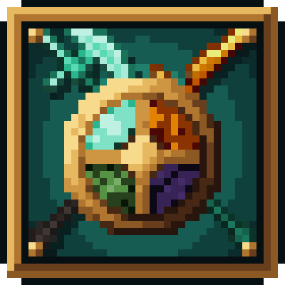

# Spartan Compat

{ width="128" align=right }

Use Spartan Weaponry’s weapon families with the metals and gems already in your pack. The documented 1.0.0 build covers 40 materials from 17 mods. Each enabled material gets all 24 weapon types, with traits or built-in enchantments suited to that material.

Craft most of them like their iron counterparts. Some late-game Cataclysm materials use smithing instead. A material appears when its source mod is installed; the other content mods are optional. Ultima Ratio is one of those integrations and has no CurseForge project of its own.

## Versions and requirements

| Minecraft | Loader | Documented build | Required weapon mod |
|---|---|---|---|
| 1.21.1 | NeoForge | 1.0.0 | [Spartan Weaponry Unofficial](https://www.curseforge.com/projects/1450963) 1.2.3 or newer |

[Caverns & Chasms](https://www.curseforge.com/projects/438005) is optional; it supplies Necromium. You can use the mod without it.

[CurseForge project](https://www.curseforge.com/projects/1802929)

## Optional material mods

Each of these mods supplies its listed materials. Install only the ones you want; Spartan Compat does not require all 17.

| Mod | Materials |
|---|---|
| [The Twilight Forest](https://www.curseforge.com/projects/227639) | Ironwood, Steeleaf, Knightmetal, Fiery |
| [Aquaculture 2](https://www.curseforge.com/projects/60028) | Neptunium |
| [L_Ender's Cataclysm](https://www.curseforge.com/projects/551586) | Ignitium, Cursium, Witherite, Ancient Metal, Black Steel |
| [Caverns & Chasms](https://www.curseforge.com/projects/438005) | Necromium |
| [Thaumaturge](https://www.curseforge.com/projects/1628024) | Thaumium, Void Metal |
| Ultima Ratio | Starsteel, Eclipse |
| The Undergarden | Cloggrum, Froststeel, Utherium, Forgotten |
| Deeper and Darker | Resonarium, Warden |
| The Aether | Zanite, Gravitite |
| Allthemodium | Allthemodium, Vibranium, Unobtainium |
| Mekanism Tools | Osmium, Refined Obsidian, Refined Glowstone, Lapis Lazuli |
| Malum | Soul Stained Steel, Hallowed Gold |
| Forbidden Arcanus | Deorum, Draco Arcanus |
| [Create](https://www.curseforge.com/projects/328085) | Brass, Zinc |
| [Ars Nouveau](https://www.curseforge.com/projects/401955) | Source Gem |
| [Occultism](https://www.curseforge.com/projects/361026) | Iesnium |
| [Applied Energistics 2](https://www.curseforge.com/projects/223794) | Certus Quartz, Fluix |

## For pack makers

The files config/spartan_compat/materials.json and config/spartan_compat/traits.json control enabled modules, material values and trait settings. Changes require a restart. Weapon-trait tags let datapacks assign traits too.

## Credits and license

By Oculifelis. Code is MIT. Weapon artwork is credited to the earlier Spartan addons and Spartan Weaponry under MIT and Apache-2.0; see the notices included with the mod.
